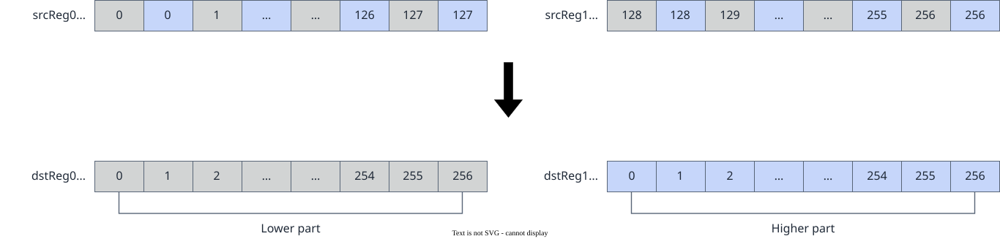

# vf.de_interleave

<!-- md-trans-meta sourceCommit=7d0ab31d84c294a0a8327f597d2bdee012acb22d translatedAt=2026-10-26T13:05:20.796Z pushedAt=2026-10-28T11:57:28.729Z nl=2 -->

## Applicable Products

<!-- npu="950" id1 -->
- Ascend 950PR&950DT products: Supported
<!-- end id1 -->
<!-- npu="A3" id2 -->
- Atlas A3 products: Not supported
<!-- end id2 -->
<!-- npu="910b" id3 -->
- Atlas A2 products: Not supported
<!-- end id3 -->

## Description

Given source operands src0 and src1, de-interleave the elements in src0 and src1 and store them into destination operands dst0 and dst1. The de-interleaving layout is shown in the following figure, where each square represents an element:

$$dstReg0_i = srcReg_{2i}, \quad dstReg1_i = srcReg_{2i+1}$$

**Figure 1** de_interleave de-interleaving layout



## Prototype

```python
de_interleave(src0, src1, dtype: Optional[DType] = None) -> (dst0, dst1)
```

## Parameters

| Parameter | Input/Output | Description |
|---|---|---|
| src0 | Input | Source operand, of the [reg_tensor](../basic_data_structures/reg_tensor.md) or [mask_reg](../basic_data_structures/mask_reg.md) type.<br>- **reg_tensor input**: The data types of source operands src0 and src1 and destination operand dst must be consistent. Supported data types: DT_INT8, DT_UINT8, DT_INT16, DT_UINT16, DT_FP16, DT_BF16, DT_INT32, DT_UINT32, DT_FP32.<br>- **mask_reg input**: Supported data types: DT_INT8, DT_UINT8, DT_INT16, DT_UINT16, DT_FP16, DT_BF16, DT_INT32, DT_UINT32, DT_FP32. |
| src1 | Input | Source operand, of the [reg_tensor](../basic_data_structures/reg_tensor.md) or [mask_reg](../basic_data_structures/mask_reg.md) type. The supported data types are the same as those of src0. |
| dtype | Input | Optional. Data type corresponding to the template parameter. It takes effect only when the source operand is mask_reg, determining the bit width for bitwise de-interleaving. |

## Constraints

- src0 and src1 can be the same reg_tensor; dst0 and dst1 cannot be the same reg_tensor. Configuring them as the same reg_tensor causes functional exceptions.

- The source operand and destination operand may be the same reg_tensor.

## Return Value

Returns a tuple (dst0, dst1).

- dst0: Destination operand, of type [reg_tensor](../basic_data_structures/reg_tensor.md) or [mask_reg](../basic_data_structures/mask_reg.md). The supported data types are the same as those described for src0.
- dst1: Destination operand, of type [reg_tensor](../basic_data_structures/reg_tensor.md) or [mask_reg](../basic_data_structures/mask_reg.md). The supported data types are the same as those described for src0.

## Examples

### reg_tensor Examples

```python
import os
import pypto_pro.language as pl
import torch
import torch_npu

@pl.vector_function
def example_vf(src_a, src_b, dst_tile):
    preg = vf.create_mask(pattern=pl.MaskPattern.ALL, dtype=pl.DT_FP16)
    src0 = vf.load_align(src_a, 0)
    src1 = vf.load_align(src_b, 0)
    dst0, dst1 = vf.de_interleave(src0, src1)
    vf.store_align(dst_tile, dst0, preg)

@pl.jit()
def example_kernel(
    a: pl.Tensor[[pl.DYNAMIC, pl.DYNAMIC], pl.DT_FP16],
    b: pl.Tensor[[pl.DYNAMIC, pl.DYNAMIC], pl.DT_FP16],
    out: pl.Tensor[[pl.DYNAMIC, pl.DYNAMIC], pl.DT_FP16],
):
    tf = pl.TileType(shape=[1, 128], dtype=pl.DT_FP16, target_memory=pl.MemorySpace.Vec)
    in_a_grp = pl.make_tile_group(type=tf, addrs=0x0, mutex_ids=[0])
    in_a = in_a_grp.current()
    in_b_grp = pl.make_tile_group(type=tf, addrs=0x100, mutex_ids=[1])
    in_b = in_b_grp.current()
    t_out_grp = pl.make_tile_group(type=tf, addrs=0x200, mutex_ids=[2])
    t_out = t_out_grp.current()
    with pl.section_vector():
        pl.load(in_a, a, [0, 0])
        pl.load(in_b, b, [0, 0])
        example_vf(in_a, in_b, t_out)
        pl.store(out, t_out, [0, 0])

def test_example():
    device_id = int(os.environ.get("TILE_FWK_DEVICE_ID", 0))
    device = f"npu:{device_id}"
    core_nums = 1
    torch.npu.set_device(device)
    a = torch.randn([1, 128], device=device, dtype=torch.float16)
    b = torch.randn([1, 128], device=device, dtype=torch.float16)
    out = torch.empty([1, 128], device=device, dtype=torch.float16)
    example_kernel[None, core_nums](a, b, out)
    torch.npu.synchronize()
    assert out.shape == torch.Size([1, 128])

if __name__ == "__main__":
    test_example()
    print("PASSED")
```

### mask_reg Examples

When the source operands are mask_reg, vf.de_interleave de-interleaves the two mask_reg bit by bit. The de-interleaving bit width is determined by the data type of mask_reg.

```python
import os
import pypto_pro.language as pl
import torch
import torch_npu

@pl.vector_function
def example_vf(src_tile, dst_tile):
    preg = vf.create_mask(pattern=pl.MaskPattern.ALL, dtype=pl.DT_FP32)
    mask_full = vf.create_mask(pattern=pl.MaskPattern.ALL, dtype=pl.DT_FP32)
    mask_m3 = vf.create_mask(pattern=pl.MaskPattern.M3, dtype=pl.DT_FP32)
    reg = vf.load_align(src_tile, 0)
    new_mask0, new_mask1 = vf.interleave(mask_full, mask_m3)
    new_mask0, new_mask1 = vf.de_interleave(new_mask0, new_mask1)
    reg_dst = vf.abs(reg, new_mask0)
    vf.store_align(dst_tile, reg_dst, preg)

@pl.jit()
def example_kernel(
    a: pl.Tensor[[pl.DYNAMIC, pl.DYNAMIC], pl.DT_FP32],
    out: pl.Tensor[[pl.DYNAMIC, pl.DYNAMIC], pl.DT_FP32],
):
    tf = pl.TileType(shape=[1, 64], dtype=pl.DT_FP32, target_memory=pl.MemorySpace.Vec)
    in_a_grp = pl.make_tile_group(type=tf, addrs=0x0, mutex_ids=[0])
    in_a = in_a_grp.current()
    t_out_grp = pl.make_tile_group(type=tf, addrs=0x100, mutex_ids=[1])
    t_out = t_out_grp.current()
    with pl.section_vector():
        pl.load(in_a, a, [0, 0])
        example_vf(in_a, t_out)
        pl.store(out, t_out, [0, 0])

def test_example():
    device_id = int(os.environ.get("TILE_FWK_DEVICE_ID", 0))
    device = f"npu:{device_id}"
    core_nums = 1
    torch.npu.set_device(device)
    a = torch.randn([1, 64], device=device, dtype=torch.float32)
    out = torch.empty([1, 64], device=device, dtype=torch.float32)
    example_kernel[None, core_nums](a, out)
    torch.npu.synchronize()
    torch.testing.assert_close(out, torch.abs(a), rtol=1e-5, atol=1e-5)

if __name__ == "__main__":
    test_example()
    print("PASSED")
```
