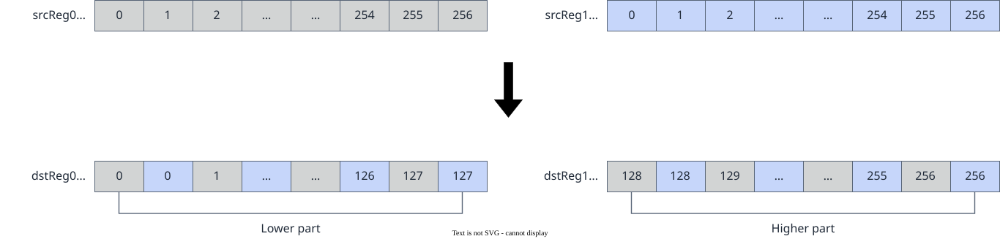

# vf.interleave

## Applicable Products

<!-- npu="950" id1 -->
- Ascend 950PR&950DT products: Supported
<!-- end id1 -->
<!-- npu="A3" id2 -->
- Atlas A3 products: Not supported
<!-- end id2 -->
<!-- npu="910b" id3 -->
- Atlas A2 products: Not supported
<!-- end id3 -->

## Description

Interleaves elements in src0 and src1 into dst0 and dst1. The following figure shows the interleaving mode, where each square represents an element.

$$dstReg0_{2i} = srcReg0_i, \quad dstReg1_{2i+1} = srcReg1_i$$

**Figure 1** Interleaving



## Prototype

```python
interleave(src0, src1, /, *, dtype: Optional[DType] = None) -> (dst0, dst1)
```

## Parameters

| Parameter| Input/Output| Description|
|---|---|---|
| src0 | Input| Source operand, which is of type [reg_tensor](../basic_data_structures/reg_tensor.md) or [mask_reg](../basic_data_structures/mask_reg.md).<br>- **reg_tensor input**: The data types of source operands src0 and src1 and destination operand dst must be identical. The supported data types are DT_INT8, DT_UINT8, DT_INT16, DT_UINT16, DT_FP16, DT_BF16, DT_INT32, DT_UINT32, DT_FP32, DT_INT64, and DT_UINT64.<br>- **mask_reg input**: The supported data types are DT_INT8, DT_UINT8, DT_INT16, DT_UINT16, DT_FP16, DT_BF16, DT_INT32, DT_UINT32, and DT_FP32.|
| src1 | Input| Source operand, which is of type [reg_tensor](../basic_data_structures/reg_tensor.md) or [mask_reg](../basic_data_structures/mask_reg.md). The supported data types are the same as those of src0.|
| dtype | Input| Data type corresponding to the template parameter. This parameter is optional. This takes effect only when the source operand is of type mask_reg, and determines the bit width for bitwise interleaving.|

## Constraints

- src0 and src1 can be the same reg_tensor, and dst0 and dst1 cannot be the same reg_tensor. Configuring them as the same reg_tensor will cause functional exceptions.

- A source operand and a destination operand can be the same reg_tensor.

## Return Value

Returns a 2-tuple (dst0, dst1).

- Destination operand dst0, which is of type [reg_tensor](../basic_data_structures/reg_tensor.md) or [mask_reg](../basic_data_structures/mask_reg.md). The supported data types are the same as those of src0.
- Destination operand dst1, which is of type [reg_tensor](../basic_data_structures/reg_tensor.md) or [mask_reg](../basic_data_structures/mask_reg.md). The supported data types are the same as those of src0.

## Examples

### reg_tensor Call Example

```python
import os
import pypto_pro.language as pl
import torch
import torch_npu

@pl.vector_function
def example_vf(src_a, src_b, dst_tile):
    preg = vf.create_mask(pattern=pl.MaskPattern.ALL, dtype=pl.DT_FP16)
    src0 = vf.load_align(src_a, 0)
    src1 = vf.load_align(src_b, 0)
    dst0, dst1 = vf.interleave(src0, src1)
    vf.store_align(dst_tile, dst0, preg)

@pl.jit()
def example_kernel(
    a: pl.Tensor[[pl.DYNAMIC, pl.DYNAMIC], pl.DT_FP16],
    b: pl.Tensor[[pl.DYNAMIC, pl.DYNAMIC], pl.DT_FP16],
    out: pl.Tensor[[pl.DYNAMIC, pl.DYNAMIC], pl.DT_FP16],
):
    tf = pl.TileType(shape=[1, 128], dtype=pl.DT_FP16, target_memory=pl.MemorySpace.Vec)
    in_a_grp = pl.make_tile_group(type=tf, addrs=0x0, mutex_ids=[0])
    in_a = in_a_grp.current()
    in_b_grp = pl.make_tile_group(type=tf, addrs=0x100, mutex_ids=[1])
    in_b = in_b_grp.current()
    t_out_grp = pl.make_tile_group(type=tf, addrs=0x200, mutex_ids=[2])
    t_out = t_out_grp.current()
    with pl.section_vector():
        pl.load(in_a, a, [0, 0])
        pl.load(in_b, b, [0, 0])
        example_vf(in_a, in_b, t_out)
        pl.store(out, t_out, [0, 0])

def test_example():
    device_id = int(os.environ.get("TILE_FWK_DEVICE_ID", 0))
    device = f"npu:{device_id}"
    core_nums = 1
    torch.npu.set_device(device)
    a = torch.randn([1, 128], device=device, dtype=torch.float16)
    b = torch.randn([1, 128], device=device, dtype=torch.float16)
    out = torch.empty([1, 128], device=device, dtype=torch.float16)
    example_kernel[None, core_nums](a, b, out)
    torch.npu.synchronize()
    assert out.shape == torch.Size([1, 128])

if __name__ == "__main__":
    test_example()
    print("PASSED")
```

### mask_reg Call Example

When the source operand is of type mask_reg, vf.interleave performs bitwise interleaving on two mask_reg operands. The interleaving bit width is determined by the data type of mask_reg.

```python
import os
import pypto_pro.language as pl
import torch
import torch_npu

@pl.vector_function
def example_vf(src_tile, dst_tile):
    preg = vf.create_mask(pattern=pl.MaskPattern.ALL, dtype=pl.DT_FP32)
    mask_full = vf.create_mask(pattern=pl.MaskPattern.ALL, dtype=pl.DT_FP32)
    mask_m3 = vf.create_mask(pattern=pl.MaskPattern.M3, dtype=pl.DT_FP32)
    reg = vf.load_align(src_tile, 0)
    new_mask0, new_mask1 = vf.interleave(mask_full, mask_m3)
    new_mask0, new_mask1 = vf.de_interleave(new_mask0, new_mask1)
    reg_dst = vf.abs(reg, new_mask0)
    vf.store_align(dst_tile, reg_dst, preg)

@pl.jit()
def example_kernel(
    a: pl.Tensor[[pl.DYNAMIC, pl.DYNAMIC], pl.DT_FP32],
    out: pl.Tensor[[pl.DYNAMIC, pl.DYNAMIC], pl.DT_FP32],
):
    tf = pl.TileType(shape=[1, 64], dtype=pl.DT_FP32, target_memory=pl.MemorySpace.Vec)
    in_a_grp = pl.make_tile_group(type=tf, addrs=0x0, mutex_ids=[0])
    in_a = in_a_grp.current()
    t_out_grp = pl.make_tile_group(type=tf, addrs=0x100, mutex_ids=[1])
    t_out = t_out_grp.current()
    with pl.section_vector():
        pl.load(in_a, a, [0, 0])
        example_vf(in_a, t_out)
        pl.store(out, t_out, [0, 0])

def test_example():
    device_id = int(os.environ.get("TILE_FWK_DEVICE_ID", 0))
    device = f"npu:{device_id}"
    core_nums = 1
    torch.npu.set_device(device)
    a = torch.randn([1, 64], device=device, dtype=torch.float32)
    out = torch.empty([1, 64], device=device, dtype=torch.float32)
    example_kernel[None, core_nums](a, out)
    torch.npu.synchronize()
    torch.testing.assert_close(out, torch.abs(a), rtol=1e-5, atol=1e-5)

if __name__ == "__main__":
    test_example()
    print("PASSED")
```

### INT64 Data Type Example

The following example performs `vf.interleave` on two INT64 registers and then performs `vf.de_interleave` on the result to restore the original data, verifying round-trip consistency.

```python
import os
import pypto_pro.language as pl
import torch
import torch_npu

@pl.vector_function
def example_vf_int64(src_a, src_b, dst_tile):
    preg = vf.create_mask(pattern=pl.MaskPattern.ALL, dtype=pl.DT_INT64)
    reg_a = vf.load_align(src_a, 0)
    reg_b = vf.load_align(src_b, 0)
    dst0, dst1 = vf.interleave(reg_a, reg_b)
    rec_a, rec_b = vf.de_interleave(dst0, dst1)
    vf.store_align(dst_tile, rec_a, preg)

@pl.jit()
def example_kernel_int64(
    a: pl.Tensor[[pl.DYNAMIC, pl.DYNAMIC], pl.DT_INT64],
    b: pl.Tensor[[pl.DYNAMIC, pl.DYNAMIC], pl.DT_INT64],
    out: pl.Tensor[[pl.DYNAMIC, pl.DYNAMIC], pl.DT_INT64],
):
    tf = pl.TileType(shape=[1, 32], dtype=pl.DT_INT64, target_memory=pl.MemorySpace.Vec)
    in_a_grp = pl.make_tile_group(type=tf, addrs=0, mutex_ids=[0])
    in_a = in_a_grp.current()
    in_b_grp = pl.make_tile_group(type=tf, addrs=256, mutex_ids=[1])
    in_b = in_b_grp.current()
    t_out_grp = pl.make_tile_group(type=tf, addrs=512, mutex_ids=[2])
    t_out = t_out_grp.current()
    with pl.section_vector():
        pl.load(in_a, a, [0, 0])
        pl.load(in_b, b, [0, 0])
        example_vf_int64(in_a, in_b, t_out)
        pl.store(out, t_out, [0, 0])

def test_example_int64():
    device_id = int(os.environ.get("TILE_FWK_DEVICE_ID", 0))
    device = f"npu:{device_id}"
    core_nums = 1
    torch.npu.set_device(device)
    a = torch.randint(-100, 100, [1, 32], device=device, dtype=torch.int64)
    b = torch.randint(-100, 100, [1, 32], device=device, dtype=torch.int64)
    out = torch.empty([1, 32], device=device, dtype=torch.int64)
    example_kernel_int64[None, core_nums](a, b, out)
    torch.npu.synchronize()
    torch.testing.assert_close(out, a, rtol=0, atol=0)

if __name__ == "__main__":
    test_example_int64()
    print("PASSED")
```
