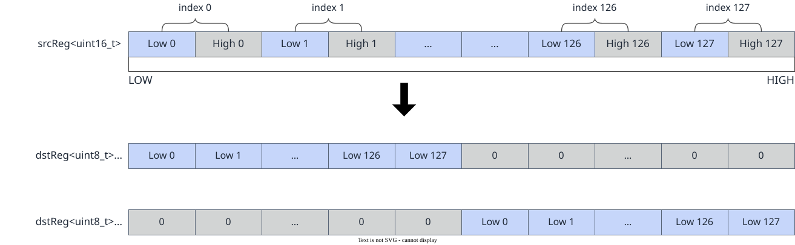
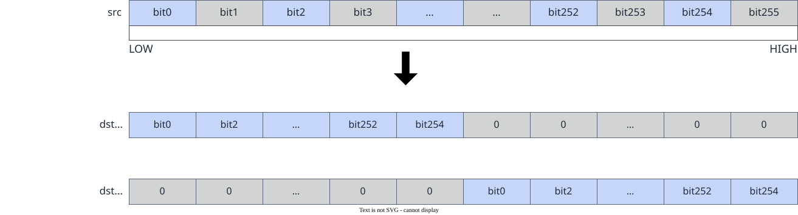

# vf.pack

<!-- md-trans-meta sourceCommit=7d0ab31d84c294a0a8327f597d2bdee012acb22d translatedAt=2026-10-26T13:06:41.600Z pushedAt=2026-10-28T11:57:28.736Z nl=2 -->

## Applicable Products

<!-- npu="950" id1 -->
- Ascend 950PR&950DT products: Supported
<!-- end id1 -->
<!-- npu="A3" id2 -->
- Atlas A3 products: Not supported
<!-- end id2 -->
<!-- npu="910b" id3 -->
- Atlas A2 products: Not supported
<!-- end id3 -->

## Description

The API automatically supports two modes based on the type of the src parameter:

**reg_tensor input**: Selects the lower 8 bits (for 16-bit-wide types such as DT_INT16, DT_UINT16, DT_FP16, and DT_BF16), the lower 16 bits (for 32-bit-wide types such as DT_INT32, DT_UINT32, and DT_FP32), or the lower 32 bits (for 64-bit-wide types such as DT_INT64 and DT_UINT64) from the elements in the source operand src, and writes them to the lower or upper half of dst based on the mode selected by part. It is used to compress wide-type data into narrow-type data. The following figure shows the schematic diagram:

**Figure 1** Pack with reg_tensor input



**mask_reg input**: Extracts the even bits from the source operand src into the lower or upper half of dst based on the mode selected by part. The following figure shows the schematic diagram:

**Figure 2** Pack with mask_reg input



## Prototype

```python
pack(src, part: Optional[PackPart] = None, dtype: Optional[DType] = None) -> dst
```

## Parameters

| Parameter | Input/Output | Description |
|---|---|---|
| src | Input | Source operand, of [reg_tensor](../basic_data_structures/reg_tensor.md) or [mask_reg](../basic_data_structures/mask_reg.md) type. For reg_tensor, the data type is the wide type before compression; for mask_reg, the data type remains unchanged. |
| part | Input | Optional. Controls whether to write to the lower or upper half of dst, corresponding to the [PackPart](../basic_data_structures/PackPart.md) type.<br>- pypto_pro.language.PackPart.LOWER: Low mode, writes to the lower half of dst.<br>- pypto_pro.language.PackPart.UPPER: High mode, writes to the upper half of dst.<br>Defaults to pypto_pro.language.PackPart.LOWER. The dual-register mode supports only the pypto_pro.language.PackPart.LOWER mode. |
| dtype | Input | Optional. Data type.<br>- Required in reg_tensor mode. Specifies the data type of the target reg_tensor (for example, pypto_pro.language.DT_UINT8, pypto_pro.language.DT_UINT16). It is required because compressing a wide type into a narrow type (for example, DT_UINT16 to DT_UINT8) makes the target reg_tensor data type different from the source reg_tensor data type, which cannot be inferred from the source operand. Therefore, the target data type must be explicitly specified through the dtype parameter.<br>- In mask_reg mode, the register type is retained, so this parameter can be omitted. |

## Constraints

- Data type constraints:

  - **reg_tensor input**

    | dst | src |
    |---|---|
    | DT_UINT8 | DT_INT16 |
    | DT_UINT8 | DT_UINT16 |
    | DT_UINT16 | DT_INT32 |
    | DT_UINT16 | DT_UINT32 |
    | DT_UINT32 | DT_INT64 |
    | DT_UINT32 | DT_UINT64 |

  - **mask_reg input**

    None

## Return Value

Returns the dst destination operand, of [reg_tensor](../basic_data_structures/reg_tensor.md) or [mask_reg](../basic_data_structures/mask_reg.md) type. For reg_tensor, the data type is the narrow type after compression; for mask_reg, the data type remains unchanged. For supported data types, see [Constraints](#constraints).

## Examples

### reg_tensor Call Example

```python
import os
import pypto_pro.language as pl
import torch
import torch_npu

@pl.vector_function
def example_vf(src_tile, dst_tile):
    preg = vf.create_mask(pattern=pl.MaskPattern.ALL, dtype=pl.DT_UINT8)
    src = vf.load_align(src_tile, 0)
    dst = vf.pack(src, part=pl.PackPart.LOWER, dtype=pl.DT_UINT8)
    vf.store_align(dst_tile, dst, preg)

@pl.jit()
def example_kernel(
    a: pl.Tensor[[pl.DYNAMIC, pl.DYNAMIC], pl.DT_UINT16],
    out: pl.Tensor[[pl.DYNAMIC, pl.DYNAMIC], pl.DT_UINT8],
):
    tf_src = pl.TileType(shape=[1, 128], dtype=pl.DT_UINT16, target_memory=pl.MemorySpace.Vec)
    tf_dst = pl.TileType(shape=[1, 256], dtype=pl.DT_UINT8, target_memory=pl.MemorySpace.Vec)
    in_a_grp = pl.make_tile_group(type=tf_src, addrs=0x0, mutex_ids=[0])
    in_a = in_a_grp.current()
    t_out_grp = pl.make_tile_group(type=tf_dst, addrs=0x100, mutex_ids=[1])
    t_out = t_out_grp.current()
    with pl.section_vector():
        pl.load(in_a, a, [0, 0])
        example_vf(in_a, t_out)
        pl.store(out, t_out, [0, 0])

def test_example():
    device_id = int(os.environ.get("TILE_FWK_DEVICE_ID", 0))
    device = f"npu:{device_id}"
    core_nums = 1
    torch.npu.set_device(device)
    a = torch.randint(0, 256, [1, 128], device=device, dtype=torch.int16)
    out = torch.empty([1, 256], device=device, dtype=torch.uint8)
    example_kernel[None, core_nums](a, out)
    torch.npu.synchronize()
    assert out.dtype == torch.uint8

if __name__ == "__main__":
    test_example()
    print("PASSED")
```

### mask_reg Examples

When the source operand is mask_reg, vf.pack extracts the even bits of the mask into the lower half or the upper half. The mask_reg variant shares the part= parameter with the reg_tensor variant to specify the mode.

```python
import os
import pypto_pro.language as pl
import torch
import torch_npu

@pl.vector_function
def example_vf(src_tile, dst_tile):
    preg = vf.create_mask(pattern=pl.MaskPattern.ALL, dtype=pl.DT_FP32)
    reg = vf.load_align(src_tile, 0)
    mask_a = vf.ge(reg, 0.0, preg)
    preg_packed = vf.pack(mask_a, part=pl.PackPart.LOWER)
    preg_unpacked = vf.unpack(preg_packed, part=pl.PackPart.LOWER)
    reg_dst = vf.abs(reg, preg_unpacked)
    vf.store_align(dst_tile, reg_dst, preg)

@pl.jit()
def example_kernel(
    a: pl.Tensor[[pl.DYNAMIC, pl.DYNAMIC], pl.DT_FP32],
    out: pl.Tensor[[pl.DYNAMIC, pl.DYNAMIC], pl.DT_FP32],
):
    tf = pl.TileType(shape=[1, 64], dtype=pl.DT_FP32, target_memory=pl.MemorySpace.Vec)
    in_a_grp = pl.make_tile_group(type=tf, addrs=0x0, mutex_ids=[0])
    in_a = in_a_grp.current()
    t_out_grp = pl.make_tile_group(type=tf, addrs=0x100, mutex_ids=[1])
    t_out = t_out_grp.current()
    with pl.section_vector():
        pl.load(in_a, a, [0, 0])
        example_vf(in_a, t_out)
        pl.store(out, t_out, [0, 0])

def test_example():
    device_id = int(os.environ.get("TILE_FWK_DEVICE_ID", 0))
    device = f"npu:{device_id}"
    core_nums = 1
    torch.npu.set_device(device)
    a = torch.randn([1, 64], device=device, dtype=torch.float32)
    out = torch.empty([1, 64], device=device, dtype=torch.float32)
    example_kernel[None, core_nums](a, out)
    torch.npu.synchronize()
    expected = torch.where(a >= 0, a, torch.zeros_like(a))
    torch.testing.assert_close(out, expected, rtol=1e-5, atol=1e-5)

if __name__ == "__main__":
    test_example()
    print("PASSED")
```
