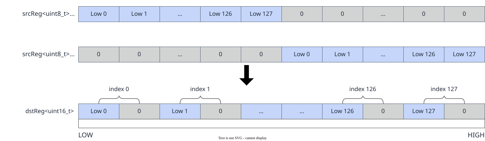
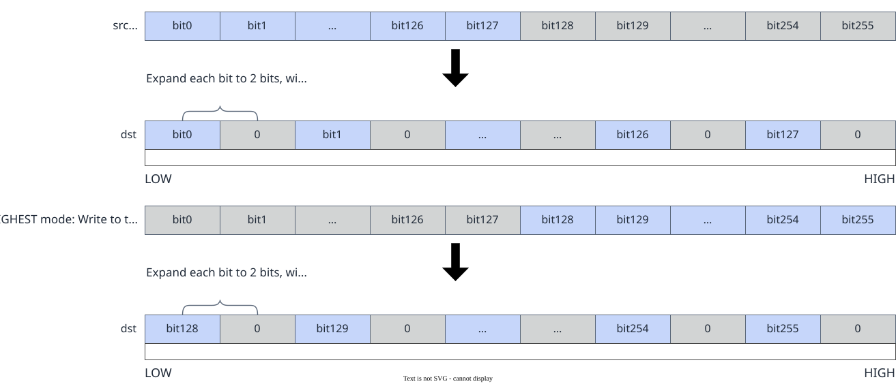

# vf.unpack

## Applicable Products

<!-- npu="950" id1 -->
- Ascend 950PR&950DT products: Supported
<!-- end id1 -->
<!-- npu="A3" id2 -->
- Atlas A3 products: Not supported
<!-- end id2 -->
<!-- npu="910b" id3 -->
- Atlas A2 products: Not supported
<!-- end id3 -->

## Description

This instruction automatically supports two modes at the backend based on the src parameter type:

**reg_tensor input**: For unsigned integers, the elements in the least significant half or the most significant half of the source operand src are written to the destination operand dst with higher bits filled with 0s to extend the bit width. For signed integers, the elements in the least significant half or the most significant half of the source operand src are written to the destination operand dst with the sign bit preserved to extend the bit width. This is used to widen narrow-type data into wide-type data. The figure below illustrates the details.

**Figure 1** reg_tensor input unpack



**mask_reg input**: Based on the mode selected by part, the instruction expands the least significant half or the most significant half of the source operand src into the destination operand dst. The figure below illustrates the details.

**Figure 2** mask_reg input unpack



## Prototype

```python
unpack(src, /, *, part: Optional[PackPart] = None, dtype: Optional[DType] = None) -> dst
```

## Parameters

| Parameter| Input/Output| Description|
|---|---|---|
| src | Input| Source operand, which is of type [reg_tensor](../basic_data_structures/reg_tensor.md) or [mask_reg](../basic_data_structures/mask_reg.md). For details about the supported data types, see [Constraints](#constraints). For reg_tensor, the data type is the narrow type before expansion; for mask_reg, the data type remains unchanged.|
| part | Input| (Optional) Whether to read the least significant half or the most significant half of src. The value is of type [PackPart](../basic_data_structures/PackPart.md).<br>- pypto_pro.language.PackPart.LOWER: The least significant half of src is read.<br>- pypto_pro.language.PackPart.UPPER: The most significant half of src is read.<br>The default value is pypto_pro.language.PackPart.LOWER. The dual-register mode supports only pypto_pro.language.PackPart.LOWER.|
| dtype | Input| (Optional) Data type.<br>- Data type of the destination reg_tensor (for example, pypto_pro.language.DT_UINT16 and pypto_pro.language.DT_UINT32). This parameter is required in reg_tensor mode. This parameter is required because the instruction widens narrow-type data into wide-type data (for example, DT_UINT8→DT_UINT16), and the data type of the destination reg_tensor differs from that of the source reg_tensor and cannot be inferred from the source operand. Therefore, the destination data type must be explicitly specified via the dtype parameter.<br>- Optional in mask_reg mode. The register type remains unchanged, so this parameter can be omitted.|

## Constraints

- Data type constraints:

  - **reg_tensor input**

    Mapping between the data types of the source and destination operands

    | dst | src |
    |---|---|
    | DT_INT16 | DT_INT8 |
    | DT_UINT16 | DT_UINT8 |
    | DT_INT32 | DT_INT16 |
    | DT_UINT32 | DT_UINT16 |
    | DT_INT64 | DT_INT32 |
    | DT_UINT64 | DT_UINT32 |

  - **mask_reg input**

    No constraints

## Return Value

Returns the destination operand dst, which is of type [reg_tensor](../basic_data_structures/reg_tensor.md) or [mask_reg](../basic_data_structures/mask_reg.md). When dst is of type reg_tensor, its data type is the wide type after expansion; when dst is of type mask_reg, its data type remains unchanged. For details about the supported data types, see [Constraints](#constraints).

## Examples

### reg_tensor Call Example

```python
import os
import pypto_pro.language as pl
import torch
import torch_npu

@pl.vector_function
def example_vf(src_tile, dst_tile):
    preg = vf.create_mask(pattern=pl.MaskPattern.ALL, dtype=pl.DT_UINT16)
    src = vf.load_align(src_tile, 0)
    dst = vf.unpack(src, part=pl.PackPart.LOWER, dtype=pl.DT_UINT16)
    vf.store_align(dst_tile, dst, preg)

@pl.jit()
def example_kernel(
    a: pl.Tensor[[pl.DYNAMIC, pl.DYNAMIC], pl.DT_UINT8],
    out: pl.Tensor[[pl.DYNAMIC, pl.DYNAMIC], pl.DT_UINT16],
):
    tf_src = pl.TileType(shape=[1, 256], dtype=pl.DT_UINT8, target_memory=pl.MemorySpace.Vec)
    tf_dst = pl.TileType(shape=[1, 128], dtype=pl.DT_UINT16, target_memory=pl.MemorySpace.Vec)
    in_a_grp = pl.make_tile_group(type=tf_src, addrs=0x0, mutex_ids=[0])
    in_a = in_a_grp.current()
    t_out_grp = pl.make_tile_group(type=tf_dst, addrs=0x100, mutex_ids=[1])
    t_out = t_out_grp.current()
    with pl.section_vector():
        pl.load(in_a, a, [0, 0])
        example_vf(in_a, t_out)
        pl.store(out, t_out, [0, 0])

def test_example():
    device_id = int(os.environ.get("TILE_FWK_DEVICE_ID", 0))
    device = f"npu:{device_id}"
    core_nums = 1
    torch.npu.set_device(device)
    a = torch.randint(0, 256, [1, 256], device=device, dtype=torch.uint8)
    out = torch.empty([1, 128], device=device, dtype=torch.int16)
    example_kernel[None, core_nums](a, out)
    torch.npu.synchronize()
    assert out.dtype == torch.int16

if __name__ == "__main__":
    test_example()
    print("PASSED")
```

### mask_reg Call Example

When the source operand is of type mask_reg, vf.unpack expands the least significant half or the most significant half of the mask (each bit is expanded to 2 bits, with the most significant bits set to 0). The mask_reg variant and the reg_tensor variant share the same part parameter for mode selection.

```python
import os
import pypto_pro.language as pl
import torch
import torch_npu

@pl.vector_function
def example_vf(src_tile, dst_tile):
    preg = vf.create_mask(pattern=pl.MaskPattern.ALL, dtype=pl.DT_FP32)
    reg = vf.load_align(src_tile, 0)
    mask_a = vf.ge(reg, 0.0, preg)
    preg_packed = vf.pack(mask_a, part=pl.PackPart.LOWER)
    preg_unpacked = vf.unpack(preg_packed, part=pl.PackPart.LOWER)
    reg_dst = vf.abs(reg, preg_unpacked)
    vf.store_align(dst_tile, reg_dst, preg)

@pl.jit()
def example_kernel(
    a: pl.Tensor[[pl.DYNAMIC, pl.DYNAMIC], pl.DT_FP32],
    out: pl.Tensor[[pl.DYNAMIC, pl.DYNAMIC], pl.DT_FP32],
):
    tf = pl.TileType(shape=[1, 64], dtype=pl.DT_FP32, target_memory=pl.MemorySpace.Vec)
    in_a_grp = pl.make_tile_group(type=tf, addrs=0x0, mutex_ids=[0])
    in_a = in_a_grp.current()
    t_out_grp = pl.make_tile_group(type=tf, addrs=0x100, mutex_ids=[1])
    t_out = t_out_grp.current()
    with pl.section_vector():
        pl.load(in_a, a, [0, 0])
        example_vf(in_a, t_out)
        pl.store(out, t_out, [0, 0])

def test_example():
    device_id = int(os.environ.get("TILE_FWK_DEVICE_ID", 0))
    device = f"npu:{device_id}"
    core_nums = 1
    torch.npu.set_device(device)
    a = torch.randn([1, 64], device=device, dtype=torch.float32)
    out = torch.empty([1, 64], device=device, dtype=torch.float32)
    example_kernel[None, core_nums](a, out)
    torch.npu.synchronize()
    expected = torch.where(a >= 0, a, torch.zeros_like(a))
    torch.testing.assert_close(out, expected, rtol=1e-5, atol=1e-5)

if __name__ == "__main__":
    test_example()
    print("PASSED")
```

### INT64 Data Type Example

In the following example, INT64 is compressed into UINT32 via `vf.pack` (the destination data type of pack must be unsigned), then reinterpreted as INT32 at the bit level via `vf.bit_cast`, and finally restored to INT64 via `vf.unpack` to verify round-trip consistency. `vf.unpack` performs sign extension on the INT32 source (filling the higher bits with the sign bits), correctly restoring the original INT64 value.

```python
import os
import pypto_pro.language as pl
import torch
import torch_npu

@pl.vector_function
def example_vf_int64(src_tile, dst_tile):
    preg = vf.create_mask(pattern=pl.MaskPattern.ALL, dtype=pl.DT_INT64)
    reg_a = vf.load_align(src_tile, 0)
    reg_packed = vf.pack(reg_a, dtype=pl.DT_UINT32)
    reg_signed = vf.bit_cast(reg_packed, dtype=pl.DT_INT32)
    reg_out = vf.unpack(reg_signed, dtype=pl.DT_INT64)
    vf.store_align(dst_tile, reg_out, preg)

@pl.jit()
def example_kernel_int64(
    a: pl.Tensor[[pl.DYNAMIC, pl.DYNAMIC], pl.DT_INT64],
    out: pl.Tensor[[pl.DYNAMIC, pl.DYNAMIC], pl.DT_INT64],
):
    tf = pl.TileType(shape=[1, 32], dtype=pl.DT_INT64, target_memory=pl.MemorySpace.Vec)
    in_a_grp = pl.make_tile_group(type=tf, addrs=0, mutex_ids=[0])
    in_a = in_a_grp.current()
    t_out_grp = pl.make_tile_group(type=tf, addrs=256, mutex_ids=[1])
    t_out = t_out_grp.current()
    with pl.section_vector():
        pl.load(in_a, a, [0, 0])
        example_vf_int64(in_a, t_out)
        pl.store(out, t_out, [0, 0])

def test_example_int64():
    device_id = int(os.environ.get("TILE_FWK_DEVICE_ID", 0))
    device = f"npu:{device_id}"
    core_nums = 1
    torch.npu.set_device(device)
    a = torch.randint(-100, 100, [1, 32], device=device, dtype=torch.int64)
    out = torch.empty([1, 32], device=device, dtype=torch.int64)
    example_kernel_int64[None, core_nums](a, out)
    torch.npu.synchronize()
    torch.testing.assert_close(out, a, rtol=0, atol=0)

if __name__ == "__main__":
    test_example_int64()
    print("PASSED")
```
