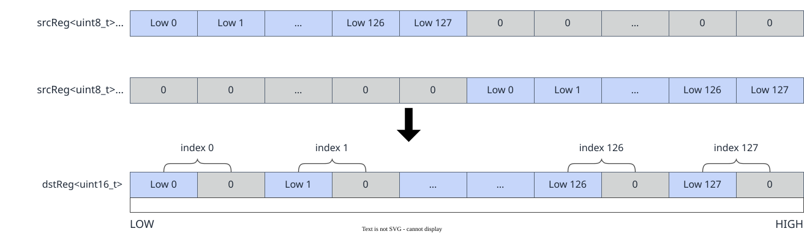
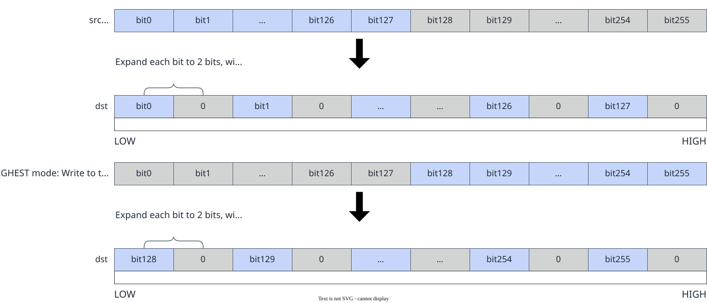

# vf.unpack

<!-- md-trans-meta sourceCommit=7d0ab31d84c294a0a8327f597d2bdee012acb22d translatedAt=2026-10-26T13:08:08.661Z pushedAt=2026-10-28T11:57:28.739Z nl=2 -->

## Applicable Products

<!-- npu="950" id1 -->
- Ascend 950PR&950DT products: Supported
<!-- end id1 -->
<!-- npu="A3" id2 -->
- Atlas A3 products: Not supported
<!-- end id2 -->
<!-- npu="910b" id3 -->
- Atlas A2 products: Not supported
<!-- end id3 -->

## Description

The API automatically supports two modes on the backend based on the type of the src parameter:

**reg_tensor input**: For unsigned integer types, the elements in the lower half or upper half of the source operand src are written to the destination operand dst with the bit width expanded by padding the high bits with 0. For signed integer types, the elements in the lower half or upper half of the source operand src are written to dst with the bit width expanded while preserving the sign bit. This is used to expand narrow-type data into wide-type data. The schematic diagram is as follows:

**Figure 1** Unpack with reg_tensor input



**mask_reg input**: Based on the mode selected by part, the lower half or upper half of the source operand src is expanded into the destination operand dst. The schematic diagram is as follows:

**Figure 2** Unpack with mask_reg input



## Prototype

```python
unpack(src, part: Optional[PackPart] = None, dtype: Optional[DType] = None) -> dst
```

## Parameters

| Parameter | Input/Output | Description |
|---|---|---|
| src | Input | Source operand, of [reg_tensor](../basic_data_structures/reg_tensor.md) or [mask_reg](../basic_data_structures/mask_reg.md) type. For supported data types, see [Constraints](#constraints). For reg_tensor, the data type is the narrow type before unpacking; for mask_reg, the data type remains unchanged. |
| part | Input | Optional. Controls whether to read the lower or upper half of src, corresponding to the [PackPart](../basic_data_structures/PackPart.md) type.<br>- pypto_pro.language.PackPart.LOWER: Low mode, reads the lower half of src.<br>- pypto_pro.language.PackPart.UPPER: High mode, reads the upper half of src.<br>Defaults to pypto_pro.language.PackPart.LOWER. Dual-register mode supports only pypto_pro.language.PackPart.LOWER. |
| dtype | Input | Optional. Data type.<br>- Required in reg_tensor mode. Specifies the data type of the destination reg_tensor (for example, pypto_pro.language.DT_UINT16, pypto_pro.language.DT_UINT32). It is required because unpacking a narrow type into a wide type (for example, DT_UINT8→DT_UINT16) changes the data type of the destination reg_tensor relative to the source reg_tensor, which cannot be inferred from the source operand. Therefore, the destination data type must be explicitly specified through the dtype parameter.<br>- In mask_reg mode, the register type is retained, so this parameter can be omitted. |

## Constraints

- Data type constraints:

  - **reg_tensor input**

    Data type mapping between source and destination operands

    | dst | src |
    |---|---|
    | DT_INT16 | DT_INT8 |
    | DT_UINT16 | DT_UINT8 |
    | DT_INT32 | DT_INT16 |
    | DT_UINT32 | DT_UINT16 |
    | DT_INT64 | DT_INT32 |
    | DT_UINT64 | DT_UINT32 |

  - **mask_reg input**

    None

## Return Value

Returns the destination operand dst, of [reg_tensor](../basic_data_structures/reg_tensor.md) or [mask_reg](../basic_data_structures/mask_reg.md) type. For reg_tensor, the data type is the wide type after unpacking; for mask_reg, the data type remains unchanged. For supported data types, see [Constraints](#constraints).

## Examples

### reg_tensor Examples

```python
import os
import pypto_pro.language as pl
import torch
import torch_npu

@pl.vector_function
def example_vf(src_tile, dst_tile):
    preg = vf.create_mask(pattern=pl.MaskPattern.ALL, dtype=pl.DT_UINT16)
    src = vf.load_align(src_tile, 0)
    dst = vf.unpack(src, part=pl.PackPart.LOWER, dtype=pl.DT_UINT16)
    vf.store_align(dst_tile, dst, preg)

@pl.jit()
def example_kernel(
    a: pl.Tensor[[pl.DYNAMIC, pl.DYNAMIC], pl.DT_UINT8],
    out: pl.Tensor[[pl.DYNAMIC, pl.DYNAMIC], pl.DT_UINT16],
):
    tf_src = pl.TileType(shape=[1, 256], dtype=pl.DT_UINT8, target_memory=pl.MemorySpace.Vec)
    tf_dst = pl.TileType(shape=[1, 128], dtype=pl.DT_UINT16, target_memory=pl.MemorySpace.Vec)
    in_a_grp = pl.make_tile_group(type=tf_src, addrs=0x0, mutex_ids=[0])
    in_a = in_a_grp.current()
    t_out_grp = pl.make_tile_group(type=tf_dst, addrs=0x100, mutex_ids=[1])
    t_out = t_out_grp.current()
    with pl.section_vector():
        pl.load(in_a, a, [0, 0])
        example_vf(in_a, t_out)
        pl.store(out, t_out, [0, 0])

def test_example():
    device_id = int(os.environ.get("TILE_FWK_DEVICE_ID", 0))
    device = f"npu:{device_id}"
    core_nums = 1
    torch.npu.set_device(device)
    a = torch.randint(0, 256, [1, 256], device=device, dtype=torch.uint8)
    out = torch.empty([1, 128], device=device, dtype=torch.int16)
    example_kernel[None, core_nums](a, out)
    torch.npu.synchronize()
    assert out.dtype == torch.int16

if __name__ == "__main__":
    test_example()
    print("PASSED")
```

### mask_reg Examples

When the source operand is mask_reg, vf.unpack expands the lower half or upper half of the mask (each bit is expanded to 2 bits, with the high bits set to zero). The mask_reg variant shares the part= parameter with the reg_tensor variant to specify the mode.

```python
import os
import pypto_pro.language as pl
import torch
import torch_npu

@pl.vector_function
def example_vf(src_tile, dst_tile):
    preg = vf.create_mask(pattern=pl.MaskPattern.ALL, dtype=pl.DT_FP32)
    reg = vf.load_align(src_tile, 0)
    mask_a = vf.ge(reg, 0.0, preg)
    preg_packed = vf.pack(mask_a, part=pl.PackPart.LOWER)
    preg_unpacked = vf.unpack(preg_packed, part=pl.PackPart.LOWER)
    reg_dst = vf.abs(reg, preg_unpacked)
    vf.store_align(dst_tile, reg_dst, preg)

@pl.jit()
def example_kernel(
    a: pl.Tensor[[pl.DYNAMIC, pl.DYNAMIC], pl.DT_FP32],
    out: pl.Tensor[[pl.DYNAMIC, pl.DYNAMIC], pl.DT_FP32],
):
    tf = pl.TileType(shape=[1, 64], dtype=pl.DT_FP32, target_memory=pl.MemorySpace.Vec)
    in_a_grp = pl.make_tile_group(type=tf, addrs=0x0, mutex_ids=[0])
    in_a = in_a_grp.current()
    t_out_grp = pl.make_tile_group(type=tf, addrs=0x100, mutex_ids=[1])
    t_out = t_out_grp.current()
    with pl.section_vector():
        pl.load(in_a, a, [0, 0])
        example_vf(in_a, t_out)
        pl.store(out, t_out, [0, 0])

def test_example():
    device_id = int(os.environ.get("TILE_FWK_DEVICE_ID", 0))
    device = f"npu:{device_id}"
    core_nums = 1
    torch.npu.set_device(device)
    a = torch.randn([1, 64], device=device, dtype=torch.float32)
    out = torch.empty([1, 64], device=device, dtype=torch.float32)
    example_kernel[None, core_nums](a, out)
    torch.npu.synchronize()
    expected = torch.where(a >= 0, a, torch.zeros_like(a))
    torch.testing.assert_close(out, expected, rtol=1e-5, atol=1e-5)

if __name__ == "__main__":
    test_example()
    print("PASSED")
```
