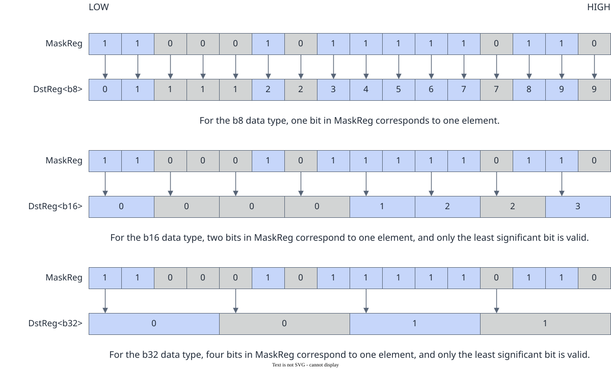

# vf.unsqueeze

<!-- md-trans-meta sourceCommit=7d0ab31d84c294a0a8327f597d2bdee012acb22d translatedAt=2026-10-26T13:08:33.624Z pushedAt=2026-10-28T11:57:28.746Z nl=2 -->

## Applicable Products

<!-- npu="950" id1 -->
- Ascend 950PR&950DT products: Supported
<!-- end id1 -->
<!-- npu="A3" id2 -->
- Atlas A3 products: Not supported
<!-- end id2 -->
<!-- npu="910b" id3 -->
- Atlas A2 products: Not supported
<!-- end id3 -->

## Description

Decompresses dst according to preg.

The algorithm is shown in the following figure. The first bit of dst is 0. When the corresponding mask value of mask[i] is 1, the value of dst[i] is dst[i-1] + 1; when the corresponding mask value of mask[i] is 0, the value of dst[i] is dst[i-1]. The most significant bit of mask is ignored and does not participate in the statistics.

$$dstReg_i = \begin{cases} 1 & \text{if } mask_i = 1 \\ 0 & \text{if } mask_i = 0 \end{cases}$$

**Figure 1** Unsqueeze diagram



mask_reg is generated by vf.create_mask or vf.update_mask and is passed directly to the vector computation API as a parameter of the mask_reg type to control which elements participate in the computation.

## Prototype

```python
unsqueeze(preg) -> dst
```

## Parameters

| Parameter | Input/Output | Description |
|---|---|---|
| preg | Input | [mask_reg](../basic_data_structures/mask_reg.md) (generated by vf.create_mask or vf.update_mask). |

## Constraints

None

## Return Value

Returns the dst destination operand, [reg_tensor](../basic_data_structures/reg_tensor.md), which stores the expansion result. Supported data types: DT_INT8, DT_UINT8, DT_INT16, DT_UINT16, DT_INT32, DT_UINT32.

## Examples

```python
import os
import pypto_pro.language as pl
import torch
import torch_npu

@pl.vector_function
def example_vf(src_tile, dst_tile):
    preg = vf.create_mask(pattern=pl.MaskPattern.ALL, dtype=pl.DT_UINT32)
    src = vf.load_align(src_tile, 0)
    dst = vf.unsqueeze(preg)
    vf.store_align(dst_tile, dst, preg)

@pl.jit()
def example_kernel(
    a: pl.Tensor[[pl.DYNAMIC, pl.DYNAMIC], pl.DT_UINT32],
    out: pl.Tensor[[pl.DYNAMIC, pl.DYNAMIC], pl.DT_UINT32],
):
    tf = pl.TileType(shape=[1, 64], dtype=pl.DT_UINT32, target_memory=pl.MemorySpace.Vec)
    in_a_grp = pl.make_tile_group(type=tf, addrs=0x0, mutex_ids=[0])
    in_a = in_a_grp.current()
    t_out_grp = pl.make_tile_group(type=tf, addrs=0x100, mutex_ids=[1])
    t_out = t_out_grp.current()
    with pl.section_vector():
        pl.load(in_a, a, [0, 0])
        example_vf(in_a, t_out)
        pl.store(out, t_out, [0, 0])

def test_example():
    device_id = int(os.environ.get("TILE_FWK_DEVICE_ID", 0))
    device = f"npu:{device_id}"
    core_nums = 1
    torch.npu.set_device(device)
    a = torch.randint(0, 100, [1, 64], device=device, dtype=torch.int32)
    out = torch.empty([1, 64], device=device, dtype=torch.int32)
    example_kernel[None, core_nums](a, out)
    torch.npu.synchronize()
    assert out.shape == torch.Size([1, 64])

if __name__ == "__main__":
    test_example()
    print("PASSED")
```
