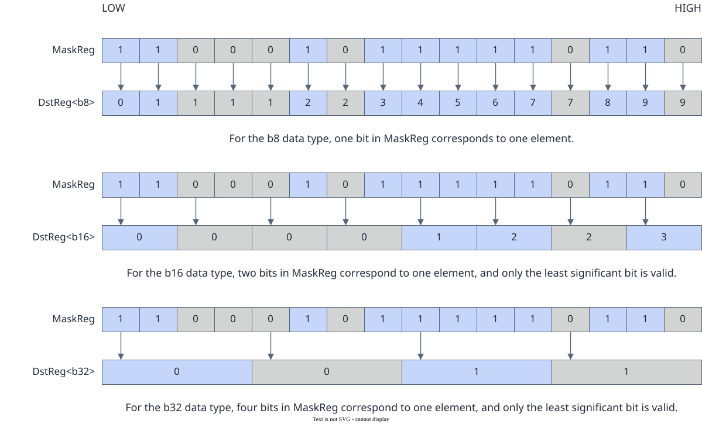

# vf.unsqueeze

## Applicable Products

<!-- npu="950" id1 -->
- Ascend 950PR&950DT products: Supported
<!-- end id1 -->
<!-- npu="A3" id2 -->
- Atlas A3 products: Not supported
<!-- end id2 -->
<!-- npu="910b" id3 -->
- Atlas A2 products: Not supported
<!-- end id3 -->

## Description

dst is used as the operation object and is decompressed based on the preg.

The following figure shows the specific algorithm. The first element of dst is set to 0. For each subsequent position i, if the corresponding mask[i] value is 1, dst[i] = dst[i – 1] + 1; if the corresponding mask[i] value is 0, dst[i] = dst[i – 1]. The most significant bit of the mask is ignored and not counted.

$$dstReg_i = \begin{cases} 1 & \text{if } mask_i = 1 \\ 0 & \text{if } mask_i = 0 \end{cases}$$

**Figure 1** Unsqueezing



mask_reg is generated by vf.create_mask or vf.update_mask and is directly passed to the vector computation API as a parameter of the mask_reg type to control which elements are involved in the computation.

## Prototype

```python
unsqueeze(preg, /) -> dst
```

## Parameters

| Parameter| Input/Output| Description|
|---|---|---|
| preg | Input| [mask_reg](../basic_data_structures/mask_reg.md) (generated by vf.create_mask or vf.update_mask)|

## Constraints

None

## Return Value

Returns the destination operand dst, which is of type [reg_tensor](../basic_data_structures/reg_tensor.md) and stores the expansion result. The supported data types are DT_INT8, DT_UINT8, DT_INT16, DT_UINT16, DT_INT32, and DT_UINT32.

## Examples

```python
import os
import pypto_pro.language as pl
import torch
import torch_npu

@pl.vector_function
def example_vf(src_tile, dst_tile):
    preg = vf.create_mask(pattern=pl.MaskPattern.ALL, dtype=pl.DT_UINT32)
    src = vf.load_align(src_tile, 0)
    dst = vf.unsqueeze(preg)
    vf.store_align(dst_tile, dst, preg)

@pl.jit()
def example_kernel(
    a: pl.Tensor[[pl.DYNAMIC, pl.DYNAMIC], pl.DT_UINT32],
    out: pl.Tensor[[pl.DYNAMIC, pl.DYNAMIC], pl.DT_UINT32],
):
    tf = pl.TileType(shape=[1, 64], dtype=pl.DT_UINT32, target_memory=pl.MemorySpace.Vec)
    in_a_grp = pl.make_tile_group(type=tf, addrs=0x0, mutex_ids=[0])
    in_a = in_a_grp.current()
    t_out_grp = pl.make_tile_group(type=tf, addrs=0x100, mutex_ids=[1])
    t_out = t_out_grp.current()
    with pl.section_vector():
        pl.load(in_a, a, [0, 0])
        example_vf(in_a, t_out)
        pl.store(out, t_out, [0, 0])

def test_example():
    device_id = int(os.environ.get("TILE_FWK_DEVICE_ID", 0))
    device = f"npu:{device_id}"
    core_nums = 1
    torch.npu.set_device(device)
    a = torch.randint(0, 100, [1, 64], device=device, dtype=torch.int32)
    out = torch.empty([1, 64], device=device, dtype=torch.int32)
    example_kernel[None, core_nums](a, out)
    torch.npu.synchronize()
    assert out.shape == torch.Size([1, 64])

if __name__ == "__main__":
    test_example()
    print("PASSED")
```
