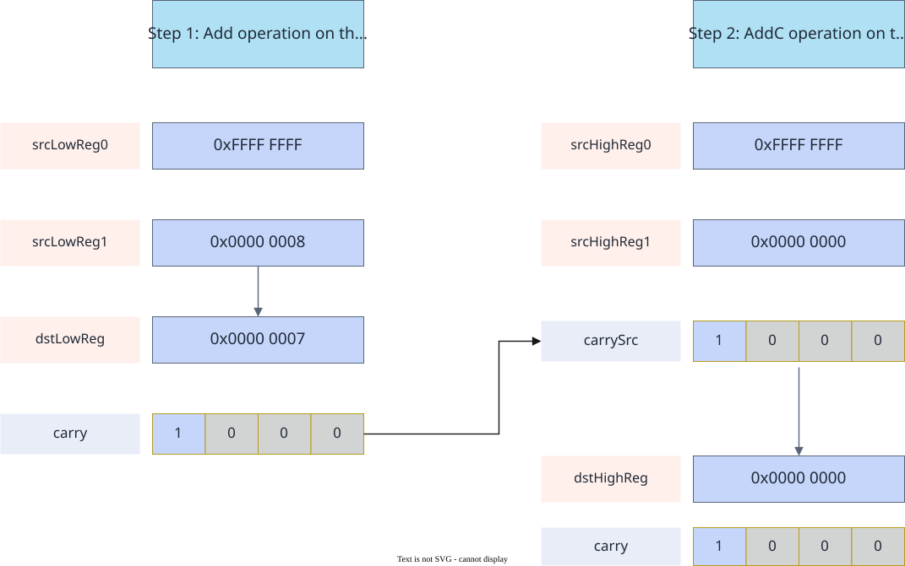

# vf.addc

<!-- md-trans-meta sourceCommit=7d0ab31d84c294a0a8327f597d2bdee012acb22d translatedAt=2026-10-26T13:11:32.640Z pushedAt=2026-10-28T11:57:28.759Z nl=2 -->

## Applicable Products

<!-- npu="950" id1 -->
- Ascend 950PR&950DT products: Supported
<!-- end id1 -->
<!-- npu="A3" id2 -->
- Atlas A3 products: Not supported
<!-- end id2 -->
<!-- npu="910b" id3 -->
- Atlas A2 products: Not supported
<!-- end id3 -->

## Description

This API performs element-wise addition on source operands src0 and src1 and the input carry carry_src based on mask, writes the result to destination operand dst, and writes the carry result of each element to carry. The computation formula is as follows:

$$\{carry_i, dst_i\} = src0_i + src1_i + carry\_src_i$$

Carry flag indicates an addition carry. If the highest bit of the bitwise sum of src0, src1, and carry_src produces a carry, the corresponding position in carry (the mask_reg that stores the carry) is set to 1 for every 4 bits; otherwise, 0 is written.

The following figure shows an applicable scenario of the vf.addc API, using the int64_t computation -1 + 8 = 7 as an example:

**Figure 1** Applicable scenario of vf.addc



## Prototype

```python
addc(src0, src1, carry_src, preg) -> (carry, dst)
```

## Parameters

| Parameter | Input/Output | Description |
|---|---|---|
| src0 | Input | Source operand 0, [reg_tensor](../basic_data_structures/reg_tensor.md). The data types of source operands src0 and src1 and destination operand dst must be consistent. Supported data types: DT_INT32 and DT_UINT32. |
| src1 | Input | Source operand 1, [reg_tensor](../basic_data_structures/reg_tensor.md). The supported data types are the same as those described for src0. |
| carry_src | Input | Input carry value, [mask_reg](../basic_data_structures/mask_reg.md). It must be created before use: create it through [vf.create_mask](../mask_operations/create_mask.md), or provide it from the carry output of the previous vf.addc. |
| preg | Input | [mask_reg](../basic_data_structures/mask_reg.md). |

## Constraints

None

## Return Value

Returns a two-tuple (carry, dst).

- carry: Output carry value, [mask_reg](../basic_data_structures/mask_reg.md), which must be created before use. Create it through [vf.create_mask](../mask_operations/create_mask.md), use it as the tuple unpacking target, and it can serve as the carry_src input for the next vf.addc call.
- dst: Destination operand, [reg_tensor](../basic_data_structures/reg_tensor.md). The supported data types are the same as those described for src0.

## Examples

```python
import os
import pypto_pro.language as pl
import torch
import torch_npu

@pl.vector_function
def example_vf(src_a, src_b, dst_tile):
    preg = vf.create_mask(pattern=pl.MaskPattern.ALL, dtype=pl.DT_UINT32)
    carry_src = vf.create_mask(pattern=pl.MaskPattern.ALL, dtype=pl.DT_UINT32)
    carry = vf.create_mask(pattern=pl.MaskPattern.ALL, dtype=pl.DT_UINT32)
    reg_a = vf.load_align(src_a, 0, dtype=pl.DT_UINT32)
    reg_b = vf.load_align(src_b, 0, dtype=pl.DT_UINT32)
    carry, reg_out = vf.addc(reg_a, reg_b, carry_src, preg)
    vf.store_align(dst_tile, reg_out, preg)

@pl.jit()
def example_kernel(
    a: pl.Tensor[[pl.DYNAMIC, pl.DYNAMIC], pl.DT_UINT32],
    b: pl.Tensor[[pl.DYNAMIC, pl.DYNAMIC], pl.DT_UINT32],
    out: pl.Tensor[[pl.DYNAMIC, pl.DYNAMIC], pl.DT_UINT32],
):
    tf = pl.TileType(shape=[1, 64], dtype=pl.DT_UINT32, target_memory=pl.MemorySpace.Vec)
    in_a_grp = pl.make_tile_group(type=tf, addrs=0x0, mutex_ids=[0])
    in_a = in_a_grp.current()
    in_b_grp = pl.make_tile_group(type=tf, addrs=0x100, mutex_ids=[1])
    in_b = in_b_grp.current()
    t_out_grp = pl.make_tile_group(type=tf, addrs=0x200, mutex_ids=[2])
    t_out = t_out_grp.current()
    with pl.section_vector():
        pl.load(in_a, a, [0, 0])
        pl.load(in_b, b, [0, 0])
        example_vf(in_a, in_b, t_out)
        pl.store(out, t_out, [0, 0])

def test_example():
    device_id = int(os.environ.get("TILE_FWK_DEVICE_ID", 0))
    device = f"npu:{device_id}"
    core_nums = 1
    torch.npu.set_device(device)
    a = torch.randint(0, 50, [1, 64], device=device, dtype=torch.int32)
    b = torch.randint(0, 50, [1, 64], device=device, dtype=torch.int32)
    out = torch.empty([1, 64], device=device, dtype=torch.int32)
    example_kernel[None, core_nums](a, b, out)
    torch.npu.synchronize()
    expected = (a.to(torch.int64) + b.to(torch.int64) + 1).to(torch.int32)
    assert torch.equal(out, expected)

if __name__ == "__main__":
    test_example()
    print("PASSED")
```
