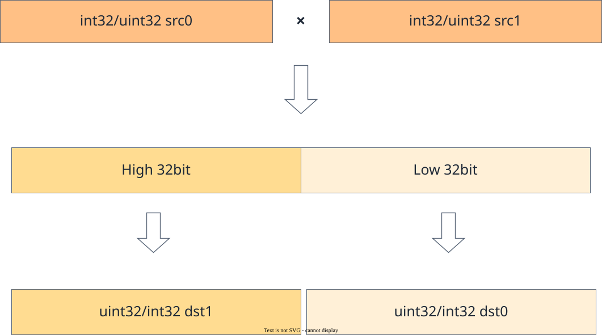

# vf.mull

<!-- md-trans-meta sourceCommit=7d0ab31d84c294a0a8327f597d2bdee012acb22d translatedAt=2026-10-26T13:18:43.208Z pushedAt=2026-10-28T11:57:28.807Z nl=2 -->

## Applicable Products

<!-- npu="950" id1 -->
- Ascend 950PR&950DT products: Supported
<!-- end id1 -->
<!-- npu="A3" id2 -->
- Atlas A3 products: Not supported
<!-- end id2 -->
<!-- npu="910b" id3 -->
- Atlas A2 products: Not supported
<!-- end id3 -->

## Description

This API performs element-wise multiplication on the input data src0 and src1 according to mask, writes the low-order part of the multiplication result to dst_lo, and writes the overflow (high-order) part to dst_hi. The computation formula is as follows:

$$dst\_lo_i = (src0_i \times src1_i) \bmod 2^{bit}$$

$$dst\_hi_i = \lfloor (src0_i \times src1_i) / 2^{bit} \rfloor$$

Here, bit indicates the bit width of the operand.

**Figure 1** vf.mull function description



## Prototype

```python
mull(src0, src1, preg) -> (dst_lo, dst_hi)
```

## Parameters

| Parameter | Input/Output | Description |
|---|---|---|
| src0 | Input | Source operand 0, [reg_tensor](../basic_data_structures/reg_tensor.md). The source operand src and the destination operand dst have the same data type. Supported data types: DT_INT32 and DT_UINT32. |
| src1 | Input | Source operand 1, [reg_tensor](../basic_data_structures/reg_tensor.md). Supported data types are the same as those described for src0. |
| preg | Input | [mask_reg](../basic_data_structures/mask_reg.md). |

## Constraints

None

## Return Value

Returns a two-tuple (dst_lo, dst_hi).

- dst_lo destination operand (low bits of the multiplication result), [reg_tensor](../basic_data_structures/reg_tensor.md), the supported data types are consistent with those described in src0.
- dst_hi destination operand (high bits of the multiplication result), [reg_tensor](../basic_data_structures/reg_tensor.md), the supported data types are the same as described in src0.

## Examples

```python
import os
import pypto_pro.language as pl
import torch
import torch_npu

@pl.vector_function
def example_vf(src_a, src_b, dst_lo, dst_hi):
    preg = vf.create_mask(pattern=pl.MaskPattern.ALL, dtype=pl.DT_UINT32)

    reg_a = vf.load_align(src_a, 0, dtype=pl.DT_UINT32)
    reg_b = vf.load_align(src_b, 0, dtype=pl.DT_UINT32)
    reg_lo, reg_hi = vf.mull(reg_a, reg_b, preg)
    vf.store_align(dst_lo, reg_lo, preg)
    vf.store_align(dst_hi, reg_hi, preg)

@pl.jit()
def example_kernel(
    a: pl.Tensor[[pl.DYNAMIC, pl.DYNAMIC], pl.DT_UINT32],
    b: pl.Tensor[[pl.DYNAMIC, pl.DYNAMIC], pl.DT_UINT32],
    out_lo: pl.Tensor[[pl.DYNAMIC, pl.DYNAMIC], pl.DT_UINT32],
    out_hi: pl.Tensor[[pl.DYNAMIC, pl.DYNAMIC], pl.DT_UINT32],
):
    tf = pl.TileType(shape=[1, 64], dtype=pl.DT_UINT32, target_memory=pl.MemorySpace.Vec)
    in_a_grp = pl.make_tile_group(type=tf, addrs=0x0, mutex_ids=[0])
    in_a = in_a_grp.current()
    in_b_grp = pl.make_tile_group(type=tf, addrs=0x100, mutex_ids=[1])
    in_b = in_b_grp.current()
    t_lo_grp = pl.make_tile_group(type=tf, addrs=0x200, mutex_ids=[2])
    t_lo = t_lo_grp.current()
    t_hi_grp = pl.make_tile_group(type=tf, addrs=0x300, mutex_ids=[3])
    t_hi = t_hi_grp.current()
    with pl.section_vector():
        pl.load(in_a, a, [0, 0])
        pl.load(in_b, b, [0, 0])
        example_vf(in_a, in_b, t_lo, t_hi)
        pl.store(out_lo, t_lo, [0, 0])
        pl.store(out_hi, t_hi, [0, 0])

def test_example():
    device_id = int(os.environ.get("TILE_FWK_DEVICE_ID", 0))
    device = f"npu:{device_id}"
    core_nums = 1
    torch.npu.set_device(device)
    a = torch.randint(1, 1000, [1, 64], device=device, dtype=torch.int32)
    b = torch.randint(1, 1000, [1, 64], device=device, dtype=torch.int32)
    out_lo = torch.empty([1, 64], device=device, dtype=torch.int32)
    out_hi = torch.empty([1, 64], device=device, dtype=torch.int32)
    example_kernel[None, core_nums](a, b, out_lo, out_hi)
    torch.npu.synchronize()
    product = a.to(torch.int64) * b.to(torch.int64)
    expected_lo = (product & 0xFFFFFFFF).to(torch.int32)
    expected_hi = (product >> 32).to(torch.int32)
    assert torch.equal(out_lo, expected_lo)
    assert torch.equal(out_hi, expected_hi)

if __name__ == "__main__":
    test_example()
    print("PASSED")
```
