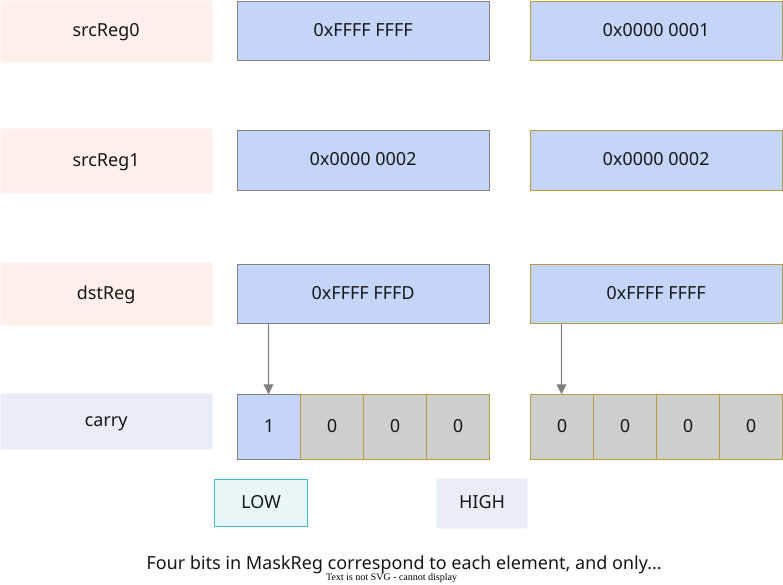

# vf.sub

<!-- md-trans-meta sourceCommit=7d0ab31d84c294a0a8327f597d2bdee012acb22d translatedAt=2026-10-26T13:21:36.811Z pushedAt=2026-10-28T11:57:28.828Z nl=2 -->

## Applicable Products

<!-- npu="950" id1 -->
- Ascend 950PR&950DT products: Supported
<!-- end id1 -->
<!-- npu="A3" id2 -->
- Atlas A3 products: Not supported
<!-- end id2 -->
<!-- npu="910b" id3 -->
- Atlas A2 products: Not supported
<!-- end id3 -->

## Description

Performs element-wise subtraction on two reg_tensors.

Based on the mask, performs element-wise subtraction on the source operands src0 and src1, and writes the result to the destination operand dst. The computation formula is as follows:

$$dst_i = src0_i - src1_i$$

**Figure 1** vf.sub function description



To obtain the borrow output of subtraction, see [vf.subc](subc.md#description).

## Prototype

```python
sub(src0, src1, preg, mode: Optional[MergeMode] = None) -> dst
```

## Parameters

| Parameter | Input/Output | Description |
|---|---|---|
| src0 | Input | Source Operand 0, [reg_tensor](../basic_data_structures/reg_tensor.md). The data type of source operand src0 is the same as that of destination operand dst. Supported data types: DT_INT8, DT_UINT8, DT_INT16, DT_UINT16, DT_INT32, DT_UINT32, DT_FP16, DT_BF16, DT_FP32. |
| src1 | Input | Source Operand 1, [reg_tensor](../basic_data_structures/reg_tensor.md), with the same data type as src0. |
| preg | Input | [mask_reg](../basic_data_structures/mask_reg.md). |
| mode | Input | Optional, corresponding to the [MergeMode](../basic_data_structures/MergeMode.md) type.<br>- pypto_pro.language.MergeMode.ZEROING (default): Elements not selected by preg are set to 0 in dst.<br>- pypto_pro.language.MergeMode.MERGING is currently not supported. |

## Constraints

None

## Return Value

Returns dst, the destination operand, [reg_tensor](../basic_data_structures/reg_tensor.md), with the same supported data types as described for src0.

## Examples

```python
import os
import pypto_pro.language as pl
import torch
import torch_npu

@pl.vector_function
def example_vf(src_a, src_b, dst_tile):
    preg = vf.create_mask(pattern=pl.MaskPattern.ALL, dtype=pl.DT_FP32)
    reg_a = vf.load_align(src_a, 0)
    reg_b = vf.load_align(src_b, 0)
    reg_out = vf.sub(reg_a, reg_b, preg)
    vf.store_align(dst_tile, reg_out, preg)

@pl.jit()
def example_kernel(
    a: pl.Tensor[[pl.DYNAMIC, pl.DYNAMIC], pl.DT_FP32],
    b: pl.Tensor[[pl.DYNAMIC, pl.DYNAMIC], pl.DT_FP32],
    out: pl.Tensor[[pl.DYNAMIC, pl.DYNAMIC], pl.DT_FP32],
):
    tf = pl.TileType(shape=[1, 64], dtype=pl.DT_FP32, target_memory=pl.MemorySpace.Vec)
    in_a_grp = pl.make_tile_group(type=tf, addrs=0x0, mutex_ids=[0])
    in_a = in_a_grp.current()
    in_b_grp = pl.make_tile_group(type=tf, addrs=0x100, mutex_ids=[1])
    in_b = in_b_grp.current()
    t_out_grp = pl.make_tile_group(type=tf, addrs=0x200, mutex_ids=[2])
    t_out = t_out_grp.current()
    with pl.section_vector():
        pl.load(in_a, a, [0, 0])
        pl.load(in_b, b, [0, 0])
        example_vf(in_a, in_b, t_out)
        pl.store(out, t_out, [0, 0])

def test_example():
    device_id = int(os.environ.get("TILE_FWK_DEVICE_ID", 0))
    device = f"npu:{device_id}"
    core_nums = 1
    torch.npu.set_device(device)
    a = torch.randn([1, 64], device=device, dtype=torch.float32)
    b = torch.randn([1, 64], device=device, dtype=torch.float32)
    out = torch.empty([1, 64], device=device, dtype=torch.float32)
    example_kernel[None, core_nums](a, b, out)
    torch.npu.synchronize()
    torch.testing.assert_close(out, a - b, rtol=1e-5, atol=1e-5)

if __name__ == "__main__":
    test_example()
    print("PASSED")
```
