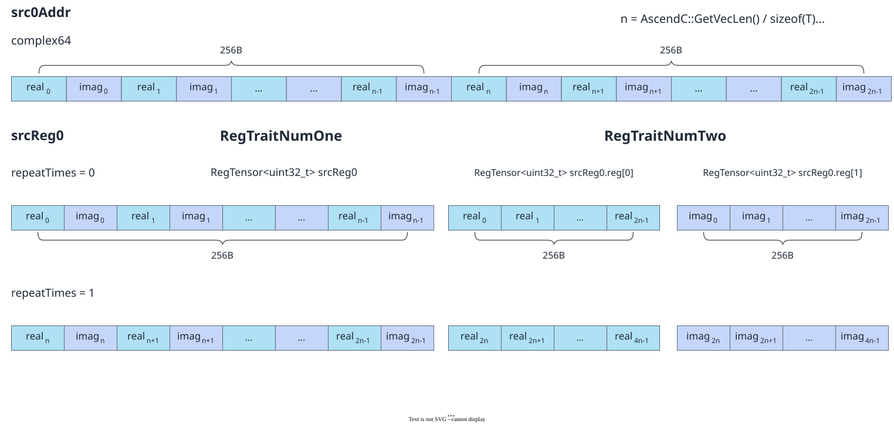
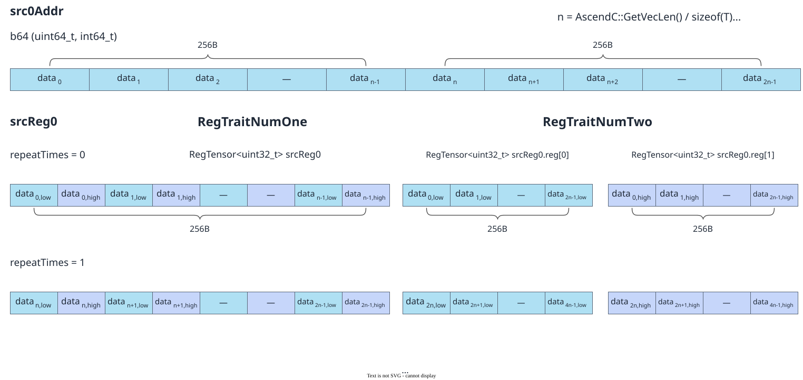

# reg_tensor

## Applicable Products

<!-- npu="950" id1 -->
- Ascend 950PR&950DT products: Supported
<!-- end id1 -->
<!-- npu="A3" id2 -->
- Atlas A3 products: Not supported
<!-- end id2 -->
<!-- npu="910b" id3 -->
- Atlas A2 products: Not supported
<!-- end id3 -->

## Description

A vector register is the fundamental data container for VF computation. It is used to store data loaded from UB Tiles, intermediate results of VF operations, and final outputs.

## Prototype

```python
reg_tensor(dtype: DType) -> reg_tensor
```

## Parameters

| Parameter| Input/Output| Description|
|---|---|---|
| dtype | Input| Data type stored in a register, which determines the number of elements the register can hold.<br>- vf.reg_tensor cannot be directly called. It is automatically declared by the compiler in the assignment form.<br>- The register is created and used within the @pypto_pro.language.vector_function function and is automatically released when the function exits.<br>- After the register is created, data must be initialized via vf.load_align or vf.full. Otherwise, the content is undefined.<br>- The maximum number of RegTensor registers is 32. If the number of registers exceeds the upper limit, the excess register data will be written to the reserved 8 KB UB memory, which may cause performance degradation. The compiler automatically reuses registers whose lifetime has ended and the reserved memory. If both registers and the reserved memory have available space, registers are reused first.|

## Constraints

- Data type constraints:

  The data types supported by RegTensor are determined by the dtype parameter. Different dtype values correspond to different element counts, while the total register size is fixed at 256 bytes.

  | dtype | Element Width| Number of Elements|
  |---|---|---|
  | DT_INT8 / DT_UINT8 / DT_HF8 / DT_FP8E4M3FN / DT_FP8E5M2 / DT_FP8E8M0 | 8 bits | 256 |
  | DT_FP4 / DT_FP4E2M1 / DT_FP4E1M2 | 4 bits (packed as b8, 2 elements per byte)| 256 (512 logical elements) |
  | DT_INT16 / DT_UINT16 / DT_FP16 / DT_BF16 | 16 bits | 128 |
  | DT_INT32 / DT_UINT32 / DT_FP32 | 32 bits | 64 |
  | DT_INT64 / DT_UINT64 | 64 bits | 32 |

  > **FP8/FP4 description**: FP8 types (DT_FP8E4M3FN, DT_FP8E5M2, DT_FP8E8M0, and DT_HF8) are 8-bit floating-point storage types. They only support data movement (load_align/store_align), data filling (full), and type conversion (astype), and cannot be used directly in arithmetic operations. FP4 types (DT_FP4E2M1, DT_FP4E1M2, and DT_FP4) are 4-bit floating-point storage types, with two elements packed into one byte (b8 storage). They likewise only support data movement, filling, and type conversion. To use them in computation, convert them to FP32/BF16/FP16 via vf.astype.

- vf.reg_tensor is a type declaration and does not produce a return value. Registers are automatically declared in the assignment form, for example, reg = vf.load_align(...) or reg = vf.add(...).

## Return Value

Returns the value of type reg_tensor.

## Key Features

### Dual-Register Mode Storage Structure for DT_FP16

The figure below shows the RegTensor storage layout for DT_FP16 in single-register and dual-register modes.

**Figure 1** RegTensor movement for DT_FP16


DT_FP16 is a 16-bit floating-point type. In dual-register mode, 2*VL of data is read from UB using the DIST_DINTLV_B16 dual load-in mode. The data is moved in an interleaved manner: elements at even indices are stored in reg[0], and elements at odd indices are stored in reg[1], with the data type being DT_UINT16. The two RegTensors store 512 bytes of data in total, with reg[0] and reg[1] each holding 128 DT_FP16 elements.

### Dual-Register Mode Storage Structure for DT_FP32

The figure below shows the RegTensor storage layout for DT_FP32 in single-register and dual-register modes.

**Figure 2** RegTensor movement for DT_FP32



DT_FP32 is a 32-bit floating-point type. In dual-register mode, 2*VL of data is read from UB using the DIST_DINTLV_B32 dual load-in mode. The data is moved in an interleaved manner: elements at even indices are stored in reg[0], and elements at odd indices are stored in reg[1], with the data type being DT_UINT32. The two RegTensors store 512 bytes of data in total, with reg[0] and reg[1] each holding 64 DT_FP32 elements.

### Dual-Register Mode Storage Structure for DT_INT64/DT_UINT64

The figure below shows the RegTensor storage layout for b64 (DT_INT64 and DT_UINT64) in single-register and dual-register modes.

**Figure 3** RegTensor movement for b64



In single-register mode, VL of data is moved from UB using the DIST_NORM mode.

In dual-register mode, 2*VL of data is read from UB using the DIST_DINTLV_B32 dual load-in mode. The b64 data is moved in an interleaved manner: elements at even indices (the lower bits) are stored in reg[0], and elements at odd indices (the higher bits) are stored in reg[1], with the data type being DT_UINT32. The two RegTensors store 512 bytes of data in total. reg[0] stores the lower 32 bits of the 64 b64 values, and reg[1] stores the higher 32 bits of the same 64 b64 values.

## Examples

```python
import pypto_pro.language as pl

@pl.vector_function
def vf_kernel():
    preg = vf.create_mask(pattern=pl.MaskPattern.ALL, dtype=pl.DT_FP32)
    reg_a = vf.load_align(src_tile, 0)
    reg_b = vf.load_align(src_tile, 0)
    reg_out = vf.add(reg_a, reg_b, preg)
```
