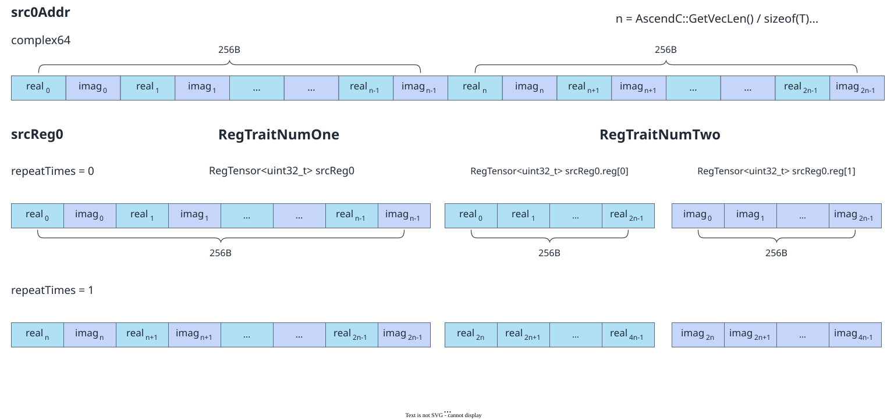
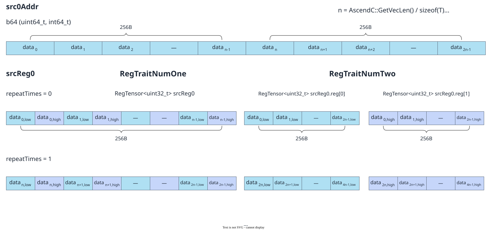

# reg_tensor

<!-- md-trans-meta sourceCommit=7d0ab31d84c294a0a8327f597d2bdee012acb22d translatedAt=2026-10-26T13:29:51.723Z pushedAt=2026-10-28T11:57:28.884Z nl=2 -->

## Applicable Products

<!-- npu="950" id1 -->
- Ascend 950PR&950DT products: Supported
<!-- end id1 -->
<!-- npu="A3" id2 -->
- Atlas A3 products: Not supported
<!-- end id2 -->
<!-- npu="910b" id3 -->
- Atlas A2 products: Not supported
<!-- end id3 -->

## Description

A vector register, the basic data container for VF computation. It stores data loaded from UB Tile, intermediate results of VF operations, and final outputs.

## Prototype

```python
reg_tensor(dtype: DType) -> reg_tensor
```

## Parameters

| Parameter | Input/Output | Description |
|---|---|---|
| dtype | Input | Data type stored in the register, which determines the number of elements covered by the register. <br>- vf.reg_tensor cannot be called directly; it is automatically declared by the compiler in assignment form.<br>- Registers are created and used within the @pypto_pro.language.vector_function function and are automatically released after the function ends.<br>- After a register is created, its data must be initialized through vf.load_align or vf.full; otherwise, the content is undefined.<br>- The maximum number of RegTensor registers is 32. Register data exceeding this limit is written to the reserved 8K UB memory, which may cause performance degradation. The compiler automatically reuses registers and reserved memory whose lifecycles have ended. If both registers and reserved memory have available space, registers are reused first. |

## Constraints

- Data type constraints:

  The data types supported by RegTensor are determined by the dtype parameter. Different dtypes correspond to different numbers of elements (the total register size is fixed at 256 bytes):

  | dtype | Element width | Number of elements |
  |---|---|---|
  | DT_INT8 / DT_UINT8 / DT_HF8 / DT_FP8E4M3FN / DT_FP8E5M2 / DT_FP8E8M0 | 8 bit | 256 |
  | DT_FP4 / DT_FP4E2M1 / DT_FP4E1M2 | 4 bit (b8 packed storage, 2 elements/byte) | 256 (logical 512) |
  | DT_INT16 / DT_UINT16 / DT_FP16 / DT_BF16 | 16 bit | 128 |
  | DT_INT32 / DT_UINT32 / DT_FP32 | 32 bit | 64 |
  | DT_INT64 / DT_UINT64 | 64 bit | 32 |

  > **FP8/FP4 description**: FP8 types (DT_FP8E4M3FN, DT_FP8E5M2, DT_FP8E8M0, DT_HF8) are 8-bit floating-point storage types that support only data movement (load_align/store_align), data filling (full), and type conversion (astype), and do not support direct arithmetic operations. FP4 types (DT_FP4E2M1, DT_FP4E1M2, DT_FP4) are 4-bit floating-point storage types in which two elements are packed into one byte (b8 storage), and likewise support only movement, filling, and type conversion. To perform computation, convert them to FP32/BF16/FP16 using vf.astype.

- vf.reg_tensor is a type declaration and does not return a value. Registers are automatically declared through assignment, for example, reg = vf.load_align(...) or reg = vf.add(...).

## Return Value

Returns the reg_tensor type.

## Key Features

### DT_FP16 Dual-Register Mode Storage Structure

The following figure shows the RegTensor storage condition for DT_FP16 in single-register mode and dual-register mode scenarios:

**Figure 1** RegTensor moving DT_FP16


DT_FP16 is a 16-bit floating-point type. In the dual-register mode scenario, 2*VL data size is read from the UB in DIST_DINTLV_B16 dual-load mode, and the data is moved in an interleaved manner. Elements with even indexes are stored in reg[0], and elements with odd indexes are stored in reg[1], with the data type being DT_UINT16. The two RegTensors store 512B of data, with reg[0] and reg[1] each storing 128 DT_FP16 elements.

### DT_FP32 Dual-Register Mode Storage Structure

The following figure shows the RegTensor storage condition for DT_FP32 in single-register mode and dual-register mode scenarios:

**Figure 2** RegTensor moving DT_FP32



DT_FP32 is a 32-bit floating-point type. In the dual-register mode scenario, 2*VL data size is read from UB in the DIST_DINTLV_B32 dual-load mode, and the data is interleaved: elements at even indexes are stored in reg[0], and elements at odd indexes are stored in reg[1], with the data type being DT_UINT32. The two RegTensors store 512B of data size, with reg[0] and reg[1] each storing 64 DT_FP32 elements.

### DT_INT64/DT_UINT64 Dual-Register Mode Storage Structure

The following figure shows the RegTensor storage condition for b64 (DT_INT64 and DT_UINT64) in single-register mode and dual-register mode scenarios:

**Figure 3** RegTensor moving b64



In single-register mode scenario, VL data size is moved from UB in DIST_NORM mode.

In the dual-register mode scenario, a data size of 2*VL is read from UB in DIST_DINTLV_B32 dual-load mode, and the b64 data is moved in an interleaved manner. Elements at even indices (low bits) are stored in reg[0], and elements at odd indices (high bits) are stored in reg[1], with the data type being DT_UINT32. The two RegTensors store 512B of data. reg[0] stores the first 32 bits (low bits) of the 64 b64 values, and reg[1] stores the last 32 bits (high bits) of the 64 b64 values.

## Examples

```python
import pypto_pro.language as pl

@pl.vector_function
def vf_kernel():
    preg = vf.create_mask(pattern=pl.MaskPattern.ALL, dtype=pl.DT_FP32)
    reg_a = vf.load_align(src_tile, 0)
    reg_b = vf.load_align(src_tile, 0)
    reg_out = vf.add(reg_a, reg_b, preg)
```
