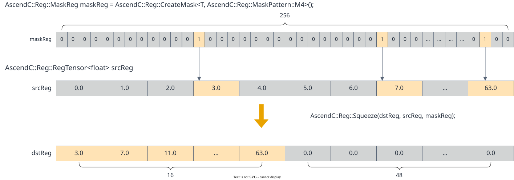

# vf.squeeze

## Applicable Products

<!-- npu="950" id1 -->
- Ascend 950PR&950DT products: Supported
<!-- end id1 -->
<!-- npu="A3" id2 -->
- Atlas A3 products: Not supported
<!-- end id2 -->
<!-- npu="910b" id3 -->
- Atlas A2 products: Not supported
<!-- end id3 -->

## Description

Copies the valid elements selected by preg from the input src sequentially into dst. The valid elements are arranged contiguously from the lowest position upward in dst, and the remaining positions are set to zero, as shown in the figure below.

$$dstReg_j = srcReg_{idx_j}, \quad j \in \{0, 1, \ldots, count\_active - 1\}$$

**Figure 1** vf.squeeze computation



Specifically, when gather_mode is set to pypto_pro.language.SqueezeMode.STORE_REG, vf.squeeze stores the total byte count of valid elements into the AR special register. In this case, when used together with the contiguous unaligned store-out interface (without explicitly passing an offset), vf.store_unalign automatically reads the valid byte count from the AR register and uses it as the address offset.

## Prototype

```python
squeeze(src, preg, /, *, gather_mode: Optional[SqueezeMode] = None) -> dst
```

## Parameters

| Parameter| Input/Output| Description|
|---|---|---|
| src | Input| Source operand, which is of type [reg_tensor](../basic_data_structures/reg_tensor.md). The supported data types are DT_INT8, DT_UINT8, DT_INT16, DT_UINT16, DT_FP16, DT_INT32, DT_UINT32, and DT_FP32.|
| preg | Input| [mask_reg](../basic_data_structures/mask_reg.md), which specifies the elements to be compressed.|
| gather_mode | Input| Optional. Collection mode: "NO_STORE_REG" (do not store into the AR register; default)/"STORE_REG" (store the total byte count of valid elements into the AR register).<br>- When gather_mode is set to "STORE_REG", due to hardware constraints, the vf.store_unalign instruction and the vf.squeeze instruction must be used alternately.<br>- When gather_mode is set to "NO_STORE_REG", the AR register is not involved, and the vf.squeeze and vf.store_unalign instructions are not forced to be used alternately.|

## Constraints

None

## Return Value

Returns dst, the destination [reg_tensor](../basic_data_structures/reg_tensor.md) that holds the compressed elements. The supported data types are the same as those of src.

## Examples

```python
import os
import pypto_pro.language as pl
import torch
import torch_npu

@pl.vector_function
def example_vf(src_tile, dst_tile):
    preg = vf.create_mask(pattern=pl.MaskPattern.ALL, dtype=pl.DT_UINT32)
    reg_src = vf.load_align(src_tile, 0)
    reg_out = vf.squeeze(reg_src, preg, gather_mode=pl.SqueezeMode.NO_STORE_REG)
    vf.store_align(dst_tile, reg_out, preg)

@pl.jit()
def example_kernel(
    a: pl.Tensor[[pl.DYNAMIC, pl.DYNAMIC], pl.DT_UINT32],
    out: pl.Tensor[[pl.DYNAMIC, pl.DYNAMIC], pl.DT_UINT32],
):
    tf = pl.TileType(shape=[1, 64], dtype=pl.DT_UINT32, target_memory=pl.MemorySpace.Vec)
    in_a_grp = pl.make_tile_group(type=tf, addrs=0x0, mutex_ids=[0])
    in_a = in_a_grp.current()
    t_out_grp = pl.make_tile_group(type=tf, addrs=0x100, mutex_ids=[1])
    t_out = t_out_grp.current()
    with pl.section_vector():
        pl.load(in_a, a, [0, 0])
        example_vf(in_a, t_out)
        pl.store(out, t_out, [0, 0])

def test_example():
    device_id = int(os.environ.get("TILE_FWK_DEVICE_ID", 0))
    device = f"npu:{device_id}"
    core_nums = 1
    torch.npu.set_device(device)
    a = torch.randint(0, 100, [1, 64], device=device, dtype=torch.int32)
    out = torch.empty([1, 64], device=device, dtype=torch.int32)
    example_kernel[None, core_nums](a, out)
    torch.npu.synchronize()
    assert out.shape == torch.Size([1, 64])

if __name__ == "__main__":
    test_example()
    print("PASSED")
```
