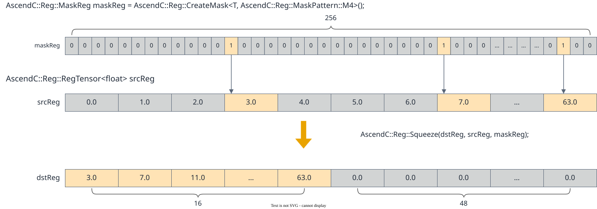

# vf.squeeze

<!-- md-trans-meta sourceCommit=7d0ab31d84c294a0a8327f597d2bdee012acb22d translatedAt=2026-10-26T13:39:16.617Z pushedAt=2026-10-28T11:57:28.930Z nl=2 -->

## Applicable Products

<!-- npu="950" id1 -->
- Ascend 950PR&950DT products: Supported
<!-- end id1 -->
<!-- npu="A3" id2 -->
- Atlas A3 products: Not supported
<!-- end id2 -->
<!-- npu="910b" id3 -->
- Atlas A2 products: Not supported
<!-- end id3 -->

## Description

Copies the valid elements selected by preg from the input src to dst in sequence. The valid elements are arranged contiguously from low to high in dst, and the remaining positions are set to 0, as shown in the following figure.

$$dstReg_j = srcReg_{idx_j}, \quad j \in \{0, 1, \ldots, count\_active - 1\}$$

**Figure 1** vf.squeeze calculation diagram



In particular, when gather_mode is set to "pypto_pro.language.SqueezeMode.STORE_REG", vf.squeeze stores the total number of bytes of the valid elements into the AR special register. In this case, when used together with the continuous unaligned store-out API (which does not require an explicit offset), vf.store_unalign automatically reads the number of valid bytes from the AR register as the address offset.

## Prototype

```python
squeeze(src, preg, gather_mode: Optional[SqueezeMode] = None) -> dst
```

## Parameters

| Parameter | Input/Output | Description |
|---|---|---|
| src | Input | Source operand, [reg_tensor](../basic_data_structures/reg_tensor.md). Supported data types: DT_INT8, DT_UINT8, DT_INT16, DT_UINT16, DT_FP16, DT_INT32, DT_UINT32, DT_FP32. |
| preg | Input | [mask_reg](../basic_data_structures/mask_reg.md), specifying which elements participate in the compression. |
| gather_mode | Input | Optional. Collection mode: "NO_STORE_REG" (not stored in the AR register, default) / "STORE_REG" (the total number of bytes of the valid elements is stored in the AR register).<br>- When gather_mode is set to "STORE_REG", due to hardware constraints, the vf.store_unalign instruction and the vf.squeeze instruction must be used alternately.<br>- When gather_mode is set to "NO_STORE_REG", the AR register is not involved, and vf.squeeze and vf.store_unalign are not required to alternate. |

## Constraints

None

## Return Value

Returns the destination [reg_tensor](../basic_data_structures/reg_tensor.md) dst, which stores the compressed elements. The supported data types are the same as those described for src.

## Examples

```python
import os
import pypto_pro.language as pl
import torch
import torch_npu

@pl.vector_function
def example_vf(src_tile, dst_tile):
    preg = vf.create_mask(pattern=pl.MaskPattern.ALL, dtype=pl.DT_UINT32)
    reg_src = vf.load_align(src_tile, 0)
    reg_out = vf.squeeze(reg_src, preg, gather_mode=pl.SqueezeMode.NO_STORE_REG)
    vf.store_align(dst_tile, reg_out, preg)

@pl.jit()
def example_kernel(
    a: pl.Tensor[[pl.DYNAMIC, pl.DYNAMIC], pl.DT_UINT32],
    out: pl.Tensor[[pl.DYNAMIC, pl.DYNAMIC], pl.DT_UINT32],
):
    tf = pl.TileType(shape=[1, 64], dtype=pl.DT_UINT32, target_memory=pl.MemorySpace.Vec)
    in_a_grp = pl.make_tile_group(type=tf, addrs=0x0, mutex_ids=[0])
    in_a = in_a_grp.current()
    t_out_grp = pl.make_tile_group(type=tf, addrs=0x100, mutex_ids=[1])
    t_out = t_out_grp.current()
    with pl.section_vector():
        pl.load(in_a, a, [0, 0])
        example_vf(in_a, t_out)
        pl.store(out, t_out, [0, 0])

def test_example():
    device_id = int(os.environ.get("TILE_FWK_DEVICE_ID", 0))
    device = f"npu:{device_id}"
    core_nums = 1
    torch.npu.set_device(device)
    a = torch.randint(0, 100, [1, 64], device=device, dtype=torch.int32)
    out = torch.empty([1, 64], device=device, dtype=torch.int32)
    example_kernel[None, core_nums](a, out)
    torch.npu.synchronize()
    assert out.shape == torch.Size([1, 64])

if __name__ == "__main__":
    test_example()
    print("PASSED")
```
