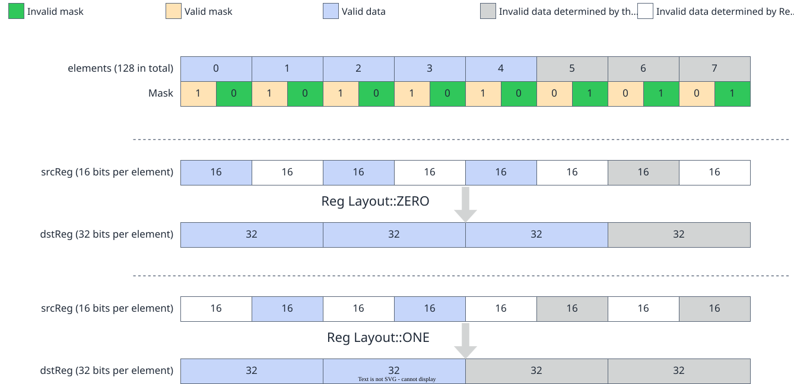

# vf.exp_sub

<!-- md-trans-meta sourceCommit=7d0ab31d84c294a0a8327f597d2bdee012acb22d translatedAt=2026-10-26T13:41:08.675Z pushedAt=2026-10-28T11:57:28.944Z nl=2 -->

## Applicable Products

<!-- npu="950" id1 -->
- Ascend 950PR&950DT products: Supported
<!-- end id1 -->
<!-- npu="A3" id2 -->
- Atlas A3 products: Not supported
<!-- end id2 -->
<!-- npu="910b" id3 -->
- Atlas A2 products: Not supported
<!-- end id3 -->

## Description

Subtracts src1 from src0, uses the difference as the exponent of e, and writes the result to dst according to preg. The formula is as follows:

When the src data type is DT_FP32:

$$
dst_i = e^{(src0_i - src1_i)}
$$

When the src data type is DT_FP16:

$$
dst_i = e^{(cast\_f16\_to\_f32(src0_i) - cast\_f16\_to\_f32(src1_i))}
$$

## Prototype

```python
exp_sub(src0, src1, preg, layout: Optional[CastLayout] = None, dtype: Optional[DType] = None) -> dst
```

## Parameters

| Parameter | Input/Output | Description |
|---|---|---|
| src0 | Input | Source operand 0, [reg_tensor](../basic_data_structures/reg_tensor.md). For supported data types, see [Constraints](#constraints). |
| src1 | Input | Source operand 1, [reg_tensor](../basic_data_structures/reg_tensor.md). For supported data types, see [Constraints](#constraints). |
| preg | Input | [mask_reg](../basic_data_structures/mask_reg.md). |
| layout | Input | Optional. Determines the half in which the result is placed: pypto_pro.language.CastLayout.ZERO (even half, default) or pypto_pro.language.CastLayout.ONE (odd half).<br>- When src is of the DT_FP16 type, both pypto_pro.language.CastLayout.ZERO and pypto_pro.language.CastLayout.ONE are supported.<br>- When src is of the DT_FP32 type, this setting does not take effect. |
| dtype | Input | Optional. Target reg_tensor data type. When src is DT_FP16, setting dtype=pypto_pro.language.DT_FP32 promotes the source operand to DT_FP32 precision before computation, producing a DT_FP32 result. |

## Constraints

- Data type constraints:

  | src0 | src1 | dst |
  |---|---|---|
  | DT_FP16 | DT_FP16 | DT_FP32 |
  | DT_FP32 | DT_FP32 | DT_FP32 |

- When the source operand data type is DT_FP32, full register overlap is supported. When the source operand data type is DT_FP16, only source operand register overlap is supported.

- When the source operand type is DT_FP16, the Vector compute unit processes at most 64 elements per computation. The valid mask bits are determined by the input data type, with only even bits being valid, totaling 128 valid bits, as shown in the following figure:

  **Figure 1** High-precision diagram of exp_sub

  

## Return Value

Returns the dst destination operand, [reg_tensor](../basic_data_structures/reg_tensor.md). For supported data types, see [Constraints](#constraints).

## Examples

### DT_FP32 Source → DT_FP32 Result

```python
import os
import pypto_pro.language as pl
import torch
import torch_npu

@pl.vector_function
def example_vf(src_a, src_b, dst_tile):
    preg = vf.create_mask(pattern=pl.MaskPattern.ALL, dtype=pl.DT_FP32)
    reg_a = vf.load_align(src_a, 0)
    reg_b = vf.load_align(src_b, 0)
    reg_out = vf.exp_sub(reg_a, reg_b, preg)
    vf.store_align(dst_tile, reg_out, preg)

@pl.jit()
def example_kernel(
    a: pl.Tensor[[pl.DYNAMIC, pl.DYNAMIC], pl.DT_FP32],
    b: pl.Tensor[[pl.DYNAMIC, pl.DYNAMIC], pl.DT_FP32],
    out: pl.Tensor[[pl.DYNAMIC, pl.DYNAMIC], pl.DT_FP32],
):
    tf = pl.TileType(shape=[1, 64], dtype=pl.DT_FP32, target_memory=pl.MemorySpace.Vec)
    in_a_grp = pl.make_tile_group(type=tf, addrs=0x0, mutex_ids=[0])
    in_a = in_a_grp.current()
    in_b_grp = pl.make_tile_group(type=tf, addrs=0x100, mutex_ids=[1])
    in_b = in_b_grp.current()
    t_out_grp = pl.make_tile_group(type=tf, addrs=0x200, mutex_ids=[2])
    t_out = t_out_grp.current()
    with pl.section_vector():
        pl.load(in_a, a, [0, 0])
        pl.load(in_b, b, [0, 0])
        example_vf(in_a, in_b, t_out)
        pl.store(out, t_out, [0, 0])

def test_example():
    device_id = int(os.environ.get("TILE_FWK_DEVICE_ID", 0))
    device = f"npu:{device_id}"
    core_nums = 1
    torch.npu.set_device(device)
    a = torch.randn([1, 64], device=device, dtype=torch.float32)
    b = torch.randn([1, 64], device=device, dtype=torch.float32)
    out = torch.empty([1, 64], device=device, dtype=torch.float32)
    example_kernel[None, core_nums](a, b, out)
    torch.npu.synchronize()
    torch.testing.assert_close(out, torch.exp(a - b), rtol=1e-5, atol=1e-5)

if __name__ == "__main__":
    test_example()
    print("PASSED")
```

### DT_FP16 Source → DT_FP32 Result

When the source operand is DT_FP16 and the destination operand is DT_FP32, the 128 DT_FP16 elements in the register are grouped into adjacent pairs. The layout determines the position of the element in each group that participates in the computation: pypto_pro.language.CastLayout.ZERO (default) selects the even position (the 0th element), and pypto_pro.language.CastLayout.ONE selects the odd position (the 1st element). The final output consists of 64 DT_FP32 elements. The following example uses the default layout=ZERO, which selects the even-position element in each group for the computation.

```python
import os
import pypto_pro.language as pl
import torch
import torch_npu

@pl.vector_function
def example_vf_half_to_float(src_a, src_b, dst_tile):
    preg = vf.create_mask(pattern=pl.MaskPattern.ALL, dtype=pl.DT_FP16)
    reg_a = vf.load_align(src_a, 0)
    reg_b = vf.load_align(src_b, 0)
    reg_out = vf.exp_sub(reg_a, reg_b, preg, dtype=pl.DT_FP32)
    vf.store_align(dst_tile, reg_out, preg)

@pl.jit()
def example_kernel_half_to_float(
    a: pl.Tensor[[pl.DYNAMIC, pl.DYNAMIC], pl.DT_FP16],
    b: pl.Tensor[[pl.DYNAMIC, pl.DYNAMIC], pl.DT_FP16],
    out: pl.Tensor[[pl.DYNAMIC, pl.DYNAMIC], pl.DT_FP32],
):
    tf_in = pl.TileType(shape=[1, 128], dtype=pl.DT_FP16, target_memory=pl.MemorySpace.Vec)
    tf_out = pl.TileType(shape=[1, 64], dtype=pl.DT_FP32, target_memory=pl.MemorySpace.Vec)
    in_a_grp = pl.make_tile_group(type=tf_in, addrs=0x0, mutex_ids=[0])
    in_a = in_a_grp.current()
    in_b_grp = pl.make_tile_group(type=tf_in, addrs=0x100, mutex_ids=[1])
    in_b = in_b_grp.current()
    t_out_grp = pl.make_tile_group(type=tf_out, addrs=0x200, mutex_ids=[2])
    t_out = t_out_grp.current()
    with pl.section_vector():
        pl.load(in_a, a, [0, 0])
        pl.load(in_b, b, [0, 0])
        example_vf_half_to_float(in_a, in_b, t_out)
        pl.store(out, t_out, [0, 0])

def test_example_half_to_float():
    device_id = int(os.environ.get("TILE_FWK_DEVICE_ID", 0))
    device = f"npu:{device_id}"
    core_nums = 1
    torch.npu.set_device(device)
    a = torch.randn([1, 128], device=device, dtype=torch.float16)
    b = torch.randn([1, 128], device=device, dtype=torch.float16)
    out = torch.empty([1, 64], device=device, dtype=torch.float32)
    example_kernel_half_to_float[None, core_nums](a, b, out)
    torch.npu.synchronize()
    torch.testing.assert_close(out, torch.exp(a[:, 0::2].float() - b[:, 0::2].float()), rtol=1e-3, atol=1e-3)

if __name__ == "__main__":
    test_example_half_to_float()
    print("PASSED")
```
