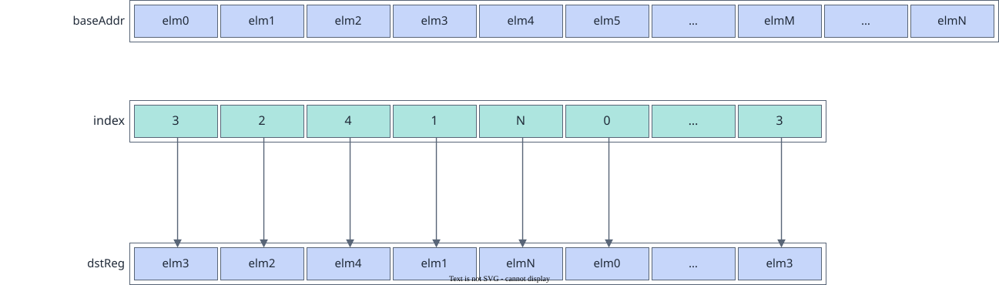
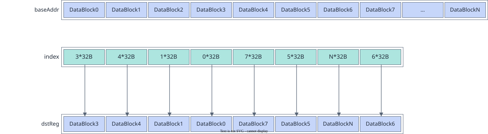

# vf.gather

<!-- md-trans-meta sourceCommit=7d0ab31d84c294a0a8327f597d2bdee012acb22d translatedAt=2026-10-26T13:45:03.956Z pushedAt=2026-10-28T11:57:28.972Z nl=2 -->

## Applicable Products

<!-- npu="950" id1 -->
- Ascend 950PR&950DT products: Supported
<!-- end id1 -->
<!-- npu="A3" id2 -->
- Atlas A3 products: Not supported
<!-- end id2 -->
<!-- npu="910b" id3 -->
- Atlas A2 products: Not supported
<!-- end id3 -->

## Description

This instruction gathers data from the source operand into the destination operand dst based on the index value index. The backend automatically dispatches to one of two forms based on the src parameter type:

**Tile→reg form** (src is a Tile): Gathers data from the Tile into a reg_tensor by index. The gather granularity is selected through data_copy_mode:

- pypto_pro.language.DataCopyMode.NORM (default): NORM mode, gathers by element, with index in units of elements. The gather process is shown in the following figure:

  **Figure 1** gather NORM mode description

  

- pypto_pro.language.DataCopyMode.DATA_BLOCK_LOAD: DATA_BLOCK_LOAD mode, gathers by DataBlock (32B), with index in units of bytes and requiring 32B alignment. The gather process is shown in the following figure:

  **Figure 2** gather DATA_BLOCK_LOAD mode description

  

**reg→reg form** (src is a reg_tensor): reg_tensor to reg_tensor gathers by element, and no mask is required.

> **Difference between the two forms**: The Tile→reg form reads data from a Tile. For 8-bit data types (DT_INT8 and DT_UINT8), the source data is zero-extended to 16 bits. The reg→reg form reads data from a reg_tensor and keeps the source data type unchanged.

## Prototype

```python
gather(src, index, preg, data_copy_mode: Optional[DataCopyMode] = None) -> dst
```

## Parameters

| Parameter | Input/Output | Description |
|---|---|---|
| src | Input | Source operand, which can be a Tile (Tile→reg form, with the base address aligned to 32 bytes) or a [reg_tensor](../basic_data_structures/reg_tensor.md) (reg→reg form). For supported data types, see [Constraints](#constraints).<br>- In NORM mode, when src is a 16-bit data type and index is DT_UINT32, each gathered 16-bit element occupies 32 bits of space (the lower 16 bits hold the data and the upper 16 bits are zero-padded). The number of valid elements in the register is the number of indices (VL/4), rather than VL/2 as in the scenario where index is DT_UINT16. When storing, use pypto_pro.language.StoreDist.NORM_B16 to write at 16-bit granularity. In the output, even positions hold valid data and odd positions are zero. This feature applies to scenarios where the index data is naturally 32 bits wide.<br>- In DATA_BLOCK_LOAD mode and the reg→reg form, the source operand and the destination operand must have the same data type. |
| index | Input | Index value, a [reg_tensor](../basic_data_structures/reg_tensor.md). For supported data types, see [Constraints](#constraints).<br>- In Tile→reg NORM mode, it is the position of each element in dst relative to src, in elements. For 8-bit data types (DT_INT8 and DT_UINT8), the source data is zero-extended to 16 bits. For 16-bit source data types (DT_INT16, DT_UINT16, DT_FP16, and DT_BF16), the index supports DT_UINT16 and DT_UINT32.<br>- In Tile→reg DATA_BLOCK_LOAD mode, it is the position of each DataBlock relative to src, and it must be 32B-aligned, that is, one index value corresponds to one DataBlock.<br>- In the reg→reg form, it is the position of each element in src, in elements, and the data type bit width must be consistent with src.<br>The data corresponding to the index value must be within the valid address range of the Tile (Tile→reg form). If the index value exceeds the maximum number of data elements that can be stored in the current reg_tensor, the index value is updated to i % (VL / sizeof(T)), where VL is 256 bytes (reg→reg form). Values in index can be repeated. |
| preg | Input | Optional, a [mask_reg](../basic_data_structures/mask_reg.md). The mask function is **supported only in the Tile→reg form** and is not supported in the reg→reg form. |
| data_copy_mode | Input | Optional keyword argument that specifies the gather granularity: pypto_pro.language.DataCopyMode.NORM (default, by element) or pypto_pro.language.DataCopyMode.DATA_BLOCK_LOAD (by 32B DataBlock). **Supported only in the Tile→reg form** and not supported in the reg→reg form. |

## Constraints

- Data type constraints:

  - **Tile→reg form, NORM mode (by element)**

    | dst | src | index |
    |---|---|---|
    | DT_INT16 | DT_INT8 | DT_UINT16 |
    | DT_INT16 | DT_INT16 | DT_UINT16 |
    | DT_UINT16 | DT_UINT8 | DT_UINT16 |
    | DT_UINT16 | DT_UINT16 | DT_UINT16 |
    | DT_FP16 | DT_FP16 | DT_UINT16 |
    | DT_BF16 | DT_BF16 | DT_UINT16 |
    | DT_INT32 | DT_INT32 | DT_UINT32 |
    | DT_UINT32 | DT_UINT32 | DT_UINT32 |
    | DT_FP32 | DT_FP32 | DT_UINT32 |
    | DT_INT64 | DT_INT64 | DT_UINT32 |
    | DT_INT64 | DT_INT64 | DT_UINT64 |
    | DT_UINT64 | DT_UINT64 | DT_UINT32 |
    | DT_UINT64 | DT_UINT64 | DT_UINT64 |
    | DT_INT16 | DT_INT16 | DT_UINT32 |
    | DT_UINT16 | DT_UINT16 | DT_UINT32 |
    | DT_FP16 | DT_FP16 | DT_UINT32 |
    | DT_BF16 | DT_BF16 | DT_UINT32 |

  - **Tile→reg form, DATA_BLOCK_LOAD mode (by 32B DataBlock)**

    Supported data types: DT_INT8, DT_UINT8, DT_INT16, DT_UINT16, DT_FP16, DT_BF16, DT_INT32, DT_UINT32, DT_FP32, DT_INT64, and DT_UINT64.
    Supported index data type: DT_UINT32.

  - **reg→reg form**

    Supported data types are: 8-bit width (DT_INT8, DT_UINT8), 16-bit width (DT_INT16, DT_UINT16, DT_FP16, DT_BF16), and 32-bit width (DT_INT32, DT_UINT32, DT_FP32).
    Supported data types for index values are: DT_UINT8, DT_UINT16, and DT_UINT32.

## Return Value

Returns the dst destination operand, [reg_tensor](../basic_data_structures/reg_tensor.md). For supported data types, see [Constraints](#constraints). In NORM mode, when dst is a 16-bit width data type (DT_INT16, DT_UINT16, DT_FP16, DT_BF16) and src is an 8-bit width data type (DT_INT8, DT_UINT8), the lower 8 bits of the destination operand are the same as those of the source operand, and the upper 8 bits are automatically padded with 0.

## Examples

### Tile→reg Form (DT_FP32 Data NORM Mode)

```python
import os
import pypto_pro.language as pl
import torch
import torch_npu

@pl.vector_function
def example_vf(src_tile, index_tile, dst_tile):
    preg = vf.create_mask(pattern=pl.MaskPattern.ALL, dtype=pl.DT_FP32)
    index_reg = vf.load_align(index_tile, 0)
    dst_reg = vf.gather(src_tile, index_reg, preg)
    vf.store_align(dst_tile, dst_reg, preg)

@pl.jit()
def example_kernel(
    a: pl.Tensor[[pl.DYNAMIC, pl.DYNAMIC], pl.DT_FP32],
    idx: pl.Tensor[[pl.DYNAMIC, pl.DYNAMIC], pl.DT_UINT32],
    out: pl.Tensor[[pl.DYNAMIC, pl.DYNAMIC], pl.DT_FP32],
):
    tf = pl.TileType(shape=[1, 64], dtype=pl.DT_FP32, target_memory=pl.MemorySpace.Vec)
    tf_idx = pl.TileType(shape=[1, 64], dtype=pl.DT_UINT32, target_memory=pl.MemorySpace.Vec)
    in_a_grp = pl.make_tile_group(type=tf, addrs=0x0, mutex_ids=[0])
    in_a = in_a_grp.current()
    in_idx_grp = pl.make_tile_group(type=tf_idx, addrs=0x100, mutex_ids=[1])
    in_idx = in_idx_grp.current()
    t_out_grp = pl.make_tile_group(type=tf, addrs=0x200, mutex_ids=[2])
    t_out = t_out_grp.current()
    with pl.section_vector():
        pl.load(in_a, a, [0, 0])
        pl.load(in_idx, idx, [0, 0])
        example_vf(in_a, in_idx, t_out)
        pl.store(out, t_out, [0, 0])

def test_example():
    device_id = int(os.environ.get("TILE_FWK_DEVICE_ID", 0))
    device = f"npu:{device_id}"
    core_nums = 1
    torch.npu.set_device(device)
    a = torch.randn([1, 64], device=device, dtype=torch.float32)
    idx = torch.arange(64, device=device, dtype=torch.int32).reshape([1, 64])
    out = torch.empty([1, 64], device=device, dtype=torch.float32)
    example_kernel[None, core_nums](a, idx, out)
    torch.npu.synchronize()
    torch.testing.assert_close(out, a, rtol=1e-5, atol=1e-5)

if __name__ == "__main__":
    test_example()
    print("PASSED")
```

### Tile→reg Form (DT_FP32 Data DATA_BLOCK_LOAD Mode)

```python
import os
import pypto_pro.language as pl
import torch
import torch_npu

@pl.vector_function
def example_vf_datablock(src_tile, dst_tile):
    preg = vf.create_mask(pattern=pl.MaskPattern.ALL, dtype=pl.DT_FP32)
    reg_idx = vf.arange(0, dtype=pl.DT_UINT32)
    preg_u = vf.create_mask(pattern=pl.MaskPattern.ALL, dtype=pl.DT_UINT32)
    reg_idx_b = vf.shift_left(reg_idx, 5, preg_u)
    dst_reg = vf.gather(src_tile, reg_idx_b, preg,
                        data_copy_mode=pl.DataCopyMode.DATA_BLOCK_LOAD)
    vf.store_align(dst_tile, dst_reg, preg)

@pl.jit()
def example_kernel(
    a: pl.Tensor[[pl.DYNAMIC, pl.DYNAMIC], pl.DT_FP32],
    out: pl.Tensor[[pl.DYNAMIC, pl.DYNAMIC], pl.DT_FP32],
):
    tf = pl.TileType(shape=[1, 64], dtype=pl.DT_FP32, target_memory=pl.MemorySpace.Vec)
    in_a_grp = pl.make_tile_group(type=tf, addrs=0x0, mutex_ids=[0])
    in_a = in_a_grp.current()
    t_out_grp = pl.make_tile_group(type=tf, addrs=0x100, mutex_ids=[1])
    t_out = t_out_grp.current()
    with pl.section_vector():
        pl.load(in_a, a, [0, 0])
        example_vf_datablock(in_a, t_out)
        pl.store(out, t_out, [0, 0])

def test_example_2():
    device_id = int(os.environ.get("TILE_FWK_DEVICE_ID", 0))
    device = f"npu:{device_id}"
    core_nums = 1
    torch.npu.set_device(device)
    a = torch.randn([1, 64], device=device, dtype=torch.float32)
    out = torch.empty([1, 64], device=device, dtype=torch.float32)
    example_kernel[None, core_nums](a, out)
    torch.npu.synchronize()
    torch.testing.assert_close(out, a, rtol=1e-5, atol=1e-5)

if __name__ == "__main__":
    test_example_2()
    print("PASSED")
```

### Tile→reg Form (DT_INT8 Data, NORM Mode)

```python
import os
import pypto_pro.language as pl
import torch
import torch_npu

@pl.vector_function
def example_vf_int8(src_tile, index_tile, dst_tile):
    preg = vf.create_mask(pattern=pl.MaskPattern.ALL, dtype=pl.DT_INT16)
    index_reg = vf.load_align(index_tile, 0, dtype=pl.DT_UINT16)
    dst_reg = vf.gather(src_tile, index_reg, preg)
    vf.store_align(dst_tile, dst_reg, preg, dist=pl.StoreDist.NORM_B16)

@pl.jit()
def example_kernel_int8(
    a: pl.Tensor[[pl.DYNAMIC, pl.DYNAMIC], pl.DT_INT8],
    idx: pl.Tensor[[pl.DYNAMIC, pl.DYNAMIC], pl.DT_UINT16],
    out: pl.Tensor[[pl.DYNAMIC, pl.DYNAMIC], pl.DT_INT16],
):
    tf = pl.TileType(shape=[1, 256], dtype=pl.DT_INT8, target_memory=pl.MemorySpace.Vec)
    tf_idx = pl.TileType(shape=[1, 128], dtype=pl.DT_UINT16, target_memory=pl.MemorySpace.Vec)
    tf_out = pl.TileType(shape=[1, 128], dtype=pl.DT_INT16, target_memory=pl.MemorySpace.Vec)
    in_a_grp = pl.make_tile_group(type=tf, addrs=0x0, mutex_ids=[0])
    in_a = in_a_grp.current()
    in_idx_grp = pl.make_tile_group(type=tf_idx, addrs=0x100, mutex_ids=[1])
    in_idx = in_idx_grp.current()
    t_out_grp = pl.make_tile_group(type=tf_out, addrs=0x200, mutex_ids=[2])
    t_out = t_out_grp.current()
    with pl.section_vector():
        pl.load(in_a, a, [0, 0])
        pl.load(in_idx, idx, [0, 0])
        example_vf_int8(in_a, in_idx, t_out)
        pl.store(out, t_out, [0, 0])

def test_example_int8():
    device_id = int(os.environ.get("TILE_FWK_DEVICE_ID", 0))
    device = f"npu:{device_id}"
    core_nums = 1
    torch.npu.set_device(device)
    a = torch.randint(-128, 127, [1, 256], device=device, dtype=torch.int8)
    idx = torch.arange(128, device=device, dtype=torch.int32).reshape([1, 128]).to(torch.uint16)
    out = torch.empty([1, 128], device=device, dtype=torch.int16)
    example_kernel_int8[None, core_nums](a, idx, out)
    torch.npu.synchronize()
    expected = a[:, :128].to(torch.uint8).to(torch.int16)
    torch.testing.assert_close(out, expected, rtol=0, atol=0)

if __name__ == "__main__":
    test_example_int8()
    print("PASSED")
```

### Tile→reg Form (DT_FP16 Data, NORM Mode)

```python
import os
import pypto_pro.language as pl
import torch
import torch_npu

@pl.vector_function
def example_vf_fp16(src_tile, index_tile, dst_tile):
    preg = vf.create_mask(pattern=pl.MaskPattern.ALL, dtype=pl.DT_FP16)
    index_reg = vf.load_align(index_tile, 0, dtype=pl.DT_UINT16)
    dst_reg = vf.gather(src_tile, index_reg, preg)
    vf.store_align(dst_tile, dst_reg, preg)

@pl.jit()
def example_kernel_fp16(
    a: pl.Tensor[[pl.DYNAMIC, pl.DYNAMIC], pl.DT_FP16],
    idx: pl.Tensor[[pl.DYNAMIC, pl.DYNAMIC], pl.DT_UINT16],
    out: pl.Tensor[[pl.DYNAMIC, pl.DYNAMIC], pl.DT_FP16],
):
    tf = pl.TileType(shape=[1, 128], dtype=pl.DT_FP16, target_memory=pl.MemorySpace.Vec)
    tf_idx = pl.TileType(shape=[1, 128], dtype=pl.DT_UINT16, target_memory=pl.MemorySpace.Vec)
    in_a_grp = pl.make_tile_group(type=tf, addrs=0x0, mutex_ids=[0])
    in_a = in_a_grp.current()
    in_idx_grp = pl.make_tile_group(type=tf_idx, addrs=0x100, mutex_ids=[1])
    in_idx = in_idx_grp.current()
    t_out_grp = pl.make_tile_group(type=tf, addrs=0x200, mutex_ids=[2])
    t_out = t_out_grp.current()
    with pl.section_vector():
        pl.load(in_a, a, [0, 0])
        pl.load(in_idx, idx, [0, 0])
        example_vf_fp16(in_a, in_idx, t_out)
        pl.store(out, t_out, [0, 0])

def test_example_fp16():
    device_id = int(os.environ.get("TILE_FWK_DEVICE_ID", 0))
    device = f"npu:{device_id}"
    core_nums = 1
    torch.npu.set_device(device)
    a = torch.randn([1, 128], device=device, dtype=torch.float16)
    idx = torch.arange(128, device=device, dtype=torch.int32).reshape([1, 128]).to(torch.uint16)
    out = torch.empty([1, 128], device=device, dtype=torch.float16)
    example_kernel_fp16[None, core_nums](a, idx, out)
    torch.npu.synchronize()
    torch.testing.assert_close(out, a, rtol=1e-3, atol=1e-3)

if __name__ == "__main__":
    test_example_fp16()
    print("PASSED")
```

### Tile→reg Form (DT_INT8 Data, DATA_BLOCK_LOAD Mode)

```python
import os
import pypto_pro.language as pl
import torch
import torch_npu

@pl.vector_function
def example_vf_int8_datablock(src_tile, dst_tile):
    preg = vf.create_mask(pattern=pl.MaskPattern.ALL, dtype=pl.DT_INT8)
    preg_u32 = vf.create_mask(pattern=pl.MaskPattern.ALL, dtype=pl.DT_UINT32)
    reg_idx = vf.arange(0, dtype=pl.DT_UINT32)
    reg_idx_b = vf.shift_left(reg_idx, 5, preg_u32)
    dst_reg = vf.gather(src_tile, reg_idx_b, preg,
                        data_copy_mode=pl.DataCopyMode.DATA_BLOCK_LOAD)
    vf.store_align(dst_tile, dst_reg, preg)

@pl.jit()
def example_kernel_int8_db(
    a: pl.Tensor[[pl.DYNAMIC, pl.DYNAMIC], pl.DT_INT8],
    out: pl.Tensor[[pl.DYNAMIC, pl.DYNAMIC], pl.DT_INT8],
):
    tf = pl.TileType(shape=[1, 256], dtype=pl.DT_INT8, target_memory=pl.MemorySpace.Vec)
    in_a_grp = pl.make_tile_group(type=tf, addrs=0x0, mutex_ids=[0])
    in_a = in_a_grp.current()
    t_out_grp = pl.make_tile_group(type=tf, addrs=0x100, mutex_ids=[1])
    t_out = t_out_grp.current()
    with pl.section_vector():
        pl.load(in_a, a, [0, 0])
        example_vf_int8_datablock(in_a, t_out)
        pl.store(out, t_out, [0, 0])

def test_example_int8_db():
    device_id = int(os.environ.get("TILE_FWK_DEVICE_ID", 0))
    device = f"npu:{device_id}"
    core_nums = 1
    torch.npu.set_device(device)
    a = torch.randint(-128, 127, [1, 256], device=device, dtype=torch.int8)
    out = torch.empty([1, 256], device=device, dtype=torch.int8)
    example_kernel_int8_db[None, core_nums](a, out)
    torch.npu.synchronize()
    torch.testing.assert_close(out, a, rtol=0, atol=0)

if __name__ == "__main__":
    test_example_int8_db()
    print("PASSED")
```

### reg→reg Form

```python
import os
import pypto_pro.language as pl
import torch
import torch_npu

@pl.vector_function
def example_vf_gather_reg(src_tile, index_tile, dst_tile):
    preg = vf.create_mask(pattern=pl.MaskPattern.ALL, dtype=pl.DT_INT8)
    src_reg = vf.load_align(src_tile, 0)
    index_reg = vf.load_align(index_tile, 0, dtype=pl.DT_UINT8)
    dst_reg = vf.gather(src_reg, index_reg)
    vf.store_align(dst_tile, dst_reg, preg)

@pl.jit()
def example_kernel_gather_reg(
    a: pl.Tensor[[pl.DYNAMIC, pl.DYNAMIC], pl.DT_INT8],
    idx: pl.Tensor[[pl.DYNAMIC, pl.DYNAMIC], pl.DT_UINT8],
    out: pl.Tensor[[pl.DYNAMIC, pl.DYNAMIC], pl.DT_INT8],
):
    tf = pl.TileType(shape=[1, 256], dtype=pl.DT_INT8, target_memory=pl.MemorySpace.Vec)
    in_a_grp = pl.make_tile_group(type=tf, addrs=0x0, mutex_ids=[0])
    in_a = in_a_grp.current()
    in_idx_grp = pl.make_tile_group(type=tf, addrs=0x100, mutex_ids=[1])
    in_idx = in_idx_grp.current()
    t_out_grp = pl.make_tile_group(type=tf, addrs=0x200, mutex_ids=[2])
    t_out = t_out_grp.current()
    with pl.section_vector():
        pl.load(in_a, a, [0, 0])
        pl.load(in_idx, idx, [0, 0])
        example_vf_gather_reg(in_a, in_idx, t_out)
        pl.store(out, t_out, [0, 0])

def test_example_gather_reg():
    device_id = int(os.environ.get("TILE_FWK_DEVICE_ID", 0))
    device = f"npu:{device_id}"
    core_nums = 1
    torch.npu.set_device(device)
    a = torch.randint(-128, 127, [1, 256], device=device, dtype=torch.int8)
    idx = torch.arange(128, device=device, dtype=torch.int32).to(torch.uint8).reshape([1, 128])
    out = torch.empty([1, 128], device=device, dtype=torch.int8)
    example_kernel_gather_reg[None, core_nums](a, idx, out)
    torch.npu.synchronize()
    torch.testing.assert_close(out, a[:, :128], rtol=0, atol=0)

if __name__ == "__main__":
    test_example_gather_reg()
    print("PASSED")
```

### Tile→reg Form (DT_FP16 Data, NORM Mode, DT_UINT32 Index)

```python
import os
import pypto_pro.language as pl
import torch
import torch_npu

@pl.vector_function
def example_vf_fp16_bc(src_tile, index_tile, dst_tile):
    preg = vf.create_mask(pattern=pl.MaskPattern.ALL, dtype=pl.DT_FP16)
    index_reg = vf.load_align(index_tile, 0, dtype=pl.DT_UINT32)
    dst_reg = vf.gather(src_tile, index_reg, preg)
    vf.store_align(dst_tile, dst_reg, preg, dist=pl.StoreDist.NORM_B16)

@pl.jit()
def example_kernel_fp16_bc(
    a: pl.Tensor[[pl.DYNAMIC, pl.DYNAMIC], pl.DT_FP16],
    idx: pl.Tensor[[pl.DYNAMIC, pl.DYNAMIC], pl.DT_UINT32],
    out: pl.Tensor[[pl.DYNAMIC, pl.DYNAMIC], pl.DT_FP16],
):
    tf = pl.TileType(shape=[1, 128], dtype=pl.DT_FP16, target_memory=pl.MemorySpace.Vec)
    tf_idx = pl.TileType(shape=[1, 64], dtype=pl.DT_UINT32, target_memory=pl.MemorySpace.Vec)
    in_a_grp = pl.make_tile_group(type=tf, addrs=0x0, mutex_ids=[0])
    in_a = in_a_grp.current()
    in_idx_grp = pl.make_tile_group(type=tf_idx, addrs=0x100, mutex_ids=[1])
    in_idx = in_idx_grp.current()
    t_out_grp = pl.make_tile_group(type=tf, addrs=0x200, mutex_ids=[2])
    t_out = t_out_grp.current()
    with pl.section_vector():
        pl.load(in_a, a, [0, 0])
        pl.load(in_idx, idx, [0, 0])
        example_vf_fp16_bc(in_a, in_idx, t_out)
        pl.store(out, t_out, [0, 0])

def test_example_fp16_bc():
    device_id = int(os.environ.get("TILE_FWK_DEVICE_ID", 0))
    device = f"npu:{device_id}"
    core_nums = 1
    torch.npu.set_device(device)
    a = torch.randn([1, 128], device=device, dtype=torch.float16)
    idx = torch.arange(64, device=device, dtype=torch.int32).reshape([1, 64])
    out = torch.empty([1, 128], device=device, dtype=torch.float16)
    example_kernel_fp16_bc[None, core_nums](a, idx, out)
    torch.npu.synchronize()
    expected = torch.zeros([1, 128], device=device, dtype=torch.float16)
    expected[:, ::2] = a[:, :64]
    torch.testing.assert_close(out, expected, rtol=1e-3, atol=1e-3)

if __name__ == "__main__":
    test_example_fp16_bc()
    print("PASSED")
```
