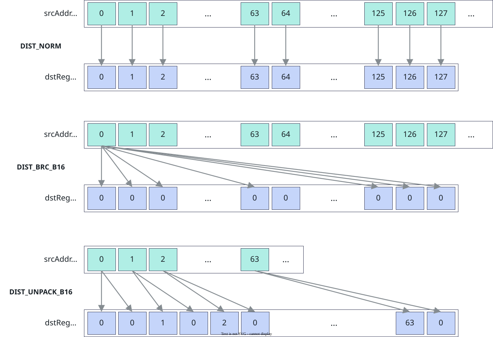
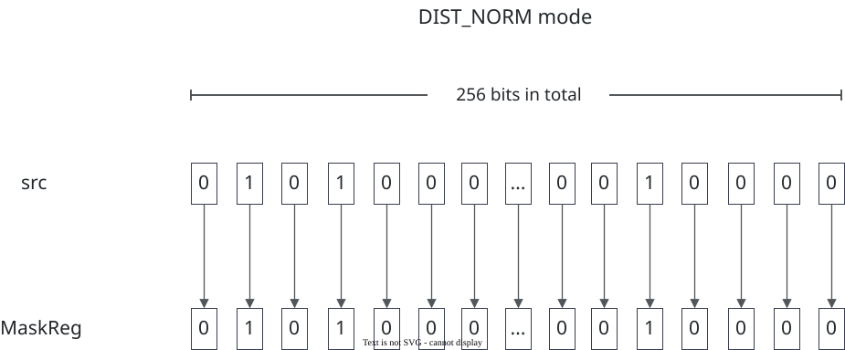
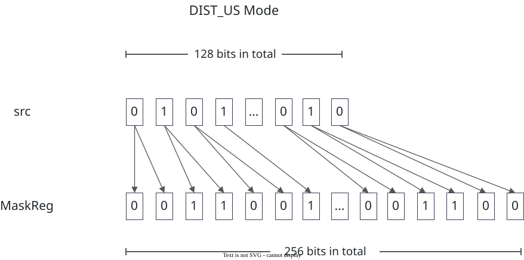
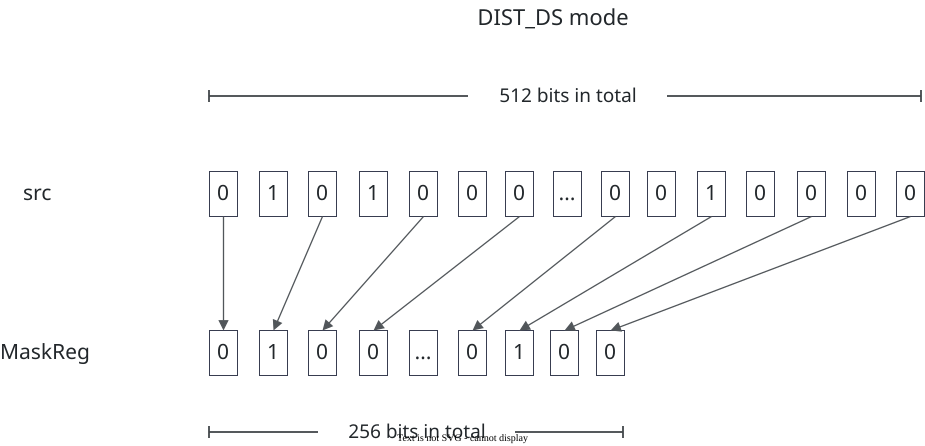

# vf.load_align

## Applicable Products

<!-- npu="950" id1 -->
- Ascend 950PR&950DT products: Supported
<!-- end id1 -->
<!-- npu="A3" id2 -->
- Atlas A3 products: Not supported
<!-- end id2 -->
<!-- npu="910b" id3 -->
- Atlas A2 products: Not supported
<!-- end id3 -->

## Description

Loads data from Tile into registers in an aligned manner. Two register types are supported: reg_tensor and mask_reg.

### reg_tensor mode

The reg_tensor mode supports both **contiguous movement** and **non-contiguous movement**. The **contiguous movement mode** is further divided into two modes: single-load mode and dual-load mode.

- **reg_tensor single-load mode**: The VL (register length) amount of data is read from Tile and loaded into one reg_tensor.
- **reg_tensor dual-load mode** (de-interleave): The 2*VL amount of data is read from Tile and loaded in an interleaved manner. The elements with even and odd indexes are separately moved into two reg_tensor (2 *VL) units.

During contiguous data movement, the dist keyword parameter can be used to configure the distribution mode of the moved data, enabling functions such as broadcast, upsampling, downsampling, and decompression. The following figure shows the contiguous movement mode. For details about the complete dist values and alignment constraints, see [Constraints](#constraints).

**Figure 1** vf.load_align contiguous aligned load distribution modes



In **non-contiguous movement mode**, the DataBlock movement mode is enabled through data_copy_mode=pypto_pro.language.DataCopyMode.DATA_BLOCK_COPY, enabling non-contiguous data movement from Tile to reg_tensor. A single instruction moves 8 DataBlocks at a time, and the block_stride parameter specifies the interval between adjacent DataBlocks. In this mode, the offset parameter is changed to the mask_reg that controls valid elements. The control rules are as follows:

- If any bit in the 32 bits corresponding to a DataBlock in the mask is 1, the data of the DataBlock is moved to dst.
- If all 32 bits corresponding to a DataBlock in the mask are 0, the data of the DataBlock is not read, and the corresponding position in dst is set to 0. No error is reported even if Tile is out of bounds.

### mask_reg mode

When the destination variable has been pre-declared as mask_reg via vf.create_mask, the backend automatically dispatches the mask_reg load path, moving data from the Tile to mask_reg.

mask_reg supports three distribution modes, configured via the dist keyword argument, enabling functions such as upsampling and downsampling:

- pypto_pro.language.LoadDist.NORM (normal mode, with the amount of data moved being VL/8)
- pypto_pro.language.LoadDist.US (upsampling mode, where each bit of data is moved twice, expanding VL/16 data to VL/8 before moving it)
- pypto_pro.language.LoadDist.DS (downsampling mode, where one out of every two bits is discarded, and VL/4 data is compressed into VL/8 before being moved)

The following figures illustrate the modes.

**Figure 2** pypto_pro.language.LoadDist.NORM mode



**Figure 3** pypto_pro.language.LoadDist.US mode



**Figure 4** pypto_pro.language.LoadDist.DS mode



## Prototype

```python
load_align(tile, offset=None, /, *, dist: Optional[LoadDist] = None, dtype: Optional[DType] = None, post_update: bool = False, block_stride=None, repeat_stride=None, data_copy_mode: Optional[DataCopyMode] = None) -> dst
```

## Parameters

| Parameter| Input/Output| Description|
|---|---|---|
| tile | Input| Source operand, the Tile address. The address must be 32-byte aligned. The supported data types are DT_INT8, DT_UINT8, DT_INT16, DT_UINT16, DT_FP16, DT_BF16, DT_INT32, DT_UINT32, DT_FP32, DT_INT64, DT_UINT64, DT_FP8E4M3FN, DT_FP8E5M2, DT_FP8E8M0, DT_HF8, DT_FP4E2M1, and DT_FP4E1M2.|
| offset | Input| (Optional) Address offset parameter. The movement API is automatically dispatched according to the passed-in type. In **contiguous movement mode** and **mask_reg mode**, the unit is the number of elements. In **non-contiguous movement mode**, the unit is mask.<br>- **Contiguous movement mode**:<br>&nbsp;&nbsp;- **Integer or [row, col] list/tuple**: An integer offset is converted into pointer arithmetic Tile + offset during code generation.<br>&nbsp;&nbsp;&nbsp;&nbsp;The linear offset of an [row, col] list/tuple is row * shape[1] + col, where row is in units of the number of Tile columns (that is, n in set_validshape[m, n]), and col is in units of elements. Both support expressions.<br>&nbsp;&nbsp;- **AddrReg** (created by vf.create_addr_reg): The actual address of the Tile to be moved is Tile plus the offset stored in AddrReg.<br>&nbsp;&nbsp;&nbsp;&nbsp;In each iteration, vf.create_addr_reg must be called first to set the offset, and then the movement instruction is called.<br>- **Non-contiguous movement mode** (DataBlock load mode, data_copy_mode=pypto_pro.language.DataCopyMode.DATA_BLOCK_COPY): In this mode, the offset position is changed to the mask_reg that controls valid elements.<br>&nbsp;&nbsp;A DataBlock is loaded in if any bit of its corresponding 32 bits in the mask is 1; if all bits are 0, it is not read and the corresponding destination position is set to 0.<br>&nbsp;&nbsp;- When post_update is set to True, the source address automatically increments by the repeat_stride step after the movement, so the address does not need to be manually updated in each iteration.<br>&nbsp;&nbsp;- When post_update is set to False, the address is not updated after the movement.<br>- **mask_reg mode** (pre-declared using vf.create_mask):<br>&nbsp;&nbsp;- **Integer**: This is valid only when post_update is set to True. When post_update is set to False, integer offsets are not supported.<br>&nbsp;&nbsp;- **AddrReg** (created via vf.create_addr_reg): The actual address of the Tile to be moved is srcAddr plus the offset stored in AddrReg.|
| dist | Input| (Optional) Data distribution mode, corresponding to the [LoadDist](../basic_data_structures/LoadDist.md) type. For details about the specific mode, see the tables in [Constraints](#constraints) based on whether the **reg_tensor single-load mode**, **reg_tensor dual-load mode**, or **mask_reg mode** is used.|
| dtype | Input| (Optional) Data type of the destination [reg_tensor](../basic_data_structures/reg_tensor.md) or [mask_reg](../basic_data_structures/mask_reg.md). This parameter needs to be specified when the data type of the source Tile is inconsistent with the expected register data type (for example, the source Tile is DT_FP32 but needs to be loaded into the register with bit reinterpretation as DT_UINT32). By default, it is inferred from the data type of the source Tile.|
| post_update | Input| Optional. If this parameter is set to True, the source address automatically increments after the movement. The default value is False. This is applicable for contiguous loading within a loop, avoiding manual offset updates.|
| block_stride | Input| Optional. This parameter is valid only when data_copy_mode is set to pypto_pro.language.DataCopyMode.DATA_BLOCK_COPY. In other modes, the parameter will be ignored. This parameter indicates the stride between adjacent DataBlocks, in units of DataBlock (32 bytes). When block_stride is set to 0, the first DataBlock is repeatedly moved.|
| repeat_stride | Input| Optional. This parameter is valid only when data_copy_mode is set to pypto_pro.language.DataCopyMode.DATA_BLOCK_COPY and post_update is set to True. This parameter indicates the address update stride during repeated movement, in units of DataBlock (32 bytes). The value must be 32-byte aligned. When post_update is set to True, the source address is automatically updated after the movement as follows: srcAddr += repeat_stride * 32B.|
| data_copy_mode | Input| (Optional) Data copy mode, corresponding to the [DataCopyMode](../basic_data_structures/DataCopyMode.md) type. This parameter is valid only in **reg_tensor** mode. The mask_reg mode does not support this parameter. Values: pypto_pro.language.DataCopyMode.NORM (default, common contiguous movement) or pypto_pro.language.DataCopyMode.DATA_BLOCK_COPY (non-contiguous movement in the unit of DataBlock (32 bytes)).|

## Constraints

- dist parameter description for each mode:

  Some modes provide both the general form and the explicit granularity form. The general form (such as BRC and US) does not carry a granularity suffix. The backend automatically selects the corresponding B8/B16/B32 variant based on the data type of the destination register. The explicit granularity form (such as BRC_B8 and US_B16) directly specifies the granularity. Both forms can be used. For details about the values, see [LoadDist Enumeration](../basic_data_structures/LoadDist.md).

  **Table 1** dist parameter description in reg_tensor single-load mode

  | dist Value| Description| Movement Alignment Constraint (Byte)|
  |---|---|---|
  | pypto_pro.language.LoadDist.NORM | Normal mode, moving an amount of data equal to VL.| 32 |
  | pypto_pro.language.LoadDist.BRC | Broadcast mode (general), automatically selecting the B8/B16/B32 granularity based on the data type.| 1/2/4 |
  | pypto_pro.language.LoadDist.BRC_B8 | A piece of 8-bit data is moved and broadcast to all element positions.| 1 |
  | pypto_pro.language.LoadDist.BRC_B16 | A piece of 16-bit data is moved and broadcast to all element positions.| 2 |
  | pypto_pro.language.LoadDist.BRC_B32 | A piece of 32-bit data is moved and broadcast to all element positions.| 4 |
  | pypto_pro.language.LoadDist.US | Upsampling mode (general). The B8/B16 granularity is automatically selected based on the data type.| min(32, VL/2) |
  | pypto_pro.language.LoadDist.US_B8 | 2× upsampling; the loaded data amount is VL/2; each input element is duplicated twice; the data type is an 8-bit-wide type.| min(32, VL/2) |
  | pypto_pro.language.LoadDist.US_B16 | 2× upsampling; the loaded data amount is VL/2; each input element is duplicated twice; the data type is a 16-bit-wide type.| min(32, VL/2) |
  | pypto_pro.language.LoadDist.DS | Downsampling mode (general). The B8/B16 granularity is automatically selected based on the data type.| 32 |
  | pypto_pro.language.LoadDist.DS_B8 | 2× downsampling; the loaded data amount is 2 × VL; every other data item is retained; the data type is an 8-bit-wide type.| 32 |
  | pypto_pro.language.LoadDist.DS_B16 | 2× downsampling; the loaded data amount is 2 × VL; every other data item is retained; the data type is a 16-bit-wide type.| 32 |
  | pypto_pro.language.LoadDist.UNPK | Decompression mode (general). The B8/B16/B32 granularity is automatically selected based on the data type.| min(32, VL/2) |
  | pypto_pro.language.LoadDist.UNPK_B8 | Decompression mode. A data amount of VL/2 is loaded as unsigned integer u8; after each element, one zero-valued element is appended, that is, the data is unpacked to VL.| min(32, VL/2) |
  | pypto_pro.language.LoadDist.UNPK_B16 | Decompression mode. A data amount of VL/2 is loaded as unsigned integer u16; after each element, one zero-valued element is appended, that is, the data is unpacked to VL.| min(32, VL/2) |
  | pypto_pro.language.LoadDist.UNPK_B32 | Decompression mode. A data amount of VL/2 is loaded as unsigned integer u32; after each element, one zero-valued element is appended, that is, the data is unpacked to VL.| min(32, VL/2) |
  | pypto_pro.language.LoadDist.UNPK4 | 4-element decompression mode. A data amount of VL/4 is loaded as u8; after each element, three zero-valued elements are appended, that is, the data is unpacked to VL.| min(32, VL/4) |
  | pypto_pro.language.LoadDist.BLK | A DataBlock (32 bytes) is read and sent to the VL.| 32 |
  | pypto_pro.language.LoadDist.E2B | Element-to-DataBlock expansion mode (general). The B16/B32 granularity is automatically selected based on the data type.| VL/16 or VL/8|
  | pypto_pro.language.LoadDist.E2B_B16 | (VL/DataBlock) 16-bit (B16) data items are loaded, and each element (16 bits) is broadcast into a single DataBlock (32 bytes).| VL/16 |
  | pypto_pro.language.LoadDist.E2B_B32 | (VL/DataBlock) 32-bit (B32) data items are loaded, and each element (32 bits) is broadcast into a single DataBlock (32 bytes).| VL/8 |

  **Table 2** dist parameter description in reg_tensor dual-load mode

  | dist Value| Description| Movement Alignment Constraint (Byte)|
  |---|---|---|
  | pypto_pro.language.LoadDist.DINTLV_B8 | Dual-load mode; element-based interleaved movement; even-indexed elements are stored into dst0, and odd-indexed elements are stored into dst1; the data type is an 8-bit-wide type.| 32 |
  | pypto_pro.language.LoadDist.DINTLV_B16 | Dual-load mode; element-based interleaved movement; even-indexed elements are stored into dst0, and odd-indexed elements are stored into dst1; the data type is a 16-bit-wide type.| 32 |
  | pypto_pro.language.LoadDist.DINTLV_B32 | Dual-load mode; element-based interleaved movement; even-indexed elements are stored into dst0, and odd-indexed elements are stored into dst1; the data type is a 32-bit-wide type.| 32 |

  **Table 3** dist parameter description in mask_reg mode

  | dist Value| Description| Movement Alignment Constraint (Byte)|
  |---|---|---|
  | pypto_pro.language.LoadDist.NORM | Normal mode, moving an amount of data equal to VL/8.| VL/8 |
  | pypto_pro.language.LoadDist.US | Upsampling mode, where each bit of data is moved twice, expanding VL/16 data to VL/8 before moving it.| VL/16 |
  | pypto_pro.language.LoadDist.DS | Downsampling mode, where data is discarded every other bit, compressing VL/4 data to VL/8 before moving it.| min(32, VL/4) |

## Return Value

Returns the destination operand dst, which is of type [reg_tensor](../basic_data_structures/reg_tensor.md) or [mask_reg](../basic_data_structures/mask_reg.md).

- When the destination is a reg_tensor, the **reg_tensor single-load mode** is used. The supported data types are the same as those of Tile.

- Even/odd destination operand in dst_even/dst_odd **reg_tensor dual-load mode**, which is of type [reg_tensor](../basic_data_structures/reg_tensor.md). The supported data types are the same as those of Tile.

- When the destination has been pre-declared as mask_reg via vf.create_mask, the mask_reg load path is automatically dispatched, and the data in the tile is moved to the mask_reg.

## Examples

### Normal Aligned Load

```python
import os
import pypto_pro.language as pl
import torch
import torch_npu

@pl.vector_function
def example_vf(src_tile, dst_tile):
    preg = vf.create_mask(pattern=pl.MaskPattern.ALL, dtype=pl.DT_FP32)
    src0 = vf.load_align(src_tile, 0)
    vf.store_align(dst_tile, src0, preg)
    reg = vf.load_align(src_tile, 0, post_update=True)
    vf.store_align(dst_tile, reg, preg)

@pl.jit()
def example_kernel(
    a: pl.Tensor[[pl.DYNAMIC, pl.DYNAMIC], pl.DT_FP32],
    out: pl.Tensor[[pl.DYNAMIC, pl.DYNAMIC], pl.DT_FP32],
):
    tf = pl.TileType(shape=[1, 64], dtype=pl.DT_FP32, target_memory=pl.MemorySpace.Vec)
    in_a_grp = pl.make_tile_group(type=tf, addrs=0x0, mutex_ids=[0])
    in_a = in_a_grp.current()
    t_out_grp = pl.make_tile_group(type=tf, addrs=0x100, mutex_ids=[1])
    t_out = t_out_grp.current()
    with pl.section_vector():
        pl.load(in_a, a, [0, 0])
        example_vf(in_a, t_out)
        pl.store(out, t_out, [0, 0])

def test_example():
    device_id = int(os.environ.get("TILE_FWK_DEVICE_ID", 0))
    device = f"npu:{device_id}"
    core_nums = 1
    torch.npu.set_device(device)
    a = torch.randn([1, 64], device=device, dtype=torch.float32)
    out = torch.empty([1, 64], device=device, dtype=torch.float32)
    example_kernel[None, core_nums](a, out)
    torch.npu.synchronize()
    torch.testing.assert_close(out, a, rtol=1e-5, atol=1e-5)

if __name__ == "__main__":
    test_example()
    print("PASSED")
```

### de-interleave Load Example

```python
import os
import pypto_pro.language as pl
import torch
import torch_npu

@pl.vector_function
def example_vf(src_tile, dst_tile):
    preg = vf.create_mask(pattern=pl.MaskPattern.ALL, dtype=pl.DT_FP32)
    dst_even, dst_odd = vf.load_align(src_tile, 0, dist=pl.LoadDist.DINTLV_B32)
    vf.store_align(dst_tile, dst_even, preg)

@pl.jit()
def example_kernel(
    a: pl.Tensor[[pl.DYNAMIC, pl.DYNAMIC], pl.DT_FP32],
    out: pl.Tensor[[pl.DYNAMIC, pl.DYNAMIC], pl.DT_FP32],
):
    tf = pl.TileType(shape=[1, 128], dtype=pl.DT_FP32, target_memory=pl.MemorySpace.Vec)
    in_a_grp = pl.make_tile_group(type=tf, addrs=0x0, mutex_ids=[0])
    in_a = in_a_grp.current()
    t_out_grp = pl.make_tile_group(type=tf, addrs=0x200, mutex_ids=[1])
    t_out = t_out_grp.current()
    with pl.section_vector():
        pl.load(in_a, a, [0, 0])
        example_vf(in_a, t_out)
        pl.store(out, t_out, [0, 0])

def test_example_2():
    device_id = int(os.environ.get("TILE_FWK_DEVICE_ID", 0))
    device = f"npu:{device_id}"
    core_nums = 1
    torch.npu.set_device(device)
    a = torch.randn([1, 128], device=device, dtype=torch.float32)
    out = torch.empty([1, 64], device=device, dtype=torch.float32)
    example_kernel[None, core_nums](a, out)
    torch.npu.synchronize()
    expected = a[:, ::2]
    torch.testing.assert_close(out, expected, rtol=1e-5, atol=1e-5)

if __name__ == "__main__":
    test_example_2()
    print("PASSED")
```

### List Offset Load Example

```python
import os
import pypto_pro.language as pl
import torch
import torch_npu

@pl.vector_function
def example_vf(src_tile, dst_tile):
    preg = vf.create_mask(pattern=pl.MaskPattern.ALL, dtype=pl.DT_FP32)
    reg = vf.load_align(src_tile, [1, 0])
    vf.store_align(dst_tile, reg, preg)

@pl.jit()
def example_kernel(
    a: pl.Tensor[[pl.DYNAMIC, pl.DYNAMIC], pl.DT_FP32],
    out: pl.Tensor[[pl.DYNAMIC, pl.DYNAMIC], pl.DT_FP32],
):
    tf = pl.TileType(shape=[2, 64], dtype=pl.DT_FP32, target_memory=pl.MemorySpace.Vec)
    in_a_grp = pl.make_tile_group(type=tf, addrs=0x0, mutex_ids=[0])
    in_a = in_a_grp.current()
    t_out_grp = pl.make_tile_group(type=tf, addrs=0x200, mutex_ids=[1])
    t_out = t_out_grp.current()
    with pl.section_vector():
        pl.load(in_a, a, [0, 0])
        example_vf(in_a, t_out)
        pl.store(out, t_out, [0, 0])

def test_example_5():
    device_id = int(os.environ.get("TILE_FWK_DEVICE_ID", 0))
    device = f"npu:{device_id}"
    core_nums = 1
    torch.npu.set_device(device)
    a = torch.randn([2, 64], device=device, dtype=torch.float32)
    out = torch.empty([1, 64], device=device, dtype=torch.float32)
    example_kernel[None, core_nums](a, out)
    torch.npu.synchronize()
    torch.testing.assert_close(out, a[1:2, :], rtol=1e-5, atol=1e-5)

if __name__ == "__main__":
    test_example_5()
    print("PASSED")
```

```python
import os
import pypto_pro.language as pl
import torch
import torch_npu

@pl.vector_function
def example_vf(src_tile, dst_tile, n_rows):
    preg = vf.create_mask(pattern=pl.MaskPattern.ALL, dtype=pl.DT_FP32)
    for i in pl.range(n_rows):
        reg = vf.load_align(src_tile, [i, 0])
        vf.store_align(dst_tile + i * 64, reg, preg)

@pl.jit()
def example_kernel(
    a: pl.Tensor[[pl.DYNAMIC, pl.DYNAMIC], pl.DT_FP32],
    out: pl.Tensor[[pl.DYNAMIC, pl.DYNAMIC], pl.DT_FP32],
):
    tf = pl.TileType(shape=[2, 64], dtype=pl.DT_FP32, target_memory=pl.MemorySpace.Vec)
    in_a_grp = pl.make_tile_group(type=tf, addrs=0x0, mutex_ids=[0])
    in_a = in_a_grp.current()
    t_out_grp = pl.make_tile_group(type=tf, addrs=0x200, mutex_ids=[1])
    t_out = t_out_grp.current()
    with pl.section_vector():
        pl.load(in_a, a, [0, 0])
        example_vf(in_a, t_out, 2)
        pl.store(out, t_out, [0, 0])

def test_example_6():
    device_id = int(os.environ.get("TILE_FWK_DEVICE_ID", 0))
    device = f"npu:{device_id}"
    core_nums = 1
    torch.npu.set_device(device)
    a = torch.randn([2, 64], device=device, dtype=torch.float32)
    out = torch.empty([2, 64], device=device, dtype=torch.float32)
    example_kernel[None, core_nums](a, out)
    torch.npu.synchronize()
    torch.testing.assert_close(out, a, rtol=1e-5, atol=1e-5)

if __name__ == "__main__":
    test_example_6()
    print("PASSED")
```

### AddrReg Offset Load Example

```python
import os
import pypto_pro.language as pl
import torch
import torch_npu

@pl.vector_function
def example_vf(src_tile, dst_tile):
    preg = vf.create_mask(pattern=pl.MaskPattern.ALL, dtype=pl.DT_FP32)
    one_repeat_size = 64
    repeat_times = 2
    for i in pl.range(0, repeat_times, 1):
        a_reg = vf.create_addr_reg(one_repeat_size, dtype=pl.DT_FP32)
        reg = vf.load_align(src_tile, a_reg)
        vf.store_align(dst_tile, reg, preg, a_reg)

@pl.jit()
def example_kernel(
    a: pl.Tensor[[pl.DYNAMIC, pl.DYNAMIC], pl.DT_FP32],
    out: pl.Tensor[[pl.DYNAMIC, pl.DYNAMIC], pl.DT_FP32],
):
    tf = pl.TileType(shape=[1, 128], dtype=pl.DT_FP32, target_memory=pl.MemorySpace.Vec)
    in_a_grp = pl.make_tile_group(type=tf, addrs=0x0, mutex_ids=[0])
    in_a = in_a_grp.current()
    t_out_grp = pl.make_tile_group(type=tf, addrs=0x200, mutex_ids=[1])
    t_out = t_out_grp.current()
    with pl.section_vector():
        pl.load(in_a, a, [0, 0])
        example_vf(in_a, t_out)
        pl.store(out, t_out, [0, 0])

def test_example_3():
    device_id = int(os.environ.get("TILE_FWK_DEVICE_ID", 0))
    device = f"npu:{device_id}"
    core_nums = 1
    torch.npu.set_device(device)
    a = torch.randn([1, 128], device=device, dtype=torch.float32)
    out = torch.empty([1, 128], device=device, dtype=torch.float32)
    example_kernel[None, core_nums](a, out)
    torch.npu.synchronize()
    torch.testing.assert_close(out, a, rtol=1e-5, atol=1e-5)

if __name__ == "__main__":
    test_example_3()
    print("PASSED")
```

### mask_reg Load Example

```python
import os
import pypto_pro.language as pl
import torch
import torch_npu

@pl.vector_function
def example_vf(src_tile, mask_buf_tile, dst_tile):
    preg = vf.create_mask(pattern=pl.MaskPattern.ALL, dtype=pl.DT_FP32)
    reg_a = vf.load_align(src_tile, 0)
    cmp_mask = vf.ge(reg_a, 0.0, preg)
    vf.store_align(mask_buf_tile, cmp_mask, dist=pl.StoreDist.PACK)
    vf.mem_bar(mode=pl.MemBarMode.VST_VLD)
    loaded_mask = vf.create_mask(pattern=pl.MaskPattern.ALL, dtype=pl.DT_FP32)
    loaded_mask = vf.load_align(mask_buf_tile, dist=pl.LoadDist.US)
    reg_dst = vf.abs(reg_a, loaded_mask)
    vf.store_align(dst_tile, reg_dst, preg)

@pl.jit()
def example_kernel(
    a: pl.Tensor[[pl.DYNAMIC, pl.DYNAMIC], pl.DT_FP32],
    out: pl.Tensor[[pl.DYNAMIC, pl.DYNAMIC], pl.DT_FP32],
):
    tf = pl.TileType(shape=[1, 64], dtype=pl.DT_FP32, target_memory=pl.MemorySpace.Vec)
    tu = pl.TileType(shape=[1, 64], dtype=pl.DT_UINT32, target_memory=pl.MemorySpace.Vec)
    in_a_grp = pl.make_tile_group(type=tf, addrs=0x0, mutex_ids=[0])
    in_a = in_a_grp.current()
    t_mask_grp = pl.make_tile_group(type=tu, addrs=0x100, mutex_ids=[1])
    t_mask = t_mask_grp.current()
    t_out_grp = pl.make_tile_group(type=tf, addrs=0x200, mutex_ids=[2])
    t_out = t_out_grp.current()
    with pl.section_vector():
        pl.load(in_a, a, [0, 0])
        example_vf(in_a, t_mask, t_out)
        pl.store(out, t_out, [0, 0])

def test_example_4():
    device_id = int(os.environ.get("TILE_FWK_DEVICE_ID", 0))
    device = f"npu:{device_id}"
    core_nums = 1
    torch.npu.set_device(device)
    a = torch.randn([1, 64], device=device, dtype=torch.float32)
    out = torch.empty([1, 64], device=device, dtype=torch.float32)
    example_kernel[None, core_nums](a, out)
    torch.npu.synchronize()
    expected = torch.where(a >= 0, torch.abs(a), torch.tensor(0.0, device=device))
    torch.testing.assert_close(out, expected, rtol=1e-5, atol=1e-5)

if __name__ == "__main__":
    test_example_4()
    print("PASSED")
```

### FP8 Data Load Example

```python
import os
import pypto_pro.language as pl
import torch
import torch_npu

@pl.vector_function
def example_vf_fp8(src_tile, dst_tile):
    preg = vf.create_mask(pattern=pl.MaskPattern.ALL, dtype=pl.DT_FP32)
    reg_f8 = vf.load_align(src_tile, 0, dtype=pl.DT_FP8E4M3FN)
    reg_f32 = vf.astype(reg_f8, preg, dtype=pl.DT_FP32)
    vf.store_align(dst_tile, reg_f32, preg)

@pl.jit()
def example_kernel_fp8(
    a: pl.Tensor[[pl.DYNAMIC, pl.DYNAMIC], pl.DT_FP8E4M3FN],
    out: pl.Tensor[[pl.DYNAMIC, pl.DYNAMIC], pl.DT_FP32],
):
    tf_in = pl.TileType(shape=[1, 256], dtype=pl.DT_FP8E4M3FN, target_memory=pl.MemorySpace.Vec)
    tf_out = pl.TileType(shape=[1, 64], dtype=pl.DT_FP32, target_memory=pl.MemorySpace.Vec)
    in_a_grp = pl.make_tile_group(type=tf_in, addrs=0x0, mutex_ids=[0])
    in_a = in_a_grp.current()
    t_out_grp = pl.make_tile_group(type=tf_out, addrs=0x100, mutex_ids=[1])
    t_out = t_out_grp.current()
    with pl.section_vector():
        pl.load(in_a, a, [0, 0])
        example_vf_fp8(in_a, t_out)
        pl.store(out, t_out, [0, 0])

def test_example_fp8():
    device_id = int(os.environ.get("TILE_FWK_DEVICE_ID", 0))
    device = f"npu:{device_id}"
    core_nums = 1
    torch.npu.set_device(device)
    a = torch.randn([1, 256], device=device, dtype=torch.float32).to(torch.float8_e4m3fn)
    out = torch.empty([1, 64], device=device, dtype=torch.float32)
    example_kernel_fp8[None, core_nums](a, out)
    torch.npu.synchronize()
    expected = a.to(torch.float32)
    torch.testing.assert_close(out, expected[:, ::4], rtol=1e-2, atol=1e-2)

if __name__ == "__main__":
    test_example_fp8()
    print("PASSED")
```

### HF8 Data Load and Storage

Load data in HF8 type and directly store it back to verify the movement path of the HF8 type. HF8 is an 8-bit storage type and requires a mask with a width of b8.

```python
import os
import pypto_pro.language as pl
import torch
import torch_npu

@pl.vector_function
def example_vf_hf8_store(src_tile, dst_tile):
    preg_b8 = vf.create_mask(pattern=pl.MaskPattern.ALL, dtype=pl.DT_HF8)
    reg_hf8 = vf.load_align(src_tile, 0, dtype=pl.DT_HF8)
    vf.store_align(dst_tile, reg_hf8, preg_b8)

@pl.jit()
def example_kernel_hf8_store(
    a: pl.Tensor[[pl.DYNAMIC, pl.DYNAMIC], pl.DT_HF8],
    out: pl.Tensor[[pl.DYNAMIC, pl.DYNAMIC], pl.DT_HF8],
):
    tf = pl.TileType(shape=[1, 256], dtype=pl.DT_HF8, target_memory=pl.MemorySpace.Vec)
    in_a_grp = pl.make_tile_group(type=tf, addrs=0x0, mutex_ids=[0])
    in_a = in_a_grp.current()
    t_out_grp = pl.make_tile_group(type=tf, addrs=0x100, mutex_ids=[1])
    t_out = t_out_grp.current()
    with pl.section_vector():
        pl.load(in_a, a, [0, 0])
        example_vf_hf8_store(in_a, t_out)
        pl.store(out, t_out, [0, 0])

def test_example_hf8_store():
    device_id = int(os.environ.get("TILE_FWK_DEVICE_ID", 0))
    device = f"npu:{device_id}"
    core_nums = 1
    torch.npu.set_device(device)
    a = torch.randint(0, 256, [1, 256], device=device, dtype=torch.uint8)
    out = torch.empty([1, 256], device=device, dtype=torch.uint8)
    example_kernel_hf8_store[None, core_nums](a, out)
    torch.npu.synchronize()
    torch.testing.assert_close(out, a, rtol=0, atol=0)

if __name__ == "__main__":
    test_example_hf8_store()
    print("PASSED")
```

### HF8 to FP32 (layout=TWO/THREE)

HF8 is an 8-bit type, and FP32 is a 32-bit type. So their bit-width ratio is 1:4. FP32→HF8 is a 4× narrowing conversion. The layout parameter controls which sub-area of the HF8 register the conversion result is stored in (CastLayout.ZERO/ONE/TWO/THREE corresponds to the 0th/1st/2nd/3rd byte position, respectively). HF8→FP32 is a 4× expansion conversion. The layout parameter controls which sub-area of the HF8 register the data is read from and extended to FP32.

The following example first generates HF8 data through an FP32→HF8 conversion (layout=ZERO), and then converts the HF8 data back to FP32 and stores it using layout=ZERO/ONE/TWO/THREE, demonstrating the usage of the four CastLayout values. layout=ZERO reads valid data, while other layouts read unwritten sub-areas, so the result is 0.

```python
import os
import pypto_pro.language as pl
import torch
import torch_npu

@pl.vector_function
def example_vf_hf8_to_fp32(src_tile, dst_tile):
    preg_b32 = vf.create_mask(pattern=pl.MaskPattern.ALL, dtype=pl.DT_FP32)
    reg_f32 = vf.load_align(src_tile, 0)
    reg_hf8 = vf.astype(reg_f32, preg_b32, dtype=pl.DT_HF8, layout=pl.CastLayout.ZERO,
                        round_mode=pl.VFRoundMode.CAST_ROUND, saturate=pl.SaturateMode.ON)
    reg_f32_zero = vf.astype(reg_hf8, preg_b32, dtype=pl.DT_FP32, layout=pl.CastLayout.ZERO)
    vf.store_align(dst_tile, reg_f32_zero, preg_b32, 0)
    reg_f32_one = vf.astype(reg_hf8, preg_b32, dtype=pl.DT_FP32, layout=pl.CastLayout.ONE)
    vf.store_align(dst_tile, reg_f32_one, preg_b32, 64)
    reg_f32_two = vf.astype(reg_hf8, preg_b32, dtype=pl.DT_FP32, layout=pl.CastLayout.TWO)
    vf.store_align(dst_tile, reg_f32_two, preg_b32, 128)
    reg_f32_three = vf.astype(reg_hf8, preg_b32, dtype=pl.DT_FP32, layout=pl.CastLayout.THREE)
    vf.store_align(dst_tile, reg_f32_three, preg_b32, 192)

@pl.jit()
def example_kernel_hf8_to_fp32(
    a: pl.Tensor[[pl.DYNAMIC, pl.DYNAMIC], pl.DT_FP32],
    out: pl.Tensor[[pl.DYNAMIC, pl.DYNAMIC], pl.DT_FP32],
):
    tf_in = pl.TileType(shape=[1, 64], dtype=pl.DT_FP32, target_memory=pl.MemorySpace.Vec)
    tf_out = pl.TileType(shape=[1, 256], dtype=pl.DT_FP32, target_memory=pl.MemorySpace.Vec)
    in_a_grp = pl.make_tile_group(type=tf_in, addrs=0x0, mutex_ids=[0])
    in_a = in_a_grp.current()
    t_out_grp = pl.make_tile_group(type=tf_out, addrs=0x100, mutex_ids=[1])
    t_out = t_out_grp.current()
    with pl.section_vector():
        pl.load(in_a, a, [0, 0])
        example_vf_hf8_to_fp32(in_a, t_out)
        pl.store(out, t_out, [0, 0])

def test_example_hf8_to_fp32():
    device_id = int(os.environ.get("TILE_FWK_DEVICE_ID", 0))
    device = f"npu:{device_id}"
    core_nums = 1
    torch.npu.set_device(device)
    a = torch.randn([1, 64], device=device, dtype=torch.float32)
    out = torch.empty([1, 256], device=device, dtype=torch.float32)
    example_kernel_hf8_to_fp32[None, core_nums](a, out)
    torch.npu.synchronize()
    torch.testing.assert_close(out[:, 0:64], a, rtol=1e-1, atol=1e-1)
    torch.testing.assert_close(out[:, 64:256], torch.zeros([1, 192], device=device, dtype=torch.float32), rtol=0, atol=0)

if __name__ == "__main__":
    test_example_hf8_to_fp32()
    print("PASSED")
```

### INT64 Data Type Example

```python
import os
import pypto_pro.language as pl
import torch
import torch_npu

@pl.vector_function
def example_vf_int64(src_tile, dst_tile):
    preg = vf.create_mask(pattern=pl.MaskPattern.ALL, dtype=pl.DT_INT64)
    reg_a = vf.load_align(src_tile, 0)
    reg_out = vf.load_align(src_tile, 0)
    vf.store_align(dst_tile, reg_out, preg)

@pl.jit()
def example_kernel_int64(
    a: pl.Tensor[[pl.DYNAMIC, pl.DYNAMIC], pl.DT_INT64],
    out: pl.Tensor[[pl.DYNAMIC, pl.DYNAMIC], pl.DT_INT64],
):
    tf = pl.TileType(shape=[1, 32], dtype=pl.DT_INT64, target_memory=pl.MemorySpace.Vec)
    in_a_grp = pl.make_tile_group(type=tf, addrs=0, mutex_ids=[0])
    in_a = in_a_grp.current()
    t_out_grp = pl.make_tile_group(type=tf, addrs=256, mutex_ids=[1])
    t_out = t_out_grp.current()
    with pl.section_vector():
        pl.load(in_a, a, [0, 0])
        example_vf_int64(in_a, t_out)
        pl.store(out, t_out, [0, 0])

def test_example_int64():
    device_id = int(os.environ.get("TILE_FWK_DEVICE_ID", 0))
    device = f"npu:{device_id}"
    core_nums = 1
    torch.npu.set_device(device)
    a = torch.randint(-100, 100, [1, 32], device=device, dtype=torch.int64)
    out = torch.empty([1, 32], device=device, dtype=torch.int64)
    example_kernel_int64[None, core_nums](a, out)
    torch.npu.synchronize()
    torch.testing.assert_close(out, a, rtol=0, atol=0)

if __name__ == "__main__":
    test_example_int64()
    print("PASSED")
```
