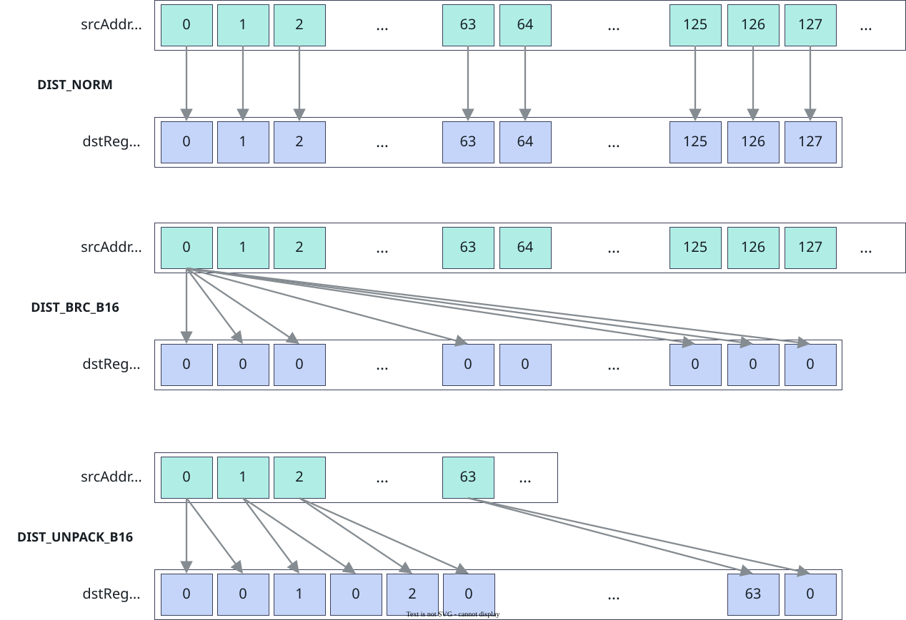
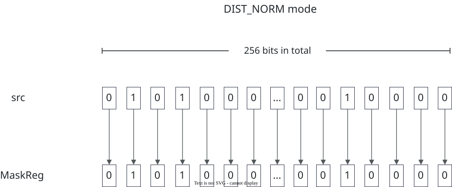
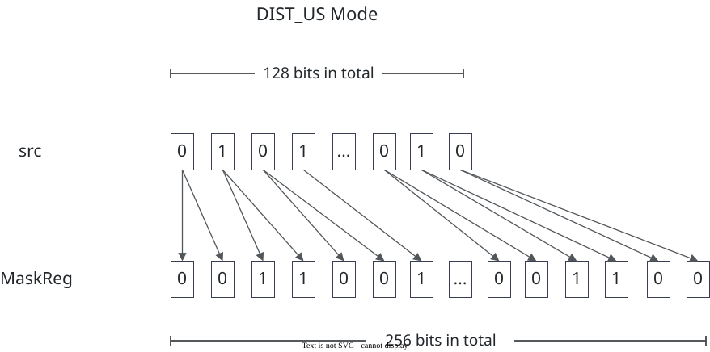
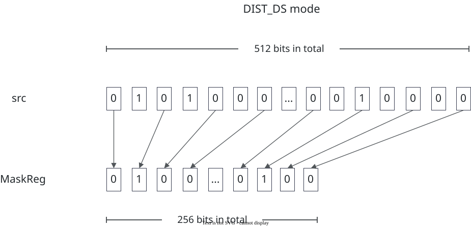

# vf.load_align

<!-- md-trans-meta sourceCommit=7d0ab31d84c294a0a8327f597d2bdee012acb22d translatedAt=2026-10-26T13:46:41.833Z pushedAt=2026-10-28T11:57:28.988Z nl=2 -->

## Applicable Products

<!-- npu="950" id1 -->
- Ascend 950PR&950DT products: Supported
<!-- end id1 -->
<!-- npu="A3" id2 -->
- Atlas A3 products: Not supported
<!-- end id2 -->
<!-- npu="910b" id3 -->
- Atlas A2 products: Not supported
<!-- end id3 -->

## Description

Loads data from Tile into registers with alignment, supporting two register types: reg_tensor and mask_reg.

### reg_tensor Mode

The reg_tensor mode supports **continuous load mode** and **non-continuous load mode**. The **continuous load mode** is further divided into two modes: single-load mode and dual-load mode:

- **reg_tensor single-load mode**: Reads VL (register length) data from the Tile and loads it into one reg_tensor.
- **reg_tensor dual-load mode** (de-interleave): Reads 2*VL data from the Tile, performs interleaved load, and loads even-indexed and odd-indexed elements into two reg_tensors (2*VL) respectively.

During continuous data load, you can configure the data distribution mode via the dist keyword parameter to implement broadcast, upsampling, downsampling, decompression, and other functions. The following figure shows the continuous load mode. For the complete dist values and alignment constraints, see [Constraints](#constraints).

**Figure 1** Distribution mode of vf.load_align continuous aligned load



In **non-continuous load mode**, enable the DataBlock load mode by setting data_copy_mode=pypto_pro.language.DataCopyMode.DATA_BLOCK_COPY to load data from the Tile to the reg_tensor non-contiguously. A single instruction loads eight DataBlocks at a time, and the block_stride parameter indicates the interval between adjacent DataBlocks. In this mode, the offset parameter is changed to pass a mask_reg that controls the valid elements. The control rules are as follows:

- When any bit of the 32 bits corresponding to a certain DataBlock in the mask is 1, the data corresponding to that DataBlock is loaded into dst.
- When all 32 bits corresponding to a certain DataBlock in the mask are 0, the data corresponding to that DataBlock is not read, and the corresponding position in dst is set to 0. No error is reported even if the Tile is out of bounds.

### mask_reg mode

When the target variable has been predeclared as mask_reg via vf.create_mask, the backend automatically dispatches the mask_reg load path to load data from Tile to mask_reg.

The mask_reg target supports three distribution modes, configured through the dist keyword argument, which enable upsampling, downsampling, and other functions:

- pypto_pro.language.LoadDist.NORM (normal mode, loading a data size of VL/8)
- pypto_pro.language.LoadDist.US (upsampling mode, loading each bit of data twice to expand VL/16 data into VL/8)
- pypto_pro.language.LoadDist.DS (downsampling mode, discarding data every other bit to compress VL/4 data into VL/8)

The following figures illustrate each mode:

**Figure 2** pypto_pro.language.LoadDist.NORM mode



**Figure 3** pypto_pro.language.LoadDist.US mode



**Figure 4** pypto_pro.language.LoadDist.DS mode



## Prototype

```python
load_align(tile, offset=None, dist: Optional[LoadDist] = None, dtype: Optional[DType] = None, post_update: bool = False, block_stride=None, repeat_stride=None, data_copy_mode: Optional[DataCopyMode] = None) -> dst
```

## Parameters

| Parameter | Input/Output | Description |
|---|---|---|
| tile | Input | Source operand, the Tile address. The address must be 32-byte aligned. Supported data types: DT_INT8, DT_UINT8, DT_INT16, DT_UINT16, DT_FP16, DT_BF16, DT_INT32, DT_UINT32, DT_FP32, DT_INT64, DT_UINT64, DT_FP8E4M3FN, DT_FP8E5M2, DT_FP8E8M0, DT_HF8, DT_FP4E2M1, DT_FP4E1M2. |
| offset | Input | Optional, the address offset parameter. The load API is dispatched automatically based on the passed type. In **continuous load mode** and **mask_reg mode**, the unit is the number of elements; in **non-continuous load mode**, it is a mask.<br>- **Continuous load mode**:<br>&nbsp;&nbsp;- **Integer or [row, col] list**: An integer offset is converted to pointer arithmetic Tile + offset at code generation time.<br>&nbsp;&nbsp;&nbsp;&nbsp;The linear offset of a [row, col] list is row * shape[1] + col, where row is in units of the number of Tile columns (that is, n in set_validshape[m, n]) and col is in units of elements. Both support expressions.<br>&nbsp;&nbsp;- **AddrReg** (created by vf.create_addr_reg): The actual load Tile address is Tile + the offset stored in AddrReg.<br>&nbsp;&nbsp;&nbsp;&nbsp;For each iteration, call vf.create_addr_reg to set the offset before calling the load instruction.<br>- **Non-continuous load mode** (DataBlock load mode, when data_copy_mode=pypto_pro.language.DataCopyMode.DATA_BLOCK_COPY): In this mode, the offset position is replaced by a mask_reg that controls valid elements.<br>&nbsp;&nbsp;A certain DataBlock is loaded when any bit of its corresponding 32 bits in the mask is 1; when all bits are 0, it is not read and the corresponding position in dst is set to 0.<br>&nbsp;&nbsp;- When post_update=True, the source address automatically advances by the repeat_stride step after loading, so you do not need to update the address manually in each iteration.<br>&nbsp;&nbsp;- When post_update=False, the address is not updated after loading.<br>- **mask_reg mode** (requires pre-declaration with vf.create_mask):<br>&nbsp;&nbsp;- **Integer**: Takes effect only when post_update=True; an integer offset is not supported when post_update=False.<br>&nbsp;&nbsp;- **AddrReg** (created by vf.create_addr_reg): The actual load Tile address is srcAddr + the offset stored in AddrReg. |
| dist | Input | Optional, the data distribution mode, corresponding to the [LoadDist](../basic_data_structures/LoadDist.md) type. For the specific modes of **reg_tensor single-load mode**, **reg_tensor dual-load mode**, and **mask_reg mode**, see the tables in [Constraints](#constraints). |
| dtype | Input | Optional, specifies the data type of the target [reg_tensor](../basic_data_structures/reg_tensor.md) or [mask_reg](../basic_data_structures/mask_reg.md). It must be specified when the source Tile data type differs from the expected register data type (for example, when the source Tile is DT_FP32 but needs to be reinterpreted as DT_UINT32 bits and loaded into the register). By default, it is inferred from the source Tile data type. |
| post_update | Input | Optional. When True, the source address automatically advances after loading. Defaults to False. Suitable for continuous loading within a loop, avoiding manual offset updates. |
| block_stride | Input | Optional. Takes effect only when data_copy_mode=pypto_pro.language.DataCopyMode.DATA_BLOCK_COPY; it is ignored in other modes. Indicates the interval between adjacent DataBlocks, in units of DataBlock (32 bytes). When block_stride=0, the first DataBlock is loaded repeatedly. |
| repeat_stride | Input | Optional. Takes effect only when data_copy_mode=pypto_pro.language.DataCopyMode.DATA_BLOCK_COPY and post_update=True. Indicates the address update step for repeated loading, in units of DataBlock (32 bytes), and must be 32-byte aligned. When post_update=True, the source address is automatically updated to srcAddr += repeat_stride * 32B after loading. |
| data_copy_mode | Input | Optional, the data copy mode, corresponding to the [DataCopyMode](../basic_data_structures/DataCopyMode.md) type. Takes effect only in **reg_tensor mode**; the mask_reg target does not support this parameter. Values: pypto_pro.language.DataCopyMode.NORM (default, normal continuous load) or pypto_pro.language.DataCopyMode.DATA_BLOCK_COPY (non-continuous load in units of DataBlock (32B)). |

## Constraints

- Description of the dist parameter in each mode:

  Some modes provide both a general form and an explicit-granularity form. The general form (such as BRC and US) has no granularity suffix, and the backend automatically selects the corresponding B8/B16/B32 variant based on the data type of the target register; the explicit-granularity form (such as BRC_B8 and US_B16) directly specifies the granularity. Both forms can be used. For the complete value description, see the [LoadDist enumeration type](../basic_data_structures/LoadDist.md).

  **Table 1** dist parameter description for reg_tensor single-load mode

  | dist value | Meaning | alignment constraint (Byte) |
  |---|---|---|
  | pypto_pro.language.LoadDist.NORM | Normal mode, loads VL amount of data. | 32 |
  | pypto_pro.language.LoadDist.BRC | Broadcast mode (general), automatically selects the B8/B16/B32 granularity based on the data type. | 1/2/4 |
  | pypto_pro.language.LoadDist.BRC_B8 | Loads one 8-bit-wide data element and broadcasts it to all element positions. | 1 |
  | pypto_pro.language.LoadDist.BRC_B16 | Loads one 16-bit-wide data element and broadcasts it to all element positions. | 2 |
  | pypto_pro.language.LoadDist.BRC_B32 | Loads one 32-bit-wide data element and broadcasts it to all element positions. | 4 |
  | pypto_pro.language.LoadDist.US | Upsampling mode (general), automatically selects the B8/B16 granularity based on the data type. | min(32, VL/2) |
  | pypto_pro.language.LoadDist.US_B8 | 2x data upsampling, loads VL/2 amount of data, repeats each input element twice, with an 8-bit-wide data type. | min(32, VL/2) |
  | pypto_pro.language.LoadDist.US_B16 | 2x data upsampling, loads VL/2 amount of data, repeats each input element twice, with a 16-bit-wide data type. | min(32, VL/2) |
  | pypto_pro.language.LoadDist.DS | Downsampling mode (general), automatically selects the B8/B16 granularity based on the data type. | 32 |
  | pypto_pro.language.LoadDist.DS_B8 | 2x data downsampling, loads 2*VL amount of data, keeps every other element, with an 8-bit-wide data type. | 32 |
  | pypto_pro.language.LoadDist.DS_B16 | 2x data downsampling, loads 2*VL amount of data, keeps every other element, with a 16-bit-wide data type. | 32 |
  | pypto_pro.language.LoadDist.UNPK | Decompression mode (general), automatically selects the B8/B16/B32 granularity based on the data type. | min(32, VL/2) |
  | pypto_pro.language.LoadDist.UNPK_B8 | Decompression mode, loads VL/2 amount of data as unsigned integer u8, and pads one zero-valued element after each element, that is, unpacks to VL. | min(32, VL/2) |
  | pypto_pro.language.LoadDist.UNPK_B16 | Decompression mode, loads VL/2 amount of data as unsigned integer u16, and pads one zero-valued element after each element, that is, unpacks to VL. | min(32, VL/2) |
  | pypto_pro.language.LoadDist.UNPK_B32 | Decompression mode, loads VL/2 amount of data as unsigned integer u32, and pads one zero-valued element after each element, that is, unpacks to VL. | min(32, VL/2) |
  | pypto_pro.language.LoadDist.UNPK4 | 4-element decompression mode, fixed to load VL/4 data size as u8, unpacks to VL, and pads three zero-valued elements after each element. | min(32, VL/4) |
  | pypto_pro.language.LoadDist.BLK | Reads one DataBlock (32B) and broadcasts it to VL. | 32 |
  | pypto_pro.language.LoadDist.E2B | Element-to-DataBlock expansion mode (general), automatically selects the B16/B32 granularity based on the data type. | VL/16 or VL/8 |
  | pypto_pro.language.LoadDist.E2B_B16 | Loads (VL/DataBlock) B16 elements and broadcasts each element (16 bits) to one DataBlock (32B). | VL/16 |
  | pypto_pro.language.LoadDist.E2B_B32 | Loads (VL/DataBlock) B32 elements and broadcasts each element (32 bits) to one DataBlock (32B). | VL/8 |

  **Table 2** dist parameter description for reg_tensor dual-load mode

  | dist value | Meaning | alignment constraint (Byte) |
  |---|---|---|
  | pypto_pro.language.LoadDist.DINTLV_B8 | Dual-load mode, element-based interleaved load, stores even-index elements into dst0 and odd-index elements into dst1, with an 8-bit-wide data type. | 32 |
  | pypto_pro.language.LoadDist.DINTLV_B16 | Dual-load mode, element-based interleaved load, stores even-index elements into dst0 and odd-index elements into dst1, with a 16-bit-wide data type. | 32 |
  | pypto_pro.language.LoadDist.DINTLV_B32 | Dual-load mode, element-based interleaved load, stores even-index elements into dst0 and odd-index elements into dst1, with a 32-bit-wide data type. | 32 |

  **Table 3** mask_reg mode dist parameter description

  | dist value | Meaning | alignment constraint (Byte) |
  |---|---|---|
  | pypto_pro.language.LoadDist.NORM | Normal mode, loading a data volume of VL/8. | VL/8 |
  | pypto_pro.language.LoadDist.US | Upsampling mode, loading each bit of data twice, expanding VL/16 data to VL/8. | VL/16 |
  | pypto_pro.language.LoadDist.DS | Downsampling mode, discarding every other bit of data, compressing VL/4 data to VL/8. | min(32, VL/4) |

## Return Value

Returns the dst destination operand, of type [reg_tensor](../basic_data_structures/reg_tensor.md) or [mask_reg](../basic_data_structures/mask_reg.md).

- When the target is reg_tensor, it is the **reg_tensor single-load mode**, and the supported data types are consistent with those described in Tile.

- dst_even/dst_odd are the even/odd destination operands of the **reg_tensor dual-load mode**, of type [reg_tensor](../basic_data_structures/reg_tensor.md), and the supported data types are consistent with those described in Tile.

- When the target has been pre-declared as mask_reg via vf.create_mask, the mask_reg loading path is automatically dispatched, loading the data in Tile into mask_reg.

## Examples

### Normal Aligned Load

```python
import os
import pypto_pro.language as pl
import torch
import torch_npu

@pl.vector_function
def example_vf(src_tile, dst_tile):
    preg = vf.create_mask(pattern=pl.MaskPattern.ALL, dtype=pl.DT_FP32)
    src0 = vf.load_align(src_tile, 0)
    vf.store_align(dst_tile, src0, preg)
    reg = vf.load_align(src_tile, 0, post_update=True)
    vf.store_align(dst_tile, reg, preg)

@pl.jit()
def example_kernel(
    a: pl.Tensor[[pl.DYNAMIC, pl.DYNAMIC], pl.DT_FP32],
    out: pl.Tensor[[pl.DYNAMIC, pl.DYNAMIC], pl.DT_FP32],
):
    tf = pl.TileType(shape=[1, 64], dtype=pl.DT_FP32, target_memory=pl.MemorySpace.Vec)
    in_a_grp = pl.make_tile_group(type=tf, addrs=0x0, mutex_ids=[0])
    in_a = in_a_grp.current()
    t_out_grp = pl.make_tile_group(type=tf, addrs=0x100, mutex_ids=[1])
    t_out = t_out_grp.current()
    with pl.section_vector():
        pl.load(in_a, a, [0, 0])
        example_vf(in_a, t_out)
        pl.store(out, t_out, [0, 0])

def test_example():
    device_id = int(os.environ.get("TILE_FWK_DEVICE_ID", 0))
    device = f"npu:{device_id}"
    core_nums = 1
    torch.npu.set_device(device)
    a = torch.randn([1, 64], device=device, dtype=torch.float32)
    out = torch.empty([1, 64], device=device, dtype=torch.float32)
    example_kernel[None, core_nums](a, out)
    torch.npu.synchronize()
    torch.testing.assert_close(out, a, rtol=1e-5, atol=1e-5)

if __name__ == "__main__":
    test_example()
    print("PASSED")
```

### de-interleave loading example

```python
import os
import pypto_pro.language as pl
import torch
import torch_npu

@pl.vector_function
def example_vf(src_tile, dst_tile):
    preg = vf.create_mask(pattern=pl.MaskPattern.ALL, dtype=pl.DT_FP32)
    dst_even, dst_odd = vf.load_align(src_tile, 0, dist=pl.LoadDist.DINTLV_B32)
    vf.store_align(dst_tile, dst_even, preg)

@pl.jit()
def example_kernel(
    a: pl.Tensor[[pl.DYNAMIC, pl.DYNAMIC], pl.DT_FP32],
    out: pl.Tensor[[pl.DYNAMIC, pl.DYNAMIC], pl.DT_FP32],
):
    tf = pl.TileType(shape=[1, 128], dtype=pl.DT_FP32, target_memory=pl.MemorySpace.Vec)
    in_a_grp = pl.make_tile_group(type=tf, addrs=0x0, mutex_ids=[0])
    in_a = in_a_grp.current()
    t_out_grp = pl.make_tile_group(type=tf, addrs=0x200, mutex_ids=[1])
    t_out = t_out_grp.current()
    with pl.section_vector():
        pl.load(in_a, a, [0, 0])
        example_vf(in_a, t_out)
        pl.store(out, t_out, [0, 0])

def test_example_2():
    device_id = int(os.environ.get("TILE_FWK_DEVICE_ID", 0))
    device = f"npu:{device_id}"
    core_nums = 1
    torch.npu.set_device(device)
    a = torch.randn([1, 128], device=device, dtype=torch.float32)
    out = torch.empty([1, 64], device=device, dtype=torch.float32)
    example_kernel[None, core_nums](a, out)
    torch.npu.synchronize()
    expected = a[:, ::2]
    torch.testing.assert_close(out, expected, rtol=1e-5, atol=1e-5)

if __name__ == "__main__":
    test_example_2()
    print("PASSED")
```

### List Offset Loading Example

```python
import os
import pypto_pro.language as pl
import torch
import torch_npu

@pl.vector_function
def example_vf(src_tile, dst_tile):
    preg = vf.create_mask(pattern=pl.MaskPattern.ALL, dtype=pl.DT_FP32)
    reg = vf.load_align(src_tile, [1, 0])
    vf.store_align(dst_tile, reg, preg)

@pl.jit()
def example_kernel(
    a: pl.Tensor[[pl.DYNAMIC, pl.DYNAMIC], pl.DT_FP32],
    out: pl.Tensor[[pl.DYNAMIC, pl.DYNAMIC], pl.DT_FP32],
):
    tf = pl.TileType(shape=[2, 64], dtype=pl.DT_FP32, target_memory=pl.MemorySpace.Vec)
    in_a_grp = pl.make_tile_group(type=tf, addrs=0x0, mutex_ids=[0])
    in_a = in_a_grp.current()
    t_out_grp = pl.make_tile_group(type=tf, addrs=0x200, mutex_ids=[1])
    t_out = t_out_grp.current()
    with pl.section_vector():
        pl.load(in_a, a, [0, 0])
        example_vf(in_a, t_out)
        pl.store(out, t_out, [0, 0])

def test_example_5():
    device_id = int(os.environ.get("TILE_FWK_DEVICE_ID", 0))
    device = f"npu:{device_id}"
    core_nums = 1
    torch.npu.set_device(device)
    a = torch.randn([2, 64], device=device, dtype=torch.float32)
    out = torch.empty([1, 64], device=device, dtype=torch.float32)
    example_kernel[None, core_nums](a, out)
    torch.npu.synchronize()
    torch.testing.assert_close(out, a[1:2, :], rtol=1e-5, atol=1e-5)

if __name__ == "__main__":
    test_example_5()
    print("PASSED")
```

```python
import os
import pypto_pro.language as pl
import torch
import torch_npu

@pl.vector_function
def example_vf(src_tile, dst_tile, n_rows):
    preg = vf.create_mask(pattern=pl.MaskPattern.ALL, dtype=pl.DT_FP32)
    for i in pl.range(n_rows):
        reg = vf.load_align(src_tile, [i, 0])
        vf.store_align(dst_tile + i * 64, reg, preg)

@pl.jit()
def example_kernel(
    a: pl.Tensor[[pl.DYNAMIC, pl.DYNAMIC], pl.DT_FP32],
    out: pl.Tensor[[pl.DYNAMIC, pl.DYNAMIC], pl.DT_FP32],
):
    tf = pl.TileType(shape=[2, 64], dtype=pl.DT_FP32, target_memory=pl.MemorySpace.Vec)
    in_a_grp = pl.make_tile_group(type=tf, addrs=0x0, mutex_ids=[0])
    in_a = in_a_grp.current()
    t_out_grp = pl.make_tile_group(type=tf, addrs=0x200, mutex_ids=[1])
    t_out = t_out_grp.current()
    with pl.section_vector():
        pl.load(in_a, a, [0, 0])
        example_vf(in_a, t_out, 2)
        pl.store(out, t_out, [0, 0])

def test_example_6():
    device_id = int(os.environ.get("TILE_FWK_DEVICE_ID", 0))
    device = f"npu:{device_id}"
    core_nums = 1
    torch.npu.set_device(device)
    a = torch.randn([2, 64], device=device, dtype=torch.float32)
    out = torch.empty([2, 64], device=device, dtype=torch.float32)
    example_kernel[None, core_nums](a, out)
    torch.npu.synchronize()
    torch.testing.assert_close(out, a, rtol=1e-5, atol=1e-5)

if __name__ == "__main__":
    test_example_6()
    print("PASSED")
```

### AddrReg Offset Loading Example

```python
import os
import pypto_pro.language as pl
import torch
import torch_npu

@pl.vector_function
def example_vf(src_tile, dst_tile):
    preg = vf.create_mask(pattern=pl.MaskPattern.ALL, dtype=pl.DT_FP32)
    one_repeat_size = 64
    repeat_times = 2
    for i in pl.range(0, repeat_times, 1):
        a_reg = vf.create_addr_reg(one_repeat_size, dtype=pl.DT_FP32)
        reg = vf.load_align(src_tile, a_reg)
        vf.store_align(dst_tile, reg, preg, a_reg)

@pl.jit()
def example_kernel(
    a: pl.Tensor[[pl.DYNAMIC, pl.DYNAMIC], pl.DT_FP32],
    out: pl.Tensor[[pl.DYNAMIC, pl.DYNAMIC], pl.DT_FP32],
):
    tf = pl.TileType(shape=[1, 128], dtype=pl.DT_FP32, target_memory=pl.MemorySpace.Vec)
    in_a_grp = pl.make_tile_group(type=tf, addrs=0x0, mutex_ids=[0])
    in_a = in_a_grp.current()
    t_out_grp = pl.make_tile_group(type=tf, addrs=0x200, mutex_ids=[1])
    t_out = t_out_grp.current()
    with pl.section_vector():
        pl.load(in_a, a, [0, 0])
        example_vf(in_a, t_out)
        pl.store(out, t_out, [0, 0])

def test_example_3():
    device_id = int(os.environ.get("TILE_FWK_DEVICE_ID", 0))
    device = f"npu:{device_id}"
    core_nums = 1
    torch.npu.set_device(device)
    a = torch.randn([1, 128], device=device, dtype=torch.float32)
    out = torch.empty([1, 128], device=device, dtype=torch.float32)
    example_kernel[None, core_nums](a, out)
    torch.npu.synchronize()
    torch.testing.assert_close(out, a, rtol=1e-5, atol=1e-5)

if __name__ == "__main__":
    test_example_3()
    print("PASSED")
```

### mask_reg loading example

```python
import os
import pypto_pro.language as pl
import torch
import torch_npu

@pl.vector_function
def example_vf(src_tile, mask_buf_tile, dst_tile):
    preg = vf.create_mask(pattern=pl.MaskPattern.ALL, dtype=pl.DT_FP32)
    reg_a = vf.load_align(src_tile, 0)
    cmp_mask = vf.ge(reg_a, 0.0, preg)
    vf.store_align(mask_buf_tile, cmp_mask, dist=pl.StoreDist.PACK)
    vf.mem_bar(mode=pl.MemBarMode.VST_VLD)
    loaded_mask = vf.create_mask(pattern=pl.MaskPattern.ALL, dtype=pl.DT_FP32)
    loaded_mask = vf.load_align(mask_buf_tile, dist=pl.LoadDist.US)
    reg_dst = vf.abs(reg_a, loaded_mask)
    vf.store_align(dst_tile, reg_dst, preg)

@pl.jit()
def example_kernel(
    a: pl.Tensor[[pl.DYNAMIC, pl.DYNAMIC], pl.DT_FP32],
    out: pl.Tensor[[pl.DYNAMIC, pl.DYNAMIC], pl.DT_FP32],
):
    tf = pl.TileType(shape=[1, 64], dtype=pl.DT_FP32, target_memory=pl.MemorySpace.Vec)
    tu = pl.TileType(shape=[1, 64], dtype=pl.DT_UINT32, target_memory=pl.MemorySpace.Vec)
    in_a_grp = pl.make_tile_group(type=tf, addrs=0x0, mutex_ids=[0])
    in_a = in_a_grp.current()
    t_mask_grp = pl.make_tile_group(type=tu, addrs=0x100, mutex_ids=[1])
    t_mask = t_mask_grp.current()
    t_out_grp = pl.make_tile_group(type=tf, addrs=0x200, mutex_ids=[2])
    t_out = t_out_grp.current()
    with pl.section_vector():
        pl.load(in_a, a, [0, 0])
        example_vf(in_a, t_mask, t_out)
        pl.store(out, t_out, [0, 0])

def test_example_4():
    device_id = int(os.environ.get("TILE_FWK_DEVICE_ID", 0))
    device = f"npu:{device_id}"
    core_nums = 1
    torch.npu.set_device(device)
    a = torch.randn([1, 64], device=device, dtype=torch.float32)
    out = torch.empty([1, 64], device=device, dtype=torch.float32)
    example_kernel[None, core_nums](a, out)
    torch.npu.synchronize()
    expected = torch.where(a >= 0, torch.abs(a), torch.tensor(0.0, device=device))
    torch.testing.assert_close(out, expected, rtol=1e-5, atol=1e-5)

if __name__ == "__main__":
    test_example_4()
    print("PASSED")
```

### FP8 Data Loading Examples

```python
import os
import pypto_pro.language as pl
import torch
import torch_npu

@pl.vector_function
def example_vf_fp8(src_tile, dst_tile):
    preg = vf.create_mask(pattern=pl.MaskPattern.ALL, dtype=pl.DT_FP32)
    reg_f8 = vf.load_align(src_tile, 0, dtype=pl.DT_FP8E4M3FN)
    reg_f32 = vf.astype(reg_f8, preg, dtype=pl.DT_FP32)
    vf.store_align(dst_tile, reg_f32, preg)

@pl.jit()
def example_kernel_fp8(
    a: pl.Tensor[[pl.DYNAMIC, pl.DYNAMIC], pl.DT_FP8E4M3FN],
    out: pl.Tensor[[pl.DYNAMIC, pl.DYNAMIC], pl.DT_FP32],
):
    tf_in = pl.TileType(shape=[1, 256], dtype=pl.DT_FP8E4M3FN, target_memory=pl.MemorySpace.Vec)
    tf_out = pl.TileType(shape=[1, 64], dtype=pl.DT_FP32, target_memory=pl.MemorySpace.Vec)
    in_a_grp = pl.make_tile_group(type=tf_in, addrs=0x0, mutex_ids=[0])
    in_a = in_a_grp.current()
    t_out_grp = pl.make_tile_group(type=tf_out, addrs=0x100, mutex_ids=[1])
    t_out = t_out_grp.current()
    with pl.section_vector():
        pl.load(in_a, a, [0, 0])
        example_vf_fp8(in_a, t_out)
        pl.store(out, t_out, [0, 0])

def test_example_fp8():
    device_id = int(os.environ.get("TILE_FWK_DEVICE_ID", 0))
    device = f"npu:{device_id}"
    core_nums = 1
    torch.npu.set_device(device)
    a = torch.randn([1, 256], device=device, dtype=torch.float32).to(torch.float8_e4m3fn)
    out = torch.empty([1, 64], device=device, dtype=torch.float32)
    example_kernel_fp8[None, core_nums](a, out)
    torch.npu.synchronize()
    expected = a.to(torch.float32)
    torch.testing.assert_close(out, expected[:, ::4], rtol=1e-2, atol=1e-2)

if __name__ == "__main__":
    test_example_fp8()
    print("PASSED")
```

### HF8 Data Loading and Storage

Load data as HF8 and store it back directly to verify the load path for the HF8 type. HF8 is an 8-bit storage type, which requires a mask of b8 width.

```python
import os
import pypto_pro.language as pl
import torch
import torch_npu

@pl.vector_function
def example_vf_hf8_store(src_tile, dst_tile):
    preg_b8 = vf.create_mask(pattern=pl.MaskPattern.ALL, dtype=pl.DT_HF8)
    reg_hf8 = vf.load_align(src_tile, 0, dtype=pl.DT_HF8)
    vf.store_align(dst_tile, reg_hf8, preg_b8)

@pl.jit()
def example_kernel_hf8_store(
    a: pl.Tensor[[pl.DYNAMIC, pl.DYNAMIC], pl.DT_HF8],
    out: pl.Tensor[[pl.DYNAMIC, pl.DYNAMIC], pl.DT_HF8],
):
    tf = pl.TileType(shape=[1, 256], dtype=pl.DT_HF8, target_memory=pl.MemorySpace.Vec)
    in_a_grp = pl.make_tile_group(type=tf, addrs=0x0, mutex_ids=[0])
    in_a = in_a_grp.current()
    t_out_grp = pl.make_tile_group(type=tf, addrs=0x100, mutex_ids=[1])
    t_out = t_out_grp.current()
    with pl.section_vector():
        pl.load(in_a, a, [0, 0])
        example_vf_hf8_store(in_a, t_out)
        pl.store(out, t_out, [0, 0])

def test_example_hf8_store():
    device_id = int(os.environ.get("TILE_FWK_DEVICE_ID", 0))
    device = f"npu:{device_id}"
    core_nums = 1
    torch.npu.set_device(device)
    a = torch.randint(0, 256, [1, 256], device=device, dtype=torch.uint8)
    out = torch.empty([1, 256], device=device, dtype=torch.uint8)
    example_kernel_hf8_store[None, core_nums](a, out)
    torch.npu.synchronize()
    torch.testing.assert_close(out, a, rtol=0, atol=0)

if __name__ == "__main__":
    test_example_hf8_store()
    print("PASSED")
```

### HF8 to FP32 (layout=TWO/THREE)

HF8 is an 8-bit type and FP32 is a 32-bit type, with a bit-width ratio of 1:4. FP32 to HF8 is a 4x narrowing conversion, where the layout parameter controls which sub-region of the HF8 register the conversion result is placed in (CastLayout.ZERO/ONE/TWO/THREE correspond to byte positions 0/1/2/3, respectively). HF8 to FP32 is a 4x widening conversion, where the layout parameter controls which sub-region of the HF8 register is read and expanded to FP32.

The following example first generates HF8 data through an FP32 to HF8 conversion (layout=ZERO), then converts the HF8 data back to FP32 using layout=ZERO/ONE/TWO/THREE respectively and stores it, demonstrating the four CastLayout usage modes. layout=ZERO reads valid data, while the other layout values read unwritten sub-regions, resulting in 0.

```python
import os
import pypto_pro.language as pl
import torch
import torch_npu

@pl.vector_function
def example_vf_hf8_to_fp32(src_tile, dst_tile):
    preg_b32 = vf.create_mask(pattern=pl.MaskPattern.ALL, dtype=pl.DT_FP32)
    reg_f32 = vf.load_align(src_tile, 0)
    reg_hf8 = vf.astype(reg_f32, preg_b32, dtype=pl.DT_HF8, layout=pl.CastLayout.ZERO,
                        round_mode=pl.VFRoundMode.CAST_ROUND, saturate=pl.SaturateMode.ON)
    reg_f32_zero = vf.astype(reg_hf8, preg_b32, dtype=pl.DT_FP32, layout=pl.CastLayout.ZERO)
    vf.store_align(dst_tile, reg_f32_zero, preg_b32, 0)
    reg_f32_one = vf.astype(reg_hf8, preg_b32, dtype=pl.DT_FP32, layout=pl.CastLayout.ONE)
    vf.store_align(dst_tile, reg_f32_one, preg_b32, 64)
    reg_f32_two = vf.astype(reg_hf8, preg_b32, dtype=pl.DT_FP32, layout=pl.CastLayout.TWO)
    vf.store_align(dst_tile, reg_f32_two, preg_b32, 128)
    reg_f32_three = vf.astype(reg_hf8, preg_b32, dtype=pl.DT_FP32, layout=pl.CastLayout.THREE)
    vf.store_align(dst_tile, reg_f32_three, preg_b32, 192)

@pl.jit()
def example_kernel_hf8_to_fp32(
    a: pl.Tensor[[pl.DYNAMIC, pl.DYNAMIC], pl.DT_FP32],
    out: pl.Tensor[[pl.DYNAMIC, pl.DYNAMIC], pl.DT_FP32],
):
    tf_in = pl.TileType(shape=[1, 64], dtype=pl.DT_FP32, target_memory=pl.MemorySpace.Vec)
    tf_out = pl.TileType(shape=[1, 256], dtype=pl.DT_FP32, target_memory=pl.MemorySpace.Vec)
    in_a_grp = pl.make_tile_group(type=tf_in, addrs=0x0, mutex_ids=[0])
    in_a = in_a_grp.current()
    t_out_grp = pl.make_tile_group(type=tf_out, addrs=0x100, mutex_ids=[1])
    t_out = t_out_grp.current()
    with pl.section_vector():
        pl.load(in_a, a, [0, 0])
        example_vf_hf8_to_fp32(in_a, t_out)
        pl.store(out, t_out, [0, 0])

def test_example_hf8_to_fp32():
    device_id = int(os.environ.get("TILE_FWK_DEVICE_ID", 0))
    device = f"npu:{device_id}"
    core_nums = 1
    torch.npu.set_device(device)
    a = torch.randn([1, 64], device=device, dtype=torch.float32)
    out = torch.empty([1, 256], device=device, dtype=torch.float32)
    example_kernel_hf8_to_fp32[None, core_nums](a, out)
    torch.npu.synchronize()
    torch.testing.assert_close(out[:, 0:64], a, rtol=1e-1, atol=1e-1)
    torch.testing.assert_close(out[:, 64:256], torch.zeros([1, 192], device=device, dtype=torch.float32), rtol=0, atol=0)

if __name__ == "__main__":
    test_example_hf8_to_fp32()
    print("PASSED")
```
