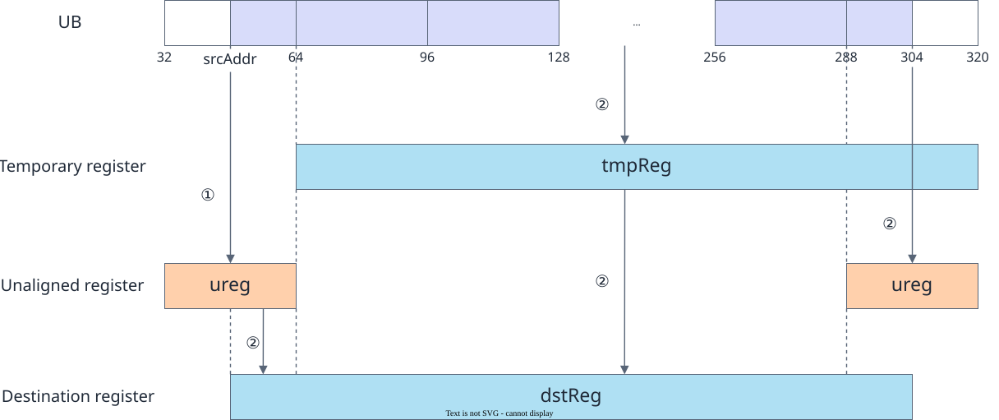
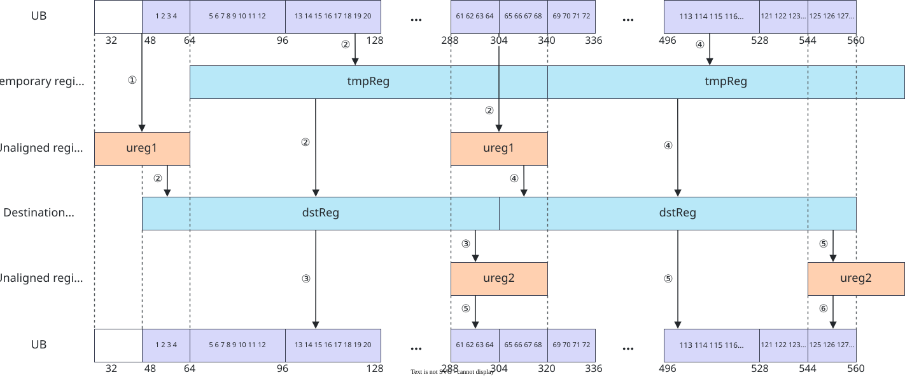

# vf.load_unalign

<!-- md-trans-meta sourceCommit=7d0ab31d84c294a0a8327f597d2bdee012acb22d translatedAt=2026-10-26T13:49:44.742Z pushedAt=2026-10-28T11:57:28.995Z nl=2 -->

## Applicable Products

<!-- npu="950" id1 -->
- Ascend 950PR&950DT products: Supported
<!-- end id1 -->
<!-- npu="A3" id2 -->
- Atlas A3 products: Not supported
<!-- end id2 -->
<!-- npu="910b" id3 -->
- Atlas A2 products: Not supported
<!-- end id3 -->

## Description

To improve the handling of irregular memory addresses, reg_tensor supports accessing addresses that are not 32-byte aligned during data movement, reducing the performance overhead caused by unaligned access. vf.load_unalign moves data continuously from unaligned addresses to reg_tensor. It uses the unaligned register UnalignRegForLoad as a temporary buffer to hold data that crosses alignment boundaries, thereby achieving efficient continuous unaligned data transfer.

There are three types of APIs for unaligned load-in: the standard move API, the PostUpdate extended move API, and the API that stores offsets in the AddrReg register.

| API Type | Trigger Condition | Description |
|---|---|---|
| Standard move API | stride is not passed | After a move is completed, the Tile address is not automatically updated. You need to manually update the address in each iteration. |
| PostUpdate extended move API | stride is passed | After a move is completed, the Tile address is automatically updated. You do not need to manually update the address in each iteration. |
| AddrReg offset storage API | offset is an AddrReg created by vf.create_addr_reg | In each iteration, call vf.create_addr_reg to manually set the address offset first, and then call the move instruction. |

Before reading an unaligned address, initialize with vf.load_unalign_pre to save the data that is not 32-byte aligned, and then call vf.load_unalign to move the data in.

### Unaligned Load-In Principle

As shown in the following figure, data is read from the Tile address srcAddr ~ 304 and moved to the target reg_tensor (256B). The processing flow is as follows:

① Call **load_unalign_pre** to initialize the unaligned load-in. The unaligned register ureg caches the valid data at Tile addresses 32 ~ 64, serving as the pre-data cache for subsequent unaligned access.

② Call **load_unalign**. The hardware instruction moves the aligned data at Tile addresses 64 ~ 320 into the temporary reg_tensor, concatenates the data corresponding to srcAddr ~ 64 in ureg with the data corresponding to addresses 64 ~ 304 in the temporary reg_tensor, and writes the result to the target reg_tensor. In addition, the data at Tile addresses 288 ~ 320 is written to ureg.

**Figure 1** Unaligned load-in example



### Continuous Unaligned Load and Store Principles

**Figure 2** Continuous unaligned load and store principles (data type DT_UINT32)



During continuous unaligned load, vf.load_unalign caches the subsequent unaligned data into the ureg created by vf.load_unalign_init. Therefore, the next load does not need to call vf.load_unalign_pre again; you only need to call vf.load_unalign_pre once before the iteration starts, thereby optimizing the performance of unaligned load.

During continuous unaligned store, vf.store_unalign in the next iteration writes the data cached into the ureg by vf.store_unalign in the current iteration to the Tile. Therefore, the current iteration does not need to call vf.store_unalign_post to write the ureg data to the Tile; you only need to call vf.store_unalign_post once after the iteration ends, thereby optimizing the performance of unaligned store.

As shown in the preceding figure, loading the DT_UINT32 data [1, 2, 3, ..., 128] at Tile addresses 48 to 560 into dstReg and then storing it back to the Tile requires two load and store operations, that is, the for loop executes twice, with initialization and post-processing moved outside the for loop. stride = 256B / sizeof(T) (that is, each address offset is 256B), and repeatTimes = dataSize / 256B (that is, the number of iterations = total data size / VL).

The specific move steps are as follows:

1. Unaligned load-in initialization: update ureg = [1, 2, 3, 4];
2. Unaligned load-in: tmpReg = [5, 6, 7, ..., 68], write part of the tmpReg data and the ureg data to dstReg = [1, 2, 3, ..., 64], and update ureg = [61, 62, 63, ..., 68];
3. Unaligned store: write part of the dstReg data [1, 2, 3, ..., 60] to Tile addresses 48 to 288, and update align_reg = [61, 62, 63, 64];
4. Unaligned load-in: tmpReg = [69, 70, 71, ..., 128]. The tmpReg data and partial ureg data are written to dstReg = [65, 66, 67, ..., 128];
5. Unaligned load-out: The align_reg data [61, 62, 63, 64] and partial dstReg data [65, 66, 67, ..., 124] are written to Tile addresses 288 to 544, and align_reg is updated to [125, 126, 127, 128];
6. Post-processing after unaligned load-out: Write the cached data [125, 126, 127, 128] in align_reg to Tile addresses 544 to 560.

## Prototype

```python
load_unalign(align_reg, tile, stride) -> dst
```

## Parameters

| Parameter | Input/Output | Description |
|---|---|---|
| align_reg | Input/Output | Unaligned register of UnalignRegForLoad type, used to store data that is not 32-byte aligned. The register size is 32 bytes (created by vf.load_unalign_init()). |
| tile | Input | Source operand, Tile address. The start address must be 32-byte aligned. The data types of the destination operand and source operand must be consistent. Supported data types: DT_INT8, DT_UINT8, DT_INT16, DT_UINT16, DT_FP16, DT_BF16, DT_INT32, DT_UINT32, DT_FP32, DT_INT64, DT_UINT64, DT_FP8E4M3FN, DT_FP8E5M2, DT_FP8E8M0, DT_HF8, DT_FP4E2M1, DT_FP4E1M2. |
| stride | Input | Optional. When passed, post-update mode is automatically enabled, and the source address automatically advances by the stride after the move. When not passed, normal load mode is used. |

## Constraints

- The vf.load_unalign_pre and vf.load_unalign APIs must be used in combination.

## Return Value

Returns the dst destination operand, [reg_tensor](../basic_data_structures/reg_tensor.md). The supported data types are the same as those described for tile.

## Examples

### Basic Unaligned Load

```python
import os
import pypto_pro.language as pl
import torch
import torch_npu

@pl.vector_function
def example_vf(src_tile, dst_tile):
    ureg = vf.load_unalign_init()
    vf.load_unalign_pre(ureg, src_tile)
    src_reg = vf.load_unalign(ureg, src_tile, 64)
    store_ureg = vf.unalign_reg_for_store()
    vf.store_unalign(dst_tile, src_reg, store_ureg, 64, post_update=True)
    vf.store_unalign_post(dst_tile, store_ureg, 0, post_update=True)

@pl.jit()
def example_kernel(
    a: pl.Tensor[[pl.DYNAMIC, pl.DYNAMIC], pl.DT_FP32],
    out: pl.Tensor[[pl.DYNAMIC, pl.DYNAMIC], pl.DT_FP32],
):
    tf = pl.TileType(shape=[1, 64], dtype=pl.DT_FP32, target_memory=pl.MemorySpace.Vec)
    in_a_grp = pl.make_tile_group(type=tf, addrs=0x0, mutex_ids=[0])
    in_a = in_a_grp.current()
    t_out_grp = pl.make_tile_group(type=tf, addrs=0x100, mutex_ids=[1])
    t_out = t_out_grp.current()
    with pl.section_vector():
        pl.load(in_a, a, [0, 0])
        example_vf(in_a, t_out)
        pl.store(out, t_out, [0, 0])

def test_example():
    device_id = int(os.environ.get("TILE_FWK_DEVICE_ID", 0))
    device = f"npu:{device_id}"
    core_nums = 1
    torch.npu.set_device(device)
    a = torch.randn([1, 64], device=device, dtype=torch.float32)
    out = torch.empty([1, 64], device=device, dtype=torch.float32)
    example_kernel[None, core_nums](a, out)
    torch.npu.synchronize()
    torch.testing.assert_close(out, a, rtol=1e-5, atol=1e-5)

if __name__ == "__main__":
    test_example()
    print("PASSED")
```

### Continuous Unaligned Load Example with Stride

```python
import os
import pypto_pro.language as pl
import torch
import torch_npu

@pl.vector_function
def example_vf(src_tile, dst_tile):
    preg = vf.create_mask(pattern=pl.MaskPattern.ALL, dtype=pl.DT_FP32)
    ureg = vf.load_unalign_init()
    vf.load_unalign_pre(ureg, src_tile)
    store_ureg = vf.unalign_reg_for_store()
    src_reg = vf.load_unalign(ureg, src_tile, 64)
    vf.store_unalign(dst_tile, src_reg, store_ureg, 64, post_update=True)
    vf.store_unalign_post(dst_tile, store_ureg, 64, post_update=True)

@pl.jit()
def example_kernel(
    a: pl.Tensor[[pl.DYNAMIC, pl.DYNAMIC], pl.DT_FP32],
    out: pl.Tensor[[pl.DYNAMIC, pl.DYNAMIC], pl.DT_FP32],
):
    tf = pl.TileType(shape=[1, 64], dtype=pl.DT_FP32, target_memory=pl.MemorySpace.Vec)
    in_a_grp = pl.make_tile_group(type=tf, addrs=0x0, mutex_ids=[0])
    in_a = in_a_grp.current()
    t_out_grp = pl.make_tile_group(type=tf, addrs=0x100, mutex_ids=[1])
    t_out = t_out_grp.current()
    with pl.section_vector():
        pl.load(in_a, a, [0, 0])
        example_vf(in_a, t_out)
        pl.store(out, t_out, [0, 0])

def test_example_2():
    device_id = int(os.environ.get("TILE_FWK_DEVICE_ID", 0))
    device = f"npu:{device_id}"
    core_nums = 1
    torch.npu.set_device(device)
    a = torch.randn([1, 64], device=device, dtype=torch.float32)
    out = torch.empty([1, 64], device=device, dtype=torch.float32)
    example_kernel[None, core_nums](a, out)
    torch.npu.synchronize()
    torch.testing.assert_close(out, a, rtol=1e-5, atol=1e-5)

if __name__ == "__main__":
    test_example_2()
    print("PASSED")
```
