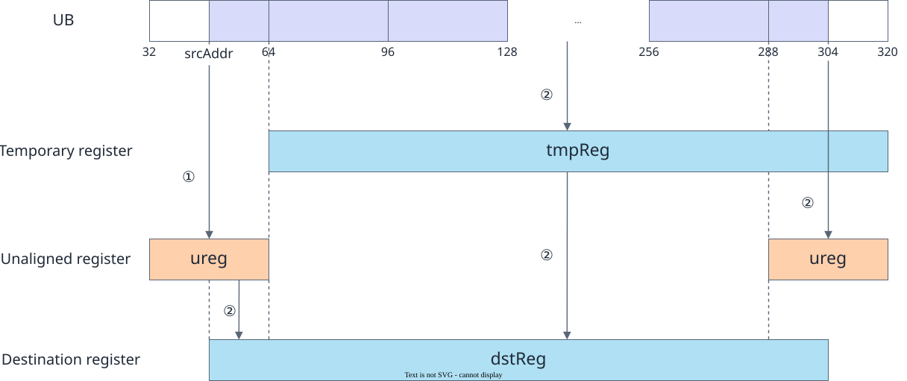
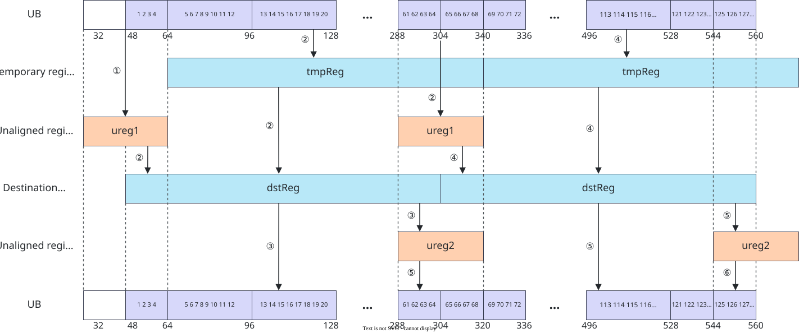

# vf.load_unalign

## Applicable Products

<!-- npu="950" id1 -->
- Ascend 950PR&950DT products: Supported
<!-- end id1 -->
<!-- npu="A3" id2 -->
- Atlas A3 products: Not supported
<!-- end id2 -->
<!-- npu="910b" id3 -->
- Atlas A2 products: Not supported
<!-- end id3 -->

## Description

To improve the ability to handle irregular memory addresses, reg_tensor supports accessing addresses that are not 32-byte aligned during data movement, thereby reducing the performance overhead caused by unaligned access. vf.load_unalign enables contiguous data movement from unaligned addresses to a reg_tensor. It uses the unaligned register UnalignRegForLoad as a temporary buffer to hold data that crosses alignment boundaries, achieving efficient contiguous unaligned data movement.

There are three types of APIs for unaligned movement: the ordinary movement API, the PostUpdate-extended movement API, and the API that stores the offset in the AddrReg register.

| API Type| Trigger Condition| Description|
|---|---|---|
| Ordinary movement API| stride not passed| After a movement is complete, the Tile address is not automatically updated. You need to manually update the address in each iteration.|
| PostUpdate-extended movement API| stride passed| After a movement is complete, the Tile address is automatically updated. You do not need to manually update the address in each iteration.|
| API that stores the offset in the AddrReg register| offset is an AddrReg created by vf.create_addr_reg.| In each iteration, vf.create_addr_reg must be called first to manually set the address offset, and then the movement instruction is called.|

Before reading unaligned addresses, you should first initialize via vf.load_unalign_pre to save the non-32-byte-aligned data, and then call vf.load_unalign to load the data in.

### Principle of Unaligned Load

As shown in the following figure, data is read from the Tile addresses srcAddr to 304 and moved to the destination reg_tensor (256 bytes). The process is as follows:

1. **load_unalign_pre** is called to initialize the unaligned load. The unaligned register ureg caches the valid data at Tile addresses 32 to 64 as the pre-data cache for subsequent unaligned access.

2. **load_unalign** is called. The hardware instruction moves the aligned data at Tile addresses 64 to 320 into a temporary reg_tensor, and concatenates the data in ureg corresponding to srcAddr to 64 with the data in the temporary reg_tensor corresponding to addresses 64 to 304. The result is written into the destination reg_tensor. In addition, the data at Tile addresses 288 to 320 is written into ureg.

**Figure 1** Example of unaligned load



### Contiguous unaligned data movement

**Figure 2** Contiguous unaligned data load and store (data type: DT_UINT32)



In contiguous unaligned load, vf.load_unalign caches the subsequent unaligned data into the ureg created by vf.load_unalign_init, so the next load does not need to call vf.load_unalign_pre again. vf.load_unalign_pre only needs to be called once before the iteration starts, thereby optimizing the performance of unaligned load.

In contiguous unaligned store, the vf.store_unalign of the next iteration writes the data that the current iteration's vf.store_unalign cached in ureg into the Tile. Therefore, the current iteration does not need to call vf.store_unalign_post to write the ureg data into the Tile; vf.store_unalign_post only needs to be called once after the iteration ends, thereby optimizing the performance of unaligned store.

As shown in the figure above, to load the DT_UINT32 data [1, 2, 3, ..., 128] at Tile addresses 48 to 560 into dstReg and then store it back to the Tile, two load/store operations are required, that is, the for loop is executed twice, with initialization and post-processing moved outside the for loop. stride = 256B/sizeof(T) (that is, the address offset is 256B each time), and repeatTimes = dataSize/256B (that is, the number of iterations = total data amount/VL).

The specific movement steps are as follows:

1. Unaligned load initialization: ureg is updated to [1, 2, 3, 4].
2. Unaligned load: tmpReg is set to [5, 6, 7, ..., 68]; part of the tmpReg data together with the ureg data is written into dstReg, so that dstReg contains [1, 2, 3, ..., 64]; ureg is updated to [61, 62, 63, ..., 68].
3. Unaligned store: Part of the dstReg data, [1, 2, 3, ..., 60], is written to Tile addresses 48–288; align_reg is updated to [61, 62, 63, 64].
4. Unaligned load: tmpReg is set to [69, 70, 71, ..., 128]; part of the ureg data together with the tmpReg data is written into dstReg, so that dstReg contains [65, 66, 67, ..., 128].
5. Unaligned store: The align_reg data [61, 62, 63, 64] together with part of the dstReg data [65, 66, 67, ..., 124] is written to Tile addresses 288–544; align_reg is updated to [125, 126, 127, 128].
6. Unaligned store post-processing: The data cached in align_reg, [125, 126, 127, 128], is written to Tile addresses 544–560.

## Prototype

```python
load_unalign(align_reg, tile, stride=None, /) -> dst
```

## Parameters

| Parameter| Input/Output| Description|
|---|---|---|
| align_reg | Input/Output| Unaligned register of type UnalignRegForLoad, which is used to store non-32-byte data. The register size is 32 bytes (created by vf.load_unalign_init()).|
| tile | Input| Source operand, Tile address. The start address must be 32-byte aligned. The destination operand and the source operand must have the same data type. The supported data types are DT_INT8, DT_UINT8, DT_INT16, DT_UINT16, DT_FP16, DT_BF16, DT_INT32, DT_UINT32, DT_FP32, DT_INT64, DT_UINT64, DT_FP8E4M3FN, DT_FP8E5M2, DT_FP8E8M0, DT_HF8, DT_FP4E2M1, and DT_FP4E1M2.|
| stride | Input| Optional. When this parameter is passed, the post-update mode is automatically enabled. After the movement, the source address is automatically incremented by the step size specified by stride. If this parameter is not passed, the common load mode is used.|

## Constraints

- The vf.load_unalign_pre and vf.load_unalign APIs must be used together.

## Return Value

Returns the destination operand dst, which is of type [reg_tensor](../basic_data_structures/reg_tensor.md). The supported data types are the same as those of tile.

## Examples

### Basic Unaligned Load

```python
import os
import pypto_pro.language as pl
import torch
import torch_npu

@pl.vector_function
def example_vf(src_tile, dst_tile):
    ureg = vf.load_unalign_init()
    vf.load_unalign_pre(ureg, src_tile)
    src_reg = vf.load_unalign(ureg, src_tile, 64)
    store_ureg = vf.unalign_reg_for_store()
    vf.store_unalign(dst_tile, src_reg, store_ureg, 64, post_update=True)
    vf.store_unalign_post(dst_tile, store_ureg, 0, post_update=True)

@pl.jit()
def example_kernel(
    a: pl.Tensor[[pl.DYNAMIC, pl.DYNAMIC], pl.DT_FP32],
    out: pl.Tensor[[pl.DYNAMIC, pl.DYNAMIC], pl.DT_FP32],
):
    tf = pl.TileType(shape=[1, 64], dtype=pl.DT_FP32, target_memory=pl.MemorySpace.Vec)
    in_a_grp = pl.make_tile_group(type=tf, addrs=0x0, mutex_ids=[0])
    in_a = in_a_grp.current()
    t_out_grp = pl.make_tile_group(type=tf, addrs=0x100, mutex_ids=[1])
    t_out = t_out_grp.current()
    with pl.section_vector():
        pl.load(in_a, a, [0, 0])
        example_vf(in_a, t_out)
        pl.store(out, t_out, [0, 0])

def test_example():
    device_id = int(os.environ.get("TILE_FWK_DEVICE_ID", 0))
    device = f"npu:{device_id}"
    core_nums = 1
    torch.npu.set_device(device)
    a = torch.randn([1, 64], device=device, dtype=torch.float32)
    out = torch.empty([1, 64], device=device, dtype=torch.float32)
    example_kernel[None, core_nums](a, out)
    torch.npu.synchronize()
    torch.testing.assert_close(out, a, rtol=1e-5, atol=1e-5)

if __name__ == "__main__":
    test_example()
    print("PASSED")
```

### Example of Contiguous Unaligned Load with Stride

```python
import os
import pypto_pro.language as pl
import torch
import torch_npu

@pl.vector_function
def example_vf(src_tile, dst_tile):
    preg = vf.create_mask(pattern=pl.MaskPattern.ALL, dtype=pl.DT_FP32)
    ureg = vf.load_unalign_init()
    vf.load_unalign_pre(ureg, src_tile)
    store_ureg = vf.unalign_reg_for_store()
    src_reg = vf.load_unalign(ureg, src_tile, 64)
    vf.store_unalign(dst_tile, src_reg, store_ureg, 64, post_update=True)
    vf.store_unalign_post(dst_tile, store_ureg, 64, post_update=True)

@pl.jit()
def example_kernel(
    a: pl.Tensor[[pl.DYNAMIC, pl.DYNAMIC], pl.DT_FP32],
    out: pl.Tensor[[pl.DYNAMIC, pl.DYNAMIC], pl.DT_FP32],
):
    tf = pl.TileType(shape=[1, 64], dtype=pl.DT_FP32, target_memory=pl.MemorySpace.Vec)
    in_a_grp = pl.make_tile_group(type=tf, addrs=0x0, mutex_ids=[0])
    in_a = in_a_grp.current()
    t_out_grp = pl.make_tile_group(type=tf, addrs=0x100, mutex_ids=[1])
    t_out = t_out_grp.current()
    with pl.section_vector():
        pl.load(in_a, a, [0, 0])
        example_vf(in_a, t_out)
        pl.store(out, t_out, [0, 0])

def test_example_2():
    device_id = int(os.environ.get("TILE_FWK_DEVICE_ID", 0))
    device = f"npu:{device_id}"
    core_nums = 1
    torch.npu.set_device(device)
    a = torch.randn([1, 64], device=device, dtype=torch.float32)
    out = torch.empty([1, 64], device=device, dtype=torch.float32)
    example_kernel[None, core_nums](a, out)
    torch.npu.synchronize()
    torch.testing.assert_close(out, a, rtol=1e-5, atol=1e-5)

if __name__ == "__main__":
    test_example_2()
    print("PASSED")
```

### INT64 Data Type Example

```python
import os
import pypto_pro.language as pl
import torch
import torch_npu

@pl.vector_function
def example_vf_int64(src_tile, dst_tile):
    preg = vf.create_mask(pattern=pl.MaskPattern.ALL, dtype=pl.DT_INT64)
    reg_a = vf.load_align(src_tile, 0)
    ureg = vf.load_unalign_init()
    vf.load_unalign_pre(ureg, src_tile)
    reg_out = vf.load_unalign(ureg, src_tile)
    vf.store_align(dst_tile, reg_out, preg)

@pl.jit()
def example_kernel_int64(
    a: pl.Tensor[[pl.DYNAMIC, pl.DYNAMIC], pl.DT_INT64],
    out: pl.Tensor[[pl.DYNAMIC, pl.DYNAMIC], pl.DT_INT64],
):
    tf = pl.TileType(shape=[1, 32], dtype=pl.DT_INT64, target_memory=pl.MemorySpace.Vec)
    in_a_grp = pl.make_tile_group(type=tf, addrs=0, mutex_ids=[0])
    in_a = in_a_grp.current()
    t_out_grp = pl.make_tile_group(type=tf, addrs=256, mutex_ids=[1])
    t_out = t_out_grp.current()
    with pl.section_vector():
        pl.load(in_a, a, [0, 0])
        example_vf_int64(in_a, t_out)
        pl.store(out, t_out, [0, 0])

def test_example_int64():
    device_id = int(os.environ.get("TILE_FWK_DEVICE_ID", 0))
    device = f"npu:{device_id}"
    core_nums = 1
    torch.npu.set_device(device)
    a = torch.randint(-100, 100, [1, 32], device=device, dtype=torch.int64)
    out = torch.empty([1, 32], device=device, dtype=torch.int64)
    example_kernel_int64[None, core_nums](a, out)
    torch.npu.synchronize()
    torch.testing.assert_close(out, a, rtol=0, atol=0)

if __name__ == "__main__":
    test_example_int64()
    print("PASSED")
```
