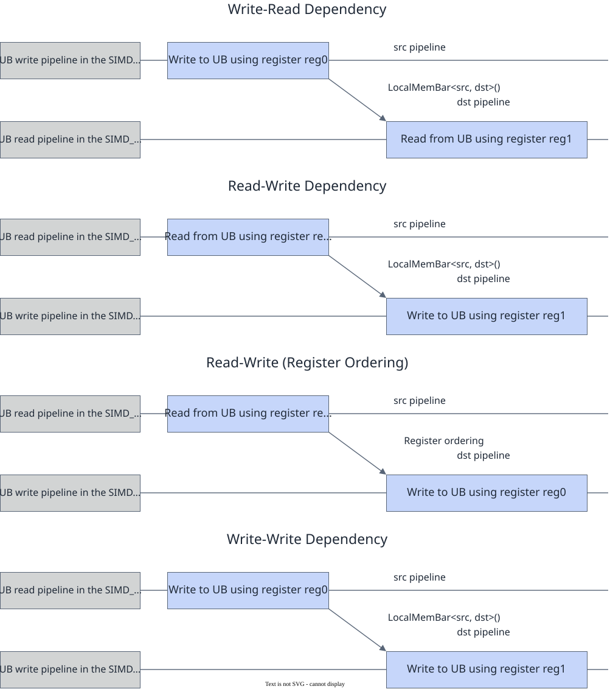

# vf.mem_bar

<!-- md-trans-meta sourceCommit=7d0ab31d84c294a0a8327f597d2bdee012acb22d translatedAt=2026-10-26T13:51:19.057Z pushedAt=2026-10-28T11:57:28.992Z nl=2 -->

## Applicable Products

<!-- npu="950" id1 -->
- Ascend 950PR&950DT products: Supported
<!-- end id1 -->
<!-- npu="A3" id2 -->
- Atlas A3 products: Not supported
<!-- end id2 -->
<!-- npu="910b" id3 -->
- Atlas A2 products: Not supported
<!-- end id3 -->

## Description

A memory barrier that imposes ordering guarantees between src-type memory operations and subsequent dst-type memory operations, ensuring that operations before the barrier are visible to operations after the barrier.

As shown in the following figure, the destination pipeline waits for all instructions on the source pipeline to complete before execution. In read/write scenarios, when the read instruction and the write instruction use the same register, register ordering is triggered, and the instructions execute in code order without inserting synchronization instructions. When different registers are used, a synchronization instruction must be inserted to ensure that the read and write instructions execute in order. The same applies to write/write scenarios.

**Figure 1** Pipeline waiting diagram



Select the src→dst type combination through mode. A total of 12 valid combinations are supported (V* indicates vector, *_LD, *_ST, ST_*, LD_* indicate scalar, and *_ALL indicates a full barrier for that unit):

| mode | src → dst meaning |
|---|---|
| VST_VLD | vector store → vector load (default, RAW) |
| VLD_VST | vector load → vector store (WAR) |
| VST_VST | vector store → vector store (WAW) |
| VST_LD | vector store → scalar load |
| VST_ST | vector store → scalar store |
| VLD_ST | vector load → scalar store |
| ST_VLD | scalar store → vector load |
| ST_VST | scalar store → vector store |
| LD_VST | scalar load → vector store |
| VV_ALL | all vectors ↔ all vectors |
| VS_ALL | all vectors ↔ all scalars |
| SV_ALL | all scalars ↔ all vectors |

## Prototype

```python
mem_bar(mode: Optional[MemBarMode] = None)
```

## Parameters

| Parameter | Input/Output | Description |
|---|---|---|
| mode | Input | Optional. Barrier mode, corresponding to the [MemBarMode](../basic_data_structures/MemBarMode.md) type, the pypto_pro.language.MemBarMode enum (see the 12 combinations in the table above). Defaults to pypto_pro.language.MemBarMode.VST_VLD. mode can only take one of the 12 valid combinations in the table above. |

## Constraints

None

## Return Value

None

## Examples

```python
import os
import pypto_pro.language as pl
import torch
import torch_npu

@pl.vector_function
def example_vf(in_a, t_f0):
    preg = vf.create_mask(pattern=pl.MaskPattern.ALL, dtype=pl.DT_FP32)
    reg_a = vf.load_align(in_a, 0)
    reg_t = vf.add(reg_a, reg_a, preg)
    vf.store_align(t_f0, reg_t, preg)
    vf.mem_bar(mode=pl.MemBarMode.VST_VST)
    reg_r = vf.load_align(t_f0, 0)
    vf.mem_bar(mode=pl.MemBarMode.VV_ALL)
    vf.store_align(t_f0, reg_r, preg)

@pl.jit()
def example_kernel(
    a: pl.Tensor[[pl.DYNAMIC, pl.DYNAMIC], pl.DT_FP32],
    out: pl.Tensor[[pl.DYNAMIC, pl.DYNAMIC], pl.DT_FP32],
):
    tf = pl.TileType(shape=[1, 64], dtype=pl.DT_FP32, target_memory=pl.MemorySpace.Vec)
    in_a_grp = pl.make_tile_group(type=tf, addrs=0x0, mutex_ids=[0])
    in_a = in_a_grp.current()
    t_out_grp = pl.make_tile_group(type=tf, addrs=0x100, mutex_ids=[1])
    t_out = t_out_grp.current()
    with pl.section_vector():
        pl.load(in_a, a, [0, 0])
        example_vf(in_a, t_out)
        pl.store(out, t_out, [0, 0])

def test_example():
    device_id = int(os.environ.get("TILE_FWK_DEVICE_ID", 0))
    device = f"npu:{device_id}"
    core_nums = 1
    torch.npu.set_device(device)
    a = torch.randn([1, 64], device=device, dtype=torch.float32)
    out = torch.empty([1, 64], device=device, dtype=torch.float32)
    example_kernel[None, core_nums](a, out)
    torch.npu.synchronize()
    torch.testing.assert_close(out, a + a, rtol=1e-5, atol=1e-5)

if __name__ == "__main__":
    test_example()
    print("PASSED")
```
