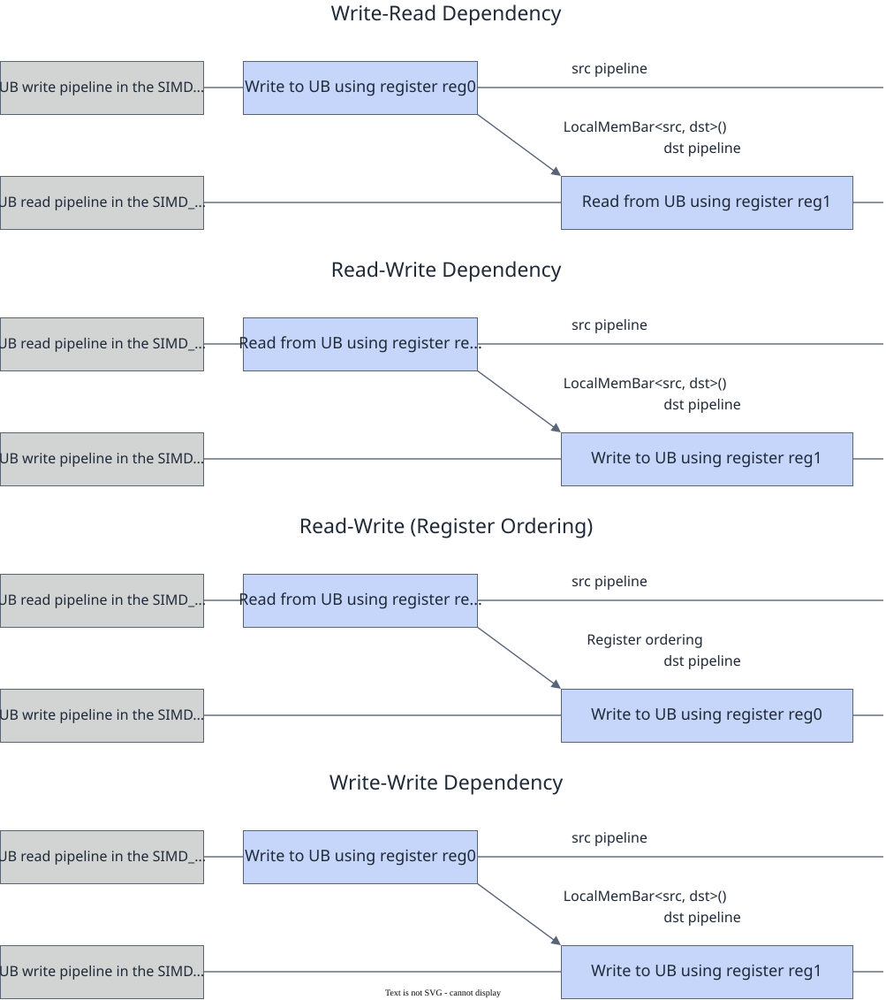

# vf.mem_bar

## Applicable Products

<!-- npu="950" id1 -->
- Ascend 950PR&950DT products: Supported
<!-- end id1 -->
<!-- npu="A3" id2 -->
- Atlas A3 products: Not supported
<!-- end id2 -->
<!-- npu="910b" id3 -->
- Atlas A2 products: Not supported
<!-- end id3 -->

## Description

Memory barrier, which imposes an ordering guarantee between src-class memory operations and subsequent dst-class memory operations, ensuring that operations before the barrier are visible to operations after the barrier.

As shown in the following figure, the destination pipeline waits for all instructions on the source pipeline to complete before execution. In a read-write scenario, when the register used by the read instruction is the same as the register used by the write instruction, register ordering can be triggered, and the instructions are executed in program order without inserting a synchronization instruction. When the registers used are different, a synchronization instruction must be inserted if the read and write instructions are to be executed in order. The same applies to write-write scenarios.

**Figure 1** Pipeline waiting



The mode selects the src→dst type combination, and a total of 12 valid combinations are supported (V denotes vector; LD and ST denote scalar; _ALL denotes a full barrier for the unit).

| Mode| src → dst Meaning|
|---|---|
| VST_VLD | Vector store → Vector load (default, RAW)|
| VLD_VST | Vector load → Vector store (WAR)|
| VST_VST | Vector store → Vector store (WAW)|
| VST_LD | Vector store → Scalar load|
| VST_ST | Vector store → Scalar store|
| VLD_ST | Vector load → Scalar store|
| ST_VLD | Scalar store → Vector load|
| ST_VST | Scalar store → Vector store|
| LD_VST | Scalar load → Vector store|
| VV_ALL | All vectors ↔ All vectors|
| VS_ALL | All vectors ↔ All scalars|
| SV_ALL | All scalars ↔ All vectors|

## Prototype

```python
mem_bar(*, mode: Optional[MemBarMode] = None)
```

## Parameters

| Parameter| Input/Output| Description|
|---|---|---|
| mode | Input| (Optional) Barrier mode, corresponding to the [MemBarMode](../basic_data_structures/MemBarMode.md) type, a pypto_pro.language.MemBarMode enumeration (see the 12 combinations in the preceding table). The default value is pypto_pro.language.MemBarMode.VST_VLD. The value of mode can only be one of the 12 valid combinations listed in the preceding table.|

## Constraints

None

## Return Value

None

## Examples

```python
import os
import pypto_pro.language as pl
import torch
import torch_npu

@pl.vector_function
def example_vf(in_a, t_f0):
    preg = vf.create_mask(pattern=pl.MaskPattern.ALL, dtype=pl.DT_FP32)
    reg_a = vf.load_align(in_a, 0)
    reg_t = vf.add(reg_a, reg_a, preg)
    vf.store_align(t_f0, reg_t, preg)
    vf.mem_bar(mode=pl.MemBarMode.VST_VST)
    reg_r = vf.load_align(t_f0, 0)
    vf.mem_bar(mode=pl.MemBarMode.VV_ALL)
    vf.store_align(t_f0, reg_r, preg)

@pl.jit()
def example_kernel(
    a: pl.Tensor[[pl.DYNAMIC, pl.DYNAMIC], pl.DT_FP32],
    out: pl.Tensor[[pl.DYNAMIC, pl.DYNAMIC], pl.DT_FP32],
):
    tf = pl.TileType(shape=[1, 64], dtype=pl.DT_FP32, target_memory=pl.MemorySpace.Vec)
    in_a_grp = pl.make_tile_group(type=tf, addrs=0x0, mutex_ids=[0])
    in_a = in_a_grp.current()
    t_out_grp = pl.make_tile_group(type=tf, addrs=0x100, mutex_ids=[1])
    t_out = t_out_grp.current()
    with pl.section_vector():
        pl.load(in_a, a, [0, 0])
        example_vf(in_a, t_out)
        pl.store(out, t_out, [0, 0])

def test_example():
    device_id = int(os.environ.get("TILE_FWK_DEVICE_ID", 0))
    device = f"npu:{device_id}"
    core_nums = 1
    torch.npu.set_device(device)
    a = torch.randn([1, 64], device=device, dtype=torch.float32)
    out = torch.empty([1, 64], device=device, dtype=torch.float32)
    example_kernel[None, core_nums](a, out)
    torch.npu.synchronize()
    torch.testing.assert_close(out, a + a, rtol=1e-5, atol=1e-5)

if __name__ == "__main__":
    test_example()
    print("PASSED")
```
