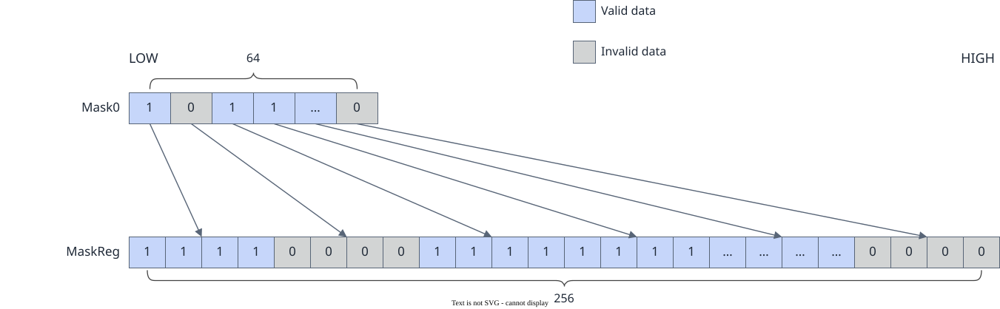

# vf.move

## Applicable Products

<!-- npu="950" id1 -->
- Ascend 950PR&950DT products: Supported
<!-- end id1 -->
<!-- npu="A3" id2 -->
- Atlas A3 products: Not supported
<!-- end id2 -->
<!-- npu="910b" id3 -->
- Atlas A2 products: Not supported
<!-- end id3 -->

## Description

Copies elements from the source operand src to the corresponding position of the destination operand dst. Two register types are supported: reg_tensor and mask_reg.

- **reg_tensor mode**: Each valid element in src is copied one by one into the corresponding position in dst, while invalid positions retain the original value of dst.
- **mask_reg mode**: Bits in src are copied to the corresponding positions in dst. If there is an input mask, only the valid bits selected by the mask are copied, and invalid positions are filled with 0. The mechanism is shown in the following figure. For the 16-bit width types (DT_INT16, DT_UINT16, DT_FP16, and DT_BF16), the complete 128-bit {MASK1, MASK0} is read, and each bit is duplicated into 2 bits. For the 32-bit width types (DT_INT32, DT_UINT32, and DT_FP32), the 64-bit MASK0 is read, and each bit is duplicated into 4 bits.

  

## Prototype

```python
move(src, preg=None, /, *, mode: Optional[MergeMode] = None) -> dst
```

## Parameters

| Parameter| Input/Output| Description|
|---|---|---|
| src | Input| Source operand, which is of type [reg_tensor](../basic_data_structures/reg_tensor.md) or [mask_reg](../basic_data_structures/mask_reg.md). The source operand src and the destination operand dst must have the same data type. The supported data types are DT_BOOL, DT_INT8, DT_UINT8, DT_INT16, DT_UINT16, DT_FP16, DT_BF16, DT_INT32, DT_UINT32, DT_FP32, DT_INT64, and DT_UINT64.|
| preg | Input| [mask_reg](../basic_data_structures/mask_reg.md). It controls which elements/bits are involved in the operation.<br>- **reg_tensor mode**: preg is a valid indicator of element operations. For positions selected by preg, the corresponding elements in src are copied into dst; for positions not selected by preg, dst retains its original value.<br>- **mask_reg mode**: preg controls which bits are valid. For bits selected by preg, the corresponding bits in src are copied into dst; for bits not selected by preg, the corresponding positions in dst are filled with 0.|
| mode | Input| (Optional) This parameter corresponds to the [MergeMode](../basic_data_structures/MergeMode.md) type.<br>- pypto_pro.language.MergeMode.MERGING (default): Elements not selected by preg retain their original values in dst.<br>- pypto_pro.language.MergeMode.ZEROING (**not supported** currently).|

## Constraints

None

## Return Value

Returns the destination operand dst, which is of type [reg_tensor](../basic_data_structures/reg_tensor.md) or [mask_reg](../basic_data_structures/mask_reg.md). The supported data types are the same as those for src.

## Examples

### reg_tensor Mode

```python
import os
import pypto_pro.language as pl
import torch
import torch_npu

@pl.vector_function
def example_vf(src_tile, dst_tile):
    preg = vf.create_mask(pattern=pl.MaskPattern.ALL, dtype=pl.DT_FP32)
    reg_a = vf.load_align(src_tile, 0)
    reg_b = vf.move(reg_a, preg)
    src_mask = vf.create_mask(pattern=pl.MaskPattern.ALL, dtype=pl.DT_FP32)
    dst_mask = vf.create_mask(pattern=pl.MaskPattern.ALLF, dtype=pl.DT_FP32)
    dst_mask = vf.move(src_mask)
    vf.store_align(dst_tile, reg_b, dst_mask)

@pl.jit()
def example_kernel(
    a: pl.Tensor[[pl.DYNAMIC, pl.DYNAMIC], pl.DT_FP32],
    out: pl.Tensor[[pl.DYNAMIC, pl.DYNAMIC], pl.DT_FP32],
):
    tf = pl.TileType(shape=[1, 64], dtype=pl.DT_FP32, target_memory=pl.MemorySpace.Vec)
    in_a_grp = pl.make_tile_group(type=tf, addrs=0x0, mutex_ids=[0])
    in_a = in_a_grp.current()
    t_out_grp = pl.make_tile_group(type=tf, addrs=0x100, mutex_ids=[1])
    t_out = t_out_grp.current()
    with pl.section_vector():
        pl.load(in_a, a, [0, 0])
        example_vf(in_a, t_out)
        pl.store(out, t_out, [0, 0])

def test_example():
    device_id = int(os.environ.get("TILE_FWK_DEVICE_ID", 0))
    device = f"npu:{device_id}"
    core_nums = 1
    torch.npu.set_device(device)
    a = torch.randn([1, 64], device=device, dtype=torch.float32)
    out = torch.empty([1, 64], device=device, dtype=torch.float32)
    example_kernel[None, core_nums](a, out)
    torch.npu.synchronize()
    torch.testing.assert_close(out, a, rtol=1e-5, atol=1e-5)

if __name__ == "__main__":
    test_example()
    print("PASSED")
```

### mask_reg Mode

```python
import os
import pypto_pro.language as pl
import torch
import torch_npu

@pl.vector_function
def example_vf(src_tile, dst_tile):
    preg = vf.create_mask(pattern=pl.MaskPattern.ALL, dtype=pl.DT_FP32)
    reg = vf.load_align(src_tile, 0)
    mask_a = vf.ge(reg, 0.0, preg)
    dst_mask = vf.move(mask_a)
    reg_dst = vf.abs(reg, dst_mask)
    vf.store_align(dst_tile, reg_dst, preg)

@pl.jit()
def example_kernel(
    a: pl.Tensor[[pl.DYNAMIC, pl.DYNAMIC], pl.DT_FP32],
    out: pl.Tensor[[pl.DYNAMIC, pl.DYNAMIC], pl.DT_FP32],
):
    tf = pl.TileType(shape=[1, 64], dtype=pl.DT_FP32, target_memory=pl.MemorySpace.Vec)
    in_a_grp = pl.make_tile_group(type=tf, addrs=0x0, mutex_ids=[0])
    in_a = in_a_grp.current()
    t_out_grp = pl.make_tile_group(type=tf, addrs=0x100, mutex_ids=[1])
    t_out = t_out_grp.current()
    with pl.section_vector():
        pl.load(in_a, a, [0, 0])
        example_vf(in_a, t_out)
        pl.store(out, t_out, [0, 0])

def test_example():
    device_id = int(os.environ.get("TILE_FWK_DEVICE_ID", 0))
    device = f"npu:{device_id}"
    core_nums = 1
    torch.npu.set_device(device)
    a = torch.randn([1, 64], device=device, dtype=torch.float32)
    out = torch.empty([1, 64], device=device, dtype=torch.float32)
    example_kernel[None, core_nums](a, out)
    torch.npu.synchronize()
    expected = torch.where(a >= 0, a, torch.zeros_like(a))
    torch.testing.assert_close(out, expected, rtol=1e-5, atol=1e-5)

if __name__ == "__main__":
    test_example()
    print("PASSED")
```

### FP8 Data Type in reg_tensor Mode

```python
import os
import pypto_pro.language as pl
import torch
import torch_npu

@pl.vector_function
def example_vf_fp8(src_tile, dst_tile):
    preg = vf.create_mask(pattern=pl.MaskPattern.ALL, dtype=pl.DT_FP32)
    reg_f8 = vf.load_align(src_tile, 0, dtype=pl.DT_FP8E4M3FN)
    reg_f32 = vf.astype(reg_f8, preg, dtype=pl.DT_FP32)
    reg_dst = vf.move(reg_f32, preg)
    vf.store_align(dst_tile, reg_dst, preg)

@pl.jit()
def example_kernel_fp8(
    a: pl.Tensor[[pl.DYNAMIC, pl.DYNAMIC], pl.DT_FP8E4M3FN],
    out: pl.Tensor[[pl.DYNAMIC, pl.DYNAMIC], pl.DT_FP32],
):
    tf_in = pl.TileType(shape=[1, 256], dtype=pl.DT_FP8E4M3FN, target_memory=pl.MemorySpace.Vec)
    tf_out = pl.TileType(shape=[1, 64], dtype=pl.DT_FP32, target_memory=pl.MemorySpace.Vec)
    in_a_grp = pl.make_tile_group(type=tf_in, addrs=0x0, mutex_ids=[0])
    in_a = in_a_grp.current()
    t_out_grp = pl.make_tile_group(type=tf_out, addrs=0x100, mutex_ids=[1])
    t_out = t_out_grp.current()
    with pl.section_vector():
        pl.load(in_a, a, [0, 0])
        example_vf_fp8(in_a, t_out)
        pl.store(out, t_out, [0, 0])

def test_example_fp8():
    device_id = int(os.environ.get("TILE_FWK_DEVICE_ID", 0))
    device = f"npu:{device_id}"
    core_nums = 1
    torch.npu.set_device(device)
    a = torch.randn([1, 256], device=device, dtype=torch.float32).to(torch.float8_e4m3fn)
    out = torch.empty([1, 64], device=device, dtype=torch.float32)
    example_kernel_fp8[None, core_nums](a, out)
    torch.npu.synchronize()
    expected = a.to(torch.float32)
    torch.testing.assert_close(out, expected[:, ::4], rtol=1e-2, atol=1e-2)

if __name__ == "__main__":
    test_example_fp8()
    print("PASSED")
```

### INT64 Data Type Example

```python
import os
import pypto_pro.language as pl
import torch
import torch_npu

@pl.vector_function
def example_vf_int64(src_tile, dst_tile):
    preg = vf.create_mask(pattern=pl.MaskPattern.ALL, dtype=pl.DT_INT64)
    reg_a = vf.load_align(src_tile, 0)
    reg_out = vf.move(reg_a, preg)
    vf.store_align(dst_tile, reg_out, preg)

@pl.jit()
def example_kernel_int64(
    a: pl.Tensor[[pl.DYNAMIC, pl.DYNAMIC], pl.DT_INT64],
    out: pl.Tensor[[pl.DYNAMIC, pl.DYNAMIC], pl.DT_INT64],
):
    tf = pl.TileType(shape=[1, 32], dtype=pl.DT_INT64, target_memory=pl.MemorySpace.Vec)
    in_a_grp = pl.make_tile_group(type=tf, addrs=0, mutex_ids=[0])
    in_a = in_a_grp.current()
    t_out_grp = pl.make_tile_group(type=tf, addrs=256, mutex_ids=[1])
    t_out = t_out_grp.current()
    with pl.section_vector():
        pl.load(in_a, a, [0, 0])
        example_vf_int64(in_a, t_out)
        pl.store(out, t_out, [0, 0])

def test_example_int64():
    device_id = int(os.environ.get("TILE_FWK_DEVICE_ID", 0))
    device = f"npu:{device_id}"
    core_nums = 1
    torch.npu.set_device(device)
    a = torch.randint(-100, 100, [1, 32], device=device, dtype=torch.int64)
    out = torch.empty([1, 32], device=device, dtype=torch.int64)
    example_kernel_int64[None, core_nums](a, out)
    torch.npu.synchronize()
    torch.testing.assert_close(out, a, rtol=0, atol=0)

if __name__ == "__main__":
    test_example_int64()
    print("PASSED")
```
