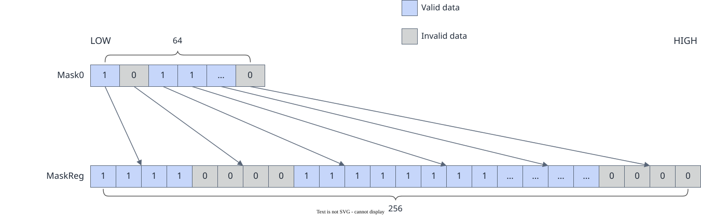

# vf.move

<!-- md-trans-meta sourceCommit=7d0ab31d84c294a0a8327f597d2bdee012acb22d translatedAt=2026-10-26T13:52:10.694Z pushedAt=2026-10-28T11:57:29.001Z nl=2 -->

## Applicable Products

<!-- npu="950" id1 -->
- Ascend 950PR&950DT products: Supported
<!-- end id1 -->
<!-- npu="A3" id2 -->
- Atlas A3 products: not supported
<!-- end id2 -->
<!-- npu="910b" id3 -->
- Atlas A2 products: not supported
<!-- end id3 -->

## Description

Copies the elements in the source operand src to the corresponding positions in the destination operand dst. Two register types are supported: reg_tensor and mask_reg:

- **reg_tensor mode**: Copies each valid element in src to the corresponding position in dst, while invalid positions retain the original dst values.
- **mask_reg mode**: Copies the bits in src to the corresponding positions in dst. If a mask is provided, only the valid bits selected by the mask are copied, and invalid positions are filled with 0. The mechanism is shown in the following figure: for 16-bit-wide types (DT_INT16, DT_UINT16, DT_FP16, DT_BF16), the full 128-bit {MASK1, MASK0} is read and each bit is replicated to 2 bits; for 32-bit-wide types (DT_INT32, DT_UINT32, DT_FP32), the 64-bit MASK0 is read and each bit is replicated to 4 bits.

  

## Prototype

```python
move(src, preg, mode: Optional[MergeMode] = None) -> dst
```

## Parameters

| Parameter | Input/Output | Description |
|---|---|---|
| src | Input | Source operand, of type [reg_tensor](../basic_data_structures/reg_tensor.md) or [mask_reg](../basic_data_structures/mask_reg.md). The data type of the source operand src must be consistent with that of the destination operand dst. Supported data types: DT_BOOL, DT_INT8, DT_UINT8, DT_INT16, DT_UINT16, DT_FP16, DT_BF16, DT_INT32, DT_UINT32, DT_FP32. |
| preg | Input | [mask_reg](../basic_data_structures/mask_reg.md). Controls which elements/bits participate in the operation:<br>- **reg_tensor mode**: preg indicates which elements are valid. For positions selected by preg, the corresponding elements in src are copied to dst; for positions not selected by preg, dst retains the original values.<br>- **mask_reg mode**: preg controls which bits are valid. For bits selected by preg, the corresponding bits in src are copied to dst; for bits not selected by preg, the corresponding positions in dst are filled with 0. |
| mode | Input | Optional, of type [MergeMode](../basic_data_structures/MergeMode.md).<br>- pypto_pro.language.MergeMode.MERGING (default): elements not selected by preg retain the original values in dst.<br>- pypto_pro.language.MergeMode.ZEROING: currently **not supported**. |

## Constraints

None

## Return Value

Returns the destination operand dst, of type [reg_tensor](../basic_data_structures/reg_tensor.md) or [mask_reg](../basic_data_structures/mask_reg.md). The supported data types are the same as those described for src.

## Examples

### reg_tensor Mode

```python
import os
import pypto_pro.language as pl
import torch
import torch_npu

@pl.vector_function
def example_vf(src_tile, dst_tile):
    preg = vf.create_mask(pattern=pl.MaskPattern.ALL, dtype=pl.DT_FP32)
    reg_a = vf.load_align(src_tile, 0)
    reg_b = vf.move(reg_a, preg)
    src_mask = vf.create_mask(pattern=pl.MaskPattern.ALL, dtype=pl.DT_FP32)
    dst_mask = vf.create_mask(pattern=pl.MaskPattern.ALLF, dtype=pl.DT_FP32)
    dst_mask = vf.move(src_mask)
    vf.store_align(dst_tile, reg_b, dst_mask)

@pl.jit()
def example_kernel(
    a: pl.Tensor[[pl.DYNAMIC, pl.DYNAMIC], pl.DT_FP32],
    out: pl.Tensor[[pl.DYNAMIC, pl.DYNAMIC], pl.DT_FP32],
):
    tf = pl.TileType(shape=[1, 64], dtype=pl.DT_FP32, target_memory=pl.MemorySpace.Vec)
    in_a_grp = pl.make_tile_group(type=tf, addrs=0x0, mutex_ids=[0])
    in_a = in_a_grp.current()
    t_out_grp = pl.make_tile_group(type=tf, addrs=0x100, mutex_ids=[1])
    t_out = t_out_grp.current()
    with pl.section_vector():
        pl.load(in_a, a, [0, 0])
        example_vf(in_a, t_out)
        pl.store(out, t_out, [0, 0])

def test_example():
    device_id = int(os.environ.get("TILE_FWK_DEVICE_ID", 0))
    device = f"npu:{device_id}"
    core_nums = 1
    torch.npu.set_device(device)
    a = torch.randn([1, 64], device=device, dtype=torch.float32)
    out = torch.empty([1, 64], device=device, dtype=torch.float32)
    example_kernel[None, core_nums](a, out)
    torch.npu.synchronize()
    torch.testing.assert_close(out, a, rtol=1e-5, atol=1e-5)

if __name__ == "__main__":
    test_example()
    print("PASSED")
```

### mask_reg mode

```python
import os
import pypto_pro.language as pl
import torch
import torch_npu

@pl.vector_function
def example_vf(src_tile, dst_tile):
    preg = vf.create_mask(pattern=pl.MaskPattern.ALL, dtype=pl.DT_FP32)
    reg = vf.load_align(src_tile, 0)
    mask_a = vf.ge(reg, 0.0, preg)
    dst_mask = vf.move(mask_a)
    reg_dst = vf.abs(reg, dst_mask)
    vf.store_align(dst_tile, reg_dst, preg)

@pl.jit()
def example_kernel(
    a: pl.Tensor[[pl.DYNAMIC, pl.DYNAMIC], pl.DT_FP32],
    out: pl.Tensor[[pl.DYNAMIC, pl.DYNAMIC], pl.DT_FP32],
):
    tf = pl.TileType(shape=[1, 64], dtype=pl.DT_FP32, target_memory=pl.MemorySpace.Vec)
    in_a_grp = pl.make_tile_group(type=tf, addrs=0x0, mutex_ids=[0])
    in_a = in_a_grp.current()
    t_out_grp = pl.make_tile_group(type=tf, addrs=0x100, mutex_ids=[1])
    t_out = t_out_grp.current()
    with pl.section_vector():
        pl.load(in_a, a, [0, 0])
        example_vf(in_a, t_out)
        pl.store(out, t_out, [0, 0])

def test_example():
    device_id = int(os.environ.get("TILE_FWK_DEVICE_ID", 0))
    device = f"npu:{device_id}"
    core_nums = 1
    torch.npu.set_device(device)
    a = torch.randn([1, 64], device=device, dtype=torch.float32)
    out = torch.empty([1, 64], device=device, dtype=torch.float32)
    example_kernel[None, core_nums](a, out)
    torch.npu.synchronize()
    expected = torch.where(a >= 0, a, torch.zeros_like(a))
    torch.testing.assert_close(out, expected, rtol=1e-5, atol=1e-5)

if __name__ == "__main__":
    test_example()
    print("PASSED")
```

### reg_tensor Mode with FP8 Data Type

```python
import os
import pypto_pro.language as pl
import torch
import torch_npu

@pl.vector_function
def example_vf_fp8(src_tile, dst_tile):
    preg = vf.create_mask(pattern=pl.MaskPattern.ALL, dtype=pl.DT_FP32)
    reg_f8 = vf.load_align(src_tile, 0, dtype=pl.DT_FP8E4M3FN)
    reg_f32 = vf.astype(reg_f8, preg, dtype=pl.DT_FP32)
    reg_dst = vf.move(reg_f32, preg)
    vf.store_align(dst_tile, reg_dst, preg)

@pl.jit()
def example_kernel_fp8(
    a: pl.Tensor[[pl.DYNAMIC, pl.DYNAMIC], pl.DT_FP8E4M3FN],
    out: pl.Tensor[[pl.DYNAMIC, pl.DYNAMIC], pl.DT_FP32],
):
    tf_in = pl.TileType(shape=[1, 256], dtype=pl.DT_FP8E4M3FN, target_memory=pl.MemorySpace.Vec)
    tf_out = pl.TileType(shape=[1, 64], dtype=pl.DT_FP32, target_memory=pl.MemorySpace.Vec)
    in_a_grp = pl.make_tile_group(type=tf_in, addrs=0x0, mutex_ids=[0])
    in_a = in_a_grp.current()
    t_out_grp = pl.make_tile_group(type=tf_out, addrs=0x100, mutex_ids=[1])
    t_out = t_out_grp.current()
    with pl.section_vector():
        pl.load(in_a, a, [0, 0])
        example_vf_fp8(in_a, t_out)
        pl.store(out, t_out, [0, 0])

def test_example_fp8():
    device_id = int(os.environ.get("TILE_FWK_DEVICE_ID", 0))
    device = f"npu:{device_id}"
    core_nums = 1
    torch.npu.set_device(device)
    a = torch.randn([1, 256], device=device, dtype=torch.float32).to(torch.float8_e4m3fn)
    out = torch.empty([1, 64], device=device, dtype=torch.float32)
    example_kernel_fp8[None, core_nums](a, out)
    torch.npu.synchronize()
    expected = a.to(torch.float32)
    torch.testing.assert_close(out, expected[:, ::4], rtol=1e-2, atol=1e-2)

if __name__ == "__main__":
    test_example_fp8()
    print("PASSED")
```
