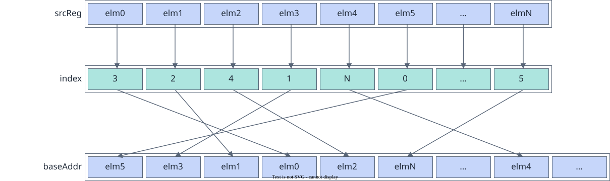

# vf.scatter

<!-- md-trans-meta sourceCommit=7d0ab31d84c294a0a8327f597d2bdee012acb22d translatedAt=2026-10-26T13:51:46.983Z pushedAt=2026-10-28T11:57:28.998Z nl=2 -->

## Applicable Products

<!-- npu="950" id1 -->
- Ascend 950PR&950DT products: Supported
<!-- end id1 -->
<!-- npu="A3" id2 -->
- Atlas A3 products: Not supported
<!-- end id2 -->
<!-- npu="910b" id3 -->
- Atlas A2 products: Not supported
<!-- end id3 -->

## Description

This instruction scatters the elements in the source operand src into the destination operand Tile based on the index value index. The scattering process is shown in the following figure:

**Figure 1** vf.scatter function description



## Prototype

```python
scatter(tile, src, index, preg)
```

## Parameters

| Parameter | Input/Output | Description |
|---|---|---|
| tile | Output | Destination operand, Tile address, which must be 32-byte aligned. |
| src | Input | Source operand, [reg_tensor](../basic_data_structures/reg_tensor.md). For supported data types, see [Constraints](#constraints). When src is of the DT_INT8 or DT_UINT8 data type, only the even-indexed elements in the source operand are valid. That is, the data at even positions [0, 2, 4, ..., 252, 254] in src is scattered and stored into the destination operand. |
| index | Input | Index value, [reg_tensor](../basic_data_structures/reg_tensor.md). For supported data types, see [Constraints](#constraints). The position of each element in src relative to the base address in Tile, in elements. The values in index must be unique. If duplicate index values exist, the system retains only the data corresponding to one of them. |
| preg | Input | [mask_reg](../basic_data_structures/mask_reg.md). |

## Constraints

- Data type constraints:

  | src | index |
  |---|---|
  | DT_INT8 | DT_UINT16 |
  | DT_UINT8 | DT_UINT16 |
  | DT_INT16 | DT_UINT16 |
  | DT_UINT16 | DT_UINT16 |
  | DT_FP16 | DT_UINT16 |
  | DT_BF16 | DT_UINT16 |
  | DT_INT32 | DT_UINT32 |
  | DT_UINT32 | DT_UINT32 |
  | DT_FP32 | DT_UINT32 |
  | DT_INT64 | DT_UINT32 |
  | DT_INT64 | DT_UINT64 |
  | DT_UINT64 | DT_UINT32 |
  | DT_UINT64 | DT_UINT64 |

## Return Value

None

## Examples

```python
import os
import pypto_pro.language as pl
import torch
import torch_npu

@pl.vector_function
def example_vf(src_tile, index_tile, dst_tile):
    preg = vf.create_mask(pattern=pl.MaskPattern.ALL, dtype=pl.DT_FP32)
    src_reg = vf.load_align(src_tile, 0)
    index_reg = vf.load_align(index_tile, 0)
    vf.scatter(dst_tile, src_reg, index_reg, preg)

@pl.jit()
def example_kernel(
    a: pl.Tensor[[pl.DYNAMIC, pl.DYNAMIC], pl.DT_FP32],
    idx: pl.Tensor[[pl.DYNAMIC, pl.DYNAMIC], pl.DT_UINT32],
    out: pl.Tensor[[pl.DYNAMIC, pl.DYNAMIC], pl.DT_FP32],
):
    tf = pl.TileType(shape=[1, 64], dtype=pl.DT_FP32, target_memory=pl.MemorySpace.Vec)
    tf_idx = pl.TileType(shape=[1, 64], dtype=pl.DT_UINT32, target_memory=pl.MemorySpace.Vec)
    in_a_grp = pl.make_tile_group(type=tf, addrs=0x0, mutex_ids=[0])
    in_a = in_a_grp.current()
    in_idx_grp = pl.make_tile_group(type=tf_idx, addrs=0x100, mutex_ids=[1])
    in_idx = in_idx_grp.current()
    t_out_grp = pl.make_tile_group(type=tf, addrs=0x200, mutex_ids=[2])
    t_out = t_out_grp.current()
    with pl.section_vector():
        pl.load(in_a, a, [0, 0])
        pl.load(in_idx, idx, [0, 0])
        example_vf(in_a, in_idx, t_out)
        pl.store(out, t_out, [0, 0])

def test_example():
    device_id = int(os.environ.get("TILE_FWK_DEVICE_ID", 0))
    device = f"npu:{device_id}"
    core_nums = 1
    torch.npu.set_device(device)
    a = torch.randn([1, 64], device=device, dtype=torch.float32)
    idx = torch.arange(64, device=device, dtype=torch.int32).reshape([1, 64])
    out = torch.empty([1, 64], device=device, dtype=torch.float32)
    example_kernel[None, core_nums](a, idx, out)
    torch.npu.synchronize()
    torch.testing.assert_close(out, a, rtol=1e-5, atol=1e-5)

if __name__ == "__main__":
    test_example()
    print("PASSED")
```
