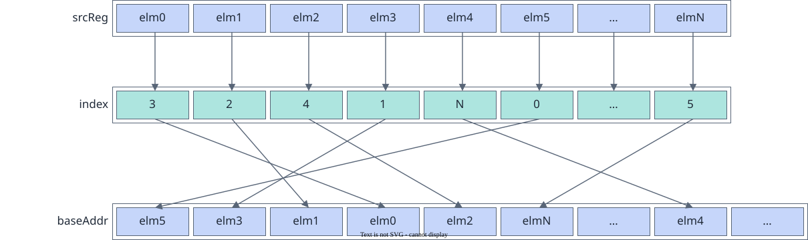

# vf.scatter

## Applicable Products

<!-- npu="950" id1 -->
- Ascend 950PR&950DT products: Supported
<!-- end id1 -->
<!-- npu="A3" id2 -->
- Atlas A3 products: Not supported
<!-- end id2 -->
<!-- npu="910b" id3 -->
- Atlas A2 products: Not supported
<!-- end id3 -->

## Description

This instruction scatters the elements in the source operand src into the destination operand Tile according to the index value (index). The following figure shows the scatter process.

**Figure 1** vf.scatter function description



## Prototype

```python
scatter(tile, src, index, preg, /)
```

## Parameters

| Parameter| Input/Output| Description|
|---|---|---|
| tile | Output| Destination operand, Tile address, which must be 32-byte aligned.|
| src | Input| Source operand, which is of type [reg_tensor](../basic_data_structures/reg_tensor.md). For details about the supported data types, see [Constraints](#constraints). When src is of the DT_INT8 or DT_UINT8 data type, only the even elements in the source operand are valid. That is, the data at even positions [0, 2, 4, ..., 252, 254] in src is scattered to the destination operand.|
| index | Input| Index value, which is of type [reg_tensor](../basic_data_structures/reg_tensor.md). For details about the supported data types, see [Constraints](#constraints). The index value specifies the position of each element in src relative to the base address in Tile, in units of elements. The values in index must be unique. If duplicate index values exist, the system retains only one corresponding data record.|
| preg | Input| [mask_reg](../basic_data_structures/mask_reg.md).|

## Constraints

- Data type constraints:

  | src | index |
  |---|---|
  | DT_INT8 | DT_UINT16 |
  | DT_UINT8 | DT_UINT16 |
  | DT_INT16 | DT_UINT16 |
  | DT_UINT16 | DT_UINT16 |
  | DT_FP16 | DT_UINT16 |
  | DT_BF16 | DT_UINT16 |
  | DT_INT32 | DT_UINT32 |
  | DT_UINT32 | DT_UINT32 |
  | DT_FP32 | DT_UINT32 |
  | DT_INT64 | DT_UINT32 |
  | DT_INT64 | DT_UINT64 |
  | DT_UINT64 | DT_UINT32 |
  | DT_UINT64 | DT_UINT64 |

## Return Value

None

## Examples

### Basic Call Example

```python
import os
import pypto_pro.language as pl
import torch
import torch_npu

@pl.vector_function
def example_vf(src_tile, index_tile, dst_tile):
    preg = vf.create_mask(pattern=pl.MaskPattern.ALL, dtype=pl.DT_FP32)
    src_reg = vf.load_align(src_tile, 0)
    index_reg = vf.load_align(index_tile, 0)
    vf.scatter(dst_tile, src_reg, index_reg, preg)

@pl.jit()
def example_kernel(
    a: pl.Tensor[[pl.DYNAMIC, pl.DYNAMIC], pl.DT_FP32],
    idx: pl.Tensor[[pl.DYNAMIC, pl.DYNAMIC], pl.DT_UINT32],
    out: pl.Tensor[[pl.DYNAMIC, pl.DYNAMIC], pl.DT_FP32],
):
    tf = pl.TileType(shape=[1, 64], dtype=pl.DT_FP32, target_memory=pl.MemorySpace.Vec)
    tf_idx = pl.TileType(shape=[1, 64], dtype=pl.DT_UINT32, target_memory=pl.MemorySpace.Vec)
    in_a_grp = pl.make_tile_group(type=tf, addrs=0x0, mutex_ids=[0])
    in_a = in_a_grp.current()
    in_idx_grp = pl.make_tile_group(type=tf_idx, addrs=0x100, mutex_ids=[1])
    in_idx = in_idx_grp.current()
    t_out_grp = pl.make_tile_group(type=tf, addrs=0x200, mutex_ids=[2])
    t_out = t_out_grp.current()
    with pl.section_vector():
        pl.load(in_a, a, [0, 0])
        pl.load(in_idx, idx, [0, 0])
        example_vf(in_a, in_idx, t_out)
        pl.store(out, t_out, [0, 0])

def test_example():
    device_id = int(os.environ.get("TILE_FWK_DEVICE_ID", 0))
    device = f"npu:{device_id}"
    core_nums = 1
    torch.npu.set_device(device)
    a = torch.randn([1, 64], device=device, dtype=torch.float32)
    idx = torch.arange(64, device=device, dtype=torch.int32).reshape([1, 64])
    out = torch.empty([1, 64], device=device, dtype=torch.float32)
    example_kernel[None, core_nums](a, idx, out)
    torch.npu.synchronize()
    torch.testing.assert_close(out, a, rtol=1e-5, atol=1e-5)

if __name__ == "__main__":
    test_example()
    print("PASSED")
```

### INT64 Data Type Example

```python
import os
import pypto_pro.language as pl
import torch
import torch_npu

@pl.vector_function
def example_vf_int64(src_tile, dst_tile):
    preg = vf.create_mask(pattern=pl.MaskPattern.ALL, dtype=pl.DT_INT64)
    reg_a = vf.load_align(src_tile, 0)
    reg_idx = vf.full(0, preg, dtype=pl.DT_UINT32)
    vf.scatter(dst_tile, reg_a, reg_idx, preg)
    reg_out = reg_a
    vf.store_align(dst_tile, reg_out, preg)

@pl.jit()
def example_kernel_int64(
    a: pl.Tensor[[pl.DYNAMIC, pl.DYNAMIC], pl.DT_INT64],
    out: pl.Tensor[[pl.DYNAMIC, pl.DYNAMIC], pl.DT_INT64],
):
    tf = pl.TileType(shape=[1, 32], dtype=pl.DT_INT64, target_memory=pl.MemorySpace.Vec)
    in_a_grp = pl.make_tile_group(type=tf, addrs=0, mutex_ids=[0])
    in_a = in_a_grp.current()
    t_out_grp = pl.make_tile_group(type=tf, addrs=256, mutex_ids=[1])
    t_out = t_out_grp.current()
    with pl.section_vector():
        pl.load(in_a, a, [0, 0])
        example_vf_int64(in_a, t_out)
        pl.store(out, t_out, [0, 0])

def test_example_int64():
    device_id = int(os.environ.get("TILE_FWK_DEVICE_ID", 0))
    device = f"npu:{device_id}"
    core_nums = 1
    torch.npu.set_device(device)
    a = torch.randint(-100, 100, [1, 32], device=device, dtype=torch.int64)
    out = torch.empty([1, 32], device=device, dtype=torch.int64)
    example_kernel_int64[None, core_nums](a, out)
    torch.npu.synchronize()
    torch.testing.assert_close(out, a, rtol=0, atol=0)

if __name__ == "__main__":
    test_example_int64()
    print("PASSED")
```
