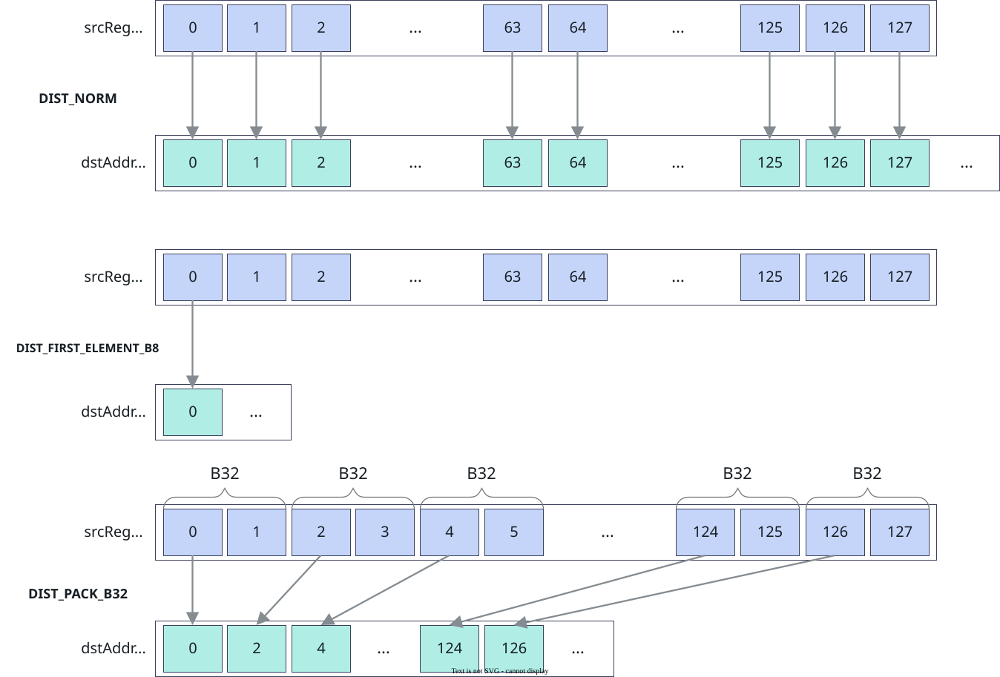

# vf.store_align

## Applicable Products

<!-- npu="950" id1 -->
- Ascend 950PR&950DT products: Supported
<!-- end id1 -->
<!-- npu="A3" id2 -->
- Atlas A3 products: Not supported
<!-- end id2 -->
<!-- npu="910b" id3 -->
- Atlas A2 products: Not supported
<!-- end id3 -->

## Description

Stores reg_tensor or mask_reg data into a Tile in an aligned manner. Two register types are supported: reg_tensor and mask_reg.

### reg_tensor mode

The reg_tensor mode supports both **contiguous movement** and **non-contiguous movement**. The contiguous movement mode is further divided into single-store mode and dual-store mode:

- **reg_tensor single-store mode**: One VL worth of data from a single reg_tensor is stored into a Tile.
- **reg_tensor dual-store mode** (interleave): The elements from two reg_tensors are interleaved and stored into a Tile; the dst length is 2*VL.

In **contiguous movement mode**, when data is stored out, the dist keyword argument can be used to configure the data distribution mode, enabling functions such as compression and storing only the first element. The figure below illustrates the store behavior of some distribution modes.

**Figure 1** Distribution modes for contiguous aligned store in vf.store_align



In **non-contiguous movement mode**, the DataBlock movement mode is enabled through data_copy_mode=pypto_pro.language.DataCopyMode.DATA_BLOCK_COPY, enabling non-contiguous data movement from reg_tensor to Tile. A single instruction moves 8 DataBlocks at a time, and the block_stride parameter specifies the interval between adjacent DataBlocks. In this mode, the preg parameter is changed to the mask_reg that controls valid elements. The mask control rules are as follows:

- If any bit in the 32 bits corresponding to a DataBlock in the mask is 1, the data of the DataBlock is moved to the Tile.
- If all 32 bits corresponding to a DataBlock in the mask are 0, the data of the DataBlock is not written, and the corresponding position in Tile is not updated. No error is reported even if Tile is out of bounds.

When post_update is set to True, the destination address is automatically updated based on the repeat_stride parameter after the movement.

- When post_update is set to False, the actual Tile start address for the movement is dstAddr, and the address is not updated after the movement.
- When post_update is set to True, the actual Tile start address for the movement is dstAddr. After the movement, the address is updated as dstAddr += repeat_stride * 32B (the unit is DataBlock, 32 bytes). repeat_stride must be 32-byte aligned.

### mask_reg mode

When the source operand has been pre-declared as mask_reg via vf.create_mask, the mask_reg storage path is automatically dispatched at the backend, and the data in the mask_reg is moved to the Tile.

The mask_reg source supports two distribution modes, which are configured via the dist keyword argument:

- pypto_pro.language.StoreDist.NORM (normal mode, with a data amount of VL/8 moved)
- pypto_pro.language.StoreDist.PACK (compression mode, where data is discarded every other bit, and the VL/8 of data is compressed to VL/16 for store)

The mask_reg mode also supports three types of data movement APIs (normal movement, PostUpdate, and AddrReg).

## Prototype

```python
store_align(tile, src, preg=None, offset=None, /, *, dist: Optional[StoreDist] = None, data_copy_mode: Optional[DataCopyMode] = None, block_stride=None, repeat_stride=None, post_update: bool = False)
```

## Parameters

| Parameter| Input/Output| Description|
|---|---|---|
| tile | Output| Destination operand, Tile address. The address must be 32-byte aligned.|
| src | Input| Source operand, which is of type [reg_tensor](../basic_data_structures/reg_tensor.md) or [mask_reg](../basic_data_structures/mask_reg.md). The supported data types are DT_INT8, DT_UINT8, DT_INT16, DT_UINT16, DT_FP16, DT_BF16, DT_INT32, DT_UINT32, DT_FP32, DT_INT64, DT_UINT64, DT_FP8E4M3FN, DT_FP8E5M2, DT_FP8E8M0, DT_HF8, DT_FP4E2M1, and DT_FP4E1M2.<br>- When the source is a reg_tensor, a single src corresponds to **reg_tensor single-store mode**; when two sources, src_even and src_odd, are provided, it corresponds to **reg_tensor dual-store mode**.<br>- When the source has been pre-declared as mask_reg via vf.create_mask, the mask_reg store path is automatically dispatched, moving the data in mask_reg out to the Tile.|
| preg | Input| [mask_reg](../basic_data_structures/mask_reg.md), specifying the element range to be written. This parameter does not need to be passed in **mask_reg mode**.<br>In **contiguous movement mode**, when the corresponding bit in the mask is 1, the element is written to the Tile; when it is 0, the element is not written, and the corresponding position in the Tile retains its original value. In **non-contiguous movement mode** (DataBlock mode, data_copy_mode=pypto_pro.language.DataCopyMode.DATA_BLOCK_COPY), this position instead takes a mask_reg that controls the valid elements. The mask control rules are as follows: if any bit of the 32 bits corresponding to a DataBlock in the mask is 1, the DataBlock is stored out; if all bits are 0, it is not written and the corresponding position in the Tile is not updated. No error is reported even if the Tile access goes out of bounds.|
| offset | Input| (Optional) End position parameter (the fourth parameter). The semantics are automatically assigned based on the mode and the post_update value. The unit is the number of elements. In **non-contiguous movement mode** (data_copy_mode=pypto_pro.language.DataCopyMode.DATA_BLOCK_COPY), this parameter position is block_stride (see below).<br>- **Contiguous movement mode + post_update=False**: used as the address offset.<br>&nbsp;&nbsp;- **Integer or [row, col] list/tuple**: An integer offset is converted into pointer arithmetic Tile + offset during code generation. When an [row, col] list or tuple is passed in, the linear offset is row * shape[1] + col, where row is in units of the number of Tile columns (that is, n in set_validshape[m, n]), and col is in units of elements. Both support expressions.<br>&nbsp;&nbsp;- **AddrReg** (created by vf.create_addr_reg): The actual address of the Tile to be moved is Tile plus the offset stored in AddrReg. In each iteration, vf.create_addr_reg must be called first to set the offset, and then the movement instruction is called.<br>- **Contiguous movement mode + post_update=True**: used as the PostUpdate address increment step (in elements). After the movement, the destination address is automatically updated as dstAddr += stride. The default value of stride is 0. For 64-bit-wide data types (DT_INT64 and DT_UINT64), stride is automatically doubled.<br>- **mask_reg mode** (when the source is mask_reg):<br>&nbsp;&nbsp;- **Integer**: This is valid only when post_update is set to True and is used as the address update stride. When post_update is set to False, integer offsets are not supported.<br>&nbsp;&nbsp;- **AddrReg** (created by vf.create_addr_reg): The actual address of the Tile to be moved is dstAddr plus the offset stored in AddrReg.|
| dist | Input| (Optional) Data storage distribution mode, corresponding to the [StoreDist](../basic_data_structures/StoreDist.md) type. For details about the specific mode, see the tables in [Constraints](#constraints) based on whether the **reg_tensor single-store mode**, **reg_tensor dual-store mode**, or **mask_reg mode** is used.|
| data_copy_mode | Input| (Optional) Data copy mode, corresponding to the [DataCopyMode](../basic_data_structures/DataCopyMode.md) type. This parameter is valid only when src is reg_tensor. The mask_reg source does not support this parameter. Values: pypto_pro.language.DataCopyMode.NORM (default, common contiguous movement) or pypto_pro.language.DataCopyMode.DATA_BLOCK_COPY (non-contiguous movement in the unit of DataBlock (32 bytes)).|
| block_stride | Input| Optional. This parameter is valid only when data_copy_mode is set to pypto_pro.language.DataCopyMode.DATA_BLOCK_COPY. In other modes, the parameter will be ignored. This parameter indicates the stride between adjacent DataBlocks, in units of DataBlock (32 bytes). This parameter can be passed as a positional parameter (the 4th parameter) or as a keyword argument.|
| repeat_stride | Input| Optional. This parameter is valid only when data_copy_mode is set to pypto_pro.language.DataCopyMode.DATA_BLOCK_COPY and post_update is set to True. This parameter indicates the address update stride during repeated movement, in units of DataBlock (32 bytes). The value must be 32-byte aligned. When post_update is set to True, the destination address is automatically updated to dstAddr += repeat_stride * 32B after the movement. This parameter can be passed as a positional parameter (the 5th parameter) or a keyword argument.|
| post_update | Input| (Optional) If this parameter is set to True, the destination address automatically increments after the movement. The default value is False. This is applicable for contiguous storage within a loop.|

## Constraints

- dist parameter description for each mode

  **Table 1** dist parameter description in reg_tensor single-store mode

  | dist Value| Description| Alignment Constraint (Byte)|
  |---|---|---|
  | pypto_pro.language.StoreDist.NORM | Normal mode (general). The bit width granularity is automatically selected based on the data type to store VL of data. The 64-bit data types DT_INT64 and DT_UINT64 support only this mode.| 32 |
  | pypto_pro.language.StoreDist.NORM_B8 | Normal store as an 8-bit-wide type; storing VL of data.| 32 |
  | pypto_pro.language.StoreDist.NORM_B16 | Normal store as a 16-bit-wide type; storing VL of data.| 32 |
  | pypto_pro.language.StoreDist.NORM_B32 | Normal store as a 32-bit-wide type; storing VL of data.| 32 |
  | pypto_pro.language.StoreDist.FIRST_ELEMENT | Mask is ignored. Only the first element of src is stored to dst (general). The bit width granularity is automatically selected based on the data type.| By dtype width|
  | pypto_pro.language.StoreDist.FIRST_ELEMENT_B8 | Mask is ignored. Only the first element of src is stored to dst. The data type is 8-bit wide.| 1 |
  | pypto_pro.language.StoreDist.FIRST_ELEMENT_B16 | Mask is ignored. Only the first element of src is stored to dst. The data type is 16-bit wide.| 2 |
  | pypto_pro.language.StoreDist.FIRST_ELEMENT_B32 | Mask is ignored. Only the first element of src is stored to dst. The data type is 32-bit wide.| 4 |
  | pypto_pro.language.StoreDist.PACK | Compression mode (general). According to the mask, the least significant half of bits of valid elements in src are stored contiguously in dst. The bit width granularity is automatically selected based on the data type.| min(32, VL/2) |
  | pypto_pro.language.StoreDist.PACK_B16 | Compression mode. The least significant half of bits of valid elements in src are stored contiguously in dst based on the mask, with a 16-bit width.| min(32, VL/2) |
  | pypto_pro.language.StoreDist.PACK_B32 | Compression mode. The least significant half of bits of valid elements in src are stored contiguously in dst based on the mask, with a 32-bit width.| min(32, VL/2) |
  | pypto_pro.language.StoreDist.PACK_B64 | Compression mode. The least significant half of bits of valid elements in src are stored contiguously in dst based on the mask, with a 64-bit width.| min(32, VL/2) |
  | pypto_pro.language.StoreDist.PACK4 | 4-element compression mode (general). The lower 8 bits (one quarter) of valid elements in src are stored contiguously in dst based on the mask.| min(32, VL/4) |
  | pypto_pro.language.StoreDist.PACK4_B32 | 4-element compression mode. The lower 8 bits (one quarter) of valid elements in src are stored contiguously in dst at 32-bit-wide granularity.| min(32, VL/4) |

  **Table 2** dist parameter description in reg_tensor dual-store mode

  | dist Value| Description| Alignment Constraint (Byte)|
  |---|---|---|
  | pypto_pro.language.StoreDist.INTLV | Interleaved store (general). Elements in src0 and src1 are interleaved and stored in dst. The bit width granularity is automatically selected based on the data type.| 32 |
  | pypto_pro.language.StoreDist.INTLV_B8 | Interleaved store by 8-bit width. Elements in src0 and src1 are interleaved and stored in dst.| 32 |
  | pypto_pro.language.StoreDist.INTLV_B16 | Interleaved store by 16-bit width. Elements in src0 and src1 are interleaved and stored in dst.| 32 |
  | pypto_pro.language.StoreDist.INTLV_B32 | Interleaved store by 32-bit width. Elements in src0 and src1 are interleaved and stored in dst.| 32 |

  **Table 3** dist parameter description in mask_reg mode

  | dist Value| Description| Alignment Constraint (Byte)|
  |---|---|---|
  | pypto_pro.language.StoreDist.NORM | Normal mode. A data amount of VL/8 is stored.| VL/8 |
  | pypto_pro.language.StoreDist.PACK | Compression mode. Data is discarded every other bit, and a data amount of VL/8 is compressed into VL/16 for store.| VL/16 |

- API calling:

  **Table 4** Calling methods of the three types of data movement APIs

  | API Type| Trigger Condition| Description|
  |---|---|---|
  | Ordinary movement API| offset is an integer or a [row, col] list, and post_update is False (default).| After a movement is complete, the Tile address is not automatically updated. You need to manually update the offset in each iteration.|
  | PostUpdate-extended movement API| post_update=True or stride passed in| After a movement is complete, the Tile address is automatically updated. You do not need to manually update the offset in each iteration. This is applicable for contiguous storage within a loop.|
  | API that stores the offset in the AddrReg register| offset is an AddrReg created by vf.create_addr_reg.| In each iteration, vf.create_addr_reg must be called first to manually set the address offset, and then the movement instruction is called.|

## Return Value

None

## Examples

### Normal Aligned Store

```python
import os
import pypto_pro.language as pl
import torch
import torch_npu

@pl.vector_function
def example_vf(src_tile, dst_tile):
    preg = vf.create_mask(pattern=pl.MaskPattern.ALL, dtype=pl.DT_FP32)
    reg = vf.load_align(src_tile, 0)
    vf.store_align(dst_tile, reg, preg)

@pl.jit()
def example_kernel(
    a: pl.Tensor[[pl.DYNAMIC, pl.DYNAMIC], pl.DT_FP32],
    out: pl.Tensor[[pl.DYNAMIC, pl.DYNAMIC], pl.DT_FP32],
):
    tf = pl.TileType(shape=[1, 64], dtype=pl.DT_FP32, target_memory=pl.MemorySpace.Vec)
    in_a_grp = pl.make_tile_group(type=tf, addrs=0x0, mutex_ids=[0])
    in_a = in_a_grp.current()
    t_out_grp = pl.make_tile_group(type=tf, addrs=0x100, mutex_ids=[1])
    t_out = t_out_grp.current()
    with pl.section_vector():
        pl.load(in_a, a, [0, 0])
        example_vf(in_a, t_out)
        pl.store(out, t_out, [0, 0])

def test_example():
    device_id = int(os.environ.get("TILE_FWK_DEVICE_ID", 0))
    device = f"npu:{device_id}"
    core_nums = 1
    torch.npu.set_device(device)
    a = torch.randn([1, 64], device=device, dtype=torch.float32)
    out = torch.empty([1, 64], device=device, dtype=torch.float32)
    example_kernel[None, core_nums](a, out)
    torch.npu.synchronize()
    torch.testing.assert_close(out, a, rtol=1e-5, atol=1e-5)

if __name__ == "__main__":
    test_example()
    print("PASSED")
```

### Example of Interleaved Store

With dist=pypto_pro.language.StoreDist.INTLV_B32, the even/odd registers are interleaved and written into the Tile.

```python
import os
import pypto_pro.language as pl
import torch
import torch_npu

@pl.vector_function
def example_vf(src_tile, dst_tile):
    preg = vf.create_mask(pattern=pl.MaskPattern.ALL, dtype=pl.DT_FP32)
    dst_even, dst_odd = vf.load_align(src_tile, 0, dist=pl.LoadDist.DINTLV_B32)
    vf.store_align(dst_tile, dst_even, dst_odd, preg, dist=pl.StoreDist.INTLV_B32)

@pl.jit()
def example_kernel(
    a: pl.Tensor[[pl.DYNAMIC, pl.DYNAMIC], pl.DT_FP32],
    out: pl.Tensor[[pl.DYNAMIC, pl.DYNAMIC], pl.DT_FP32],
):
    tf = pl.TileType(shape=[1, 128], dtype=pl.DT_FP32, target_memory=pl.MemorySpace.Vec)
    in_a_grp = pl.make_tile_group(type=tf, addrs=0x0, mutex_ids=[0])
    in_a = in_a_grp.current()
    t_out_grp = pl.make_tile_group(type=tf, addrs=0x200, mutex_ids=[1])
    t_out = t_out_grp.current()
    with pl.section_vector():
        pl.load(in_a, a, [0, 0])
        example_vf(in_a, t_out)
        pl.store(out, t_out, [0, 0])

def test_example_2():
    device_id = int(os.environ.get("TILE_FWK_DEVICE_ID", 0))
    device = f"npu:{device_id}"
    core_nums = 1
    torch.npu.set_device(device)
    a = torch.randn([1, 128], device=device, dtype=torch.float32)
    out = torch.empty([1, 128], device=device, dtype=torch.float32)
    example_kernel[None, core_nums](a, out)
    torch.npu.synchronize()
    torch.testing.assert_close(out, a, rtol=1e-5, atol=1e-5)

if __name__ == "__main__":
    test_example_2()
    print("PASSED")
```

### Example of List Offset Store

```python
import os
import pypto_pro.language as pl
import torch
import torch_npu

@pl.vector_function
def example_vf(src_tile, dst_tile):
    preg = vf.create_mask(pattern=pl.MaskPattern.ALL, dtype=pl.DT_FP32)
    reg = vf.load_align(src_tile, [0, 0])
    vf.store_align(dst_tile, reg, preg, [1, 0])

@pl.jit()
def example_kernel(
    a: pl.Tensor[[pl.DYNAMIC, pl.DYNAMIC], pl.DT_FP32],
    out: pl.Tensor[[pl.DYNAMIC, pl.DYNAMIC], pl.DT_FP32],
):
    tf = pl.TileType(shape=[2, 64], dtype=pl.DT_FP32, target_memory=pl.MemorySpace.Vec)
    in_a_grp = pl.make_tile_group(type=tf, addrs=0x0, mutex_ids=[0])
    in_a = in_a_grp.current()
    t_out_grp = pl.make_tile_group(type=tf, addrs=0x200, mutex_ids=[1])
    t_out = t_out_grp.current()
    with pl.section_vector():
        pl.load(in_a, a, [0, 0])
        pl.load(t_out, out, [0, 0])
        example_vf(in_a, t_out)
        pl.store(out, t_out, [0, 0])

def test_example_6():
    device_id = int(os.environ.get("TILE_FWK_DEVICE_ID", 0))
    device = f"npu:{device_id}"
    core_nums = 1
    torch.npu.set_device(device)
    a = torch.randn([2, 64], device=device, dtype=torch.float32)
    out = torch.zeros([2, 64], device=device, dtype=torch.float32)
    example_kernel[None, core_nums](a, out)
    torch.npu.synchronize()
    expected = torch.zeros([2, 64], device=device, dtype=torch.float32)
    expected[1, :] = a[0, :]
    torch.testing.assert_close(out, expected, rtol=1e-5, atol=1e-5)

if __name__ == "__main__":
    test_example_6()
    print("PASSED")
```

```python
import os
import pypto_pro.language as pl
import torch
import torch_npu

@pl.vector_function
def example_vf(src_tile, dst_tile, n_rows):
    preg = vf.create_mask(pattern=pl.MaskPattern.ALL, dtype=pl.DT_FP32)
    for i in pl.range(n_rows):
        reg = vf.load_align(src_tile, [i, 0])
        vf.store_align(dst_tile, reg, preg, [i, 0])

@pl.jit()
def example_kernel(
    a: pl.Tensor[[pl.DYNAMIC, pl.DYNAMIC], pl.DT_FP32],
    out: pl.Tensor[[pl.DYNAMIC, pl.DYNAMIC], pl.DT_FP32],
):
    tf = pl.TileType(shape=[2, 64], dtype=pl.DT_FP32, target_memory=pl.MemorySpace.Vec)
    in_a_grp = pl.make_tile_group(type=tf, addrs=0x0, mutex_ids=[0])
    in_a = in_a_grp.current()
    t_out_grp = pl.make_tile_group(type=tf, addrs=0x200, mutex_ids=[1])
    t_out = t_out_grp.current()
    with pl.section_vector():
        pl.load(in_a, a, [0, 0])
        example_vf(in_a, t_out, 2)
        pl.store(out, t_out, [0, 0])

def test_example_7():
    device_id = int(os.environ.get("TILE_FWK_DEVICE_ID", 0))
    device = f"npu:{device_id}"
    core_nums = 1
    torch.npu.set_device(device)
    a = torch.randn([2, 64], device=device, dtype=torch.float32)
    out = torch.empty([2, 64], device=device, dtype=torch.float32)
    example_kernel[None, core_nums](a, out)
    torch.npu.synchronize()
    torch.testing.assert_close(out, a, rtol=1e-5, atol=1e-5)

if __name__ == "__main__":
    test_example_7()
    print("PASSED")
```

### Example of AddrReg Offset Store

Use vf.create_addr_reg to create an address offset register, so that the load and store addresses can be offset synchronously within a loop.

```python
import os
import pypto_pro.language as pl
import torch
import torch_npu

@pl.vector_function
def example_vf(src_tile, dst_tile):
    preg = vf.create_mask(pattern=pl.MaskPattern.ALL, dtype=pl.DT_FP32)
    one_repeat_size = 64
    repeat_times = 2
    for i in pl.range(0, repeat_times, 1):
        a_reg = vf.create_addr_reg(one_repeat_size, dtype=pl.DT_FP32)
        reg = vf.load_align(src_tile, a_reg)
        vf.store_align(dst_tile, reg, preg, a_reg)

@pl.jit()
def example_kernel(
    a: pl.Tensor[[pl.DYNAMIC, pl.DYNAMIC], pl.DT_FP32],
    out: pl.Tensor[[pl.DYNAMIC, pl.DYNAMIC], pl.DT_FP32],
):
    tf = pl.TileType(shape=[1, 128], dtype=pl.DT_FP32, target_memory=pl.MemorySpace.Vec)
    in_a_grp = pl.make_tile_group(type=tf, addrs=0x0, mutex_ids=[0])
    in_a = in_a_grp.current()
    t_out_grp = pl.make_tile_group(type=tf, addrs=0x200, mutex_ids=[1])
    t_out = t_out_grp.current()
    with pl.section_vector():
        pl.load(in_a, a, [0, 0])
        example_vf(in_a, t_out)
        pl.store(out, t_out, [0, 0])

def test_example_3():
    device_id = int(os.environ.get("TILE_FWK_DEVICE_ID", 0))
    device = f"npu:{device_id}"
    core_nums = 1
    torch.npu.set_device(device)
    a = torch.randn([1, 128], device=device, dtype=torch.float32)
    out = torch.empty([1, 128], device=device, dtype=torch.float32)
    example_kernel[None, core_nums](a, out)
    torch.npu.synchronize()
    torch.testing.assert_close(out, a, rtol=1e-5, atol=1e-5)

if __name__ == "__main__":
    test_example_3()
    print("PASSED")
```

### mask_reg Store Example

When src is mask_reg, vf.store_align automatically dispatches the mask_reg store path, and no predicate mask parameter needs to be passed in.

```python
import os
import pypto_pro.language as pl
import torch
import torch_npu

@pl.vector_function
def example_vf(src_tile, mask_buf_tile, dst_tile):
    preg = vf.create_mask(pattern=pl.MaskPattern.ALL, dtype=pl.DT_FP32)
    reg_a = vf.load_align(src_tile, 0)
    cmp_mask = vf.ge(reg_a, 0.0, preg)
    vf.store_align(mask_buf_tile, cmp_mask, dist=pl.StoreDist.PACK)
    vf.mem_bar(mode=pl.MemBarMode.VST_VLD)
    loaded_mask = vf.create_mask(pattern=pl.MaskPattern.ALL, dtype=pl.DT_FP32)
    loaded_mask = vf.load_align(mask_buf_tile, dist=pl.LoadDist.US)
    reg_dst = vf.abs(reg_a, loaded_mask)
    vf.store_align(dst_tile, reg_dst, preg)

@pl.jit()
def example_kernel(
    a: pl.Tensor[[pl.DYNAMIC, pl.DYNAMIC], pl.DT_FP32],
    out: pl.Tensor[[pl.DYNAMIC, pl.DYNAMIC], pl.DT_FP32],
):
    tf = pl.TileType(shape=[1, 64], dtype=pl.DT_FP32, target_memory=pl.MemorySpace.Vec)
    tu = pl.TileType(shape=[1, 64], dtype=pl.DT_UINT32, target_memory=pl.MemorySpace.Vec)
    in_a_grp = pl.make_tile_group(type=tf, addrs=0x0, mutex_ids=[0])
    in_a = in_a_grp.current()
    t_mask_grp = pl.make_tile_group(type=tu, addrs=0x100, mutex_ids=[1])
    t_mask = t_mask_grp.current()
    t_out_grp = pl.make_tile_group(type=tf, addrs=0x200, mutex_ids=[2])
    t_out = t_out_grp.current()
    with pl.section_vector():
        pl.load(in_a, a, [0, 0])
        example_vf(in_a, t_mask, t_out)
        pl.store(out, t_out, [0, 0])

def test_example_4():
    device_id = int(os.environ.get("TILE_FWK_DEVICE_ID", 0))
    device = f"npu:{device_id}"
    core_nums = 1
    torch.npu.set_device(device)
    a = torch.randn([1, 64], device=device, dtype=torch.float32)
    out = torch.empty([1, 64], device=device, dtype=torch.float32)
    example_kernel[None, core_nums](a, out)
    torch.npu.synchronize()
    expected = torch.where(a >= 0, torch.abs(a), torch.tensor(0.0, device=device))
    torch.testing.assert_close(out, expected, rtol=1e-5, atol=1e-5)

if __name__ == "__main__":
    test_example_4()
    print("PASSED")
```

### Post-update Contiguous Store Example

Using post_update=True for contiguous store within a loop, the destination address automatically increments, so there is no need to manually calculate the offset.

```python
import os
import pypto_pro.language as pl
import torch
import torch_npu

@pl.vector_function
def example_vf(src_tile, dst_tile):
    preg = vf.create_mask(pattern=pl.MaskPattern.ALL, dtype=pl.DT_FP32)
    one_repeat_size = 64
    repeat_times = 2
    for i in pl.range(0, repeat_times, 1):
        reg = vf.load_align(src_tile, i * one_repeat_size)
        vf.store_align(dst_tile, reg, preg, one_repeat_size, post_update=True)

@pl.jit()
def example_kernel(
    a: pl.Tensor[[pl.DYNAMIC, pl.DYNAMIC], pl.DT_FP32],
    out: pl.Tensor[[pl.DYNAMIC, pl.DYNAMIC], pl.DT_FP32],
):
    tf = pl.TileType(shape=[1, 128], dtype=pl.DT_FP32, target_memory=pl.MemorySpace.Vec)
    in_a_grp = pl.make_tile_group(type=tf, addrs=0x0, mutex_ids=[0])
    in_a = in_a_grp.current()
    t_out_grp = pl.make_tile_group(type=tf, addrs=0x200, mutex_ids=[1])
    t_out = t_out_grp.current()
    with pl.section_vector():
        pl.load(in_a, a, [0, 0])
        example_vf(in_a, t_out)
        pl.store(out, t_out, [0, 0])

def test_example_5():
    device_id = int(os.environ.get("TILE_FWK_DEVICE_ID", 0))
    device = f"npu:{device_id}"
    core_nums = 1
    torch.npu.set_device(device)
    a = torch.randn([1, 128], device=device, dtype=torch.float32)
    out = torch.empty([1, 128], device=device, dtype=torch.float32)
    example_kernel[None, core_nums](a, out)
    torch.npu.synchronize()
    torch.testing.assert_close(out, a, rtol=1e-5, atol=1e-5)

if __name__ == "__main__":
    test_example_5()
    print("PASSED")
```

### FP8 Data Storage Example

```python
import os
import pypto_pro.language as pl
import torch
import torch_npu

@pl.vector_function
def example_vf_fp8(src_tile, dst_tile):
    preg_f32 = vf.create_mask(pattern=pl.MaskPattern.ALL, dtype=pl.DT_FP32)
    preg_f8 = vf.create_mask(pattern=pl.MaskPattern.ALL, dtype=pl.DT_FP8E4M3FN)
    reg_f32 = vf.load_align(src_tile, 0)
    reg_f8 = vf.astype(reg_f32, preg_f32, dtype=pl.DT_FP8E4M3FN,
                       layout=pl.CastLayout.ZERO, saturate=pl.SaturateMode.ON)
    vf.store_align(dst_tile, reg_f8, preg_f8)

@pl.jit()
def example_kernel_fp8(
    a: pl.Tensor[[pl.DYNAMIC, pl.DYNAMIC], pl.DT_FP32],
    out: pl.Tensor[[pl.DYNAMIC, pl.DYNAMIC], pl.DT_FP8E4M3FN],
):
    tf_in = pl.TileType(shape=[1, 64], dtype=pl.DT_FP32, target_memory=pl.MemorySpace.Vec)
    tf_out = pl.TileType(shape=[1, 256], dtype=pl.DT_FP8E4M3FN, target_memory=pl.MemorySpace.Vec)
    in_a_grp = pl.make_tile_group(type=tf_in, addrs=0x0, mutex_ids=[0])
    in_a = in_a_grp.current()
    t_out_grp = pl.make_tile_group(type=tf_out, addrs=0x100, mutex_ids=[1])
    t_out = t_out_grp.current()
    with pl.section_vector():
        pl.load(in_a, a, [0, 0])
        example_vf_fp8(in_a, t_out)
        pl.store(out, t_out, [0, 0])

def test_example_fp8():
    device_id = int(os.environ.get("TILE_FWK_DEVICE_ID", 0))
    device = f"npu:{device_id}"
    core_nums = 1
    torch.npu.set_device(device)
    a = torch.randn([1, 64], device=device, dtype=torch.float32)
    out = torch.empty([1, 256], device=device, dtype=torch.float8_e4m3fn)
    example_kernel_fp8[None, core_nums](a, out)
    torch.npu.synchronize()
    expected = a.to(torch.float8_e4m3fn).to(torch.float32)
    torch.testing.assert_close(out.to(torch.float32)[:, ::4], expected, rtol=1e-2, atol=1e-2)

if __name__ == "__main__":
    test_example_fp8()
    print("PASSED")
```

### INT64 Data Type Example

```python
import os
import pypto_pro.language as pl
import torch
import torch_npu

@pl.vector_function
def example_vf_int64(src_tile, dst_tile):
    preg = vf.create_mask(pattern=pl.MaskPattern.ALL, dtype=pl.DT_INT64)
    reg_a = vf.load_align(src_tile, 0)
    vf.store_align(dst_tile, reg_a, preg)

@pl.jit()
def example_kernel_int64(
    a: pl.Tensor[[pl.DYNAMIC, pl.DYNAMIC], pl.DT_INT64],
    out: pl.Tensor[[pl.DYNAMIC, pl.DYNAMIC], pl.DT_INT64],
):
    tf = pl.TileType(shape=[1, 32], dtype=pl.DT_INT64, target_memory=pl.MemorySpace.Vec)
    in_a_grp = pl.make_tile_group(type=tf, addrs=0, mutex_ids=[0])
    in_a = in_a_grp.current()
    t_out_grp = pl.make_tile_group(type=tf, addrs=256, mutex_ids=[1])
    t_out = t_out_grp.current()
    with pl.section_vector():
        pl.load(in_a, a, [0, 0])
        example_vf_int64(in_a, t_out)
        pl.store(out, t_out, [0, 0])

def test_example_int64():
    device_id = int(os.environ.get("TILE_FWK_DEVICE_ID", 0))
    device = f"npu:{device_id}"
    core_nums = 1
    torch.npu.set_device(device)
    a = torch.randint(-100, 100, [1, 32], device=device, dtype=torch.int64)
    out = torch.empty([1, 32], device=device, dtype=torch.int64)
    example_kernel_int64[None, core_nums](a, out)
    torch.npu.synchronize()
    torch.testing.assert_close(out, a, rtol=0, atol=0)

if __name__ == "__main__":
    test_example_int64()
    print("PASSED")
```
