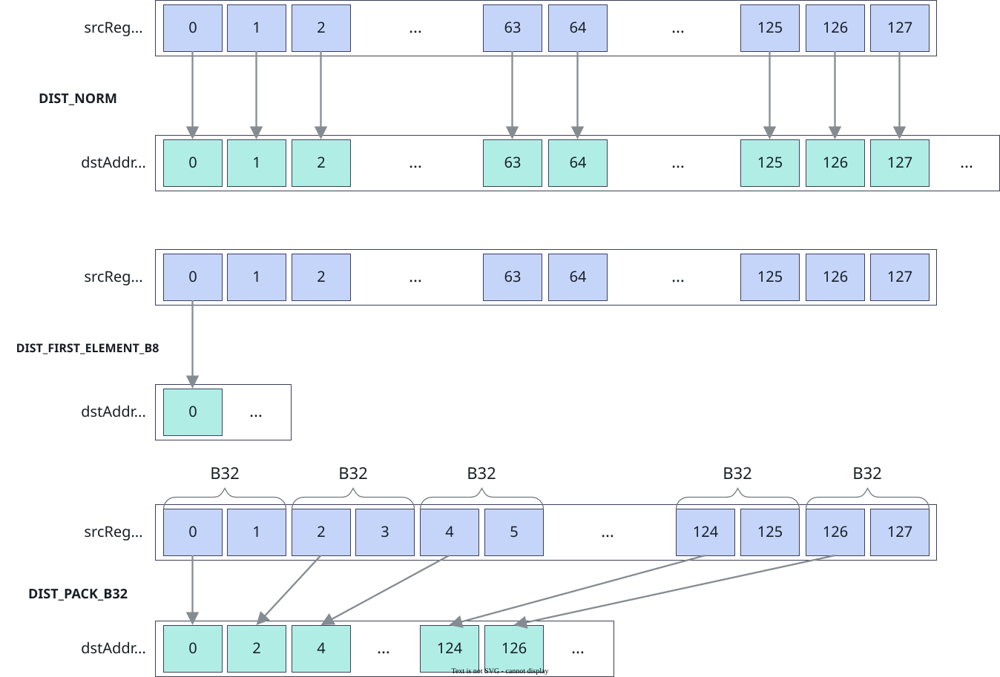

# vf.store_align

<!-- md-trans-meta sourceCommit=7d0ab31d84c294a0a8327f597d2bdee012acb22d translatedAt=2026-10-26T13:55:54.667Z pushedAt=2026-10-28T11:57:29.018Z nl=2 -->

## Applicable Products

<!-- npu="950" id1 -->
- Ascend 950PR&950DT products: Supported
<!-- end id1 -->
<!-- npu="A3" id2 -->
- Atlas A3 products: Not supported
<!-- end id2 -->
<!-- npu="910b" id3 -->
- Atlas A2 products: Not supported
<!-- end id3 -->

## Description

Stores reg_tensor or mask_reg data to Tile with alignment. Supports two register types: reg_tensor and mask_reg.

### reg_tensor Mode

The reg_tensor mode supports **continuous transfer mode** and **non-continuous transfer mode**. The continuous transfer mode is further divided into single-output mode and dual-output mode:

- **reg_tensor single-output mode**: Outputs the VL amount of data in one reg_tensor to the Tile.
- **reg_tensor dual-output mode** (interleave): Outputs the elements in two reg_tensors to the Tile in an interleaved manner, with a dst length of 2*VL.

In **continuous transfer mode**, when data is output, you can configure the data distribution mode of the transfer through the dist keyword parameter to implement functions such as compression and outputting only the first element. The following figure shows the output diagram of some distribution modes:

**Figure 1** vf.store_align continuous aligned output distribution mode diagram



In **non-continuous transfer mode**, the DataBlock transfer mode is enabled through data_copy_mode=pypto_pro.language.DataCopyMode.DATA_BLOCK_COPY to implement non-continuous transfer of data from reg_tensor to the Tile. A single instruction transfers 8 DataBlocks at a time, and the block_stride parameter indicates the interval between adjacent DataBlocks. In this mode, the preg parameter position is changed to pass the mask_reg that controls valid elements. The mask control rules are as follows:

- When any bit of the 32 bits corresponding to a certain DataBlock in the mask is 1, the data corresponding to that DataBlock is output to the Tile.
- When all 32 bits corresponding to a certain DataBlock in the mask are 0, the data corresponding to that DataBlock is not written out, and the corresponding position in the Tile is not updated. No error is reported even if the Tile is out of bounds.

When post_update=True is also specified, the destination address is automatically updated after the transfer based on the repeat_stride parameter:

- When post_update=False, the actual transfer starts from the Tile at dstAddr, and the address is not updated after the transfer.
- When post_update=True, the actual transfer starts from the Tile at dstAddr, and after the transfer the address is updated as dstAddr += repeat_stride * 32B (in units of DataBlock, 32 bytes). repeat_stride must be 32-byte aligned.

### mask_reg Mode

When the source operand has been predeclared as mask_reg through vf.create_mask, the backend automatically dispatches the mask_reg storage path to output the data in mask_reg to the Tile.

The mask_reg source supports two distribution modes, configured through the dist keyword parameter:

- pypto_pro.language.StoreDist.NORM (normal mode, transferring VL/8 data volume)
- pypto_pro.language.StoreDist.PACK (compression mode, discarding data at every 1-bit interval and compressing VL/8 data to VL/16 for output)

The mask_reg mode also supports three types of transfer APIs (normal transfer/PostUpdate/AddrReg).

## Prototype

```python
store_align(tile, src, preg, offset, dist=None, data_copy_mode=None, block_stride=None, repeat_stride=None, post_update=False)
```

## Parameters

| Parameter | Input/Output | Description |
|---|---|---|
| tile | Output | Destination operand, the Tile address. The address requires 32-byte alignment. |
| src | Input | Source operand, of type [reg_tensor](../basic_data_structures/reg_tensor.md) or [mask_reg](../basic_data_structures/mask_reg.md). Supported data types: DT_INT8, DT_UINT8, DT_INT16, DT_UINT16, DT_FP16, DT_BF16, DT_INT32, DT_UINT32, DT_FP32, DT_INT64, DT_UINT64, DT_FP8E4M3FN, DT_FP8E5M2, DT_FP8E8M0, DT_HF8, DT_FP4E2M1, DT_FP4E1M2.<br>- When the source is reg_tensor, a single src corresponds to **reg_tensor single-output mode**; when both src_even and src_odd are provided, it is **reg_tensor dual-output mode**.<br>- When the source has been predeclared as mask_reg through vf.create_mask, the mask_reg storage path is automatically dispatched to output the data in mask_reg to the Tile. |
| preg | Input | [mask_reg](../basic_data_structures/mask_reg.md), specifying the element range to be written. Not required in **mask_reg mode**.<br>- In **continuous transfer mode**, when the corresponding bit in the mask is 1, the element is written to the Tile; when it is 0, the element is not written and the corresponding position in the Tile retains its original value. In **non-continuous transfer mode** (data_copy_mode=pypto_pro.language.DataCopyMode.DATA_BLOCK_COPY in DataBlock mode), this position instead receives the mask_reg that controls valid elements. The mask control rule is as follows: a DataBlock is output when any of its corresponding 32 bits in the mask is 1; when all are 0, it is not written and the corresponding position in the Tile is not updated, and no error is reported even if the Tile is out of bounds. |
| offset | Input | Optional, trailing positional parameter (the 4th). Its semantics are automatically dispatched based on the mode and the post_update value, in units of elements. In **non-continuous transfer mode** (data_copy_mode=pypto_pro.language.DataCopyMode.DATA_BLOCK_COPY), this parameter position is block_stride (see below).<br>- **Continuous transfer mode + post_update=False**: used as an address offset.<br>&nbsp;&nbsp;- **Integer or [row, col] list**: an integer offset is converted to pointer arithmetic Tile + offset at code generation. When a [row, col] list or tuple is passed, the linear offset is row * shape[1] + col, where row is in units of the Tile column count (that is, n in set_validshape[m, n]) and col is in units of elements; both support expressions.<br>&nbsp;&nbsp;- **AddrReg** (created by vf.create_addr_reg): the actual transfer Tile address is Tile + the offset stored in AddrReg. In each iteration, vf.create_addr_reg must be called first to set the offset before calling the transfer instruction.<br>- **Continuous transfer mode + post_update=True**: used as the PostUpdate address accumulation stride (in elements). After the transfer, the destination address is automatically updated to dstAddr += stride. Defaults to 0. For 64-bit data types (DT_INT64, DT_UINT64), it is automatically doubled.<br>- **mask_reg mode** (when the source is mask_reg):<br>&nbsp;&nbsp;- **Integer**: takes effect only when post_update=True, as the address update stride; an integer offset is not supported when post_update=False.<br>&nbsp;&nbsp;- **AddrReg** (created by vf.create_addr_reg): the actual transfer Tile address is dstAddr + the offset stored in AddrReg. |
| dist | Input | Optional, data storage distribution mode, corresponding to the [StoreDist](../basic_data_structures/StoreDist.md) type. For the specific modes of **reg_tensor single-output mode**, **reg_tensor dual-output mode**, and **mask_reg mode**, see the respective tables in [Constraints](#constraints). |
| data_copy_mode | Input | Optional, data copy mode, corresponding to the [DataCopyMode](../basic_data_structures/DataCopyMode.md) type. Valid only when src is reg_tensor; the mask_reg source does not support this parameter. Values: pypto_pro.language.DataCopyMode.NORM (default, normal continuous transfer) or pypto_pro.language.DataCopyMode.DATA_BLOCK_COPY (non-continuous transfer in units of DataBlock (32B)). |
| block_stride | Input | Optional, valid only in data_copy_mode=pypto_pro.language.DataCopyMode.DATA_BLOCK_COPY mode; ignored in other modes. Indicates the interval between adjacent DataBlocks, in units of DataBlock (32 bytes). Can be passed as a positional parameter (the 4th) or a keyword parameter. |
| repeat_stride | Input | Optional, valid only in data_copy_mode=pypto_pro.language.DataCopyMode.DATA_BLOCK_COPY mode with post_update=True. Indicates the address update stride for repeated transfer, in units of DataBlock (32 bytes), requiring 32-byte alignment. When post_update=True, the destination address is automatically updated to dstAddr += repeat_stride * 32B after the transfer. Can be passed as a positional parameter (the 5th) or a keyword parameter. |
| post_update | Input | Optional. When True, the destination address automatically accumulates after the transfer; defaults to False. Suitable for continuous storage within a loop. |

## Constraints

- dist parameter description for each mode:

  **Table 1** dist parameter description for reg_tensor single-output mode

  | dist value | Meaning | alignment constraint (Byte) |
  |---|---|---|
  | pypto_pro.language.StoreDist.NORM | Normal mode (general), automatically selecting the bit width granularity based on the data type and transferring VL data. The 64-bit data types DT_INT64 and DT_UINT64 support only this mode. | 32 |
  | pypto_pro.language.StoreDist.NORM_B8 | Normal storage by 8-bit type, transferring VL data. | 32 |
  | pypto_pro.language.StoreDist.NORM_B16 | Normal storage by 16-bit type, transferring VL data. | 32 |
  | pypto_pro.language.StoreDist.NORM_B32 | Normal storage by 32-bit type, transferring VL data. | 32 |
  | pypto_pro.language.StoreDist.FIRST_ELEMENT | Ignores the mask and outputs only the first element of src to dst (general), automatically selecting the bit width granularity based on the data type. | By dtype width |
  | pypto_pro.language.StoreDist.FIRST_ELEMENT_B8 | Ignores the mask and outputs only the first element of src to dst, with an 8-bit data type. | 1 |
  | pypto_pro.language.StoreDist.FIRST_ELEMENT_B16 | Ignores the mask and outputs only the first element of src to dst, with a 16-bit data type. | 2 |
  | pypto_pro.language.StoreDist.FIRST_ELEMENT_B32 | Ignores the mask and outputs only the first element of src to dst, with a 32-bit data type. | 4 |
  | pypto_pro.language.StoreDist.PACK | Compression mode (general), continuously storing the lower half of the bit data of valid elements in src into dst based on the mask, automatically selecting the bit width granularity based on the data type. | min(32, VL/2) |
  | pypto_pro.language.StoreDist.PACK_B16 | Compression mode, continuously storing the lower half of the bit data of valid elements in src into dst by 16-bit type based on the mask. | min(32, VL/2) |
  | pypto_pro.language.StoreDist.PACK_B32 | Compression mode, continuously storing the lower half of the bit data of valid elements in src into dst by 32-bit type based on the mask. | min(32, VL/2) |
  | pypto_pro.language.StoreDist.PACK_B64 | Compression mode, continuously storing the lower half of the bit data of valid elements in src into dst by 64-bit type based on the mask. | min(32, VL/2) |
  | pypto_pro.language.StoreDist.PACK4 | 4-element compression mode (general), continuously storing the lower 8 bits (one quarter) of valid elements in src into dst based on the mask. | min(32, VL/4) |
  | pypto_pro.language.StoreDist.PACK4_B32 | 4-element compression mode, continuously storing the lower 8 bits (one quarter) of valid elements in src into dst by 32-bit type granularity. | min(32, VL/4) |

  **Table 2** dist parameter description for reg_tensor dual-output mode

  | dist value | Description | alignment constraint (Byte) |
  |---|---|---|
  | pypto_pro.language.StoreDist.INTLV | Interleaved storage (general). Interleaves the elements in src0 and src1 into dst, and automatically selects the bit width granularity based on the data type. | 32 |
  | pypto_pro.language.StoreDist.INTLV_B8 | Interleaved storage by 8-bit width type. Interleaves the elements in src0 and src1 into dst. | 32 |
  | pypto_pro.language.StoreDist.INTLV_B16 | Interleaved storage by 16-bit width type. Interleaves the elements in src0 and src1 into dst. | 32 |
  | pypto_pro.language.StoreDist.INTLV_B32 | Interleaved storage by 32-bit width granularity. Interleaves the elements in src0 and src1 into dst. | 32 |

  **Table 3** dist parameter description for mask_reg mode

  | dist value | Description | alignment constraint (Byte) |
  |---|---|---|
  | pypto_pro.language.StoreDist.NORM | Normal mode. Transfers VL/8 data. | VL/8 |
  | pypto_pro.language.StoreDist.PACK | Compression mode. Discards data at every other bit and compresses VL/8 data to VL/16 for output. | VL/16 |

- API call method description:

  **Table 4** Call methods of the three transfer API types

  | API type | Trigger condition | Description |
  |---|---|---|
  | Normal transfer API | offset is an integer or a [row, col] list, and post_update=False (default) | After a transfer is completed, the Tile address is not automatically updated. You need to manually update offset in each iteration. |
  | PostUpdate extended transfer API | post_update=True or stride is passed | After a transfer is completed, the Tile address is automatically updated. You do not need to manually update offset in each iteration. This is suitable for continuous storage within a loop. |
  | AddrReg storage offset API | offset is an AddrReg created by vf.create_addr_reg | In each iteration, you need to first call vf.create_addr_reg to manually set the address offset, and then call the transfer instruction. |

## Return Value

None

## Examples

### Normal Aligned Storage

```python
import os
import pypto_pro.language as pl
import torch
import torch_npu

@pl.vector_function
def example_vf(src_tile, dst_tile):
    preg = vf.create_mask(pattern=pl.MaskPattern.ALL, dtype=pl.DT_FP32)
    reg = vf.load_align(src_tile, 0)
    vf.store_align(dst_tile, reg, preg)

@pl.jit()
def example_kernel(
    a: pl.Tensor[[pl.DYNAMIC, pl.DYNAMIC], pl.DT_FP32],
    out: pl.Tensor[[pl.DYNAMIC, pl.DYNAMIC], pl.DT_FP32],
):
    tf = pl.TileType(shape=[1, 64], dtype=pl.DT_FP32, target_memory=pl.MemorySpace.Vec)
    in_a_grp = pl.make_tile_group(type=tf, addrs=0x0, mutex_ids=[0])
    in_a = in_a_grp.current()
    t_out_grp = pl.make_tile_group(type=tf, addrs=0x100, mutex_ids=[1])
    t_out = t_out_grp.current()
    with pl.section_vector():
        pl.load(in_a, a, [0, 0])
        example_vf(in_a, t_out)
        pl.store(out, t_out, [0, 0])

def test_example():
    device_id = int(os.environ.get("TILE_FWK_DEVICE_ID", 0))
    device = f"npu:{device_id}"
    core_nums = 1
    torch.npu.set_device(device)
    a = torch.randn([1, 64], device=device, dtype=torch.float32)
    out = torch.empty([1, 64], device=device, dtype=torch.float32)
    example_kernel[None, core_nums](a, out)
    torch.npu.synchronize()
    torch.testing.assert_close(out, a, rtol=1e-5, atol=1e-5)

if __name__ == "__main__":
    test_example()
    print("PASSED")
```

### interleaved storage example

Use dist=pypto_pro.language.StoreDist.INTLV_B32 to write even/odd registers into the Tile in an interleaved manner:

```python
import os
import pypto_pro.language as pl
import torch
import torch_npu

@pl.vector_function
def example_vf(src_tile, dst_tile):
    preg = vf.create_mask(pattern=pl.MaskPattern.ALL, dtype=pl.DT_FP32)
    dst_even, dst_odd = vf.load_align(src_tile, 0, dist=pl.LoadDist.DINTLV_B32)
    vf.store_align(dst_tile, dst_even, dst_odd, preg, dist=pl.StoreDist.INTLV_B32)

@pl.jit()
def example_kernel(
    a: pl.Tensor[[pl.DYNAMIC, pl.DYNAMIC], pl.DT_FP32],
    out: pl.Tensor[[pl.DYNAMIC, pl.DYNAMIC], pl.DT_FP32],
):
    tf = pl.TileType(shape=[1, 128], dtype=pl.DT_FP32, target_memory=pl.MemorySpace.Vec)
    in_a_grp = pl.make_tile_group(type=tf, addrs=0x0, mutex_ids=[0])
    in_a = in_a_grp.current()
    t_out_grp = pl.make_tile_group(type=tf, addrs=0x200, mutex_ids=[1])
    t_out = t_out_grp.current()
    with pl.section_vector():
        pl.load(in_a, a, [0, 0])
        example_vf(in_a, t_out)
        pl.store(out, t_out, [0, 0])

def test_example_2():
    device_id = int(os.environ.get("TILE_FWK_DEVICE_ID", 0))
    device = f"npu:{device_id}"
    core_nums = 1
    torch.npu.set_device(device)
    a = torch.randn([1, 128], device=device, dtype=torch.float32)
    out = torch.empty([1, 128], device=device, dtype=torch.float32)
    example_kernel[None, core_nums](a, out)
    torch.npu.synchronize()
    torch.testing.assert_close(out, a, rtol=1e-5, atol=1e-5)

if __name__ == "__main__":
    test_example_2()
    print("PASSED")
```

### List Offset Storage Example

```python
import os
import pypto_pro.language as pl
import torch
import torch_npu

@pl.vector_function
def example_vf(src_tile, dst_tile):
    preg = vf.create_mask(pattern=pl.MaskPattern.ALL, dtype=pl.DT_FP32)
    reg = vf.load_align(src_tile, [0, 0])
    vf.store_align(dst_tile, reg, preg, [1, 0])

@pl.jit()
def example_kernel(
    a: pl.Tensor[[pl.DYNAMIC, pl.DYNAMIC], pl.DT_FP32],
    out: pl.Tensor[[pl.DYNAMIC, pl.DYNAMIC], pl.DT_FP32],
):
    tf = pl.TileType(shape=[2, 64], dtype=pl.DT_FP32, target_memory=pl.MemorySpace.Vec)
    in_a_grp = pl.make_tile_group(type=tf, addrs=0x0, mutex_ids=[0])
    in_a = in_a_grp.current()
    t_out_grp = pl.make_tile_group(type=tf, addrs=0x200, mutex_ids=[1])
    t_out = t_out_grp.current()
    with pl.section_vector():
        pl.load(in_a, a, [0, 0])
        pl.load(t_out, out, [0, 0])
        example_vf(in_a, t_out)
        pl.store(out, t_out, [0, 0])

def test_example_6():
    device_id = int(os.environ.get("TILE_FWK_DEVICE_ID", 0))
    device = f"npu:{device_id}"
    core_nums = 1
    torch.npu.set_device(device)
    a = torch.randn([2, 64], device=device, dtype=torch.float32)
    out = torch.zeros([2, 64], device=device, dtype=torch.float32)
    example_kernel[None, core_nums](a, out)
    torch.npu.synchronize()
    expected = torch.zeros([2, 64], device=device, dtype=torch.float32)
    expected[1, :] = a[0, :]
    torch.testing.assert_close(out, expected, rtol=1e-5, atol=1e-5)

if __name__ == "__main__":
    test_example_6()
    print("PASSED")
```

```python
import os
import pypto_pro.language as pl
import torch
import torch_npu

@pl.vector_function
def example_vf(src_tile, dst_tile, n_rows):
    preg = vf.create_mask(pattern=pl.MaskPattern.ALL, dtype=pl.DT_FP32)
    for i in pl.range(n_rows):
        reg = vf.load_align(src_tile, [i, 0])
        vf.store_align(dst_tile, reg, preg, [i, 0])

@pl.jit()
def example_kernel(
    a: pl.Tensor[[pl.DYNAMIC, pl.DYNAMIC], pl.DT_FP32],
    out: pl.Tensor[[pl.DYNAMIC, pl.DYNAMIC], pl.DT_FP32],
):
    tf = pl.TileType(shape=[2, 64], dtype=pl.DT_FP32, target_memory=pl.MemorySpace.Vec)
    in_a_grp = pl.make_tile_group(type=tf, addrs=0x0, mutex_ids=[0])
    in_a = in_a_grp.current()
    t_out_grp = pl.make_tile_group(type=tf, addrs=0x200, mutex_ids=[1])
    t_out = t_out_grp.current()
    with pl.section_vector():
        pl.load(in_a, a, [0, 0])
        example_vf(in_a, t_out, 2)
        pl.store(out, t_out, [0, 0])

def test_example_7():
    device_id = int(os.environ.get("TILE_FWK_DEVICE_ID", 0))
    device = f"npu:{device_id}"
    core_nums = 1
    torch.npu.set_device(device)
    a = torch.randn([2, 64], device=device, dtype=torch.float32)
    out = torch.empty([2, 64], device=device, dtype=torch.float32)
    example_kernel[None, core_nums](a, out)
    torch.npu.synchronize()
    torch.testing.assert_close(out, a, rtol=1e-5, atol=1e-5)

if __name__ == "__main__":
    test_example_7()
    print("PASSED")
```

### AddrReg Offset Storage Example

Use vf.create_addr_reg to create an address offset register, and synchronize the load and store address offsets in the loop:

```python
import os
import pypto_pro.language as pl
import torch
import torch_npu

@pl.vector_function
def example_vf(src_tile, dst_tile):
    preg = vf.create_mask(pattern=pl.MaskPattern.ALL, dtype=pl.DT_FP32)
    one_repeat_size = 64
    repeat_times = 2
    for i in pl.range(0, repeat_times, 1):
        a_reg = vf.create_addr_reg(one_repeat_size, dtype=pl.DT_FP32)
        reg = vf.load_align(src_tile, a_reg)
        vf.store_align(dst_tile, reg, preg, a_reg)

@pl.jit()
def example_kernel(
    a: pl.Tensor[[pl.DYNAMIC, pl.DYNAMIC], pl.DT_FP32],
    out: pl.Tensor[[pl.DYNAMIC, pl.DYNAMIC], pl.DT_FP32],
):
    tf = pl.TileType(shape=[1, 128], dtype=pl.DT_FP32, target_memory=pl.MemorySpace.Vec)
    in_a_grp = pl.make_tile_group(type=tf, addrs=0x0, mutex_ids=[0])
    in_a = in_a_grp.current()
    t_out_grp = pl.make_tile_group(type=tf, addrs=0x200, mutex_ids=[1])
    t_out = t_out_grp.current()
    with pl.section_vector():
        pl.load(in_a, a, [0, 0])
        example_vf(in_a, t_out)
        pl.store(out, t_out, [0, 0])

def test_example_3():
    device_id = int(os.environ.get("TILE_FWK_DEVICE_ID", 0))
    device = f"npu:{device_id}"
    core_nums = 1
    torch.npu.set_device(device)
    a = torch.randn([1, 128], device=device, dtype=torch.float32)
    out = torch.empty([1, 128], device=device, dtype=torch.float32)
    example_kernel[None, core_nums](a, out)
    torch.npu.synchronize()
    torch.testing.assert_close(out, a, rtol=1e-5, atol=1e-5)

if __name__ == "__main__":
    test_example_3()
    print("PASSED")
```

### mask_reg storage example

When src is mask_reg, vf.store_align automatically dispatches the mask_reg storage path, and no predicate mask parameter needs to be passed:

```python
import os
import pypto_pro.language as pl
import torch
import torch_npu

@pl.vector_function
def example_vf(src_tile, mask_buf_tile, dst_tile):
    preg = vf.create_mask(pattern=pl.MaskPattern.ALL, dtype=pl.DT_FP32)
    reg_a = vf.load_align(src_tile, 0)
    cmp_mask = vf.ge(reg_a, 0.0, preg)
    vf.store_align(mask_buf_tile, cmp_mask, dist=pl.StoreDist.PACK)
    vf.mem_bar(mode=pl.MemBarMode.VST_VLD)
    loaded_mask = vf.create_mask(pattern=pl.MaskPattern.ALL, dtype=pl.DT_FP32)
    loaded_mask = vf.load_align(mask_buf_tile, dist=pl.LoadDist.US)
    reg_dst = vf.abs(reg_a, loaded_mask)
    vf.store_align(dst_tile, reg_dst, preg)

@pl.jit()
def example_kernel(
    a: pl.Tensor[[pl.DYNAMIC, pl.DYNAMIC], pl.DT_FP32],
    out: pl.Tensor[[pl.DYNAMIC, pl.DYNAMIC], pl.DT_FP32],
):
    tf = pl.TileType(shape=[1, 64], dtype=pl.DT_FP32, target_memory=pl.MemorySpace.Vec)
    tu = pl.TileType(shape=[1, 64], dtype=pl.DT_UINT32, target_memory=pl.MemorySpace.Vec)
    in_a_grp = pl.make_tile_group(type=tf, addrs=0x0, mutex_ids=[0])
    in_a = in_a_grp.current()
    t_mask_grp = pl.make_tile_group(type=tu, addrs=0x100, mutex_ids=[1])
    t_mask = t_mask_grp.current()
    t_out_grp = pl.make_tile_group(type=tf, addrs=0x200, mutex_ids=[2])
    t_out = t_out_grp.current()
    with pl.section_vector():
        pl.load(in_a, a, [0, 0])
        example_vf(in_a, t_mask, t_out)
        pl.store(out, t_out, [0, 0])

def test_example_4():
    device_id = int(os.environ.get("TILE_FWK_DEVICE_ID", 0))
    device = f"npu:{device_id}"
    core_nums = 1
    torch.npu.set_device(device)
    a = torch.randn([1, 64], device=device, dtype=torch.float32)
    out = torch.empty([1, 64], device=device, dtype=torch.float32)
    example_kernel[None, core_nums](a, out)
    torch.npu.synchronize()
    expected = torch.where(a >= 0, torch.abs(a), torch.tensor(0.0, device=device))
    torch.testing.assert_close(out, expected, rtol=1e-5, atol=1e-5)

if __name__ == "__main__":
    test_example_4()
    print("PASSED")
```

### Post-update Continuous Storage Example

Use post_update=True to store continuously in a loop, with the destination address incrementing automatically, eliminating the need to manually calculate the offset:

```python
import os
import pypto_pro.language as pl
import torch
import torch_npu

@pl.vector_function
def example_vf(src_tile, dst_tile):
    preg = vf.create_mask(pattern=pl.MaskPattern.ALL, dtype=pl.DT_FP32)
    one_repeat_size = 64
    repeat_times = 2
    for i in pl.range(0, repeat_times, 1):
        reg = vf.load_align(src_tile, i * one_repeat_size)
        vf.store_align(dst_tile, reg, preg, one_repeat_size, post_update=True)

@pl.jit()
def example_kernel(
    a: pl.Tensor[[pl.DYNAMIC, pl.DYNAMIC], pl.DT_FP32],
    out: pl.Tensor[[pl.DYNAMIC, pl.DYNAMIC], pl.DT_FP32],
):
    tf = pl.TileType(shape=[1, 128], dtype=pl.DT_FP32, target_memory=pl.MemorySpace.Vec)
    in_a_grp = pl.make_tile_group(type=tf, addrs=0x0, mutex_ids=[0])
    in_a = in_a_grp.current()
    t_out_grp = pl.make_tile_group(type=tf, addrs=0x200, mutex_ids=[1])
    t_out = t_out_grp.current()
    with pl.section_vector():
        pl.load(in_a, a, [0, 0])
        example_vf(in_a, t_out)
        pl.store(out, t_out, [0, 0])

def test_example_5():
    device_id = int(os.environ.get("TILE_FWK_DEVICE_ID", 0))
    device = f"npu:{device_id}"
    core_nums = 1
    torch.npu.set_device(device)
    a = torch.randn([1, 128], device=device, dtype=torch.float32)
    out = torch.empty([1, 128], device=device, dtype=torch.float32)
    example_kernel[None, core_nums](a, out)
    torch.npu.synchronize()
    torch.testing.assert_close(out, a, rtol=1e-5, atol=1e-5)

if __name__ == "__main__":
    test_example_5()
    print("PASSED")
```

### FP8 Data Storage Example

```python
import os
import pypto_pro.language as pl
import torch
import torch_npu

@pl.vector_function
def example_vf_fp8(src_tile, dst_tile):
    preg_f32 = vf.create_mask(pattern=pl.MaskPattern.ALL, dtype=pl.DT_FP32)
    preg_f8 = vf.create_mask(pattern=pl.MaskPattern.ALL, dtype=pl.DT_FP8E4M3FN)
    reg_f32 = vf.load_align(src_tile, 0)
    reg_f8 = vf.astype(reg_f32, preg_f32, dtype=pl.DT_FP8E4M3FN,
                       layout=pl.CastLayout.ZERO, saturate=pl.SaturateMode.ON)
    vf.store_align(dst_tile, reg_f8, preg_f8)

@pl.jit()
def example_kernel_fp8(
    a: pl.Tensor[[pl.DYNAMIC, pl.DYNAMIC], pl.DT_FP32],
    out: pl.Tensor[[pl.DYNAMIC, pl.DYNAMIC], pl.DT_FP8E4M3FN],
):
    tf_in = pl.TileType(shape=[1, 64], dtype=pl.DT_FP32, target_memory=pl.MemorySpace.Vec)
    tf_out = pl.TileType(shape=[1, 256], dtype=pl.DT_FP8E4M3FN, target_memory=pl.MemorySpace.Vec)
    in_a_grp = pl.make_tile_group(type=tf_in, addrs=0x0, mutex_ids=[0])
    in_a = in_a_grp.current()
    t_out_grp = pl.make_tile_group(type=tf_out, addrs=0x100, mutex_ids=[1])
    t_out = t_out_grp.current()
    with pl.section_vector():
        pl.load(in_a, a, [0, 0])
        example_vf_fp8(in_a, t_out)
        pl.store(out, t_out, [0, 0])

def test_example_fp8():
    device_id = int(os.environ.get("TILE_FWK_DEVICE_ID", 0))
    device = f"npu:{device_id}"
    core_nums = 1
    torch.npu.set_device(device)
    a = torch.randn([1, 64], device=device, dtype=torch.float32)
    out = torch.empty([1, 256], device=device, dtype=torch.float8_e4m3fn)
    example_kernel_fp8[None, core_nums](a, out)
    torch.npu.synchronize()
    expected = a.to(torch.float8_e4m3fn).to(torch.float32)
    torch.testing.assert_close(out.to(torch.float32)[:, ::4], expected, rtol=1e-2, atol=1e-2)

if __name__ == "__main__":
    test_example_fp8()
    print("PASSED")
```
