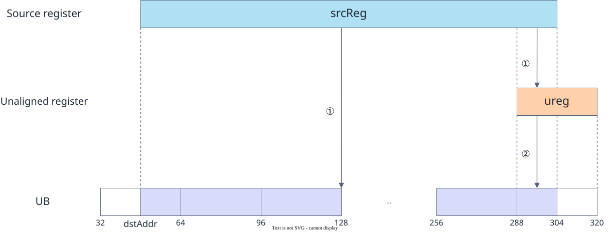
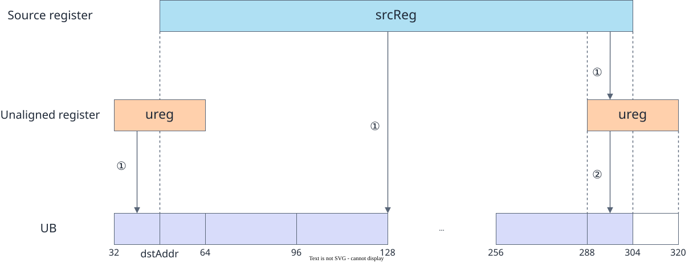
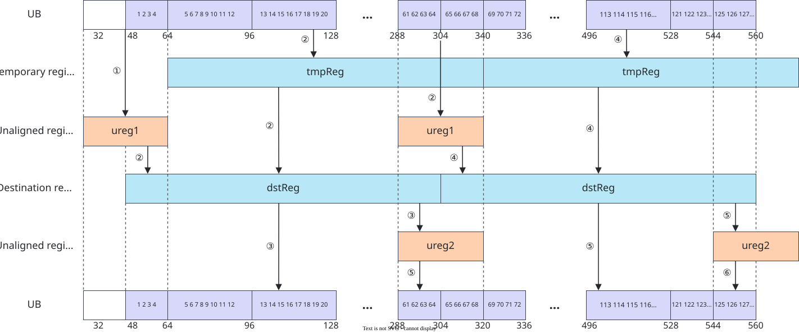

# vf.store_unalign

## Applicable Products

<!-- npu="950" id1 -->
- Ascend 950PR&950DT products: Supported
<!-- end id1 -->
<!-- npu="A3" id2 -->
- Atlas A3 products: Not supported
<!-- end id2 -->
<!-- npu="910b" id3 -->
- Atlas A2 products: Not supported
<!-- end id3 -->

## Description

Unaligned store, which writes variable-length vector data or mask_reg data into a Tile. It is used together with vf.unalign_reg_for_store() and vf.store_unalign_post(). When src is mask_reg, the backend automatically dispatches the mask_reg unaligned store path.

### Principle of Unaligned Store

The unaligned data in the source reg_tensor is written to the Tile address dstAddr. Depending on the current state of ureg, there are two scenarios:

**Scenario 1:** ureg is empty (first iteration).

As shown in the figure below, data is read from the source reg_tensor (256B) and moved to the destination Tile address (dstAddr to 304). The processing flow is as follows:

1. Call **store_unalign**. At this point, there is no valid data in ureg, indicating the initial state of contiguous unaligned store. The data in the source reg_tensor corresponding to Tile addresses 48–288 is written to dstAddr. In addition, the data in the source reg_tensor corresponding to Tile addresses 288–304 is written into ureg.

2. Call **store_unalign_post** for unaligned store post-processing. The data cached in ureg is written to Tile addresses 288–304.

**Figure 1** Unaligned data store (ureg is empty)



**Scenario 2:** ureg is not empty (iterations other than the first).

As shown in the figure below, data is read from the source reg_tensor (256B) and moved to the destination Tile address (dstAddr to 304). The process is as follows:

1. Call **store_unalign**. At this point, valid data exists in ureg. The system concatenates the data in ureg corresponding to Tile addresses 32–dstAddr with the data in the source reg_tensor corresponding to Tile addresses dstAddr–288, and writes the result to Tile address dstAddr. In addition, the data in the source reg_tensor corresponding to Tile addresses 288–304 is written into ureg.

2. Call **store_unalign_post** for unaligned store post-processing. The data cached in ureg is written to Tile addresses 288–304.

**Figure 2** Unaligned data store (ureg is not empty)



### Example of Contiguous Unaligned Data Load and Store

**Figure 3** Example of contiguous unaligned data load and store (data type: DT_UINT32)



In contiguous unaligned load, vf.load_unalign caches the subsequent unaligned data into the ureg, so the next load does not need to call vf.load_unalign_pre again. vf.load_unalign_pre only needs to be called once before the iteration starts, thereby optimizing the performance of unaligned load.

In contiguous unaligned store, the vf.store_unalign of the next iteration writes the data that the current iteration's vf.store_unalign cached in ureg into the Tile. Therefore, the current iteration does not need to call vf.store_unalign_post to write the ureg data into the Tile; vf.store_unalign_post only needs to be called once after the iteration ends, thereby optimizing the performance of unaligned store.

## Prototype

```python
store_unalign(tile, src, align_reg, stride=None, /, *, post_update: bool = False)
```

## Parameters

| Parameter| Input/Output| Description|
|---|---|---|
| tile | Output| Destination operand, Tile address.|
| src | Input| Source operand, which is of type [reg_tensor](../basic_data_structures/reg_tensor.md) or [mask_reg](../basic_data_structures/mask_reg.md). The destination operand and the source operand must have the same data type. The supported data types are DT_INT8, DT_UINT8, DT_INT16, DT_UINT16, DT_FP16, DT_BF16, DT_INT32, DT_UINT32, DT_FP32, DT_INT64, DT_UINT64, DT_FP8E4M3FN, DT_FP8E5M2, DT_FP8E8M0, DT_HF8, DT_FP4E2M1, and DT_FP4E1M2.|
| align_reg | Input| alignment tracker register (created by vf.unalign_reg_for_store()).|
| stride | Input| (Optional) Number of stored elements or an address register.<br>- When it is an integer scalar, it represents the address update step and is valid only when post_update is True.<br>- When it is an AddrReg (created by vf.create_addr_reg), a vector offset address is used to replace the scalar stride. This input is mandatory when src is a reg_tensor. When src is a mask_reg, stride is not passed.|
| post_update | Input| (Optional) When the value is True, the tracker automatically increments to the next segment. The default value is False.|

## Constraints

- This API must be used together with vf.store_unalign_post() and called before vf.store_unalign_post().

## Return Value

None

## Examples

### Basic Unaligned Store

Unaligned store is used in conjunction with unaligned load to form a complete unaligned data movement flow. vf.load_unalign_init allocates the unaligned load register, vf.load_unalign_pre initializes the cache, and vf.load_unalign performs the load. vf.unalign_reg_for_store allocates the store alignment register, vf.store_unalign performs the store, and vf.store_unalign_post flushes out the remaining data.

```python
import os
import pypto_pro.language as pl
import torch
import torch_npu

@pl.vector_function
def example_vf(src_tile, dst_tile):
    ureg = vf.load_unalign_init()
    vf.load_unalign_pre(ureg, src_tile)
    src_reg = vf.load_unalign(ureg, src_tile, 64)
    store_ureg = vf.unalign_reg_for_store()
    vf.store_unalign(dst_tile, src_reg, store_ureg, 64, post_update=True)
    vf.store_unalign_post(dst_tile, store_ureg, 0, post_update=True)

@pl.jit()
def example_kernel(
    a: pl.Tensor[[pl.DYNAMIC, pl.DYNAMIC], pl.DT_FP32],
    out: pl.Tensor[[pl.DYNAMIC, pl.DYNAMIC], pl.DT_FP32],
):
    tf = pl.TileType(shape=[1, 64], dtype=pl.DT_FP32, target_memory=pl.MemorySpace.Vec)
    in_a_grp = pl.make_tile_group(type=tf, addrs=0x0, mutex_ids=[0])
    in_a = in_a_grp.current()
    t_out_grp = pl.make_tile_group(type=tf, addrs=0x100, mutex_ids=[1])
    t_out = t_out_grp.current()
    with pl.section_vector():
        pl.load(in_a, a, [0, 0])
        example_vf(in_a, t_out)
        pl.store(out, t_out, [0, 0])

def test_example():
    device_id = int(os.environ.get("TILE_FWK_DEVICE_ID", 0))
    device = f"npu:{device_id}"
    core_nums = 1
    torch.npu.set_device(device)
    a = torch.randn([1, 64], device=device, dtype=torch.float32)
    out = torch.empty([1, 64], device=device, dtype=torch.float32)
    example_kernel[None, core_nums](a, out)
    torch.npu.synchronize()
    torch.testing.assert_close(out, a, rtol=1e-5, atol=1e-5)

if __name__ == "__main__":
    test_example()
    print("PASSED")
```

### AddrReg Unaligned Store Example

When an AddrReg (created by vf.create_addr_reg) is passed as the stride parameter, the AddrReg provides a set of vector offset addresses. This is suitable for unaligned store scenarios with variable strides.

```python
import os
import pypto_pro.language as pl
import torch
import torch_npu

@pl.vector_function
def example_vf(src_tile, dst_tile):
    ureg = vf.load_unalign_init()
    vf.load_unalign_pre(ureg, src_tile)
    src_reg = vf.load_unalign(ureg, src_tile, 64)
    store_ureg = vf.unalign_reg_for_store()
    for i in pl.range(0, 1, 1):
        addr_reg = vf.create_addr_reg(64, dtype=pl.DT_FP32)
        vf.store_unalign(dst_tile, src_reg, store_ureg, addr_reg, post_update=True)
        vf.store_unalign_post(dst_tile, store_ureg, addr_reg)

@pl.jit()
def example_kernel(
    a: pl.Tensor[[pl.DYNAMIC, pl.DYNAMIC], pl.DT_FP32],
    out: pl.Tensor[[pl.DYNAMIC, pl.DYNAMIC], pl.DT_FP32],
):
    tf = pl.TileType(shape=[1, 64], dtype=pl.DT_FP32, target_memory=pl.MemorySpace.Vec)
    in_a_grp = pl.make_tile_group(type=tf, addrs=0x0, mutex_ids=[0])
    in_a = in_a_grp.current()
    t_out_grp = pl.make_tile_group(type=tf, addrs=0x100, mutex_ids=[1])
    t_out = t_out_grp.current()
    with pl.section_vector():
        pl.load(in_a, a, [0, 0])
        example_vf(in_a, t_out)
        pl.store(out, t_out, [0, 0])

def test_example():
    device_id = int(os.environ.get("TILE_FWK_DEVICE_ID", 0))
    device = f"npu:{device_id}"
    core_nums = 1
    torch.npu.set_device(device)
    a = torch.randn([1, 64], device=device, dtype=torch.float32)
    out = torch.empty([1, 64], device=device, dtype=torch.float32)
    example_kernel[None, core_nums](a, out)
    torch.npu.synchronize()
    assert out.shape == torch.Size([1, 64])

if __name__ == "__main__":
    test_example()
    print("PASSED")
```

### mask_reg Unaligned Store Example

When src is mask_reg, vf.store_unalign automatically selects the mask_reg unaligned store path. The 32-byte [mask_reg](../basic_data_structures/mask_reg.md) data is packed into 16 bytes for 16-bit-wide types (DT_INT16, DT_UINT16, DT_FP16, and DT_BF16), or into 8 bytes for 32-bit-wide types (DT_INT32, DT_UINT32, and DT_FP32), and then written to the Tile. The hardware extracts the least significant bit (LSB) from each group of 2 bits (16-bit-wide) or 4 bits (32-bit-wide).

```python
import os
import pypto_pro.language as pl
import torch
import torch_npu

@pl.vector_function
def example_vf(src_tile, mask_buf_tile):
    preg = vf.create_mask(pattern=pl.MaskPattern.ALL, dtype=pl.DT_FP32)
    reg_a = vf.load_align(src_tile, 0)
    cmp_mask = vf.ge(reg_a, 0.0, preg)
    ureg = vf.unalign_reg_for_store()
    vf.store_unalign(mask_buf_tile, cmp_mask, ureg)
    vf.store_unalign_post(mask_buf_tile, ureg, 0, post_update=True)

@pl.jit()
def example_kernel(
    a: pl.Tensor[[pl.DYNAMIC, pl.DYNAMIC], pl.DT_FP32],
    out: pl.Tensor[[pl.DYNAMIC, pl.DYNAMIC], pl.DT_UINT32],
):
    tf = pl.TileType(shape=[1, 64], dtype=pl.DT_FP32, target_memory=pl.MemorySpace.Vec)
    tu = pl.TileType(shape=[1, 64], dtype=pl.DT_UINT32, target_memory=pl.MemorySpace.Vec)
    in_a_grp = pl.make_tile_group(type=tf, addrs=0x0, mutex_ids=[0])
    in_a = in_a_grp.current()
    t_mask_grp = pl.make_tile_group(type=tu, addrs=0x100, mutex_ids=[1])
    t_mask = t_mask_grp.current()
    with pl.section_vector():
        pl.load(in_a, a, [0, 0])
        pl.load(t_mask, out, [0, 0])
        example_vf(in_a, t_mask)
        pl.store(out, t_mask, [0, 0])

def test_example_2():
    device_id = int(os.environ.get("TILE_FWK_DEVICE_ID", 0))
    device = f"npu:{device_id}"
    core_nums = 1
    torch.npu.set_device(device)
    a = torch.ones([1, 64], device=device, dtype=torch.float32)
    out = torch.zeros([1, 64], device=device, dtype=torch.int32)
    example_kernel[None, core_nums](a, out)
    torch.npu.synchronize()
    assert (out != 0).any(), "All positive inputs should generate a non-zero packing mask."
    a = -torch.ones([1, 64], device=device, dtype=torch.float32)
    out = torch.zeros([1, 64], device=device, dtype=torch.int32)
    example_kernel[None, core_nums](a, out)
    torch.npu.synchronize()
    assert (out == 0).all(), "All negative inputs should generate a zero packing mask."

if __name__ == "__main__":
    test_example_2()
    print("PASSED")
```

### INT64 Data Type Example

```python
import os
import pypto_pro.language as pl
import torch
import torch_npu

@pl.vector_function
def example_vf_int64(src_tile, dst_tile):
    preg = vf.create_mask(pattern=pl.MaskPattern.ALL, dtype=pl.DT_INT64)
    reg_a = vf.load_align(src_tile, 0)
    ureg = vf.unalign_reg_for_store()
    vf.store_unalign(dst_tile, reg_a, ureg, 64, post_update=True)
    vf.store_unalign_post(dst_tile, ureg, 0, post_update=True)
    reg_out = reg_a
    vf.store_align(dst_tile, reg_out, preg)

@pl.jit()
def example_kernel_int64(
    a: pl.Tensor[[pl.DYNAMIC, pl.DYNAMIC], pl.DT_INT64],
    out: pl.Tensor[[pl.DYNAMIC, pl.DYNAMIC], pl.DT_INT64],
):
    tf = pl.TileType(shape=[1, 32], dtype=pl.DT_INT64, target_memory=pl.MemorySpace.Vec)
    in_a_grp = pl.make_tile_group(type=tf, addrs=0, mutex_ids=[0])
    in_a = in_a_grp.current()
    t_out_grp = pl.make_tile_group(type=tf, addrs=256, mutex_ids=[1])
    t_out = t_out_grp.current()
    with pl.section_vector():
        pl.load(in_a, a, [0, 0])
        example_vf_int64(in_a, t_out)
        pl.store(out, t_out, [0, 0])

def test_example_int64():
    device_id = int(os.environ.get("TILE_FWK_DEVICE_ID", 0))
    device = f"npu:{device_id}"
    core_nums = 1
    torch.npu.set_device(device)
    a = torch.randint(-100, 100, [1, 32], device=device, dtype=torch.int64)
    out = torch.empty([1, 32], device=device, dtype=torch.int64)
    example_kernel_int64[None, core_nums](a, out)
    torch.npu.synchronize()
    torch.testing.assert_close(out, a, rtol=0, atol=0)

if __name__ == "__main__":
    test_example_int64()
    print("PASSED")
```
