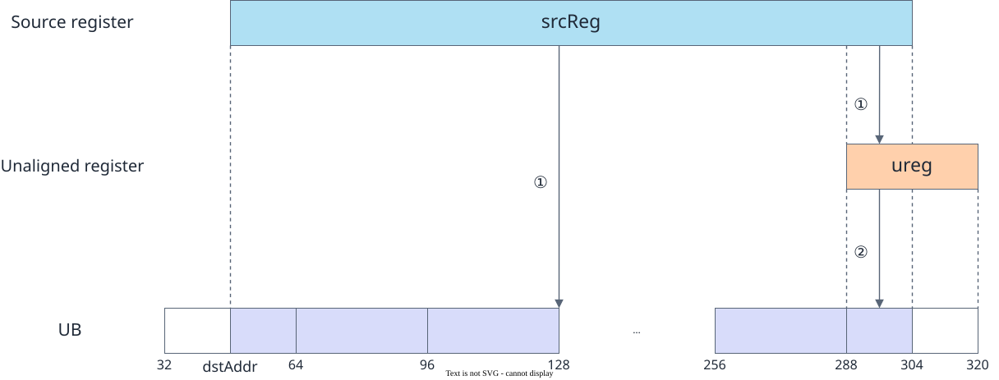
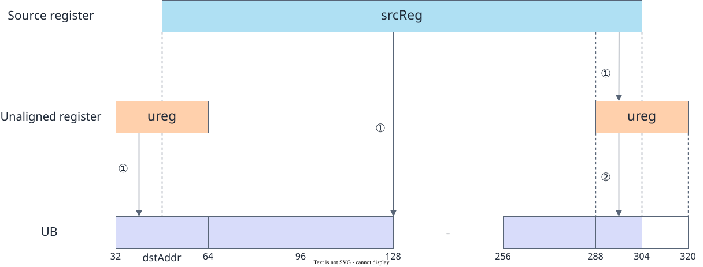
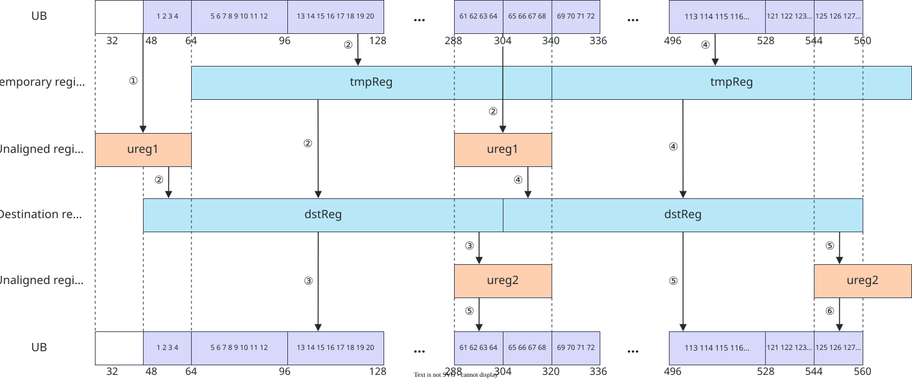

# vf.store_unalign

<!-- md-trans-meta sourceCommit=7d0ab31d84c294a0a8327f597d2bdee012acb22d translatedAt=2026-10-26T13:56:19.510Z pushedAt=2026-10-28T11:57:29.015Z nl=2 -->

## Applicable Products

<!-- npu="950" id1 -->
- Ascend 950PR&950DT products: Supported
<!-- end id1 -->
<!-- npu="A3" id2 -->
- Atlas A3 products: Not supported
<!-- end id2 -->
<!-- npu="910b" id3 -->
- Atlas A2 products: Not supported
<!-- end id3 -->

## Description

Unaligned storage writes variable-length vector data or mask_reg data into a Tile. Use it together with vf.unalign_reg_for_store() and vf.store_unalign_post(). When src is mask_reg, the backend automatically dispatches the mask_reg unaligned storage path.

### Unaligned Move-Out Principle

Writes the unaligned data in the source reg_tensor to Tile address dstAddr. Depending on the current state of ureg, there are two scenarios:

**Scenario 1: ureg is empty** (first iteration)

As shown in the following figure, data is read from the source reg_tensor (256B) and moved to the target Tile address (dstAddr ~ 304). The processing flow is as follows:

① Call **store_unalign**. At this point, ureg contains no valid data, indicating the starting state of a consecutive unaligned load. The data corresponding to Tile addresses 48 ~ 288 in the source reg_tensor is written to dstAddr. In addition, the data corresponding to Tile addresses 288 ~ 304 in the source reg_tensor is written to ureg.

② Call **store_unalign_post** to perform post-processing for the unaligned load. The data cached in ureg is written to Tile addresses 288 ~ 304.

**Figure 1** Unaligned data load (ureg is empty)



**Scenario 2: ureg is not empty** (except the first iteration)

As shown in the following figure, data is read from the source reg_tensor (256B) and moved to the target Tile address (dstAddr ~ 304). The processing flow is as follows:

① Call **store_unalign**. At this point, the ureg contains valid data. The system concatenates the data corresponding to Tile addresses 32 to dstAddr in the ureg with the data corresponding to Tile addresses dstAddr to 288 in the source reg_tensor, and writes the result to Tile address dstAddr. In addition, the data corresponding to Tile addresses 288 to 304 in the source reg_tensor is written to the ureg.

② Call **store_unalign_post** to perform post-processing for the unaligned move. The data cached in the ureg is written to Tile addresses 288 to 304.

**Figure 2** Unaligned data load (ureg not empty)



### Consecutive Unaligned Load and Store Example

**Figure 3** Consecutive unaligned load and store example (data type DT_UINT32)



During consecutive unaligned loads, vf.load_unalign caches the subsequent unaligned data in ureg. Therefore, the next load does not need to call vf.load_unalign_pre again; you only need to call vf.load_unalign_pre once before the iteration starts, which optimizes the performance of unaligned loads.

During consecutive unaligned stores, the vf.store_unalign of the next iteration writes the data cached in ureg by the vf.store_unalign of the current iteration to the Tile. Therefore, the current iteration does not need to call vf.store_unalign_post to write the ureg data to the Tile; you only need to call vf.store_unalign_post once after the iteration ends, which optimizes the performance of unaligned stores.

## Prototype

```python
store_unalign(tile, src, align_reg, stride=None, post_update: bool = False)
```

## Parameters

| Parameter | Input/Output | Description |
|---|---|---|
| tile | Output | Destination operand, the Tile address. |
| src | Input | Source operand, of type [reg_tensor](../basic_data_structures/reg_tensor.md) or [mask_reg](../basic_data_structures/mask_reg.md). The data types of the destination operand and the source operand must be consistent. Supported data types: DT_INT8, DT_UINT8, DT_INT16, DT_UINT16, DT_FP16, DT_BF16, DT_INT32, DT_UINT32, DT_FP32, DT_INT64, DT_UINT64, DT_FP8E4M3FN, DT_FP8E5M2, DT_FP8E8M0, DT_HF8, DT_FP4E2M1, DT_FP4E1M2. |
| align_reg | Input | Alignment tracker register (created by vf.unalign_reg_for_store()). |
| stride | Input | Optional, the number of stored elements or an address register.<br>- When it is an integer scalar, it represents the address update step, which is valid only when post_update = True.<br>- When it is an AddrReg (created by vf.create_addr_reg), the vector offset address is used instead of the scalar stride. It is a required input when src is reg_tensor; stride is not passed when src is mask_reg. |
| post_update | Input | Optional. When True, the tracker automatically advances to the next segment. Defaults to False. |

## Constraints

- Must be used in pairs with vf.store_unalign_post(), and must be called before vf.store_unalign_post().

## Return Value

None

## Examples

### Basic Unaligned Storage

Unaligned load and unaligned store are used together to form a complete unaligned data movement flow. vf.load_unalign_init allocates the unaligned store register, vf.load_unalign_pre initializes the cache, vf.load_unalign performs the store, vf.unalign_reg_for_store allocates the load alignment register, vf.store_unalign performs the load, and vf.store_unalign_post flushes the remaining data.

```python
import os
import pypto_pro.language as pl
import torch
import torch_npu

@pl.vector_function
def example_vf(src_tile, dst_tile):
    ureg = vf.load_unalign_init()
    vf.load_unalign_pre(ureg, src_tile)
    src_reg = vf.load_unalign(ureg, src_tile, 64)
    store_ureg = vf.unalign_reg_for_store()
    vf.store_unalign(dst_tile, src_reg, store_ureg, 64, post_update=True)
    vf.store_unalign_post(dst_tile, store_ureg, 0, post_update=True)

@pl.jit()
def example_kernel(
    a: pl.Tensor[[pl.DYNAMIC, pl.DYNAMIC], pl.DT_FP32],
    out: pl.Tensor[[pl.DYNAMIC, pl.DYNAMIC], pl.DT_FP32],
):
    tf = pl.TileType(shape=[1, 64], dtype=pl.DT_FP32, target_memory=pl.MemorySpace.Vec)
    in_a_grp = pl.make_tile_group(type=tf, addrs=0x0, mutex_ids=[0])
    in_a = in_a_grp.current()
    t_out_grp = pl.make_tile_group(type=tf, addrs=0x100, mutex_ids=[1])
    t_out = t_out_grp.current()
    with pl.section_vector():
        pl.load(in_a, a, [0, 0])
        example_vf(in_a, t_out)
        pl.store(out, t_out, [0, 0])

def test_example():
    device_id = int(os.environ.get("TILE_FWK_DEVICE_ID", 0))
    device = f"npu:{device_id}"
    core_nums = 1
    torch.npu.set_device(device)
    a = torch.randn([1, 64], device=device, dtype=torch.float32)
    out = torch.empty([1, 64], device=device, dtype=torch.float32)
    example_kernel[None, core_nums](a, out)
    torch.npu.synchronize()
    torch.testing.assert_close(out, a, rtol=1e-5, atol=1e-5)

if __name__ == "__main__":
    test_example()
    print("PASSED")
```

### AddrReg Unaligned Storage Example

When the stride parameter is passed an AddrReg (created by vf.create_addr_reg), the AddrReg provides a set of vector offset addresses, which is suitable for unaligned load scenarios with variable-length strides.

```python
import os
import pypto_pro.language as pl
import torch
import torch_npu

@pl.vector_function
def example_vf(src_tile, dst_tile):
    ureg = vf.load_unalign_init()
    vf.load_unalign_pre(ureg, src_tile)
    src_reg = vf.load_unalign(ureg, src_tile, 64)
    store_ureg = vf.unalign_reg_for_store()
    for i in pl.range(0, 1, 1):
        addr_reg = vf.create_addr_reg(64, dtype=pl.DT_FP32)
        vf.store_unalign(dst_tile, src_reg, store_ureg, addr_reg, post_update=True)
        vf.store_unalign_post(dst_tile, store_ureg, addr_reg)

@pl.jit()
def example_kernel(
    a: pl.Tensor[[pl.DYNAMIC, pl.DYNAMIC], pl.DT_FP32],
    out: pl.Tensor[[pl.DYNAMIC, pl.DYNAMIC], pl.DT_FP32],
):
    tf = pl.TileType(shape=[1, 64], dtype=pl.DT_FP32, target_memory=pl.MemorySpace.Vec)
    in_a_grp = pl.make_tile_group(type=tf, addrs=0x0, mutex_ids=[0])
    in_a = in_a_grp.current()
    t_out_grp = pl.make_tile_group(type=tf, addrs=0x100, mutex_ids=[1])
    t_out = t_out_grp.current()
    with pl.section_vector():
        pl.load(in_a, a, [0, 0])
        example_vf(in_a, t_out)
        pl.store(out, t_out, [0, 0])

def test_example():
    device_id = int(os.environ.get("TILE_FWK_DEVICE_ID", 0))
    device = f"npu:{device_id}"
    core_nums = 1
    torch.npu.set_device(device)
    a = torch.randn([1, 64], device=device, dtype=torch.float32)
    out = torch.empty([1, 64], device=device, dtype=torch.float32)
    example_kernel[None, core_nums](a, out)
    torch.npu.synchronize()
    assert out.shape == torch.Size([1, 64])

if __name__ == "__main__":
    test_example()
    print("PASSED")
```

### mask_reg Unaligned Storage Example

When src is mask_reg, vf.store_unalign automatically dispatches the mask_reg unaligned storage path. The 32-byte data of [mask_reg](../basic_data_structures/mask_reg.md) is packed into 16 bytes at 16-bit width (DT_INT16, DT_UINT16, DT_FP16, DT_BF16) or into 8 bytes at 32-bit width (DT_INT32, DT_UINT32, DT_FP32) and written to the Tile. The hardware extracts the least significant bit (LSB) from every 2 bits (16-bit width) or 4 bits (32-bit width).

```python
import os
import pypto_pro.language as pl
import torch
import torch_npu

@pl.vector_function
def example_vf(src_tile, mask_buf_tile):
    preg = vf.create_mask(pattern=pl.MaskPattern.ALL, dtype=pl.DT_FP32)
    reg_a = vf.load_align(src_tile, 0)
    cmp_mask = vf.ge(reg_a, 0.0, preg)
    ureg = vf.unalign_reg_for_store()
    vf.store_unalign(mask_buf_tile, cmp_mask, ureg)
    vf.store_unalign_post(mask_buf_tile, ureg, 0, post_update=True)

@pl.jit()
def example_kernel(
    a: pl.Tensor[[pl.DYNAMIC, pl.DYNAMIC], pl.DT_FP32],
    out: pl.Tensor[[pl.DYNAMIC, pl.DYNAMIC], pl.DT_UINT32],
):
    tf = pl.TileType(shape=[1, 64], dtype=pl.DT_FP32, target_memory=pl.MemorySpace.Vec)
    tu = pl.TileType(shape=[1, 64], dtype=pl.DT_UINT32, target_memory=pl.MemorySpace.Vec)
    in_a_grp = pl.make_tile_group(type=tf, addrs=0x0, mutex_ids=[0])
    in_a = in_a_grp.current()
    t_mask_grp = pl.make_tile_group(type=tu, addrs=0x100, mutex_ids=[1])
    t_mask = t_mask_grp.current()
    with pl.section_vector():
        pl.load(in_a, a, [0, 0])
        pl.load(t_mask, out, [0, 0])
        example_vf(in_a, t_mask)
        pl.store(out, t_mask, [0, 0])

def test_example_2():
    device_id = int(os.environ.get("TILE_FWK_DEVICE_ID", 0))
    device = f"npu:{device_id}"
    core_nums = 1
    torch.npu.set_device(device)
    a = torch.ones([1, 64], device=device, dtype=torch.float32)
    out = torch.zeros([1, 64], device=device, dtype=torch.int32)
    example_kernel[None, core_nums](a, out)
    torch.npu.synchronize()
    assert (out != 0).any(), "All-positive input should produce a non-zero packed mask."
    a = -torch.ones([1, 64], device=device, dtype=torch.float32)
    out = torch.zeros([1, 64], device=device, dtype=torch.int32)
    example_kernel[None, core_nums](a, out)
    torch.npu.synchronize()
    assert (out == 0).all(), "All-negative input should produce a zero packed mask."

if __name__ == "__main__":
    test_example_2()
    print("PASSED")
```
