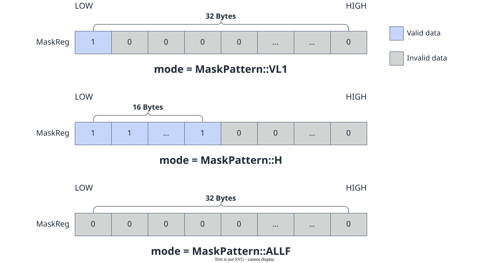
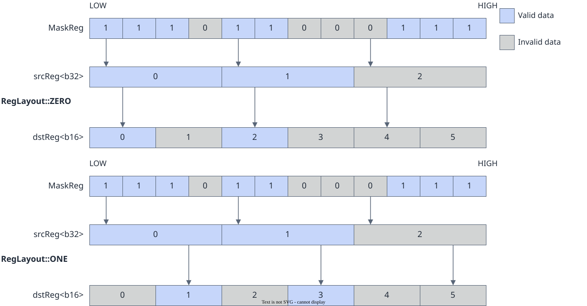

# vf.create_mask

<!-- md-trans-meta sourceCommit=7d0ab31d84c294a0a8327f597d2bdee012acb22d translatedAt=2026-10-26T14:04:18.161Z pushedAt=2026-10-28T11:57:29.062Z nl=2 -->

## Applicable Products

<!-- npu="950" id1 -->
- Ascend 950PR&950DT products: Supported
<!-- end id1 -->
<!-- npu="A3" id2 -->
- Atlas A3 products: Not supported
<!-- end id2 -->
<!-- npu="910b" id3 -->
- Atlas A2 products: Not supported
<!-- end id3 -->

## Description

Creates a mask_reg to specify the range of elements that participate in subsequent VF operations.

### How mask_reg Works

mask_reg is a dedicated register that controls element-level validity in VF operations. When a VF operator (such as vf.add or vf.mul) executes, it determines whether each element participates in the operation based on the corresponding bit of that element in mask_reg:

- **Bit set to 1 (valid)**: The element participates in the operation, and the result is written to the corresponding position in the destination register.
- **Bit set to 0 (invalid)**: The element does not participate in the operation, and the corresponding position in the destination register is set to zero (a few operators such as vf.add, vf.max, vf.min, and vf.full support retaining the original value through the mode parameter).

The total bit width of mask_reg is 256 bits, and its granularity is determined by the dtype parameter. The number of mask bits corresponding to each data element varies with the element bit width. For example:

| dtype | Element Bit Width | Element Count | Mask Bits per Element | Total Mask Bit Count |
|---|---|---|---|---|
| DT_INT8 / DT_UINT8 | 8 bit | 256 | 1 bit (8-bit-width granularity) | 256 bit |
| DT_FP16 / DT_UINT16 / DT_BF16 | 16 bit | 128 | 2 bit (16-bit-width granularity) | 256 bit |
| DT_FP32 / DT_INT32 / DT_UINT32 | 32 bit | 64 | 4 bit (32-bit-width granularity) | 256 bit |
| DT_INT64 / DT_UINT64 | 64 bit | 32 | 8 bit (64-bit-width granularity) | 256 bit |

> [!CAUTION]Note
> The dtype parameter determines the mask granularity (that is, how many bits in mask_reg correspond to one data element), not the type of mask_reg itself. The type of mask_reg remains unchanged.

### Typical Use Scenarios of mask_reg

1. **Full operation**: pattern=ALL, where all elements participate in the operation (most common).
2. **Tail block processing**: When the data length is not an integer multiple of the register width, use VL1 to VL128 to limit the number of participating elements in the last block.
3. **Conditional selection**: Generate a mask using comparison operators such as vf.eq and vf.gt, and then use vf.select to select elements based on the mask.
4. **Alternating processing**: Use modes such as H, Q, M3, and M4 to filter and operate on some elements in the register.

Taking the b8 data type as an example, the element selection of the CreateMask API under different MaskPattern modes is shown in the following figure:

**Figure 1** Element selection of the CreateMask API under different MaskPattern modes for the b8 data type



### mask_reg in astype Precision Conversion

The mask bit width corresponding to an element varies with the data type. During type conversion by astype, mask_reg selects valid elements based on the input source operand.

The following figures show the conversion process between 16-bit width and 32-bit width when mask_reg and RegLayout act together:

**Figure 2** astype 16-bit to 32-bit type conversion process

 16-bit to 32-bit type conversion process](../../../figures/mask_reg_b16_to_b32_conversion.svg)

**Figure 3** astype 32-bit to 16-bit type conversion process



## Prototype

```python
create_mask(pattern: Optional[MaskPattern] = None, dtype: Optional[DType] = None) -> preg
```

## Parameters

| Parameter | Input/Output | Description |
|---|---|---|
| pattern | Input | Optional. Mask mode. The pattern parameter determines which elements in mask_reg are set to valid (1) and which are set to invalid (0), corresponding to the [MaskPattern](../basic_data_structures/MaskPattern.md) type. For supported modes, see [Constraints](#constraints). Defaults to pypto_pro.language.MaskPattern.ALL. |
| dtype | Input | Optional. Data type corresponding to the mask, which determines the mask granularity (that is, how many bits correspond to one data element). For example, pypto_pro.language.DT_FP32 corresponds to 32-bit-width granularity (64 elements × 4 bit). For all correspondences, see [Constraints](#constraints). The total bit width of the mask register is fixed at 256 bits. Defaults to pypto_pro.language.DT_FP32. |

## Constraints

- Data type constraints:

  **Table 1** Mask description for data types corresponding to dtype

  | dtype | Element Bit Width | Element Count | Mask Bit Count per Element | Total Mask Bit Count |
  |---|---|---|---|---|
  | DT_INT8 / DT_UINT8 / DT_FP8E4M3FN / DT_FP8E5M2 / DT_FP8E8M0 / DT_HF8 / DT_FP4E2M1 / DT_FP4E1M2 | 8 bit | 256 | 1 bit (b8 granularity) | 256 bit |
  | DT_FP16 / DT_UINT16 / DT_BF16 | 16 bit | 128 | 2 bit (b16 granularity) | 256 bit |
  | DT_FP32 / DT_INT32 / DT_UINT32 | 32 bit | 64 | 4 bit (b32 granularity) | 256 bit |
  | DT_INT64 / DT_UINT64 | 64 bit | 32 | 8 bit (b64 granularity) | 256 bit |

- pattern parameter description:

  **Table 2** MaskPattern mode description

  | Value | Meaning | Illustration (using DT_FP32 / 64 elements as an example) |
  |---|---|---|
  | pypto_pro.language.MaskPattern.ALL | All elements are valid | 1111111111111111...1111 (all 1s) |
  | pypto_pro.language.MaskPattern.ALLF | All elements are invalid | 0000000000000000...0000 (all 0s) |
  | pypto_pro.language.MaskPattern.VL1 | The lowest 1 element is valid | 1000000000000000...0000 |
  | pypto_pro.language.MaskPattern.VL2 | The lowest 2 elements are valid | 1100000000000000...0000 |
  | pypto_pro.language.MaskPattern.VL4 | The lowest 4 elements are valid | 1111000000000000...0000 |
  | pypto_pro.language.MaskPattern.VL8 | The lowest 8 elements are valid | 1111111100000000...0000 |
  | pypto_pro.language.MaskPattern.VL16 | The lowest 16 elements are valid | The first 16 are 1s, and the remaining are 0s |
  | pypto_pro.language.MaskPattern.VL32 | The lowest 32 elements are valid | The first 32 are 1s, and the remaining are 0s |
  | pypto_pro.language.MaskPattern.VL64 | The lowest 64 elements are valid | The first 64 are 1s, and the remaining are 0s |
  | pypto_pro.language.MaskPattern.VL128 | The lowest 128 elements are valid | All valid (meaningful only at 8-bit/16-bit granularity) |
  | pypto_pro.language.MaskPattern.H | The lowest half of the elements are valid | The first 32 are 1s, and the last 32 are 0s (for 64 elements) |
  | pypto_pro.language.MaskPattern.Q | The lowest quarter of the elements are valid | The first 16 are 1s, and the last 48 are 0s (for 64 elements) |
  | pypto_pro.language.MaskPattern.M3 | Positions that are multiples of 3 are valid | Every 3rd element is 1 |
  | pypto_pro.language.MaskPattern.M4 | Positions that are multiples of 4 are valid | Every 4th element is 1 |

## Return Value

Returns the target [mask_reg](../basic_data_structures/mask_reg.md) of preg.

## Examples

```python
import os
import pypto_pro.language as pl
import torch
import torch_npu

@pl.vector_function
def example_vf(src_tile, dst_tile):
    preg = vf.create_mask(pattern=pl.MaskPattern.ALL, dtype=pl.DT_FP32)
    reg = vf.load_align(src_tile, 0)
    vf.store_align(dst_tile, reg, preg)

@pl.jit()
def example_kernel(
    a: pl.Tensor[[pl.DYNAMIC, pl.DYNAMIC], pl.DT_FP32],
    out: pl.Tensor[[pl.DYNAMIC, pl.DYNAMIC], pl.DT_FP32],
):
    tf = pl.TileType(shape=[1, 64], dtype=pl.DT_FP32, target_memory=pl.MemorySpace.Vec)
    in_a_grp = pl.make_tile_group(type=tf, addrs=0x0, mutex_ids=[0])
    in_a = in_a_grp.current()
    t_out_grp = pl.make_tile_group(type=tf, addrs=0x100, mutex_ids=[1])
    t_out = t_out_grp.current()
    with pl.section_vector():
        pl.load(in_a, a, [0, 0])
        example_vf(in_a, t_out)
        pl.store(out, t_out, [0, 0])

def test_example():
    device_id = int(os.environ.get("TILE_FWK_DEVICE_ID", 0))
    device = f"npu:{device_id}"
    core_nums = 1
    torch.npu.set_device(device)
    a = torch.randn([1, 64], device=device, dtype=torch.float32)
    out = torch.empty([1, 64], device=device, dtype=torch.float32)
    example_kernel[None, core_nums](a, out)
    torch.npu.synchronize()
    torch.testing.assert_close(out, a, rtol=1e-5, atol=1e-5)

if __name__ == "__main__":
    test_example()
    print("PASSED")
```
