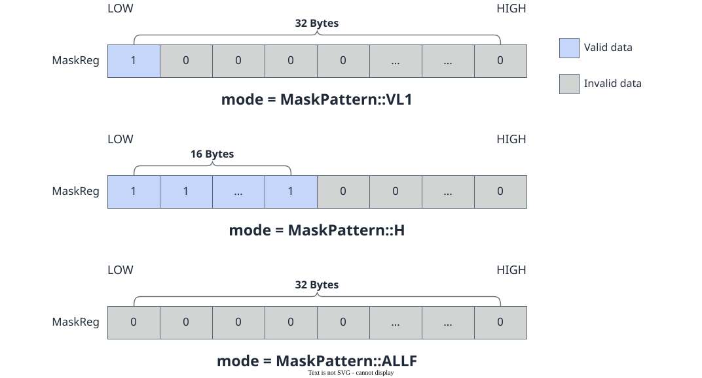
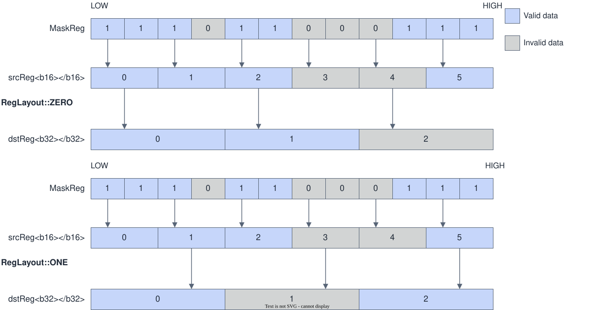
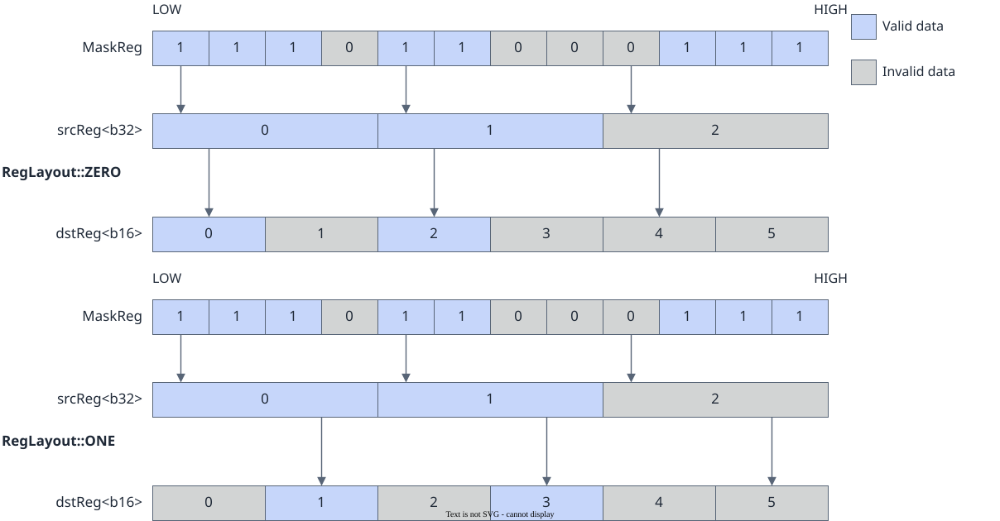

# vf.create_mask

## Applicable Products

<!-- npu="950" id1 -->
- Ascend 950PR&950DT products: Supported
<!-- end id1 -->
<!-- npu="A3" id2 -->
- Atlas A3 products: Not supported
<!-- end id2 -->
<!-- npu="910b" id3 -->
- Atlas A2 products: Not supported
<!-- end id3 -->

## Description

Creates a mask_reg to specify the range of elements that participate in subsequent VF operations.

### Principle of mask_reg

mask_reg is a dedicated register in VF operations that controls element-level validity. When VF operators (such as vf.add and vf.mul) are executed, they determine whether each element participates in the operation according to the corresponding bit of that element in mask_reg

- **Bit = 1 (valid)**: The element participates in the operation, and the result is written to the corresponding position in the destination register.
- **Bit = 0 (invalid)**: The element does not participate in the operation, and the corresponding position in the destination register is set to 0. (A few operators, such as vf.add, vf.max, vf.min, and vf.full, allow the original value to be retained by setting the mode parameter.)

The total bit width of mask_reg is 256 bits, and its granularity is determined by the dtype parameter; the number of mask bits corresponding to each data element varies with the element bit width. For example:

| dtype | Element Bit Width| Number of Elements| Mask Bits/Element| Total Mask Bits|
|---|---|---|---|---|
| DT_INT8/DT_UINT8 | 8 bits| 256 | 1 bit (8-bit-wide granularity)| 256 bits|
| DT_FP16 / DT_UINT16 / DT_BF16 | 16 bits| 128 | 2 bits (16-bit-wide granularity)| 256 bits|
| DT_FP32/DT_INT32/DT_UINT32 | 32 bits| 64 | 4 bits (32-bit-wide granularity)| 256 bits|
| DT_INT64/DT_UINT64 | 64 bits| 32 | 8 bits (64-bit-wide granularity)| 256 bits|

> [!CAUTION]
> Note that the dtype parameter determines the mask granularity (that is, how many bits in mask_reg correspond to one data element), not the type of mask_reg itself. The mask_reg type always remains unchanged.

### Typical Application Scenarios of mask_reg

1. **Full operation**: Set pattern to ALL, indicating that all elements participate in the operation (most commonly used).
2. **Tail block processing**: When the data length is not an integer multiple of the register width, use VL1–VL128 to limit the number of elements participating in the last block.
3. **Conditional selection**: Use comparison operators, such as vf.eq and vf.gt, to generate a mask, and then use vf.select to select elements based on the mask.
4. **Alternating processing**: Use modes, such as H, Q, M3, and M4, to filter and operate on part of the elements in the register.

Using the b8 data type as an example, the element selection performed by the CreateMask API under different MaskPattern modes is illustrated in the figure below.

**Figure 1** Element selection by the CreateMask API under different MaskPattern modes for the b8 data type



### mask_reg in astype Precision Conversion

Under different data types, the mask bit width corresponding to each element is different. When astype performs type conversion, mask_reg filters valid elements according to the input source operand.

The figure below shows the type conversion process between 16-bit-wide and 32-bit-wide types when mask_reg and RegLayout act together.

**Figure 2** astype 16-bit-wide to 32-bit-wide type conversion process



**Figure 3** astype 32-bit-wide to 16-bit-wide type conversion process



## Prototype

```python
create_mask(*, pattern: Optional[MaskPattern] = None, dtype: Optional[DType] = None) -> preg
```

## Parameters

| Parameter| Input/Output| Description|
|---|---|---|
| pattern | Input| Optional. Mask pattern. The pattern parameter determines which elements in mask_reg are set to valid (1) and which are set to invalid (0). It corresponds to the [MaskPattern](../basic_data_structures/MaskPattern.md) type. For details about the supported modes, see [Constraints](#constraints). The default value is pypto_pro.language.MaskPattern.ALL.|
| dtype | Input| (Optional) Data type corresponding to the mask, which determines the mask granularity (that is, how many bits correspond to one data element). For example, pypto_pro.language.DT_FP32 corresponds to a 32-bit-wide granularity (64 elements × 4 bits). For details about all mappings, see [Constraints](#constraints). The total bit width of the mask register is fixed at 256 bits, and the default is pypto_pro.language.DT_FP32.|

## Constraints

- Data type constraints:

  **Table 1** Data type masks corresponding to dtype

  | dtype | Element Bit Width| Number of Elements| Mask Bits/Element| Total Mask Bits|
  |---|---|---|---|---|
  | DT_INT8 / DT_UINT8 / DT_FP8E4M3FN / DT_FP8E5M2 / DT_FP8E8M0 / DT_HF8 / DT_FP4E2M1 / DT_FP4E1M2 | 8 bits| 256 | 1 bit (b8 granularity)| 256 bits|
  | DT_FP16 / DT_UINT16 / DT_BF16 | 16 bits| 128 | 2 bits (b16 granularity)| 256 bits|
  | DT_FP32/DT_INT32/DT_UINT32 | 32 bits| 64 | 4 bits (b32 granularity)| 256 bits|
  | DT_INT64/DT_UINT64 | 64 bits| 32 | 8 bits (b64 granularity)| 256 bits|

- pattern parameter description:

  **Table 2** MaskPattern mode description

  | Value| Description| Illustration (Using DT_FP32/64 Elements As an Example)|
  |---|---|---|
  | pypto_pro.language.MaskPattern.ALL | All elements are valid.| 1111111111111111...1111 (all ones)|
  | pypto_pro.language.MaskPattern.ALLF | All elements are invalid.| 0000000000000000...0000 (all zeros)|
  | pypto_pro.language.MaskPattern.VL1 | At least one element is valid.| 1000000000000000...0000 |
  | pypto_pro.language.MaskPattern.VL2 | At least two elements are valid.| 1100000000000000...0000 |
  | pypto_pro.language.MaskPattern.VL4 | At least four elements are valid.| 1111000000000000...0000 |
  | pypto_pro.language.MaskPattern.VL8 | At least eight elements are valid.| 1111111100000000...0000 |
  | pypto_pro.language.MaskPattern.VL16 | At least 16 elements are valid.| The first 16 bits are 1, and the rest are 0.|
  | pypto_pro.language.MaskPattern.VL32 | At least 32 elements are valid.| The first 32 bits are 1, and the rest are 0.|
  | pypto_pro.language.MaskPattern.VL64 | At least 64 elements are valid.| The first 64 bits are 1, and the rest are 0.|
  | pypto_pro.language.MaskPattern.VL128 | At least 128 elements are valid.| All valid (valid only for 8-bit-wide/16-bit-wide granularity)|
  | pypto_pro.language.MaskPattern.H | At least half of the elements are valid.| The first 32 bits are 1, and the last 32 bits are 0 (for 64 elements).|
  | pypto_pro.language.MaskPattern.Q | At least one quarter of the elements are valid.| The first 16 bits are 1, and the last 48 bits are 0 (for 64 elements).|
  | pypto_pro.language.MaskPattern.M3 | Every third element position is valid.| Every third element is 1.|
  | pypto_pro.language.MaskPattern.M4 | Every fourth element position is valid.| Every fourth element is 1.|

## Return Value

Returns preg, which is the destination [mask_reg](../basic_data_structures/mask_reg.md).

## Examples

```python
import os
import pypto_pro.language as pl
import torch
import torch_npu

@pl.vector_function
def example_vf(src_tile, dst_tile):
    preg = vf.create_mask(pattern=pl.MaskPattern.ALL, dtype=pl.DT_FP32)
    reg = vf.load_align(src_tile, 0)
    vf.store_align(dst_tile, reg, preg)

@pl.jit()
def example_kernel(
    a: pl.Tensor[[pl.DYNAMIC, pl.DYNAMIC], pl.DT_FP32],
    out: pl.Tensor[[pl.DYNAMIC, pl.DYNAMIC], pl.DT_FP32],
):
    tf = pl.TileType(shape=[1, 64], dtype=pl.DT_FP32, target_memory=pl.MemorySpace.Vec)
    in_a_grp = pl.make_tile_group(type=tf, addrs=0x0, mutex_ids=[0])
    in_a = in_a_grp.current()
    t_out_grp = pl.make_tile_group(type=tf, addrs=0x100, mutex_ids=[1])
    t_out = t_out_grp.current()
    with pl.section_vector():
        pl.load(in_a, a, [0, 0])
        example_vf(in_a, t_out)
        pl.store(out, t_out, [0, 0])

def test_example():
    device_id = int(os.environ.get("TILE_FWK_DEVICE_ID", 0))
    device = f"npu:{device_id}"
    core_nums = 1
    torch.npu.set_device(device)
    a = torch.randn([1, 64], device=device, dtype=torch.float32)
    out = torch.empty([1, 64], device=device, dtype=torch.float32)
    example_kernel[None, core_nums](a, out)
    torch.npu.synchronize()
    torch.testing.assert_close(out, a, rtol=1e-5, atol=1e-5)

if __name__ == "__main__":
    test_example()
    print("PASSED")
```
