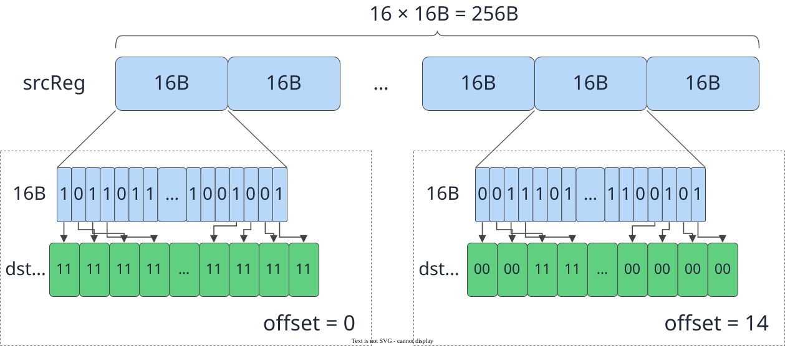
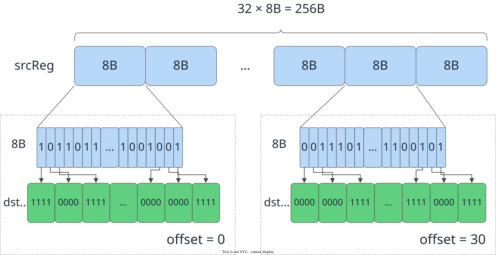

# vf.mask_gen_with_reg_tensor

## Applicable Products

<!-- npu="950" id1 -->
- Ascend 950PR&950DT products: Supported
<!-- end id1 -->
<!-- npu="A3" id2 -->
- Atlas A3 products: Not supported
<!-- end id2 -->
<!-- npu="910b" id3 -->
- Atlas A2 products: Not supported
<!-- end id3 -->

## Description

Generates a mask_reg from the bits of a specified DataBlock in a reg_tensor.

The [reg_tensor](../basic_data_structures/reg_tensor.md) (256B) is divided into multiple DataBlocks. The offset parameter specifies the DataBlock from which the mask_reg is generated. Each bit in that DataBlock is broadcast to multiple corresponding bits in the mask_reg, and the broadcast factor depends on the data type bit width.

- **b16 data types** (DT_FP16, DT_BF16, DT_INT16, and DT_UINT16): RegTensor is divided into 16 DataBlocks (16B each). Each bit is broadcast to 2 bits, producing a 32B mask_reg. offset ranges from 0 to 15.
- **b32 data types** (DT_FP32, DT_INT32, and DT_UINT32): RegTensor is divided into 32 DataBlocks (8B each). Each bit is broadcast to 4 bits, producing a 32B mask_reg. offset ranges from 0 to 31.

### Data Movement Principle for b16 Data Types

Taking the b16 data type as an example, the movement principle of mask_gen_with_reg_tensor is shown in the figure below.

**Figure 1** Movement principle of mask_gen_with_reg_tensor for b16 data types



### Data Movement Principle for b32 Data Types

Taking the b32 data type as an example, the movement principle of mask_gen_with_reg_tensor is shown in the figure below.

**Figure 2** Movement principle of mask_gen_with_reg_tensor for b32 data types



## Prototype

```python
mask_gen_with_reg_tensor(src, /, *, offset: Optional[int] = None) -> dst
```

## Parameters

| Parameter| Input/Output| Description|
|---|---|---|
| src | Input| Source operand, reg_tensor. For details about the supported data types, see [Constraints](#constraints).|
| offset | Input| (Optional) This parameter specifies which DataBlock in src is used to generate the mask_reg. The default value is 0.<br>- For 16-bit-wide data types, the value range is [0, 15] (the 256B reg_tensor is divided into 16 DataBlocks of 16B each).<br>- For 32-bit-wide data types, the value range is [0, 31] (the 256B reg_tensor is divided into 32 DataBlocks of 8B each).|

## Constraints

- Data type constraints:

  The source operand supports the following data types: DT_FP16, DT_BF16, DT_INT16, DT_UINT16, DT_FP32, DT_INT32, and DT_UINT32.

## Return Value

Returns the destination operand dst, of type [mask_reg](../basic_data_structures/mask_reg.md). In the generated mask_reg, only the least significant bit (LSB) is valid. For 16-bit-wide data types, only the LSB of each 2-bit group is valid; for 32-bit-wide data types, only the LSB of each 4-bit group is valid. For details, see [Principle of mask_reg](./create_mask.md#principle-of-mask_reg).

## Examples

```python
import os
import pypto_pro.language as pl
import torch
import torch_npu

@pl.vector_function
def example_vf(src_tile, dst_tile):
    reg = vf.load_align(src_tile, 0)
    dst = vf.mask_gen_with_reg_tensor(reg, offset=0)
    vf.store_align(dst_tile, reg, dst)

@pl.jit()
def example_kernel(
    a: pl.Tensor[[pl.DYNAMIC, pl.DYNAMIC], pl.DT_UINT32],
    out: pl.Tensor[[pl.DYNAMIC, pl.DYNAMIC], pl.DT_UINT32],
):
    tf = pl.TileType(shape=[1, 64], dtype=pl.DT_UINT32, target_memory=pl.MemorySpace.Vec)
    in_a_grp = pl.make_tile_group(type=tf, addrs=0x0, mutex_ids=[0])
    in_a = in_a_grp.current()
    t_out_grp = pl.make_tile_group(type=tf, addrs=0x100, mutex_ids=[1])
    t_out = t_out_grp.current()
    with pl.section_vector():
        pl.load(in_a, a, [0, 0])
        example_vf(in_a, t_out)
        pl.store(out, t_out, [0, 0])

def test_example():
    device_id = int(os.environ.get("TILE_FWK_DEVICE_ID", 0))
    device = f"npu:{device_id}"
    core_nums = 1
    torch.npu.set_device(device)
    a = torch.full([1, 64], -1, device=device, dtype=torch.int32)
    out = torch.empty([1, 64], device=device, dtype=torch.int32)
    example_kernel[None, core_nums](a, out)
    torch.npu.synchronize()
    torch.testing.assert_close(out, a, rtol=0, atol=0)

if __name__ == "__main__":
    test_example()
    print("PASSED")
```
