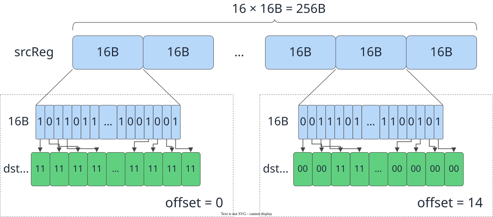
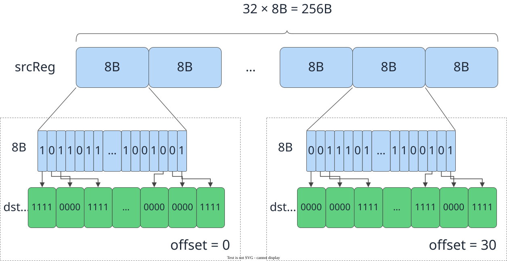

# vf.mask_gen_with_reg_tensor

<!-- md-trans-meta sourceCommit=7d0ab31d84c294a0a8327f597d2bdee012acb22d translatedAt=2026-10-26T14:05:01.318Z pushedAt=2026-10-28T11:57:29.055Z nl=2 -->

## Applicable Products

<!-- npu="950" id1 -->
- Ascend 950PR&950DT products: Supported
<!-- end id1 -->
<!-- npu="A3" id2 -->
- Atlas A3 products: Not supported
<!-- end id2 -->
<!-- npu="910b" id3 -->
- Atlas A2 products: Not supported
<!-- end id3 -->

## Description

Generates mask_reg from the bits of a specified data block (DataBlock) in reg_tensor.

[reg_tensor](../basic_data_structures/reg_tensor.md) (256B) is divided into several DataBlocks. The offset parameter specifies the DataBlock from which mask_reg is generated. Each bit in each DataBlock is broadcast to the corresponding multiple bits in mask_reg, and the broadcast multiple is determined by the data type bit width:

- **b16 data type** (DT_FP16, DT_BF16, DT_INT16, DT_UINT16): RegTensor is divided into 16 DataBlocks (16B each). Each bit is broadcast to 2 bits, generating a 32B mask_reg. The offset value range is [0, 15].
- **b32 data type** (DT_FP32, DT_INT32, DT_UINT32): RegTensor is divided into 32 DataBlocks (8B each). Each bit is broadcast to 4 bits, generating a 32B mask_reg. The offset value range is [0, 31].

### b16 Data Type Transfer Principle

Using the b16 data type as an example, the transfer principle of mask_gen_with_reg_tensor is shown in the following figure:

**Figure 1** Transfer principle of mask_gen_with_reg_tensor for the b16 data type



### b32 data type transfer principle

Taking the b32 data type as an example, the mask_gen_with_reg_tensor transfer principle is shown in the following figure:

**Figure 2** mask_gen_with_reg_tensor transfer principle for the b32 data type



## Prototype

```python
mask_gen_with_reg_tensor(src, offset: Optional[int] = None) -> dst
```

## Parameters

| Parameter | Input/Output | Description |
|---|---|---|
| src | Input | Source operand, reg_tensor. For supported data types, see [Constraints](#constraints). |
| offset | Input | Optional. Specifies the DataBlock in src from which mask_reg is generated. Defaults to 0.<br>- For 16-bit-wide data types, the value range is [0, 15] (a 256B reg_tensor is divided into 16 16B DataBlocks).<br>- For 32-bit-wide data types, the value range is [0, 31] (a 256B reg_tensor is divided into 32 8B DataBlocks). |

## Constraints

- Data type constraints:

  The source operand supports the following data types: DT_FP16, DT_BF16, DT_INT16, DT_UINT16, DT_FP32, DT_INT32, and DT_UINT32.

## Return Value

Returns the dst destination operand, [mask_reg](../basic_data_structures/mask_reg.md). In the generated mask_reg, only the lowest bit is valid: for 16-bit-wide data types, only the lowest bit of every 2 bits is valid; for 32-bit-wide data types, only the lowest bit of every 4 bits is valid. For details, see the [mask_reg working principle](./create_mask.md#how-mask_reg-works).

## Examples

```python
import os
import pypto_pro.language as pl
import torch
import torch_npu

@pl.vector_function
def example_vf(src_tile, dst_tile):
    reg = vf.load_align(src_tile, 0)
    dst = vf.mask_gen_with_reg_tensor(reg, offset=0)
    vf.store_align(dst_tile, reg, dst)

@pl.jit()
def example_kernel(
    a: pl.Tensor[[pl.DYNAMIC, pl.DYNAMIC], pl.DT_UINT32],
    out: pl.Tensor[[pl.DYNAMIC, pl.DYNAMIC], pl.DT_UINT32],
):
    tf = pl.TileType(shape=[1, 64], dtype=pl.DT_UINT32, target_memory=pl.MemorySpace.Vec)
    in_a_grp = pl.make_tile_group(type=tf, addrs=0x0, mutex_ids=[0])
    in_a = in_a_grp.current()
    t_out_grp = pl.make_tile_group(type=tf, addrs=0x100, mutex_ids=[1])
    t_out = t_out_grp.current()
    with pl.section_vector():
        pl.load(in_a, a, [0, 0])
        example_vf(in_a, t_out)
        pl.store(out, t_out, [0, 0])

def test_example():
    device_id = int(os.environ.get("TILE_FWK_DEVICE_ID", 0))
    device = f"npu:{device_id}"
    core_nums = 1
    torch.npu.set_device(device)
    a = torch.full([1, 64], -1, device=device, dtype=torch.int32)
    out = torch.empty([1, 64], device=device, dtype=torch.int32)
    example_kernel[None, core_nums](a, out)
    torch.npu.synchronize()
    torch.testing.assert_close(out, a, rtol=0, atol=0)

if __name__ == "__main__":
    test_example()
    print("PASSED")
```
