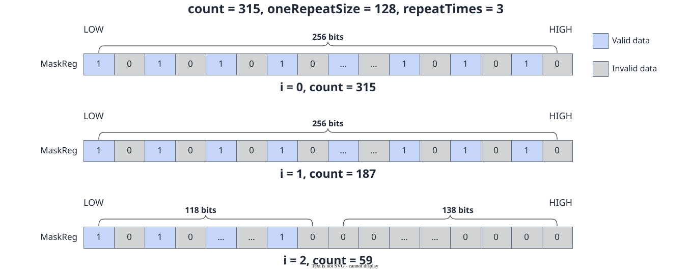

# vf.update_mask

<!-- md-trans-meta sourceCommit=7d0ab31d84c294a0a8327f597d2bdee012acb22d translatedAt=2026-10-26T14:05:22.090Z pushedAt=2026-10-28T11:57:29.065Z nl=2 -->

## Applicable Products

<!-- npu="950" id1 -->
- Ascend 950PR&950DT products: Supported
<!-- end id1 -->
<!-- npu="A3" id2 -->
- Atlas A3 products: Not supported
<!-- end id2 -->
<!-- npu="910b" id3 -->
- Atlas A2 products: Not supported
<!-- end id3 -->

## Description

Updates mask_reg from a scalar value. vf.update_mask generates a valid bit mask of the corresponding length based on the current scalarValue. Taking a 16-bit-wide data type as an example, the mask generation process is shown in the following figure:

**Figure 1** Mask generation based on scalarValue for the 16-bit-wide data type in update_mask



## Prototype

```python
update_mask(scalar, dtype: Optional[DType] = None) -> preg
```

## Parameters

| Parameter | Input/Output | Description |
|---|---|---|
| scalar | Input | Scalar value whose bits define the new mask pattern. |
| dtype | Input | Optional. Data type corresponding to the mask, which determines the mask width (defaults to pypto_pro.language.DT_FP32).<br>- This API operates on registers and does not involve address alignment.<br>- This API does not modify the values of global registers. |

## Constraints

- Data type constraints:

  The dtype parameter determines the mask granularity (that is, how many bits correspond to one data element). The total bit width of the mask register is fixed at 256 bits:

  | dtype | Element Bit Width | Element Count | Mask Bits per Element | Total Mask Bit Count |
  |---|---|---|---|---|
  | DT_INT8 / DT_UINT8 / DT_FP8E4M3FN / DT_FP8E5M2 / DT_FP8E8M0 / DT_HF8 / DT_FP4E2M1 / DT_FP4E1M2 | 8 bit | 256 | 1 bit (b8 granularity) | 256 bit |
  | DT_FP16 / DT_UINT16 / DT_BF16 | 16 bit | 128 | 2 bit (b16 granularity) | 256 bit |
  | DT_FP32 / DT_INT32 / DT_UINT32 | 32 bit | 64 | 4 bit (b32 granularity) | 256 bit |
  | DT_INT64 / DT_UINT64 | 64 bit | 32 | 8 bit (b64 granularity) | 256 bit |

  > **Note**: FP8 types (FP8E4M3FN/FP8E5M2/FP8E8M0/HF8) and FP4 types (FP4E2M1/FP4E1M2) are all stored as b8 and processed at b8 granularity. The mask register is always of the [mask_reg](../basic_data_structures/mask_reg.md) type.

## Return Value

Returns the preg target [mask_reg](../basic_data_structures/mask_reg.md).

## Examples

```python
import os
import pypto_pro.language as pl
import torch
import torch_npu

@pl.vector_function
def example_vf(src_tile, dst_tile):
    preg = vf.update_mask(0xFFFFFFFF, dtype=pl.DT_FP16)
    reg = vf.load_align(src_tile, 0)
    vf.store_align(dst_tile, reg, preg)

@pl.jit()
def example_kernel(
    a: pl.Tensor[[pl.DYNAMIC, pl.DYNAMIC], pl.DT_FP16],
    out: pl.Tensor[[pl.DYNAMIC, pl.DYNAMIC], pl.DT_FP16],
):
    tf = pl.TileType(shape=[1, 128], dtype=pl.DT_FP16, target_memory=pl.MemorySpace.Vec)
    in_a_grp = pl.make_tile_group(type=tf, addrs=0x0, mutex_ids=[0])
    in_a = in_a_grp.current()
    t_out_grp = pl.make_tile_group(type=tf, addrs=0x100, mutex_ids=[1])
    t_out = t_out_grp.current()
    with pl.section_vector():
        pl.load(in_a, a, [0, 0])
        example_vf(in_a, t_out)
        pl.store(out, t_out, [0, 0])

def test_example():
    device_id = int(os.environ.get("TILE_FWK_DEVICE_ID", 0))
    device = f"npu:{device_id}"
    core_nums = 1
    torch.npu.set_device(device)
    a = torch.randn([1, 128], device=device, dtype=torch.float16)
    out = torch.empty([1, 128], device=device, dtype=torch.float16)
    example_kernel[None, core_nums](a, out)
    torch.npu.synchronize()
    torch.testing.assert_close(out, a, rtol=1e-5, atol=1e-5)

if __name__ == "__main__":
    test_example()
    print("PASSED")
```
