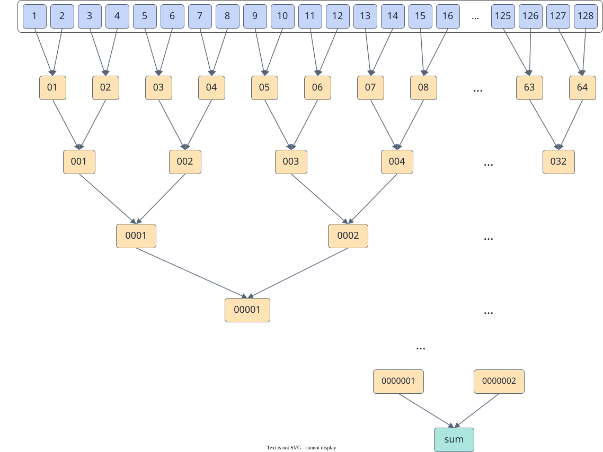

# vf.reduce_min

## Applicable Products

<!-- npu="950" id1 -->
- Ascend 950PR&950DT products: Supported
<!-- end id1 -->
<!-- npu="A3" id2 -->
- Atlas A3 products: Not supported
<!-- end id2 -->
<!-- npu="910b" id3 -->
- Atlas A2 products: Not supported
<!-- end id3 -->

## Description

reg_tensor minimum reduction: This API computes the minimum value among all valid elements in the source register src (that is, the elements selected by preg), writes the result into the first element of the destination register dst[0], writes the index of the first occurrence of the minimum value into dst[1], and sets the remaining elements to zero.

The computation process of the minimum reduction and the way the index is stored are shown in the figure below.

**Figure 1** reduce_min reduction index



## Prototype

```python
reduce_min(src, preg, /, *, datablock: bool = False, merge_mode: Optional[MergeMode] = None)
```

## Parameters

| Parameter| Input/Output| Description|
|---|---|---|
| src | Input| Source operand, which is of type [reg_tensor](../basic_data_structures/reg_tensor.md). The source operand src and the destination operand dst must have the same data type. The supported data types are DT_INT16, DT_UINT16, DT_FP16, DT_INT32, DT_UINT32, DT_FP32, DT_INT64, and DT_UINT64.|
| preg | Input| [mask_reg](../basic_data_structures/mask_reg.md). When all elements are not involved in the computation (the mask is empty), the maximum value of the data type is written to dst[0].|
| datablock | Input| (Optional) This parameter determines the operating mode of the API. When the parameter is set to True, reduction is performed at datablock granularity (corresponding to the vcgmin instruction). The default value is False. When datablock is set to True, datablock-granularity reduction is enabled, and each datablock is reduced independently: for 32-bit-wide types (DT_INT32, DT_UINT32, and DT_FP32), every 16 elements form one datablock; for 16-bit-wide types (DT_INT16, DT_UINT16, and DT_FP16), every 32 elements form one datablock. The minimum value of each datablock is computed separately, and the results are written sequentially to the least significant bits of dst.|
| merge_mode | Input| (Optional) This parameter corresponds to the [MergeMode](../basic_data_structures/MergeMode.md) type.<br>- pypto_pro.language.MergeMode.ZEROING (default): Elements not selected by preg are set to 0 in dst.<br>- pypto_pro.language.MergeMode.MERGING: Not supported currently.|

## Constraints

- When datablock is set to True, the supported data types are DT_INT16, DT_UINT16, DT_FP16, DT_INT32, DT_UINT32, and DT_FP32.

## Return Value

Returns the destination operand dst, which is of type [reg_tensor](../basic_data_structures/reg_tensor.md). The supported data types are the same as those for src. The reduction result is written to the first element dst[0], and the index is written to dst[1].

- If there are multiple minimum values, the index of the first minimum value is stored in dst[1].

- If the input data contains NaN, the NaN value for that data type is written into dst[0], and the index of the first NaN is saved in dst[1].

- min(-0, +0) = -0.

## Examples

### Basic Call Example

```python
import os
import pypto_pro.language as pl
import torch
import torch_npu

@pl.vector_function
def example_vf(src_tile, dst_tile):
    preg_all = vf.create_mask(pattern=pl.MaskPattern.ALL, dtype=pl.DT_FP32)
    src0 = vf.load_align(src_tile, 0)
    min0 = vf.reduce_min(src0, preg_all)
    vf.store_align(dst_tile, min0, preg_all)

@pl.jit()
def example_kernel(
    a: pl.Tensor[[pl.DYNAMIC, pl.DYNAMIC], pl.DT_FP32],
    out: pl.Tensor[[pl.DYNAMIC, pl.DYNAMIC], pl.DT_FP32],
):
    tf = pl.TileType(shape=[1, 64], dtype=pl.DT_FP32, target_memory=pl.MemorySpace.Vec)
    in_a_grp = pl.make_tile_group(type=tf, addrs=0x0, mutex_ids=[0])
    in_a = in_a_grp.current()
    t_out_grp = pl.make_tile_group(type=tf, addrs=0x100, mutex_ids=[1])
    t_out = t_out_grp.current()
    with pl.section_vector():
        pl.load(in_a, a, [0, 0])
        example_vf(in_a, t_out)
        pl.store(out, t_out, [0, 0])

def test_example():
    device_id = int(os.environ.get("TILE_FWK_DEVICE_ID", 0))
    device = f"npu:{device_id}"
    core_nums = 1
    torch.npu.set_device(device)
    a = torch.randn([1, 64], device=device, dtype=torch.float32)
    out = torch.empty([1, 64], device=device, dtype=torch.float32)
    example_kernel[None, core_nums](a, out)
    torch.npu.synchronize()
    torch.testing.assert_close(out[0, 0], torch.min(a), rtol=1e-5, atol=1e-5)

if __name__ == "__main__":
    test_example()
    print("PASSED")
```

### INT64 Data Type Example

```python
import os
import pypto_pro.language as pl
import torch
import torch_npu

@pl.vector_function
def example_vf_int64(src_tile, dst_tile):
    preg = vf.create_mask(pattern=pl.MaskPattern.ALL, dtype=pl.DT_INT64)
    reg_a = vf.load_align(src_tile, 0)
    reg_out = vf.reduce_min(reg_a, preg)
    vf.store_align(dst_tile, reg_out, preg)

@pl.jit()
def example_kernel_int64(
    a: pl.Tensor[[pl.DYNAMIC, pl.DYNAMIC], pl.DT_INT64],
    out: pl.Tensor[[pl.DYNAMIC, pl.DYNAMIC], pl.DT_INT64],
):
    tf = pl.TileType(shape=[1, 32], dtype=pl.DT_INT64, target_memory=pl.MemorySpace.Vec)
    in_a_grp = pl.make_tile_group(type=tf, addrs=0, mutex_ids=[0])
    in_a = in_a_grp.current()
    t_out_grp = pl.make_tile_group(type=tf, addrs=256, mutex_ids=[1])
    t_out = t_out_grp.current()
    with pl.section_vector():
        pl.load(in_a, a, [0, 0])
        example_vf_int64(in_a, t_out)
        pl.store(out, t_out, [0, 0])

def test_example_int64():
    device_id = int(os.environ.get("TILE_FWK_DEVICE_ID", 0))
    device = f"npu:{device_id}"
    core_nums = 1
    torch.npu.set_device(device)
    a = torch.randint(-100, 100, [1, 32], device=device, dtype=torch.int64)
    out = torch.zeros([1, 32], device=device, dtype=torch.int64)
    example_kernel_int64[None, core_nums](a, out)
    torch.npu.synchronize()
    torch.testing.assert_close(out[0, 0], torch.min(a), rtol=0, atol=0)

if __name__ == "__main__":
    test_example_int64()
    print("PASSED")
```
