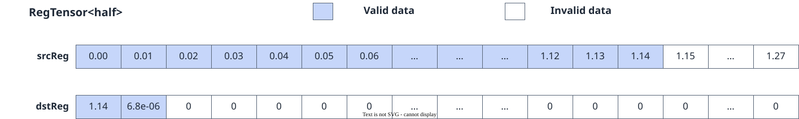

# vf.reduce_sum

## Applicable Products

<!-- npu="950" id1 -->
- Ascend 950PR&950DT products: Supported
<!-- end id1 -->
<!-- npu="A3" id2 -->
- Atlas A3 products: Not supported
<!-- end id2 -->
<!-- npu="910b" id3 -->
- Atlas A2 products: Not supported
<!-- end id3 -->

## Description

reg_tensor sum reduction: This API sums all valid elements in the source register src (that is, the elements selected by preg), writes the result into the first element of the destination register dst[0], and sets the remaining elements to zero.

The sum of the valid elements in the source operand src is computed by binary-tree accumulation. Taking the summation of DT_FP16 data as an example, if there are 128 numbers in src, they are added pairwise in a binary-tree manner, and the final destination operand is a single DT_FP16 value sum. The computation process is shown in the figure below.

**Figure 1** reduce_sum accumulation order



When the source operand data type is DT_FP16, the accumulation is performed at DT_FP16 precision. When the source operand data type is DT_INT16 or DT_UINT16, the accumulation is performed at 32-bit precision, and the final result matches the data type of the destination operand.

## Prototype

```python
reduce_sum(src, preg, /, *, datablock: bool = False, merge_mode: Optional[MergeMode] = None)
```

## Parameters

| Parameter| Input/Output| Description|
|---|---|---|
| src | Input| Source operand, which is of type [reg_tensor](../basic_data_structures/reg_tensor.md). For details about the supported data types, see [Constraints](#constraints).|
| preg | Input| [mask_reg](../basic_data_structures/mask_reg.md). When no elements participate in the computation (that is, the mask is empty), write a zero of the destination operand's data type into dst[0].|
| datablock | Input| (Optional) This parameter determines the operating mode of the API. When the parameter is set to True, reduction is performed at datablock granularity. The default value is False. When datablock is set to True, DataBlock-granularity reduction is enabled, and each DataBlock is reduced independently: for 32-bit-wide types (DT_INT32, DT_UINT32, and DT_FP32), every 8 elements form one datablock; for 16-bit-wide types (DT_INT16, DT_UINT16, and DT_FP16), every 16 elements form one datablock. The sum of each datablock is computed separately, and the results are written sequentially to the least significant bits of dst.|
| merge_mode | Input| (Optional) This parameter corresponds to the [MergeMode](../basic_data_structures/MergeMode.md) type.<br>- pypto_pro.language.MergeMode.ZEROING (default): Elements not selected by preg are set to 0 in dst.<br>- pypto_pro.language.MergeMode.MERGING: Not supported currently.|

## Constraints

- Data type constraints:

  **Table 1** Data types supported in non-datablock mode (datablock=False)

  | dst (Destination Operand Type)| src (Source Operand Type)| Accumulation Precision|
  |---|---|---|
  | DT_FP16 | DT_FP16 | DT_FP16 |
  | DT_INT32 | DT_INT16 | DT_INT32 |
  | DT_UINT32 | DT_UINT16 | DT_UINT32 |
  | DT_INT32 | DT_INT32 | DT_INT32 |
  | DT_UINT32 | DT_UINT32 | DT_UINT32 |
  | DT_FP32 | DT_FP32 | DT_FP32 |
  | DT_INT64 | DT_INT64 | DT_INT64 |
  | DT_UINT64 | DT_UINT64 | DT_UINT64 |

  **Table 2** Data types supported in datablock mode (datablock=True)

  | dst (Destination Operand Type)| src (Source Operand Type)| datablock Size|
  |---|---|---|
  | DT_FP16 | DT_FP16 | 16 elements|
  | DT_INT32 | DT_INT16 | 16 elements|
  | DT_UINT32 | DT_UINT16 | 16 elements|
  | DT_INT32 | DT_INT32 | 8 elements|
  | DT_UINT32 | DT_UINT32 | 8 elements|
  | DT_FP32 | DT_FP32 | 8 elements|

## Return Value

Returns the destination operand dst, which is of type [reg_tensor](../basic_data_structures/reg_tensor.md). The supported data types are the same as those for src. The reduction result is written to the first element dst[0], and the other elements are set to zero. The accumulation sequence within the instruction uses the binary-tree accumulation mode, ensuring deterministic results.

## Examples

### Basic Call Example

```python
import os
import pypto_pro.language as pl
import torch
import torch_npu

@pl.vector_function
def example_vf(src_tile, dst_tile):
    preg_all = vf.create_mask(pattern=pl.MaskPattern.ALL, dtype=pl.DT_FP32)
    src0 = vf.load_align(src_tile, 0)
    sum0 = vf.reduce_sum(src0, preg_all)
    vf.store_align(dst_tile, sum0, preg_all)

@pl.jit()
def example_kernel(
    a: pl.Tensor[[pl.DYNAMIC, pl.DYNAMIC], pl.DT_FP32],
    out: pl.Tensor[[pl.DYNAMIC, pl.DYNAMIC], pl.DT_FP32],
):
    tf = pl.TileType(shape=[1, 64], dtype=pl.DT_FP32, target_memory=pl.MemorySpace.Vec)
    in_a_grp = pl.make_tile_group(type=tf, addrs=0x0, mutex_ids=[0])
    in_a = in_a_grp.current()
    t_out_grp = pl.make_tile_group(type=tf, addrs=0x100, mutex_ids=[1])
    t_out = t_out_grp.current()
    with pl.section_vector():
        pl.load(in_a, a, [0, 0])
        example_vf(in_a, t_out)
        pl.store(out, t_out, [0, 0])

def test_example():
    device_id = int(os.environ.get("TILE_FWK_DEVICE_ID", 0))
    device = f"npu:{device_id}"
    core_nums = 1
    torch.npu.set_device(device)
    a = torch.randn([1, 64], device=device, dtype=torch.float32)
    out = torch.empty([1, 64], device=device, dtype=torch.float32)
    example_kernel[None, core_nums](a, out)
    torch.npu.synchronize()
    torch.testing.assert_close(out[0, 0], a.sum(), rtol=1e-5, atol=1e-5)

if __name__ == "__main__":
    test_example()
    print("PASSED")
```

### INT64 Data Type Example

```python
import os
import pypto_pro.language as pl
import torch
import torch_npu

@pl.vector_function
def example_vf_int64(src_tile, dst_tile):
    preg = vf.create_mask(pattern=pl.MaskPattern.ALL, dtype=pl.DT_INT64)
    reg_a = vf.load_align(src_tile, 0)
    reg_out = vf.reduce_sum(reg_a, preg)
    vf.store_align(dst_tile, reg_out, preg)

@pl.jit()
def example_kernel_int64(
    a: pl.Tensor[[pl.DYNAMIC, pl.DYNAMIC], pl.DT_INT64],
    out: pl.Tensor[[pl.DYNAMIC, pl.DYNAMIC], pl.DT_INT64],
):
    tf = pl.TileType(shape=[1, 32], dtype=pl.DT_INT64, target_memory=pl.MemorySpace.Vec)
    in_a_grp = pl.make_tile_group(type=tf, addrs=0, mutex_ids=[0])
    in_a = in_a_grp.current()
    t_out_grp = pl.make_tile_group(type=tf, addrs=256, mutex_ids=[1])
    t_out = t_out_grp.current()
    with pl.section_vector():
        pl.load(in_a, a, [0, 0])
        example_vf_int64(in_a, t_out)
        pl.store(out, t_out, [0, 0])

def test_example_int64():
    device_id = int(os.environ.get("TILE_FWK_DEVICE_ID", 0))
    device = f"npu:{device_id}"
    core_nums = 1
    torch.npu.set_device(device)
    a = torch.randint(-100, 100, [1, 32], device=device, dtype=torch.int64)
    out = torch.zeros([1, 32], device=device, dtype=torch.int64)
    example_kernel_int64[None, core_nums](a, out)
    torch.npu.synchronize()
    torch.testing.assert_close(out[0, 0], torch.sum(a, dtype=torch.int64), rtol=0, atol=0)

if __name__ == "__main__":
    test_example_int64()
    print("PASSED")
```
