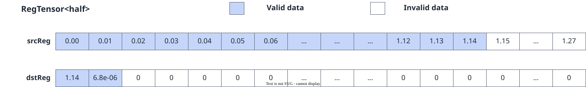

# vf.reduce_sum

<!-- md-trans-meta sourceCommit=7d0ab31d84c294a0a8327f597d2bdee012acb22d translatedAt=2026-10-26T14:08:16.128Z pushedAt=2026-10-28T11:57:29.078Z nl=2 -->

## Applicable Products

<!-- npu="950" id1 -->
- Ascend 950PR&950DT products: Supported
<!-- end id1 -->
<!-- npu="A3" id2 -->
- Atlas A3 products: Not supported
<!-- end id2 -->
<!-- npu="910b" id3 -->
- Atlas A2 products: Not supported
<!-- end id3 -->

## Description

reg_tensor sum reduction: Sums all valid elements in the source register src (elements selected by preg) and writes the result to the first element of the destination register dst[0], with the remaining elements set to zero.

Computes the sum of the valid elements in the source operand src using binary-tree accumulation. Taking the summation of DT_FP16 data as an example, when src contains 128 numbers, they are added pairwise through a binary tree, ultimately producing a single DT_FP16 value sum as the destination operand. The computation process is shown in the following figure:

**Figure 1** reduce_sum accumulation order



When the source operand data type is DT_FP16, the accumulation is performed at DT_FP16 precision. When the source operand data type is DT_INT16 or DT_UINT16, the accumulation is performed at 32-bit precision, and the final result is consistent with the destination operand data type.

## Prototype

```python
reduce_sum(src, preg, datablock: bool = False, merge_mode: Optional[MergeMode] = None)
```

## Parameters

| Parameter | Input/Output | Description |
|---|---|---|
| src | Input | Source operand, [reg_tensor](../basic_data_structures/reg_tensor.md). For supported data types, see [Constraints](#constraints). |
| preg | Input | [mask_reg](../basic_data_structures/mask_reg.md). When no elements participate in the computation (the mask is empty), 0 of the destination operand data type is written to dst[0]. |
| datablock | Input | Optional. Determines the working mode of the API. When set to True, reduction is performed at datablock granularity. Defaults to False. When datablock=True, datablock-granularity reduction is enabled, and each datablock is reduced independently: for 32-bit types (DT_INT32, DT_UINT32, DT_FP32), every 8 elements form a datablock; for 16-bit types (DT_INT16, DT_UINT16, DT_FP16), every 16 elements form a datablock. Each datablock is summed separately, and the results are written sequentially to the lowest bits of dst. |
| merge_mode | Input | Optional. Corresponds to the [MergeMode](../basic_data_structures/MergeMode.md) type.<br>- pypto_pro.language.MergeMode.ZEROING (default): Elements not selected by preg are set to 0 in dst.<br>- pypto_pro.language.MergeMode.MERGING is not supported currently. |

## Constraints

- Data type constraints:

  **Table 1** Data type support in non-datablock mode (datablock=False)

  | dst (destination operand type) | src (source operand type) | Accumulation precision |
  |---|---|---|
  | DT_FP16 | DT_FP16 | DT_FP16 |
  | DT_INT32 | DT_INT16 | DT_INT32 |
  | DT_UINT32 | DT_UINT16 | DT_UINT32 |
  | DT_INT32 | DT_INT32 | DT_INT32 |
  | DT_UINT32 | DT_UINT32 | DT_UINT32 |
  | DT_FP32 | DT_FP32 | DT_FP32 |

  **Table 2** Data type support in datablock mode (datablock=True)

  | dst (destination operand type) | src (source operand type) | Datablock size |
  |---|---|---|
  | DT_FP16 | DT_FP16 | 16 elements |
  | DT_INT32 | DT_INT16 | 16 elements |
  | DT_UINT32 | DT_UINT16 | 16 elements |
  | DT_INT32 | DT_INT32 | 8 elements |
  | DT_UINT32 | DT_UINT32 | 8 elements |
  | DT_FP32 | DT_FP32 | 8 elements |

## Return Value

Returns the dst target [reg_tensor](../basic_data_structures/reg_tensor.md). The supported data types are consistent with those described for src. The reduction result is written to the first element dst[0], and the remaining elements are set to zero. The accumulation order within the instruction uses binary tree accumulation, and the result is deterministic.

## Examples

```python
import os
import pypto_pro.language as pl
import torch
import torch_npu

@pl.vector_function
def example_vf(src_tile, dst_tile):
    preg_all = vf.create_mask(pattern=pl.MaskPattern.ALL, dtype=pl.DT_FP32)
    src0 = vf.load_align(src_tile, 0)
    sum0 = vf.reduce_sum(src0, preg_all)
    vf.store_align(dst_tile, sum0, preg_all)

@pl.jit()
def example_kernel(
    a: pl.Tensor[[pl.DYNAMIC, pl.DYNAMIC], pl.DT_FP32],
    out: pl.Tensor[[pl.DYNAMIC, pl.DYNAMIC], pl.DT_FP32],
):
    tf = pl.TileType(shape=[1, 64], dtype=pl.DT_FP32, target_memory=pl.MemorySpace.Vec)
    in_a_grp = pl.make_tile_group(type=tf, addrs=0x0, mutex_ids=[0])
    in_a = in_a_grp.current()
    t_out_grp = pl.make_tile_group(type=tf, addrs=0x100, mutex_ids=[1])
    t_out = t_out_grp.current()
    with pl.section_vector():
        pl.load(in_a, a, [0, 0])
        example_vf(in_a, t_out)
        pl.store(out, t_out, [0, 0])

def test_example():
    device_id = int(os.environ.get("TILE_FWK_DEVICE_ID", 0))
    device = f"npu:{device_id}"
    core_nums = 1
    torch.npu.set_device(device)
    a = torch.randn([1, 64], device=device, dtype=torch.float32)
    out = torch.empty([1, 64], device=device, dtype=torch.float32)
    example_kernel[None, core_nums](a, out)
    torch.npu.synchronize()
    torch.testing.assert_close(out[0, 0], a.sum(), rtol=1e-5, atol=1e-5)

if __name__ == "__main__":
    test_example()
    print("PASSED")
```
