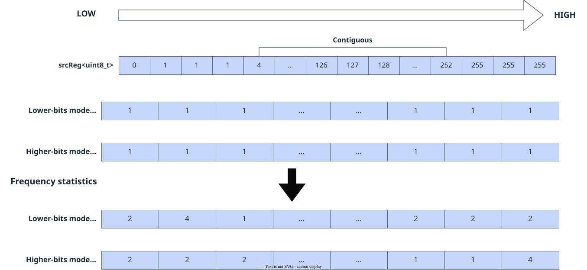
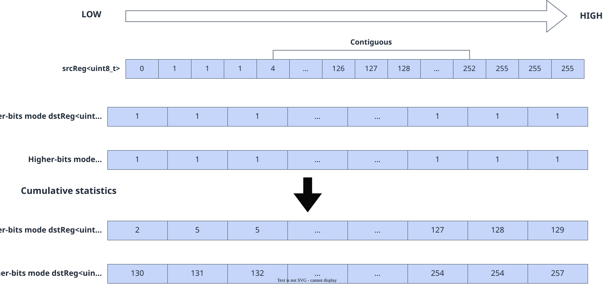

# vf.histograms

## Applicable Products

<!-- npu="950" id1 -->
- Ascend 950PR&950DT products: Supported
<!-- end id1 -->
<!-- npu="A3" id2 -->
- Atlas A3 products: Not supported
<!-- end id2 -->
<!-- npu="910b" id3 -->
- Atlas A2 products: Not supported
<!-- end id3 -->

## Description

Performs histogram statistics on the data and adds the statistical results of the source operand src to the base data of the destination operand dst, including frequency statistics and cumulative statistics.

### Frequency statistics

As shown in the figure below, in lower-bit mode (BIN0), dst counts the occurrence frequency of each value in src within the index range [0–127] (the first half); in higher-bit mode (BIN1), dst counts the frequencies within the range [128–255] (the second half). The n-th element in dst represents the number of occurrences of value n in src, and the counts are accumulated on top of the original dst data.

**Figure 1** histograms frequency statistics



### Cumulative statistics

As shown in the figure below, in lower-bit mode (BIN0), the destination register dst collects statistics on the distribution of values in the source register src that fall within the low-value interval [0–127]; in higher-bit mode (BIN1), the destination register dst collects statistics on the distribution of values in src that fall within the high-value interval [128–255]. In dst, the n-th element represents the cumulative frequency, within the corresponding interval, of all values from 0 through n in src. Finally, the statistics are accumulated on top of the original data in the destination register.

**Figure 2** histograms cumulative statistics



## Prototype

```python
histograms(src, preg, /, *, bin_type: Optional[BinType] = None, hist_type: Optional[HistType] = None)
```

## Parameters

| Parameter| Input/Output| Description|
|---|---|---|
| src | Input| Source operand, which is of type [reg_tensor](../basic_data_structures/reg_tensor.md). The supported data type is DT_UINT8. These are the input data values to be counted. The value ranges from 0 to 255.<br>- When a mask bit is 0, the value at the corresponding position in the source operand src does not participate in counting, and the value at the corresponding position in dst retains its original value (that is, no counting is performed for the value at that position in src).|
| preg | Input| [mask_reg](../basic_data_structures/mask_reg.md), specifying the range of elements that participate in counting. When a mask bit is 1, the element participates in counting; when it is 0, it does not. The dtype must be DT_UINT8 (b8 granularity).|
| bin_type | Input| Optional. Bin type, which determines the data value range for counting. It corresponds to the [BinType](../basic_data_structures/BinType.md) type.<br>- pypto_pro.language.BinType.BIN0 (default): lower-bit mode. The occurrence frequency/cumulative frequency of values in src within the range [0, 127] is counted. dst[n] corresponds to the counting result for value n.<br>- pypto_pro.language.BinType.BIN1: higher-bit mode. The occurrence frequency/cumulative frequency of values in src within the range [128, 255] is counted. During counting, the value is subtracted by 128 and mapped to the corresponding position in dst. dst[n] corresponds to the counting result for value (n+128).|
| hist_type | Input| (Optional) Statistical mode, which determines the counting method and corresponds to the [HistType](../basic_data_structures/HistType.md) type.<br>- pypto_pro.language.HistType.ACCUMULATE (default, cumulative statistics): The n-th element of dst represents the total frequency, within the corresponding interval, of all values from 0 through n in src. The counting result is accumulated on top of the original dst data.<br>- pypto_pro.language.HistType.FREQUENCY (frequency statistics): The n-th element of dst represents the number of occurrences of value n in src. The counting result is accumulated on top of the original dst data.|

## Constraints

None

## Return Value

Returns the destination dst, which is of type [reg_tensor](../basic_data_structures/reg_tensor.md) with data type DT_UINT16, which stores the bin counting results. When VL (register width) is 256 bytes, dst can hold 128 uint16 elements.<br>- When hist_type is set to ACCUMULATE, accumulation is performed in place. The dst register is both read and written. Before the first call, dst must be initialized to zero via vf.full(0, ...); subsequent calls reuse the same register and continue accumulating through dst = vf.histograms(...).<br>- The data type of dst is DT_UINT16, with a maximum value of 65535. Be careful about accumulation overflow during use.

## Examples

```python
import os
import pypto_pro.language as pl
import torch
import torch_npu

@pl.vector_function
def example_vf(src_tile, dst_tile):
    preg_b8 = vf.create_mask(pattern=pl.MaskPattern.ALL, dtype=pl.DT_UINT8)
    preg_b16 = vf.create_mask(pattern=pl.MaskPattern.ALL, dtype=pl.DT_UINT16)
    vreg = vf.load_align(src_tile, 0, dtype=pl.DT_UINT8)
    dst_reg = vf.full(0, preg_b16, dtype=pl.DT_UINT16)
    dst_reg = vf.histograms(vreg, preg_b8, bin_type=pl.BinType.BIN0, hist_type=pl.HistType.ACCUMULATE)
    vf.store_align(dst_tile, dst_reg, preg_b16)

@pl.jit()
def example_kernel(
    a: pl.Tensor[[pl.DYNAMIC, pl.DYNAMIC], pl.DT_UINT8],
    out: pl.Tensor[[pl.DYNAMIC, pl.DYNAMIC], pl.DT_UINT16],
):
    tf_src = pl.TileType(shape=[1, 256], dtype=pl.DT_UINT8, target_memory=pl.MemorySpace.Vec)
    tf_dst = pl.TileType(shape=[1, 128], dtype=pl.DT_UINT16, target_memory=pl.MemorySpace.Vec)
    in_a_grp = pl.make_tile_group(type=tf_src, addrs=0x0, mutex_ids=[0])
    in_a = in_a_grp.current()
    t_out_grp = pl.make_tile_group(type=tf_dst, addrs=0x100, mutex_ids=[1])
    t_out = t_out_grp.current()
    with pl.section_vector():
        pl.load(in_a, a, [0, 0])
        example_vf(in_a, t_out)
        pl.store(out, t_out, [0, 0])

def test_example():
    device_id = int(os.environ.get("TILE_FWK_DEVICE_ID", 0))
    device = f"npu:{device_id}"
    core_nums = 1
    torch.npu.set_device(device)
    a = torch.randint(0, 256, [1, 256], device=device, dtype=torch.uint8)
    out = torch.empty([1, 128], device=device, dtype=torch.int16)
    example_kernel[None, core_nums](a, out)
    torch.npu.synchronize()
    src_np = a.cpu().numpy().flatten()
    expected = torch.zeros(128, dtype=torch.int32, device=device)
    for v in src_np:
        if v <= 127:
            expected[v:] += 1
    torch.testing.assert_close(out[0].to(torch.int32), expected, rtol=0, atol=0)

if __name__ == "__main__":
    test_example()
    print("PASSED")
```
