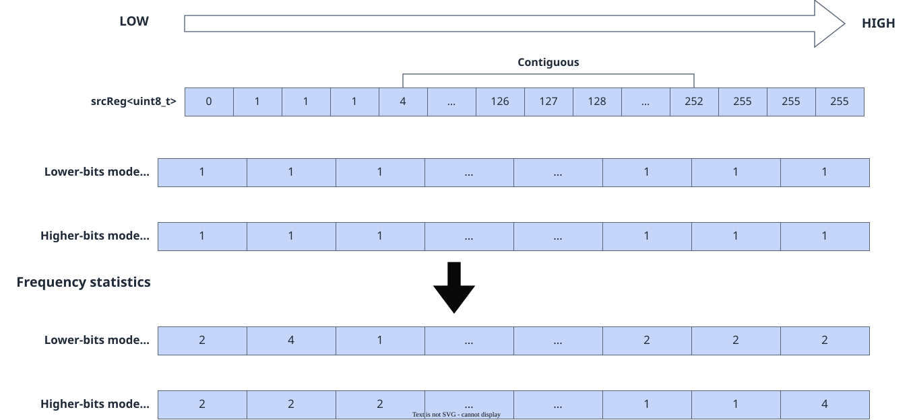
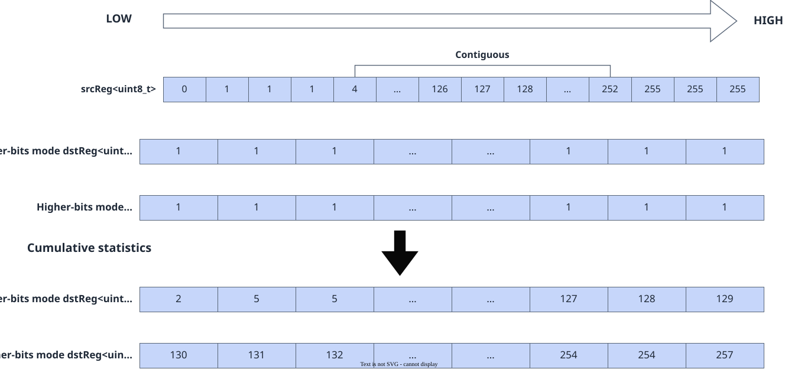

# vf.histograms

<!-- md-trans-meta sourceCommit=7d0ab31d84c294a0a8327f597d2bdee012acb22d translatedAt=2026-10-26T14:09:44.719Z pushedAt=2026-10-28T11:57:29.088Z nl=2 -->

## Applicable Products

<!-- npu="950" id1 -->
- Ascend 950PR&950DT products: Supported
<!-- end id1 -->
<!-- npu="A3" id2 -->
- Atlas A3 products: Not supported
<!-- end id2 -->
<!-- npu="910b" id3 -->
- Atlas A2 products: Not supported
<!-- end id3 -->

## Description

Performs statistics on histogram data by adding the statistical result of the source operand src to the base data of the destination operand dst, including frequency statistics and cumulative statistics of the data.

### Frequency Statistics

As shown in the following figure, in low-bit mode (BIN0), dst is used to count the occurrence frequency of each value in src whose index falls within the range [0-127] (the first half); in high-bit mode (BIN1), dst counts the frequency within the range [128-255] (the second half). The n-th element in dst indicates the number of occurrences of the value n in src, and the result is accumulated on top of the original dst data.

**Figure 1** Frequency statistics of histograms



### Cumulative Statistics

As shown in the following figure, in low-bit mode (BIN0), the destination register dst counts the distribution of values in the source register src that fall within the low-bit range [0-127]. In high-bit mode (BIN1), dst counts the distribution of values in src that fall within the high-bit range [128-255]. In dst, the n-th element represents the total frequency of all values from 0 to n in src that occur within the corresponding range. Finally, the statistical result is accumulated on top of the original data in the destination register.

**Figure 2** Histograms cumulative statistics



## Prototype

```python
histograms(src, preg, bin_type: Optional[BinType] = None, hist_type: Optional[HistType] = None)
```

## Parameters

| Parameter | Input/Output | Description |
|---|---|---|
| src | Input | Source operand, [reg_tensor](../basic_data_structures/reg_tensor.md), with a data type of DT_UINT8, containing the data to be counted. The value range is 0 to 255.<br>- When the mask bit is 0, the value at the corresponding position of the source operand src does not participate in the statistics, and the value at the corresponding position of dst remains the original value (statistics are performed on values that do not exist at that position of src). |
| preg | Input | [mask_reg](../basic_data_structures/mask_reg.md), specifying the range of elements that participate in the statistics. When the mask bit is 1, the element participates in the statistics; when it is 0, the element does not participate. The dtype must be DT_UINT8 (b8 granularity). |
| bin_type | Input | Optional. Bucket type, which determines the data value range to be counted, corresponding to the [BinType](../basic_data_structures/BinType.md) type.<br>- pypto_pro.language.BinType.BIN0 (default): Low-bit mode, which counts the occurrence frequency/cumulative frequency of values in src within the range [0, 127]. dst[n] corresponds to the statistical result of value n.<br>- pypto_pro.language.BinType.BIN1: High-bit mode, which counts the occurrence frequency/cumulative frequency of values in src within the range [128, 255]. During counting, 128 is subtracted from the value and mapped to the corresponding position of dst. dst[n] corresponds to the statistical result of value (n+128). |
| hist_type | Input | Optional. Statistics mode, which determines the counting method, corresponding to the [HistType](../basic_data_structures/HistType.md) type.<br>- pypto_pro.language.HistType.ACCUMULATE (default, cumulative statistics): The n-th element of dst represents the total frequency of all values from 0 to n in src that occur within the corresponding range. The statistical result is accumulated on top of the original data in dst.<br>- pypto_pro.language.HistType.FREQUENCY (frequency statistics): The n-th element of dst represents the number of occurrences of value n in src. The statistical result is accumulated on top of the original data in dst. |

## Constraints

None

## Return Value

Returns the destination [reg_tensor](../basic_data_structures/reg_tensor.md), with a data type of DT_UINT16, which stores the bucket counting result. When VL (register bit width) is 256 bytes, dst can store 128 uint16 elements.<br>- When hist_type=ACCUMULATE, in-place accumulation is performed: the dst register is both read and written. Before the first call, dst must be initialized to zero using vf.full(0, ...). Subsequent calls reuse the same register for continued accumulation via dst = vf.histograms(...).<br>- The data type of dst is DT_UINT16, with a maximum value of 65535. Pay attention to accumulation overflow during use.

## Examples

```python
import os
import pypto_pro.language as pl
import torch
import torch_npu

@pl.vector_function
def example_vf(src_tile, dst_tile):
    preg_b8 = vf.create_mask(pattern=pl.MaskPattern.ALL, dtype=pl.DT_UINT8)
    preg_b16 = vf.create_mask(pattern=pl.MaskPattern.ALL, dtype=pl.DT_UINT16)
    vreg = vf.load_align(src_tile, 0, dtype=pl.DT_UINT8)
    dst_reg = vf.full(0, preg_b16, dtype=pl.DT_UINT16)
    dst_reg = vf.histograms(vreg, preg_b8, bin_type=pl.BinType.BIN0, hist_type=pl.HistType.ACCUMULATE)
    vf.store_align(dst_tile, dst_reg, preg_b16)

@pl.jit()
def example_kernel(
    a: pl.Tensor[[pl.DYNAMIC, pl.DYNAMIC], pl.DT_UINT8],
    out: pl.Tensor[[pl.DYNAMIC, pl.DYNAMIC], pl.DT_UINT16],
):
    tf_src = pl.TileType(shape=[1, 256], dtype=pl.DT_UINT8, target_memory=pl.MemorySpace.Vec)
    tf_dst = pl.TileType(shape=[1, 128], dtype=pl.DT_UINT16, target_memory=pl.MemorySpace.Vec)
    in_a_grp = pl.make_tile_group(type=tf_src, addrs=0x0, mutex_ids=[0])
    in_a = in_a_grp.current()
    t_out_grp = pl.make_tile_group(type=tf_dst, addrs=0x100, mutex_ids=[1])
    t_out = t_out_grp.current()
    with pl.section_vector():
        pl.load(in_a, a, [0, 0])
        example_vf(in_a, t_out)
        pl.store(out, t_out, [0, 0])

def test_example():
    device_id = int(os.environ.get("TILE_FWK_DEVICE_ID", 0))
    device = f"npu:{device_id}"
    core_nums = 1
    torch.npu.set_device(device)
    a = torch.randint(0, 256, [1, 256], device=device, dtype=torch.uint8)
    out = torch.empty([1, 128], device=device, dtype=torch.int16)
    example_kernel[None, core_nums](a, out)
    torch.npu.synchronize()
    src_np = a.cpu().numpy().flatten()
    expected = torch.zeros(128, dtype=torch.int32, device=device)
    for v in src_np:
        if v <= 127:
            expected[v:] += 1
    torch.testing.assert_close(out[0].to(torch.int32), expected, rtol=0, atol=0)

if __name__ == "__main__":
    test_example()
    print("PASSED")
```
