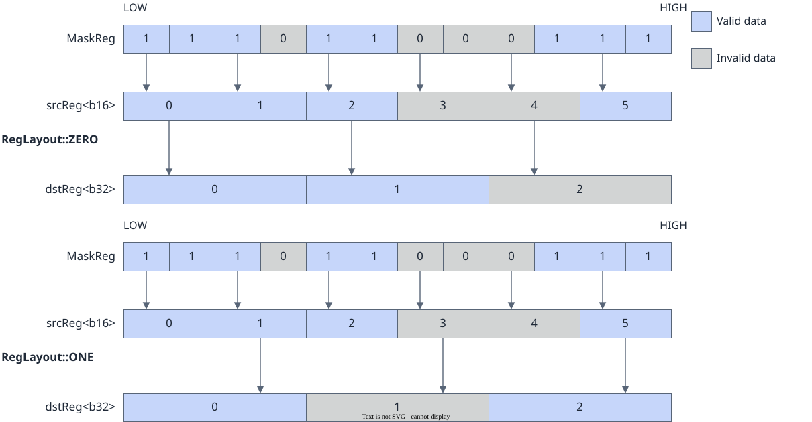
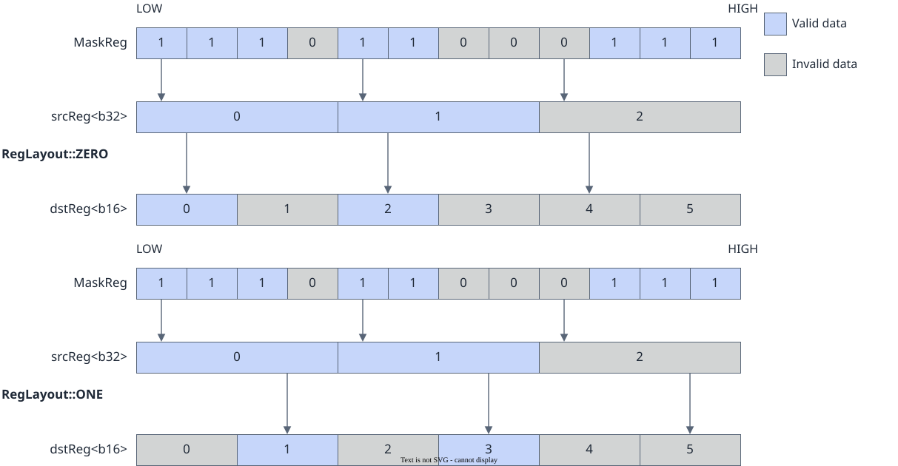
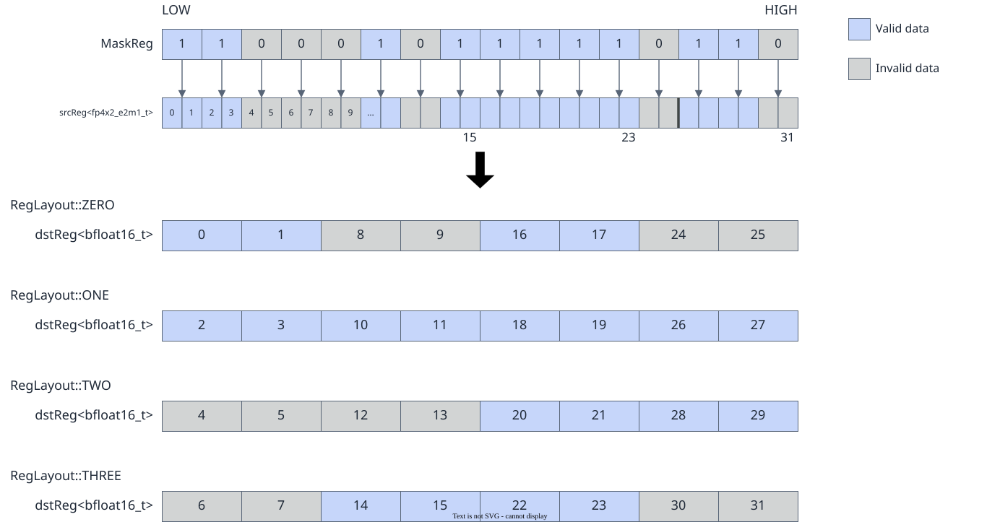
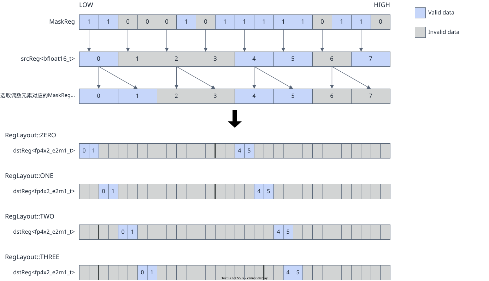

# vf.astype

<!-- md-trans-meta sourceCommit=7d0ab31d84c294a0a8327f597d2bdee012acb22d translatedAt=2026-10-26T14:16:54.611Z pushedAt=2026-10-28T11:57:29.134Z nl=2 -->

## Applicable Products

<!-- npu="950" id1 -->
- Ascend 950PR&950DT products: Supported
<!-- end id1 -->
<!-- npu="A3" id2 -->
- Atlas A3 products: Not supported
<!-- end id2 -->
<!-- npu="910b" id3 -->
- Atlas A2 products: Not supported
<!-- end id3 -->

## Description

vf.astype performs data type precision conversion by converting the source operand data type to the destination operand data type. It supports float-to-integer, float-to-float, integer-to-float, and integer-to-integer conversions.

During the conversion process, the following parameters can be configured to handle bit-width and precision changes:

- **layout** (pypto_pro.language.CastLayout): When the source operand and destination operand have different bit widths, the computation amount of a single instruction is determined by the data type with the larger bit width. layout controls how elements with the smaller bit width are arranged in the register. pypto_pro.language.CastLayout.ZERO places elements at even index positions, and pypto_pro.language.CastLayout.ONE places elements at odd index positions. The FP4 type also supports the pypto_pro.language.CastLayout.TWO and pypto_pro.language.CastLayout.THREE modes (used for 4x expansion/narrowing).
- **saturate** (pypto_pro.language.SaturateMode): Sets the saturation mode. In saturation mode, values that exceed the representable range of the destination type are truncated to the maximum/minimum value of the destination type. In non-saturation mode, the behavior of out-of-range values varies by conversion scenario (see [Constraints](#constraints)).
- **mode** (pypto_pro.language.MergeMode): Specifies the mode for writing data to the register. Elements not selected by preg are set to zero in dst (pypto_pro.language.MergeMode.ZEROING) or retain the original dst value (pypto_pro.language.MergeMode.MERGING). The current device supports only the pypto_pro.language.MergeMode.ZEROING mode.
- **round_mode** (pypto_pro.language.VFRoundMode): Sets the rounding mode. It takes effect only in conversions that may cause precision loss and support this rounding mode.

The preg bit width corresponding to elements varies across data types. During type conversion, mask_reg filters valid elements based on the source operand. When the source operand and destination operand have different bit widths, the computation amount of a single instruction is determined by the data type with the larger bit width, and layout controls how elements with the smaller bit width are arranged in registers.

The following figures show the type conversion process between 16-bit and 32-bit widths when mask_reg and layout act together:

**Figure 1** Conversion from a 16-bit type to a 32-bit type



**Figure 2** Conversion from a 32-bit type to a 16-bit type



In particular, for conversions between DT_FP4E2M1, DT_FP4E1M2, and DT_BF16, the instruction reads and writes every two elements as a pair. When converting from a larger type to a smaller type, the valid bits of preg are determined by even-numbered elements. The following figures show the conversion process between DT_FP4E2M1 and DT_BF16 when mask_reg and layout act together:

**Figure 3** Conversion from DT_FP4E2M1 to DT_BF16



**Figure 4** Conversion from DT_BF16 to DT_FP4E2M1



## Prototype

```python
astype(src, preg, dtype: DType, layout: Optional[CastLayout] = None, round_mode: Optional[VFRoundMode] = None, saturate: Optional[SaturateMode] = None, mode: Optional[MergeMode] = None) -> dst
```

## Parameters

| Parameter | Input/Output | Description |
|---|---|---|
| src | Input | Source operand, [reg_tensor](../basic_data_structures/reg_tensor.md). For supported data types, see [Constraints](#constraints). |
| preg | Input | [mask_reg](../basic_data_structures/mask_reg.md). preg filters valid elements based on the input source operand. |
| dtype | Input | Required. Specifies the data type of the destination register (for example, pypto_pro.language.DT_FP16, pypto_pro.language.DT_INT32). Because the destination type differs from the source type after type conversion, it must be explicitly specified. |
| layout | Input | Optional. [CastLayout](../basic_data_structures/CastLayout.md) enumeration type. pypto_pro.language.CastLayout.ZERO (even half, default) or pypto_pro.language.CastLayout.ONE (odd half). When the source operand and destination operand have different bit widths, controls how the elements with the smaller bit width are arranged in the register. The FP4 type also supports pypto_pro.language.CastLayout.TWO/pypto_pro.language.CastLayout.THREE modes. The specific supported values vary by conversion path. See each table in [Constraints](#constraints). |
| round_mode | Input | Optional. [VFRoundMode](../basic_data_structures/VFRoundMode.md) enumeration type, floating-point rounding mode. Default: pypto_pro.language.VFRoundMode.CAST_RINT. Different conversion paths support different rounding modes. See each table in [Constraints](#constraints). For conversion paths that do not involve precision loss, round_mode is marked as UNKNOWN (optional). |
| saturate | Input | Optional. [SaturateMode](../basic_data_structures/SaturateMode.md) enumeration type. pypto_pro.language.SaturateMode.OFF (default, non-saturating) or pypto_pro.language.SaturateMode.ON (saturating). The specific supported values vary by conversion path. See each table in [Constraints](#constraints). Paths marked as UNKNOWN indicate that no saturating/non-saturating selection is involved. |
| mode | Input | Optional. Corresponds to the [MergeMode](../basic_data_structures/MergeMode.md) type.<br>- pypto_pro.language.MergeMode.ZEROING (default): elements not filtered by preg are set to 0 in dst.<br>- pypto_pro.language.MergeMode.MERGING is currently not supported. |

## Constraints

- Data type constraints:

  **Table 1** Supported data type conversions

  | src | dst |
  |---|---|
  | DT_INT4 | DT_INT16, DT_FP16, DT_BF16 |
  | DT_INT8 | DT_INT16, DT_FP16, DT_INT32 |
  | DT_UINT8 | DT_UINT16, DT_FP16, DT_UINT32 |
  | DT_FP4E2M1 | DT_BF16 |
  | DT_FP4E1M2 | DT_BF16 |
  | DT_HF8 | DT_FP16, DT_FP32 |
  | DT_FP8E8M0 | DT_BF16 |
  | DT_FP8E5M2 | DT_FP32 |
  | DT_FP8E4M3FN | DT_FP32 |
  | DT_INT16 | DT_INT4, DT_UINT8, DT_FP16, DT_INT32, DT_UINT32, DT_FP32 |
  | DT_UINT16 | DT_UINT8, DT_UINT32 |
  | DT_FP16 | DT_INT4, DT_INT8, DT_UINT8, DT_HF8, DT_INT16, DT_BF16, DT_INT32, DT_FP32 |
  | DT_BF16 | DT_FP4E2M1, DT_FP4E1M2, DT_FP8E8M0, DT_FP16, DT_INT32, DT_FP32 |
  | DT_INT32 | DT_UINT8, DT_INT16, DT_UINT16, DT_FP32, DT_INT64 |
  | DT_UINT32 | DT_UINT8, DT_INT16, DT_UINT16 |
  | DT_FP32 | DT_HF8, DT_FP8E5M2, DT_FP8E4M3FN, DT_INT16, DT_FP16, DT_BF16, DT_INT32, DT_INT64 |
  | DT_INT64 | DT_INT32, DT_FP32 |

- Parameter type conversions in different scenarios:

  **Table 2** Float-to-integer conversion

  | src | dst | layout | saturate | mode | round_mode |
  |---|---|---|---|---|---|
  | DT_FP16 | DT_INT4 | pypto_pro.language.CastLayout.ZERO/pypto_pro.language.CastLayout.ONE/pypto_pro.language.CastLayout.TWO/pypto_pro.language.CastLayout.THREE | pypto_pro.language.SaturateMode.OFF/pypto_pro.language.SaturateMode.ON | pypto_pro.language.MergeMode.ZEROING | pypto_pro.language.VFRoundMode.CAST_RINT/pypto_pro.language.VFRoundMode.CAST_ROUND/pypto_pro.language.VFRoundMode.CAST_FLOOR/pypto_pro.language.VFRoundMode.CAST_CEIL/pypto_pro.language.VFRoundMode.CAST_TRUNC |
  | DT_FP16 | DT_INT8 | pypto_pro.language.CastLayout.ZERO/pypto_pro.language.CastLayout.ONE | pypto_pro.language.SaturateMode.OFF/pypto_pro.language.SaturateMode.ON | pypto_pro.language.MergeMode.ZEROING | pypto_pro.language.VFRoundMode.CAST_RINT/pypto_pro.language.VFRoundMode.CAST_ROUND/pypto_pro.language.VFRoundMode.CAST_FLOOR/pypto_pro.language.VFRoundMode.CAST_CEIL/pypto_pro.language.VFRoundMode.CAST_TRUNC |
  | DT_FP16 | DT_UINT8 | pypto_pro.language.CastLayout.ZERO/pypto_pro.language.CastLayout.ONE | pypto_pro.language.SaturateMode.OFF/pypto_pro.language.SaturateMode.ON | pypto_pro.language.MergeMode.ZEROING | pypto_pro.language.VFRoundMode.CAST_RINT/pypto_pro.language.VFRoundMode.CAST_ROUND/pypto_pro.language.VFRoundMode.CAST_FLOOR/pypto_pro.language.VFRoundMode.CAST_CEIL/pypto_pro.language.VFRoundMode.CAST_TRUNC |
  | DT_FP16 | DT_INT16 | UNKNOWN | pypto_pro.language.SaturateMode.OFF/pypto_pro.language.SaturateMode.ON | pypto_pro.language.MergeMode.ZEROING | pypto_pro.language.VFRoundMode.CAST_RINT/pypto_pro.language.VFRoundMode.CAST_ROUND/pypto_pro.language.VFRoundMode.CAST_FLOOR/pypto_pro.language.VFRoundMode.CAST_CEIL/pypto_pro.language.VFRoundMode.CAST_TRUNC |
  | DT_FP16 | DT_INT32 | pypto_pro.language.CastLayout.ZERO/pypto_pro.language.CastLayout.ONE | UNKNOWN | pypto_pro.language.MergeMode.ZEROING | pypto_pro.language.VFRoundMode.CAST_RINT/pypto_pro.language.VFRoundMode.CAST_ROUND/pypto_pro.language.VFRoundMode.CAST_FLOOR/pypto_pro.language.VFRoundMode.CAST_CEIL/pypto_pro.language.VFRoundMode.CAST_TRUNC |
  | DT_BF16 | DT_INT32 | pypto_pro.language.CastLayout.ZERO/pypto_pro.language.CastLayout.ONE | pypto_pro.language.SaturateMode.OFF/pypto_pro.language.SaturateMode.ON | pypto_pro.language.MergeMode.ZEROING | pypto_pro.language.VFRoundMode.CAST_RINT/pypto_pro.language.VFRoundMode.CAST_ROUND/pypto_pro.language.VFRoundMode.CAST_FLOOR/pypto_pro.language.VFRoundMode.CAST_CEIL/pypto_pro.language.VFRoundMode.CAST_TRUNC |
  | DT_FP32 | DT_INT16 | pypto_pro.language.CastLayout.ZERO/pypto_pro.language.CastLayout.ONE | pypto_pro.language.SaturateMode.OFF/pypto_pro.language.SaturateMode.ON | pypto_pro.language.MergeMode.ZEROING | pypto_pro.language.VFRoundMode.CAST_RINT/pypto_pro.language.VFRoundMode.CAST_ROUND/pypto_pro.language.VFRoundMode.CAST_FLOOR/pypto_pro.language.VFRoundMode.CAST_CEIL/pypto_pro.language.VFRoundMode.CAST_TRUNC |
  | DT_FP32 | DT_INT32 | UNKNOWN | pypto_pro.language.SaturateMode.OFF/pypto_pro.language.SaturateMode.ON | pypto_pro.language.MergeMode.ZEROING | pypto_pro.language.VFRoundMode.CAST_RINT/pypto_pro.language.VFRoundMode.CAST_ROUND/pypto_pro.language.VFRoundMode.CAST_FLOOR/pypto_pro.language.VFRoundMode.CAST_CEIL/pypto_pro.language.VFRoundMode.CAST_TRUNC |
  | DT_FP32 | DT_INT64 | pypto_pro.language.CastLayout.ZERO/pypto_pro.language.CastLayout.ONE | pypto_pro.language.SaturateMode.OFF/pypto_pro.language.SaturateMode.ON | pypto_pro.language.MergeMode.ZEROING | pypto_pro.language.VFRoundMode.CAST_RINT/pypto_pro.language.VFRoundMode.CAST_ROUND/pypto_pro.language.VFRoundMode.CAST_FLOOR/pypto_pro.language.VFRoundMode.CAST_CEIL/pypto_pro.language.VFRoundMode.CAST_TRUNC |

  **Table 3** Float-to-float conversion

  | src | dst | layout | saturate | mode | round_mode |
  |---|---|---|---|---|---|
  | DT_HF8 | DT_FP16 | pypto_pro.language.CastLayout.ZERO/pypto_pro.language.CastLayout.ONE | UNKNOWN | pypto_pro.language.MergeMode.ZEROING | UNKNOWN |
  | DT_HF8 | DT_FP32 | pypto_pro.language.CastLayout.ZERO/pypto_pro.language.CastLayout.ONE/pypto_pro.language.CastLayout.TWO/pypto_pro.language.CastLayout.THREE | UNKNOWN | pypto_pro.language.MergeMode.ZEROING | UNKNOWN |
  | DT_FP8E4M3FN | DT_FP32 | pypto_pro.language.CastLayout.ZERO/pypto_pro.language.CastLayout.ONE/pypto_pro.language.CastLayout.TWO/pypto_pro.language.CastLayout.THREE | UNKNOWN | pypto_pro.language.MergeMode.ZEROING | UNKNOWN |
  | DT_FP8E5M2 | DT_FP32 | pypto_pro.language.CastLayout.ZERO/pypto_pro.language.CastLayout.ONE/pypto_pro.language.CastLayout.TWO/pypto_pro.language.CastLayout.THREE | UNKNOWN | pypto_pro.language.MergeMode.ZEROING | UNKNOWN |
  | DT_FP8E8M0 | DT_BF16 | pypto_pro.language.CastLayout.ZERO/pypto_pro.language.CastLayout.ONE | UNKNOWN | pypto_pro.language.MergeMode.ZEROING | UNKNOWN |
  | DT_FP4E2M1 | DT_BF16 | pypto_pro.language.CastLayout.ZERO/pypto_pro.language.CastLayout.ONE/pypto_pro.language.CastLayout.TWO/pypto_pro.language.CastLayout.THREE | UNKNOWN | pypto_pro.language.MergeMode.ZEROING | UNKNOWN |
  | DT_FP4E1M2 | DT_BF16 | pypto_pro.language.CastLayout.ZERO/pypto_pro.language.CastLayout.ONE/pypto_pro.language.CastLayout.TWO/pypto_pro.language.CastLayout.THREE | UNKNOWN | pypto_pro.language.MergeMode.ZEROING | UNKNOWN |
  | DT_FP16 | DT_HF8 | pypto_pro.language.CastLayout.ZERO/pypto_pro.language.CastLayout.ONE | pypto_pro.language.SaturateMode.OFF/pypto_pro.language.SaturateMode.ON | pypto_pro.language.MergeMode.ZEROING | pypto_pro.language.VFRoundMode.CAST_ROUND/pypto_pro.language.VFRoundMode.CAST_HYBRID |
  | DT_FP16 | DT_BF16 | UNKNOWN | UNKNOWN | pypto_pro.language.MergeMode.ZEROING | pypto_pro.language.VFRoundMode.CAST_RINT/pypto_pro.language.VFRoundMode.CAST_ROUND/pypto_pro.language.VFRoundMode.CAST_FLOOR/pypto_pro.language.VFRoundMode.CAST_CEIL/pypto_pro.language.VFRoundMode.CAST_TRUNC |
  | DT_BF16 | DT_FP16 | UNKNOWN | pypto_pro.language.SaturateMode.OFF/pypto_pro.language.SaturateMode.ON | pypto_pro.language.MergeMode.ZEROING | pypto_pro.language.VFRoundMode.CAST_RINT/pypto_pro.language.VFRoundMode.CAST_ROUND/pypto_pro.language.VFRoundMode.CAST_FLOOR/pypto_pro.language.VFRoundMode.CAST_CEIL/pypto_pro.language.VFRoundMode.CAST_TRUNC |
  | DT_BF16 | DT_FP4E2M1 | pypto_pro.language.CastLayout.ZERO/pypto_pro.language.CastLayout.ONE/pypto_pro.language.CastLayout.TWO/pypto_pro.language.CastLayout.THREE | UNKNOWN | pypto_pro.language.MergeMode.ZEROING | pypto_pro.language.VFRoundMode.CAST_RINT/pypto_pro.language.VFRoundMode.CAST_ROUND/pypto_pro.language.VFRoundMode.CAST_FLOOR/pypto_pro.language.VFRoundMode.CAST_CEIL/pypto_pro.language.VFRoundMode.CAST_TRUNC |
  | DT_BF16 | DT_FP4E1M2 | pypto_pro.language.CastLayout.ZERO/pypto_pro.language.CastLayout.ONE/pypto_pro.language.CastLayout.TWO/pypto_pro.language.CastLayout.THREE | UNKNOWN | pypto_pro.language.MergeMode.ZEROING | pypto_pro.language.VFRoundMode.CAST_RINT/pypto_pro.language.VFRoundMode.CAST_ROUND/pypto_pro.language.VFRoundMode.CAST_FLOOR/pypto_pro.language.VFRoundMode.CAST_CEIL/pypto_pro.language.VFRoundMode.CAST_TRUNC |
  | DT_BF16 | DT_FP8E8M0 | pypto_pro.language.CastLayout.ZERO/pypto_pro.language.CastLayout.ONE | UNKNOWN | pypto_pro.language.MergeMode.ZEROING | UNKNOWN |
  | DT_BF16 | DT_FP32 | pypto_pro.language.CastLayout.ZERO/pypto_pro.language.CastLayout.ONE | UNKNOWN | pypto_pro.language.MergeMode.ZEROING | UNKNOWN |
  | DT_FP32 | DT_HF8 | pypto_pro.language.CastLayout.ZERO/pypto_pro.language.CastLayout.ONE/pypto_pro.language.CastLayout.TWO/pypto_pro.language.CastLayout.THREE | pypto_pro.language.SaturateMode.OFF/pypto_pro.language.SaturateMode.ON | pypto_pro.language.MergeMode.ZEROING | pypto_pro.language.VFRoundMode.CAST_ROUND/pypto_pro.language.VFRoundMode.CAST_HYBRID |
  | DT_FP32 | DT_FP8E4M3FN | pypto_pro.language.CastLayout.ZERO/pypto_pro.language.CastLayout.ONE/pypto_pro.language.CastLayout.TWO/pypto_pro.language.CastLayout.THREE | pypto_pro.language.SaturateMode.OFF/pypto_pro.language.SaturateMode.ON | pypto_pro.language.MergeMode.ZEROING | pypto_pro.language.VFRoundMode.CAST_RINT |
  | DT_FP32 | DT_FP8E5M2 | pypto_pro.language.CastLayout.ZERO/pypto_pro.language.CastLayout.ONE/pypto_pro.language.CastLayout.TWO/pypto_pro.language.CastLayout.THREE | pypto_pro.language.SaturateMode.OFF/pypto_pro.language.SaturateMode.ON | pypto_pro.language.MergeMode.ZEROING | pypto_pro.language.VFRoundMode.CAST_RINT |
  | DT_FP32 | DT_FP16 | pypto_pro.language.CastLayout.ZERO/pypto_pro.language.CastLayout.ONE | pypto_pro.language.SaturateMode.OFF/pypto_pro.language.SaturateMode.ON | pypto_pro.language.MergeMode.ZEROING | pypto_pro.language.VFRoundMode.CAST_ODD/pypto_pro.language.VFRoundMode.CAST_RINT/pypto_pro.language.VFRoundMode.CAST_ROUND/pypto_pro.language.VFRoundMode.CAST_FLOOR/pypto_pro.language.VFRoundMode.CAST_CEIL/pypto_pro.language.VFRoundMode.CAST_TRUNC |
  | DT_FP32 | DT_BF16 | pypto_pro.language.CastLayout.ZERO/pypto_pro.language.CastLayout.ONE | pypto_pro.language.SaturateMode.OFF/pypto_pro.language.SaturateMode.ON | pypto_pro.language.MergeMode.ZEROING | pypto_pro.language.VFRoundMode.CAST_RINT/pypto_pro.language.VFRoundMode.CAST_ROUND/pypto_pro.language.VFRoundMode.CAST_FLOOR/pypto_pro.language.VFRoundMode.CAST_CEIL/pypto_pro.language.VFRoundMode.CAST_TRUNC |

  **Table 4** Integer-to-float conversion

  | src | dst | layout | saturate | mode | round_mode |
  |---|---|---|---|---|---|
  | DT_INT4 | DT_FP16 | pypto_pro.language.CastLayout.ZERO/pypto_pro.language.CastLayout.ONE/pypto_pro.language.CastLayout.TWO/pypto_pro.language.CastLayout.THREE | UNKNOWN | pypto_pro.language.MergeMode.ZEROING | UNKNOWN |
  | DT_INT4 | DT_BF16 | pypto_pro.language.CastLayout.ZERO/pypto_pro.language.CastLayout.ONE/pypto_pro.language.CastLayout.TWO/pypto_pro.language.CastLayout.THREE | UNKNOWN | pypto_pro.language.MergeMode.ZEROING | UNKNOWN |
  | DT_INT8 | DT_FP16 | pypto_pro.language.CastLayout.ZERO/pypto_pro.language.CastLayout.ONE | UNKNOWN | pypto_pro.language.MergeMode.ZEROING | UNKNOWN |
  | DT_UINT8 | DT_FP16 | pypto_pro.language.CastLayout.ZERO/pypto_pro.language.CastLayout.ONE | UNKNOWN | pypto_pro.language.MergeMode.ZEROING | UNKNOWN |
  | DT_INT16 | DT_FP16 | UNKNOWN | UNKNOWN | pypto_pro.language.MergeMode.ZEROING | pypto_pro.language.VFRoundMode.CAST_RINT/pypto_pro.language.VFRoundMode.CAST_ROUND/pypto_pro.language.VFRoundMode.CAST_FLOOR/pypto_pro.language.VFRoundMode.CAST_CEIL/pypto_pro.language.VFRoundMode.CAST_TRUNC |
  | DT_INT16 | DT_FP32 | pypto_pro.language.CastLayout.ZERO/pypto_pro.language.CastLayout.ONE | UNKNOWN | pypto_pro.language.MergeMode.ZEROING | UNKNOWN |
  | DT_INT32 | DT_FP32 | UNKNOWN | UNKNOWN | pypto_pro.language.MergeMode.ZEROING | pypto_pro.language.VFRoundMode.CAST_RINT/pypto_pro.language.VFRoundMode.CAST_ROUND/pypto_pro.language.VFRoundMode.CAST_FLOOR/pypto_pro.language.VFRoundMode.CAST_CEIL/pypto_pro.language.VFRoundMode.CAST_TRUNC |
  | DT_INT64 | DT_FP32 | pypto_pro.language.CastLayout.ZERO/pypto_pro.language.CastLayout.ONE | UNKNOWN | pypto_pro.language.MergeMode.ZEROING | pypto_pro.language.VFRoundMode.CAST_RINT/pypto_pro.language.VFRoundMode.CAST_ROUND/pypto_pro.language.VFRoundMode.CAST_FLOOR/pypto_pro.language.VFRoundMode.CAST_CEIL/pypto_pro.language.VFRoundMode.CAST_TRUNC |

  **Table 5** Integer-to-integer conversion

  | src | dst | layout | saturate | mode | round_mode |
  |---|---|---|---|---|---|
  | DT_INT4 | DT_INT16 | pypto_pro.language.CastLayout.ZERO/pypto_pro.language.CastLayout.ONE/pypto_pro.language.CastLayout.TWO/pypto_pro.language.CastLayout.THREE | UNKNOWN | pypto_pro.language.MergeMode.ZEROING | UNKNOWN |
  | DT_INT8 | DT_INT16 | pypto_pro.language.CastLayout.ZERO/pypto_pro.language.CastLayout.ONE | UNKNOWN | pypto_pro.language.MergeMode.ZEROING | UNKNOWN |
  | DT_INT8 | DT_INT32 | pypto_pro.language.CastLayout.ZERO/pypto_pro.language.CastLayout.ONE/pypto_pro.language.CastLayout.TWO/pypto_pro.language.CastLayout.THREE | UNKNOWN | pypto_pro.language.MergeMode.ZEROING | UNKNOWN |
  | DT_UINT8 | DT_UINT16 | pypto_pro.language.CastLayout.ZERO/pypto_pro.language.CastLayout.ONE | UNKNOWN | pypto_pro.language.MergeMode.ZEROING | UNKNOWN |
  | DT_UINT8 | DT_UINT32 | pypto_pro.language.CastLayout.ZERO/pypto_pro.language.CastLayout.ONE/pypto_pro.language.CastLayout.TWO/pypto_pro.language.CastLayout.THREE | UNKNOWN | pypto_pro.language.MergeMode.ZEROING | UNKNOWN |
  | DT_INT16 | DT_INT4 | pypto_pro.language.CastLayout.ZERO/pypto_pro.language.CastLayout.ONE/pypto_pro.language.CastLayout.TWO/pypto_pro.language.CastLayout.THREE | pypto_pro.language.SaturateMode.OFF/pypto_pro.language.SaturateMode.ON | pypto_pro.language.MergeMode.ZEROING | UNKNOWN |
  | DT_INT16 | DT_UINT8 | pypto_pro.language.CastLayout.ZERO/pypto_pro.language.CastLayout.ONE | pypto_pro.language.SaturateMode.OFF/pypto_pro.language.SaturateMode.ON | pypto_pro.language.MergeMode.ZEROING | UNKNOWN |
  | DT_INT16 | DT_INT32 | pypto_pro.language.CastLayout.ZERO/pypto_pro.language.CastLayout.ONE | UNKNOWN | pypto_pro.language.MergeMode.ZEROING | UNKNOWN |
  | DT_INT16 | DT_UINT32 | pypto_pro.language.CastLayout.ZERO/pypto_pro.language.CastLayout.ONE | UNKNOWN | pypto_pro.language.MergeMode.ZEROING | UNKNOWN |
  | DT_UINT16 | DT_UINT8 | pypto_pro.language.CastLayout.ZERO/pypto_pro.language.CastLayout.ONE | pypto_pro.language.SaturateMode.OFF/pypto_pro.language.SaturateMode.ON | pypto_pro.language.MergeMode.ZEROING | UNKNOWN |
  | DT_UINT16 | DT_UINT32 | pypto_pro.language.CastLayout.ZERO/pypto_pro.language.CastLayout.ONE | UNKNOWN | pypto_pro.language.MergeMode.ZEROING | UNKNOWN |
  | DT_INT32 | DT_UINT8 | pypto_pro.language.CastLayout.ZERO/pypto_pro.language.CastLayout.ONE/pypto_pro.language.CastLayout.TWO/pypto_pro.language.CastLayout.THREE | pypto_pro.language.SaturateMode.OFF/pypto_pro.language.SaturateMode.ON | pypto_pro.language.MergeMode.ZEROING | UNKNOWN |
  | DT_INT32 | DT_INT16 | pypto_pro.language.CastLayout.ZERO/pypto_pro.language.CastLayout.ONE | pypto_pro.language.SaturateMode.OFF/pypto_pro.language.SaturateMode.ON | pypto_pro.language.MergeMode.ZEROING | UNKNOWN |
  | DT_INT32 | DT_UINT16 | pypto_pro.language.CastLayout.ZERO/pypto_pro.language.CastLayout.ONE | pypto_pro.language.SaturateMode.OFF/pypto_pro.language.SaturateMode.ON | pypto_pro.language.MergeMode.ZEROING | UNKNOWN |
  | DT_INT32 | DT_INT64 | pypto_pro.language.CastLayout.ZERO/pypto_pro.language.CastLayout.ONE | UNKNOWN | pypto_pro.language.MergeMode.ZEROING | UNKNOWN |
  | DT_UINT32 | DT_UINT8 | pypto_pro.language.CastLayout.ZERO/pypto_pro.language.CastLayout.ONE/pypto_pro.language.CastLayout.TWO/pypto_pro.language.CastLayout.THREE | pypto_pro.language.SaturateMode.OFF/pypto_pro.language.SaturateMode.ON | pypto_pro.language.MergeMode.ZEROING | UNKNOWN |
  | DT_UINT32 | DT_INT16 | pypto_pro.language.CastLayout.ZERO/pypto_pro.language.CastLayout.ONE | pypto_pro.language.SaturateMode.OFF/pypto_pro.language.SaturateMode.ON | pypto_pro.language.MergeMode.ZEROING | UNKNOWN |
  | DT_UINT32 | DT_UINT16 | pypto_pro.language.CastLayout.ZERO/pypto_pro.language.CastLayout.ONE | pypto_pro.language.SaturateMode.OFF/pypto_pro.language.SaturateMode.ON | pypto_pro.language.MergeMode.ZEROING | UNKNOWN |
  | DT_INT64 | DT_INT32 | pypto_pro.language.CastLayout.ZERO/pypto_pro.language.CastLayout.ONE | pypto_pro.language.SaturateMode.OFF/pypto_pro.language.SaturateMode.ON | pypto_pro.language.MergeMode.ZEROING | UNKNOWN |

  > **Meaning of UNKNOWN in the tables**: UNKNOWN in layout indicates that the source and destination bit widths are the same for this conversion path, so layout does not need to be specified (optional). UNKNOWN in saturate indicates that this conversion path does not involve a saturation/non-saturation selection (optional). UNKNOWN in round_mode indicates that this conversion path does not involve precision loss (optional).

- Saturation and non-saturation mode description:

  **Table 6** Non-saturation mode and saturation mode in different type conversion scenarios

  | Scenario | Non-saturation mode | Saturation mode |
  |---|---|---|
  | float-to-integer conversion | When the input data exceeds the maximum/minimum value of the output type, the result is truncated to the data width of the target format (the least significant bits are retained). For example, if the input half value is 257, the output uint8_t value is 1; if the input is +/-inf, the corresponding range of the output type is returned; if the input is nan, 0 is returned. | When the input data exceeds the maximum/minimum value of the output type, the corresponding maximum/minimum value of the output type is returned. For example, if the input half value is 257, the output uint8 value is 255; if the input half value is -inf, the output uint8_t value is 0; if the input is nan, 0 is returned. |
  | Float-to-float conversion | When the input data is nan, the output is nan; when the input is +/-inf, the output is +/-inf. | When the input is nan, the output is 0; when the input data exceeds the output range, the corresponding maximum/minimum value of the output type is returned. |
  | Integer-to-float conversion | Non-saturation mode is not supported. | When the input is nan, the output is 0; when the input data exceeds the maximum/minimum value of the output type, the corresponding maximum/minimum value of the output type is returned. This scenario uses saturation mode by default and requires no configuration. |
  | Integer-to-integer conversion | The input data is truncated to the target data width. For example, if the input int32_t value is 256, the output uint8_t value is 0. | When the input data exceeds the target data range, it saturates to the maximum/minimum value of the target data type. |

- Special constraints for float-to-float conversion:

    - When the output type is FP32, only non-saturation mode is supported.
    - Non-saturation mode: When the output type is FP8E4M3FN, the output is nan because FP8E4M3FN has no inf representation format.
    - Saturation mode: When the output type is FP8E5M2/FP8E4M3FN, the input nan is output as 0 by default. If CTRL[50] = 1'b1, the output is nan.
    - The FP4E2M1/FP4E1M2 data types have no definitions for inf and nan. For BF16-to-FP4 conversion, when the input BF16 value is inf or exceeds the FP4 data range, the FP4 value with the corresponding sign is returned; when the input is nan, the FP4 output is 0.
    - For the FP8E8M0 type: If the input BF16 is +/-inf or its absolute value exceeds the maximum value of the FP8E8M0 type, the FP8E8M0 maximum value 0b11111110 is returned; if the input BF16 is nan, the FP8E8M0 nan = 0b11111111 is output.

- Special constraints for integer-to-integer conversion

    - For a narrow data type such as INT16 (2 bytes) converted to a wide data type such as UINT32 (4 bytes), only saturation mode is supported, and a negative input is saturated to 0.

## Return Value

Returns the dst destination operand, [reg_tensor](../basic_data_structures/reg_tensor.md). For supported data types, see [Constraints](#constraints). When the destination operand bit width is smaller than the source operand, under the effect of preg and layout, the invalid elements in the destination operand are all 0.

## Examples

### BF16 to FP32

```python
import os
import pypto_pro.language as pl
import torch
import torch_npu

@pl.vector_function
def example_vf(src_tile, dst_tile):
    preg = vf.create_mask(pattern=pl.MaskPattern.ALL, dtype=pl.DT_FP32)
    reg_a = vf.load_align(src_tile, 0)
    reg_bf16 = vf.astype(reg_a, preg, dtype=pl.DT_BF16, layout=pl.CastLayout.ZERO)
    reg_f32 = vf.astype(reg_bf16, preg, dtype=pl.DT_FP32)
    vf.store_align(dst_tile, reg_f32, preg)

@pl.jit()
def example_kernel(
    a: pl.Tensor[[pl.DYNAMIC, pl.DYNAMIC], pl.DT_FP32],
    out: pl.Tensor[[pl.DYNAMIC, pl.DYNAMIC], pl.DT_FP32],
):
    tf = pl.TileType(shape=[1, 64], dtype=pl.DT_FP32, target_memory=pl.MemorySpace.Vec)
    in_a_grp = pl.make_tile_group(type=tf, addrs=0x0, mutex_ids=[0])
    in_a = in_a_grp.current()
    t_out_grp = pl.make_tile_group(type=tf, addrs=0x100, mutex_ids=[1])
    t_out = t_out_grp.current()
    with pl.section_vector():
        pl.load(in_a, a, [0, 0])
        example_vf(in_a, t_out)
        pl.store(out, t_out, [0, 0])

def test_example():
    device_id = int(os.environ.get("TILE_FWK_DEVICE_ID", 0))
    device = f"npu:{device_id}"
    core_nums = 1
    torch.npu.set_device(device)
    a = torch.randn([1, 64], device=device, dtype=torch.float32)
    out = torch.empty([1, 64], device=device, dtype=torch.float32)
    example_kernel[None, core_nums](a, out)
    torch.npu.synchronize()
    torch.testing.assert_close(out, a.to(torch.bfloat16).to(torch.float32), rtol=1e-3, atol=1e-3)

if __name__ == "__main__":
    test_example()
    print("PASSED")
```

### FP32 to FP16

```python
import os
import pypto_pro.language as pl
import torch
import torch_npu

@pl.vector_function
def example_vf_fp32_to_fp16(src_tile, dst_tile):
    preg = vf.create_mask(pattern=pl.MaskPattern.ALL, dtype=pl.DT_FP32)
    reg_a = vf.load_align(src_tile, 0)
    reg_f16 = vf.astype(reg_a, preg, dtype=pl.DT_FP16, layout=pl.CastLayout.ZERO)
    reg_f32 = vf.astype(reg_f16, preg, dtype=pl.DT_FP32)
    vf.store_align(dst_tile, reg_f32, preg)

@pl.jit()
def example_kernel_fp32_to_fp16(
    a: pl.Tensor[[pl.DYNAMIC, pl.DYNAMIC], pl.DT_FP32],
    out: pl.Tensor[[pl.DYNAMIC, pl.DYNAMIC], pl.DT_FP32],
):
    tf = pl.TileType(shape=[1, 64], dtype=pl.DT_FP32, target_memory=pl.MemorySpace.Vec)
    in_a_grp = pl.make_tile_group(type=tf, addrs=0x0, mutex_ids=[0])
    in_a = in_a_grp.current()
    t_out_grp = pl.make_tile_group(type=tf, addrs=0x100, mutex_ids=[1])
    t_out = t_out_grp.current()
    with pl.section_vector():
        pl.load(in_a, a, [0, 0])
        example_vf_fp32_to_fp16(in_a, t_out)
        pl.store(out, t_out, [0, 0])

def test_example_fp32_to_fp16():
    device_id = int(os.environ.get("TILE_FWK_DEVICE_ID", 0))
    device = f"npu:{device_id}"
    core_nums = 1
    torch.npu.set_device(device)
    a = torch.randn([1, 64], device=device, dtype=torch.float32)
    out = torch.empty([1, 64], device=device, dtype=torch.float32)
    example_kernel_fp32_to_fp16[None, core_nums](a, out)
    torch.npu.synchronize()
    torch.testing.assert_close(out, a.to(torch.float16).to(torch.float32), rtol=1e-3, atol=1e-3)

if __name__ == "__main__":
    test_example_fp32_to_fp16()
    print("PASSED")
```

### FP32 to INT32

```python
import os
import pypto_pro.language as pl
import torch
import torch_npu

@pl.vector_function
def example_vf_round(src_tile, dst_tile):
    preg = vf.create_mask(pattern=pl.MaskPattern.ALL, dtype=pl.DT_FP32)
    reg_a = vf.load_align(src_tile, 0)
    reg_i = vf.astype(reg_a, preg, dtype=pl.DT_INT32, round_mode=pl.VFRoundMode.CAST_RINT)
    reg_f = vf.astype(reg_i, preg, dtype=pl.DT_FP32)
    vf.store_align(dst_tile, reg_f, preg)

@pl.jit()
def example_kernel_round(
    a: pl.Tensor[[pl.DYNAMIC, pl.DYNAMIC], pl.DT_FP32],
    out: pl.Tensor[[pl.DYNAMIC, pl.DYNAMIC], pl.DT_FP32],
):
    tf = pl.TileType(shape=[1, 64], dtype=pl.DT_FP32, target_memory=pl.MemorySpace.Vec)
    in_a_grp = pl.make_tile_group(type=tf, addrs=0x0, mutex_ids=[0])
    in_a = in_a_grp.current()
    t_out_grp = pl.make_tile_group(type=tf, addrs=0x100, mutex_ids=[1])
    t_out = t_out_grp.current()
    with pl.section_vector():
        pl.load(in_a, a, [0, 0])
        example_vf_round(in_a, t_out)
        pl.store(out, t_out, [0, 0])

def test_example_2():
    device_id = int(os.environ.get("TILE_FWK_DEVICE_ID", 0))
    device = f"npu:{device_id}"
    core_nums = 1
    torch.npu.set_device(device)
    a = torch.randn([1, 64], device=device, dtype=torch.float32)
    out = torch.empty([1, 64], device=device, dtype=torch.float32)
    example_kernel_round[None, core_nums](a, out)
    torch.npu.synchronize()
    torch.testing.assert_close(out, a.to(torch.int32).to(torch.float32), rtol=0, atol=1.0)

if __name__ == "__main__":
    test_example_2()
    print("PASSED")
```

### FP32 to FP8E4M3FN

```python
import os
import pypto_pro.language as pl
import torch
import torch_npu

@pl.vector_function
def example_vf_fp8(src_tile, dst_tile):
    preg = vf.create_mask(pattern=pl.MaskPattern.ALL, dtype=pl.DT_FP32)
    reg_a = vf.load_align(src_tile, 0)
    reg_f8 = vf.astype(reg_a, preg, dtype=pl.DT_FP8E4M3FN, layout=pl.CastLayout.ZERO,
                       round_mode=pl.VFRoundMode.CAST_RINT, saturate=pl.SaturateMode.ON)
    reg_f32 = vf.astype(reg_f8, preg, dtype=pl.DT_FP32)
    vf.store_align(dst_tile, reg_f32, preg)

@pl.jit()
def example_kernel_fp8(
    a: pl.Tensor[[pl.DYNAMIC, pl.DYNAMIC], pl.DT_FP32],
    out: pl.Tensor[[pl.DYNAMIC, pl.DYNAMIC], pl.DT_FP32],
):
    tf = pl.TileType(shape=[1, 64], dtype=pl.DT_FP32, target_memory=pl.MemorySpace.Vec)
    in_a_grp = pl.make_tile_group(type=tf, addrs=0x0, mutex_ids=[0])
    in_a = in_a_grp.current()
    t_out_grp = pl.make_tile_group(type=tf, addrs=0x100, mutex_ids=[1])
    t_out = t_out_grp.current()
    with pl.section_vector():
        pl.load(in_a, a, [0, 0])
        example_vf_fp8(in_a, t_out)
        pl.store(out, t_out, [0, 0])

def test_example_fp8():
    device_id = int(os.environ.get("TILE_FWK_DEVICE_ID", 0))
    device = f"npu:{device_id}"
    core_nums = 1
    torch.npu.set_device(device)
    a = torch.randn([1, 64], device=device, dtype=torch.float32)
    out = torch.empty([1, 64], device=device, dtype=torch.float32)
    example_kernel_fp8[None, core_nums](a, out)
    torch.npu.synchronize()
    expected = a.to(torch.float8_e4m3fn).to(torch.float32)
    torch.testing.assert_close(out[:, ::2], expected[:, ::2], rtol=1e-2, atol=1e-2)

if __name__ == "__main__":
    test_example_fp8()
    print("PASSED")
```

### BF16 to FP4E2M1

```python
import numpy as np
import os
import pypto_pro.language as pl
import torch
import torch_npu

@pl.vector_function
def example_vf_fp4(src_tile, dst_tile):
    preg = vf.create_mask(pattern=pl.MaskPattern.ALL, dtype=pl.DT_BF16)
    reg_a = vf.load_align(src_tile, 0, dtype=pl.DT_BF16)
    reg_f4 = vf.astype(reg_a, preg, dtype=pl.DT_FP4E2M1, layout=pl.CastLayout.ZERO,
                       round_mode=pl.VFRoundMode.CAST_RINT)
    reg_bf16 = vf.astype(reg_f4, preg, dtype=pl.DT_BF16)
    vf.store_align(dst_tile, reg_bf16, preg)

@pl.jit()
def example_kernel_fp4(
    a: pl.Tensor[[pl.DYNAMIC, pl.DYNAMIC], pl.DT_BF16],
    out: pl.Tensor[[pl.DYNAMIC, pl.DYNAMIC], pl.DT_BF16],
):
    tf = pl.TileType(shape=[1, 128], dtype=pl.DT_BF16, target_memory=pl.MemorySpace.Vec)
    in_a_grp = pl.make_tile_group(type=tf, addrs=0x0, mutex_ids=[0])
    in_a = in_a_grp.current()
    t_out_grp = pl.make_tile_group(type=tf, addrs=0x100, mutex_ids=[1])
    t_out = t_out_grp.current()
    with pl.section_vector():
        pl.load(in_a, a, [0, 0])
        example_vf_fp4(in_a, t_out)
        pl.store(out, t_out, [0, 0])

_FP4_E2M1_VALUES = np.array([0.0, 0.5, 1.0, 1.5, 2.0, 3.0, 4.0, 6.0], dtype=np.float32)
_FP4_E2M1_EVEN_MASK = np.array([True, False, True, False, True, False, True, False])

def test_example_fp4():
    device_id = int(os.environ.get("TILE_FWK_DEVICE_ID", 0))
    device = f"npu:{device_id}"
    core_nums = 1
    torch.npu.set_device(device)
    a = torch.randn([1, 128], device=device, dtype=torch.bfloat16)
    out = torch.empty([1, 128], device=device, dtype=torch.bfloat16)
    example_kernel_fp4[None, core_nums](a, out)
    torch.npu.synchronize()
    a_np = a.cpu().float().numpy()
    sign = np.sign(a_np)
    abs_val = np.abs(a_np)
    dist = np.abs(abs_val[..., None] - _FP4_E2M1_VALUES)
    min_dist = dist.min(axis=-1)
    is_nearest = dist == min_dist[..., None]
    candidates = is_nearest & _FP4_E2M1_EVEN_MASK
    has_even = candidates.any(axis=-1)
    idx = np.where(has_even, np.argmax(candidates, axis=-1), np.argmin(dist, axis=-1))
    expected = torch.from_numpy(sign * _FP4_E2M1_VALUES[idx]).to(device=device, dtype=torch.bfloat16)
    torch.testing.assert_close(out[:, ::2], expected[:, ::2], rtol=1e-1, atol=1e-1)

if __name__ == "__main__":
    test_example_fp4()
    print("PASSED")
```

### FP16 to HF8

```python
import os
import pypto_pro.language as pl
import torch
import torch_npu

@pl.vector_function
def example_vf_hf8(src_tile, dst_tile):
    preg = vf.create_mask(pattern=pl.MaskPattern.ALL, dtype=pl.DT_FP16)
    reg_a = vf.load_align(src_tile, 0, dtype=pl.DT_FP16)
    reg_hf8 = vf.astype(reg_a, preg, dtype=pl.DT_HF8, layout=pl.CastLayout.ZERO,
                        round_mode=pl.VFRoundMode.CAST_ROUND, saturate=pl.SaturateMode.ON)
    reg_f16 = vf.astype(reg_hf8, preg, dtype=pl.DT_FP16)
    vf.store_align(dst_tile, reg_f16, preg)

@pl.jit()
def example_kernel_hf8(
    a: pl.Tensor[[pl.DYNAMIC, pl.DYNAMIC], pl.DT_FP16],
    out: pl.Tensor[[pl.DYNAMIC, pl.DYNAMIC], pl.DT_FP16],
):
    tf = pl.TileType(shape=[1, 128], dtype=pl.DT_FP16, target_memory=pl.MemorySpace.Vec)
    in_a_grp = pl.make_tile_group(type=tf, addrs=0x0, mutex_ids=[0])
    in_a = in_a_grp.current()
    t_out_grp = pl.make_tile_group(type=tf, addrs=0x100, mutex_ids=[1])
    t_out = t_out_grp.current()
    with pl.section_vector():
        pl.load(in_a, a, [0, 0])
        example_vf_hf8(in_a, t_out)
        pl.store(out, t_out, [0, 0])

def test_example_hf8():
    device_id = int(os.environ.get("TILE_FWK_DEVICE_ID", 0))
    device = f"npu:{device_id}"
    core_nums = 1
    torch.npu.set_device(device)
    a = torch.randn([1, 128], device=device, dtype=torch.float16)
    out = torch.empty([1, 128], device=device, dtype=torch.float16)
    example_kernel_hf8[None, core_nums](a, out)
    torch.npu.synchronize()
    torch.testing.assert_close(out[:, ::2], a[:, ::2], rtol=1e-1, atol=1e-1)

if __name__ == "__main__":
    test_example_hf8()
    print("PASSED")
```
