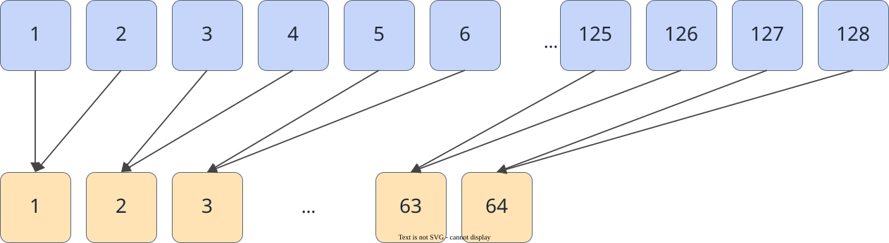

# vf.truncate

<!-- md-trans-meta sourceCommit=7d0ab31d84c294a0a8327f597d2bdee012acb22d translatedAt=2026-10-26T14:15:30.275Z pushedAt=2026-10-28T11:57:29.128Z nl=2 -->

## Applicable Products

<!-- npu="950" id1 -->
- Ascend 950PR&950DT products: Supported
<!-- end id1 -->
<!-- npu="A3" id2 -->
- Atlas A3 products: Not supported
<!-- end id2 -->
<!-- npu="910b" id3 -->
- Atlas A2 products: Not supported
<!-- end id3 -->

## Description

Truncates the floating-point elements in the source operand src to integer values (retaining the original data type) and stores them in the destination operand dst.

As shown in the following figure, the floating-point numbers 3.7 and -2.3 become 3.0 and -2.0 respectively after truncation, that is, the fractional part is discarded and only the integer part is retained, with the data type unchanged:

$$dstReg_i = \text{trunc}(srcReg_i)$$



## Prototype

```python
truncate(src, preg, mode: Optional[MergeMode] = None) -> dst
```

## Parameters

| Parameter | Input/Output | Description |
|---|---|---|
| src | Input | Source operand, [reg_tensor](../basic_data_structures/reg_tensor.md). The source operand src and the destination operand dst must have the same data type. Supported data types: DT_FP16, DT_BF16, DT_FP32. |
| preg | Input | [mask_reg](../basic_data_structures/mask_reg.md). Elements not selected by the mask are set to zero in dst. - DT_FP32 supports only the non-saturating mode. |
| mode | Input | Optional, corresponding to the [MergeMode](../basic_data_structures/MergeMode.md) type.<br>- pypto_pro.language.MergeMode.ZEROING (default): Elements not selected by preg are set to 0 in dst.<br>- pypto_pro.language.MergeMode.MERGING: Currently not supported. |

## Constraints

None

## Return Value

Returns the destination operand dst, [reg_tensor](../basic_data_structures/reg_tensor.md). The supported data types are the same as those described for src.

## Examples

```python
import os
import pypto_pro.language as pl
import torch
import torch_npu

@pl.vector_function
def example_vf(src_tile, dst_tile):
    preg = vf.create_mask(pattern=pl.MaskPattern.ALL, dtype=pl.DT_FP32)
    src_reg = vf.load_align(src_tile, 0)
    dst_reg = vf.truncate(src_reg, preg)
    vf.store_align(dst_tile, dst_reg, preg)

@pl.jit()
def example_kernel(
    a: pl.Tensor[[pl.DYNAMIC, pl.DYNAMIC], pl.DT_FP32],
    out: pl.Tensor[[pl.DYNAMIC, pl.DYNAMIC], pl.DT_FP32],
):
    tf = pl.TileType(shape=[1, 64], dtype=pl.DT_FP32, target_memory=pl.MemorySpace.Vec)
    in_a_grp = pl.make_tile_group(type=tf, addrs=0x0, mutex_ids=[0])
    in_a = in_a_grp.current()
    t_out_grp = pl.make_tile_group(type=tf, addrs=0x100, mutex_ids=[1])
    t_out = t_out_grp.current()
    with pl.section_vector():
        pl.load(in_a, a, [0, 0])
        example_vf(in_a, t_out)
        pl.store(out, t_out, [0, 0])

def test_example():
    device_id = int(os.environ.get("TILE_FWK_DEVICE_ID", 0))
    device = f"npu:{device_id}"
    core_nums = 1
    torch.npu.set_device(device)
    a = torch.randn([1, 64], device=device, dtype=torch.float32)
    out = torch.empty([1, 64], device=device, dtype=torch.float32)
    example_kernel[None, core_nums](a, out)
    torch.npu.synchronize()
    torch.testing.assert_close(out, torch.trunc(a), rtol=1e-5, atol=1e-5)

if __name__ == "__main__":
    test_example()
    print("PASSED")
```
