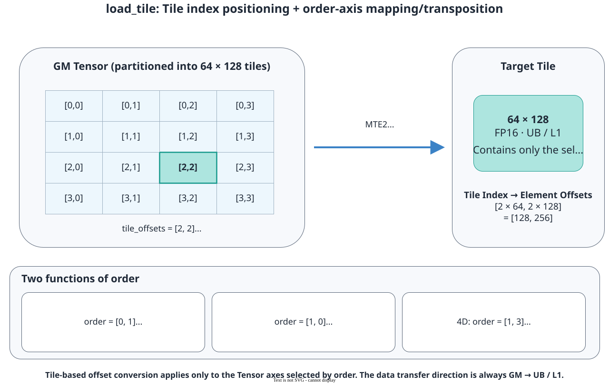

# pypto_pro.language.load_tile

<!-- md-trans-meta sourceCommit=7d0ab31d84c294a0a8327f597d2bdee012acb22d translatedAt=2026-10-26T13:00:47.577Z pushedAt=2026-10-28T11:57:28.706Z nl=2 -->

## Applicable Products

<!-- npu="950" id1 -->
- Ascend 950PR&950DT products: Supported
<!-- end id1 -->
<!-- npu="A3" id2 -->
- Atlas A3 products: Not supported
<!-- end id2 -->
<!-- npu="910b" id3 -->
- Atlas A2 products: Not supported
<!-- end id3 -->

## Description

Loads data from a GM Tensor into a Tile in the L1 Buffer or UB. Unlike [pypto_pro.language.load](load.md), tile_offsets specifies the load position by Tile block number: the Tensor dimensions of the source operand selected by order are addressed by Tile block number, and the API multiplies the corresponding number by the size of the corresponding dimension in the destination operand's Tile to convert it into absolute element coordinates; dimensions not selected by order are still addressed by absolute element coordinates.

For example, for a two-dimensional Tile with shape=[64, 128], when order is not set, tile_offsets=[2, 2] corresponds to absolute element coordinates [128, 256], which is equivalent to passing offsets=[128, 256] when calling pypto_pro.language.load.



## Prototype

```python
pypto_pro.language.load_tile(
    dst_tile: Tile,
    src_tensor: Tensor,
    /,
    tile_offsets: Offset,
    *,
    order: Optional[List[int]] = None,
) -> None
```

## Parameters

| Parameter | Input/Output | Description |
|---|---|---|
| dst_tile | Output | Destination operand, of Tile type, with storage in the L1 Buffer or UB. The start address must be 32-byte aligned. The API loads data according to the valid_shape of this Tile. For supported data type and fractal combinations, see [Constraints](#constraints). |
| src_tensor | Input | Source operand, of Tensor type, with storage in GM. For supported data type and fractal combinations, see [Constraints](#constraints). |
| tile_offsets | Input | Tile block number of each dimension of the source Tensor, of List[int or Scalar] type. The length must be the same as the number of dimensions of the source Tensor.<br>- Negative numbers are not supported.<br>- Dimensions selected by order are addressed by Tile block number. The corresponding number is multiplied by the size of the corresponding dimension in the destination operand's Tile to obtain the absolute element coordinates.<br>- Dimensions not selected by order are addressed by absolute element coordinates.<br>- The converted absolute element coordinates must be within the shape range of the source operand. You can set the valid shape through pypto_pro.language.set_validshape to ensure that the valid load range does not exceed the shape range of the source operand. |
| order | Input | Optional. Dimension mapping, a compile-time integer list of length 2, specifying the Tensor dimension index of the source operand corresponding to each dimension of the destination operand's Tile.<br>- The two dimension indices must not repeat and must be within the Tensor dimension range of the source operand.<br>- Ascending order means no transpose, for example, order=[0, 1].<br>- Descending order means transpose, for example, order=[1, 0], where the Tensor fractal description of the source operand changes from ND to DN.<br>- When not configured, the last two dimensions of the source operand's Tensor are specified, with no transpose.<br>- When loading MX matrix multiplication quantization coefficients, order cannot select the last dimension of the source operand's Tensor. When order is not set, it defaults to the last two dimensions excluding the last dimension of the source operand's Tensor.<br>- When the Tensor is one-dimensional, the order parameter is not supported. |

## Constraints

- Data type and fractal constraints:

  | Source to destination | Fractal requirement | Data type requirements |
  |---|---|---|
  | GM → UB | The source and destination fractals must be the same. ND, DN, and NZ are supported. | The source and destination data type bit width must be the same. DT_INT8, DT_UINT8, DT_FP16, DT_BF16, DT_INT16, DT_UINT16, DT_FP32, DT_INT32, DT_UINT32, DT_INT64, DT_UINT64, DT_FP8E8M0, DT_FP8E4M3FN, DT_FP8E5M2, DT_HF8, DT_FP4E2M1, and DT_FP4E1M2 are supported. |
  | GM → L1 Buffer | ND → NZ. | The source and destination data type bit width must be the same. DT_INT8, DT_UINT8, DT_FP16, DT_BF16, DT_INT16, DT_UINT16, DT_FP32, DT_INT32, DT_UINT32, DT_FP8E8M0, DT_FP8E4M3FN, DT_FP8E5M2, DT_HF8, DT_FP4E2M1, and DT_FP4E1M2 are supported. |
  | GM → L1 Buffer | DN → NZ. | The source and destination data type bit width must be the same. DT_INT8, DT_UINT8, DT_FP16, DT_BF16, DT_INT16, DT_UINT16, DT_FP32, DT_INT32, DT_UINT32, DT_FP8E8M0, DT_FP8E4M3FN, DT_FP8E5M2, and DT_HF8 are supported. |
  | GM → L1 Buffer | DN → ZN, NZ → NZ. | The source and destination data type bit width must be the same. DT_INT8, DT_UINT8, DT_FP16, DT_BF16, DT_INT16, DT_UINT16, DT_FP32, DT_INT32, DT_UINT32, DT_INT64, DT_UINT64, DT_FP8E8M0, DT_FP8E4M3FN, DT_FP8E5M2, DT_HF8, DT_FP4E2M1, and DT_FP4E1M2 are supported. |
  | GM → L1 Buffer | ND → ND. | The source and destination data types must be the same. Only DT_INT64 and DT_UINT64 are supported. |
  | GM → L1 Buffer | ND/DN → ZZ/NN, used only for loading quantization coefficients of pypto_pro.language.matmul_mx or pypto_pro.language.matmul_mx_acc. | The source and destination data types must be DT_FP8E8M0. |

- NZ load constraints:

  - When src_tensor is declared as NZ, dst_tile must be NZ, and only forward-order load from the last two dimensions of src_tensor is supported. Transposition through descending order is not supported. For details about the physical layout and tensor shape constraints of NZ, see [TensorLayout](../basic_data_structures/TensorLayout.md).
  - In the shape and valid_shape of dst_tile, M must be aligned to 16, and N must be aligned to C0 corresponding to the data type of src_tensor. After tile_offsets is converted to an absolute element offset, the offset in the N direction must also be aligned to C0.

- MX matrix multiplication quantization coefficient load constraints:

  - Only DT_FP8E8M0 src_tensor can be loaded into an L1 Buffer tile with a fractal of 32 and a layout of ZZ or NN, and used as the quantization coefficient of pypto_pro.language.matmul_mx or pypto_pro.language.matmul_mx_acc.
  - The number of dimensions of src_tensor must be greater than or equal to 3. The last dimension is a physical phase axis with a length of 2, and the offset corresponding to the phase axis in offsets must be 0. When order is explicitly set, the phase axis cannot be selected.

- Tile address reuse constraints:

  When auto_mutex is enabled, if two consecutive pypto_pro.language.load_tile calls write to the same UB or L1 Buffer address and no operation reads the data loaded by the previous load between the two loads, call [pypto_pro.language.system.bar_mte2](../synchronization/bar_mte2.md) between the two loads. pypto_pro.language.system.bar_mte2 only guarantees the order of the two write operations. If the data loaded by the previous load is still needed later, read or copy the data before reusing the address.

## Return Value

None

## Examples

### Load by Tile Block Index

The input tensor consists of four [64, 64] data blocks. The loop variable tile_index takes values from 0 to 3 in sequence, and load_tile automatically converts them into absolute element offsets 0, 64, 128, and 192 in dimension 0.

```python
import pypto_pro.language as pl


@pl.jit(auto_mutex=True)
def load_tile_kernel(
    x: pl.Tensor[[256, 64], pl.DT_FP16],
    out: pl.Tensor[[256, 64], pl.DT_FP16],
):
    tile_type = pl.TileType(
        shape=[64, 64],
        dtype=pl.DT_FP16,
        target_memory=pl.MemorySpace.Vec,
    )
    x_tiles = pl.make_tile_group(type=tile_type, addrs=0x0000, mutex_ids=[0, 1])
    out_tiles = pl.make_tile_group(type=tile_type, addrs=0x4000, mutex_ids=[2, 3])

    with pl.section_vector():
        for tile_index in pl.range(0, 4, 1):
            current_x = x_tiles.next()
            current_out = out_tiles.next()
            pl.load_tile(current_x, x, [tile_index, 0])
            pl.add(current_out, current_x, current_x)
            pl.store_tile(out, current_out, [tile_index, 0])
```

### Selecting Dimensions from a High-Dimensional Tensor for Loading

In the following example, the dimensions of the input Tensor are B, S, N, and D in order. order=[1, 3] indicates that the two dimensions of the Tile correspond to S and D, respectively. Therefore, S and D in tile_offsets are interpreted as Tile block indices, while B and N are still interpreted as absolute indices.

```python
import pypto_pro.language as pl


@pl.jit(auto_mutex=True)
def load_tile_high_dim_kernel(
    x: pl.Tensor[[2, 128, 4, 64], pl.DT_FP16],
    out: pl.Tensor[[2, 128, 4, 64], pl.DT_FP16],
):
    tile_type = pl.TileType(
        shape=[64, 64],
        dtype=pl.DT_FP16,
        target_memory=pl.MemorySpace.Vec,
    )
    x_tile = pl.make_tile_group(type=tile_type, addrs=0x0000, mutex_ids=[0])
    out_tile = pl.make_tile_group(type=tile_type, addrs=0x2000, mutex_ids=[1])

    with pl.section_vector():
        current_x = x_tile.current()
        current_out = out_tile.current()
        # Fix B=1 and N=2. The S-direction block index is 1, corresponding to an absolute element offset of 64.
        pl.load_tile(current_x, x, [1, 1, 2, 0], order=[1, 3])
        pl.add(current_out, current_x, current_x)
        pl.store_tile(out, current_out, [1, 1, 2, 0], order=[1, 3])
```

### Transpose Load

The transpose scenario is also specified through a descending order. The following example uses a square Tile with shape=[64, 64]. tile_offsets=[1, 0] is first converted to the absolute element coordinates [64, 0], and then the data is transposed and loaded from a regular ND GM Tensor into a ZN Tile.

```python
import pypto_pro.language as pl


@pl.jit(auto_mutex=True)
def load_tile_transpose_kernel(x: pl.Tensor[[128, 128], pl.DT_FP16]):
    tile_type = pl.TileType(
        shape=[64, 64],
        dtype=pl.DT_FP16,
        target_memory=pl.MemorySpace.Mat,
        layout=pl.ZN,
    )
    x_l1 = pl.make_tile_group(type=tile_type, addrs=0x0000, mutex_ids=[0])

    with pl.section_cube():
        pl.load_tile(x_l1.current(), x, [1, 0], order=[1, 0])
```
