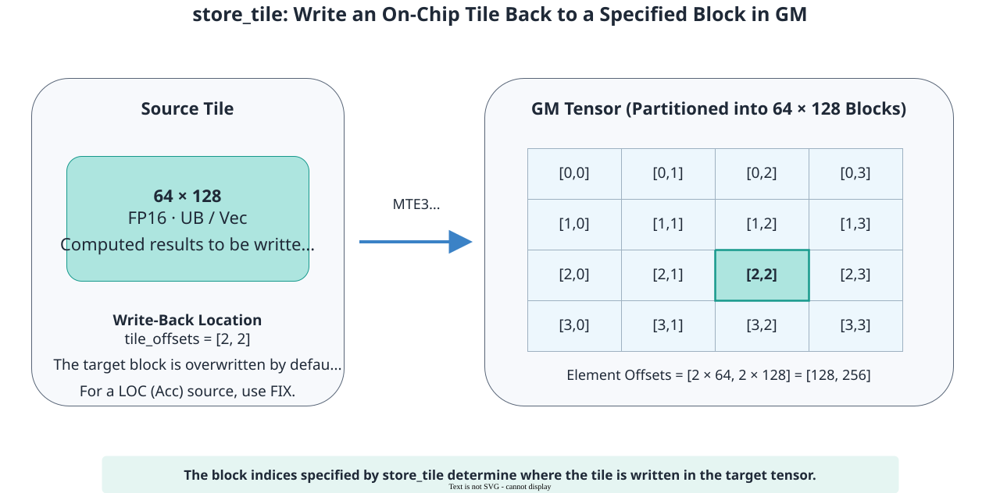

# pypto_pro.language.store_tile

<!-- md-trans-meta sourceCommit=7d0ab31d84c294a0a8327f597d2bdee012acb22d translatedAt=2026-10-26T13:02:20.554Z pushedAt=2026-10-28T11:57:28.709Z nl=2 -->

## Applicable Products

<!-- npu="950" id1 -->
- Ascend 950PR&950DT products: Supported
<!-- end id1 -->
<!-- npu="A3" id2 -->
- Atlas A3 products: Not supported
<!-- end id2 -->
<!-- npu="910b" id3 -->
- Atlas A2 products: Not supported
<!-- end id3 -->

## Description

Writes the Tile result in UB or L0C Buffer back to GM. Unlike [pypto_pro.language.store](store.md), the offset is expressed in Tile block indices. The API internally multiplies the block index by the Tile shape to convert it into absolute element coordinates. This API is the reverse operation of [pypto_pro.language.load_tile](load_tile.md).

For example, when the Tile shape is [64, 128], tile_offsets=[2, 2] is equivalent to the absolute offset [128, 256] of [pypto_pro.language.store](store.md).

The following figure uses a UB source Tile as an example to show the process of writing back to the GM tensor by block-based indexing. The block index is first converted into an element offset, and then the landing position of the target block is determined. The source Tile in L0C Buffer is written back through Fixpipe.



## Prototype

```python
pypto_pro.language.store_tile(
    dst_tensor: Tensor,
    src_tile: Tile,
    /,
    tile_offsets: Offset,
    *,
    relu_pre_mode: Optional[ReluPreMode] = None,
    scale: Optional[Union[float, Scalar, Tile]] = None,
    order: Optional[List[int]] = None,
    atomic: AtomicType = AtomicType.AtomicNone,
    phase: Optional[STPhase] = None,
) -> None
```

## Parameters

| Parameter | Input/Output | Description |
|---|---|---|
| dst_tensor | Output | Destination operand, of Tensor type, with storage space in GM. For supported data type and fractal combinations, see [Constraints](#constraints). |
| src_tile | Input | Source operand, of Tile type, with storage space in UB or L0C Buffer.<br>- The start address of a UB Tile must be 32-byte aligned.<br>- The start address of an L0C Buffer Tile must be 64-byte aligned. |
| tile_offsets | Input | Optional. Absolute element coordinates of each dimension of the destination tensor, of List[int or Scalar] type. The length must be the same as the number of dimensions of the destination tensor.<br>- Negative values are not supported.<br>- For a high-dimensional NZ tensor, the last two items correspond to the M and N directions. |
| relu_pre_mode | Input | Optional. Whether to enable the in-path ReLU operation during L0C Buffer→GM transfer, of [pypto_pro.language.ReluPreMode](../basic_data_structures/ReluPreMode.md) type. |
| scale | Input | Optional. Whether to enable quantization and set the quantization parameters in quantization mode. When data is moved out of L0C, Fixpipe multiplies it by this ratio and converts it to the destination data type. Different input forms affect the quantization granularity. The following types are supported:<br>- **float type**: Pass a fixed value directly (for example, scale = 2.0), suitable for using the same ratio for the entire tile.<br>- **Scalar type**: The quantization ratio is determined at runtime and must be passed according to the data type.<br>&nbsp;&nbsp;- DT_FP32: Pass the original ratio value directly (for example, 0.5).<br>&nbsp;&nbsp;- DT_INT32, DT_INT64: Pass the integer converted from the pre-encoded float32 bit pattern (for example, `struct.pack("!f", 0.5)`).<br>- **Tile type**: Use an independent ratio for each column. The following requirements must be met:<br>&nbsp;&nbsp;- target_memory must be pl.MemorySpace.Scaling.<br>&nbsp;&nbsp;- The shape must be [1, N] (column quantization), where N must be a multiple of 16 and N ≤ 512.<br>&nbsp;&nbsp;- The dtype must be DT_INT64.<br>&nbsp;&nbsp;- When the Tile data type of the destination operand is DT_INT8, bit46 of each DT_INT64 element in the Scaling tile must be set to 1 to select signed quantization. If it is not set, negative values in L0C Buffer are interpreted as unsigned.<br>&nbsp;&nbsp;- You need to first move the ratio data from GM to L1 Buffer, then to Scaling, and complete the MTE1→FIX synchronization.<br>&nbsp;&nbsp;- It cannot be used together with atomic. |
| order | Input | Optional. Dimension mapping, of List[int] type, specifying the target tensor dimension corresponding to each dimension of the source Tile.<br>- Each dimension number must be within the dimension range of the target tensor and must not be repeated.<br>- Only ascending order is supported.<br>- When omitted, it corresponds to the last two dimensions of the target tensor. When the GM fractal is NZ, it can only be specified as the last two dimensions of the target tensor.<br>- When the tensor is 1-dimensional, the order parameter is not supported. |
| atomic | Input | Optional. Atomic write mode, of [pypto_pro.language.AtomicType](../basic_data_structures/AtomicType.md) type. |
| phase | Input | Optional. unitFlag mechanism, of [pypto_pro.language.STPhase](../basic_data_structures/STPhase.md) type. |

## Constraints

- Data type and fractal requirements

  | Source → Destination | Fractal Requirements | Data Type Requirements |
  |---|---|---|
  | UB → GM | The source and destination fractals must be identical. ND, DN, and NZ are supported. | The source and destination data types must have the same bit width. DT_INT8, DT_UINT8, DT_FP16, DT_BF16, DT_INT16, DT_UINT16, DT_FP32, DT_INT32, DT_UINT32, DT_INT64, DT_UINT64, DT_FP8E8M0, DT_FP8E4M3FN, DT_FP8E5M2, DT_HF8, DT_FP4E2M1, and DT_FP4E1M2 are supported. |
  | L0C Buffer → GM (without scale) | NZ → ND, NZ → NZ. | DT_FP32 → DT_FP32/DT_FP16/DT_BF16 and DT_INT32 → DT_INT32/DT_FP16/DT_BF16 are supported. |
  | L0C Buffer → GM (with scale) | NZ → ND, NZ → NZ. | DT_FP32 → DT_INT8/DT_UINT8/DT_HF8/DT_FP8E4M3FN/DT_FP16/DT_BF16/DT_FP32 and DT_INT32 → DT_INT8/DT_UINT8/DT_FP16/DT_BF16 are supported. |

- GM NZ layout: For its physical arrangement, fractal axes, and the shape constraints of the complete tensor, see [TensorLayout](../basic_data_structures/TensorLayout.md). store_tile must also satisfy the following NZ transfer constraints:
    - The tile shape and valid M/N must satisfy the alignment of M to 16 and N to the C0 corresponding to the target tensor dtype. After tile_offsets are converted to absolute element offsets, the N direction must also be aligned to C0.
    - When a tile in the L0C Buffer is written back to GM directly, if multiple N fractals are written at once (valid N is greater than C0), the write-back range must cover the complete NZ physical M axis of the target tensor. If part of M spans multiple N fractals, move the data to UB first and then write it back to GM from UB.

- The API does not automatically clear the target tensor. Before the first accumulation, you must initialize the target region to zero or to the expected initial accumulation value.

- When multiple cores accumulate to the same target address simultaneously, each update is atomic. Because floating-point addition does not satisfy the associative law, results may differ slightly when the update order differs.

## Return Value

None

## Examples

### Writing Back from UB to GM by Tile Block Index

```python
import pypto_pro.language as pl


@pl.jit(auto_mutex=True)
def store_tile_kernel(
    x: pl.Tensor[[64, 64], pl.DT_FP16],
    out: pl.Tensor[[256, 64], pl.DT_FP16],   # 4 blocks of 64x64
):
    tt = pl.TileType(shape=[64, 64], dtype=pl.DT_FP16, target_memory=pl.MemorySpace.Vec)
    tile_x = pl.make_tile_group(type=tt, addrs=0x0000, mutex_ids=[0])

    with pl.section_vector():
        cur_x = tile_x.current()
        pl.load(cur_x, x, [0, 0])
        for ti in pl.range(0, 4, 1):
            pl.store_tile(out, cur_x, [ti, 0])
```

### High-Dimensional Tensor Write-Back

```python
# Four-dimensional BSND tensor: Tile corresponds to dimensions 1 and 3, and the remaining dimensions use absolute offsets.
pl.store_tile(p_buf, p_f16, [b_idx, qi * 2 + sub_id, n_idx, ki], order=[1, 3])
```
