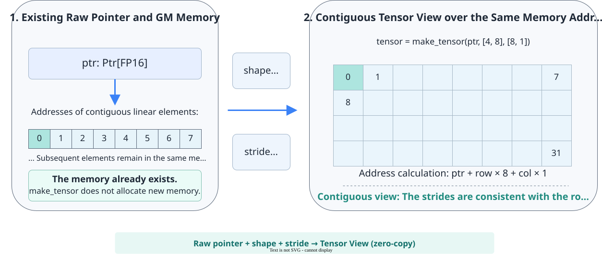
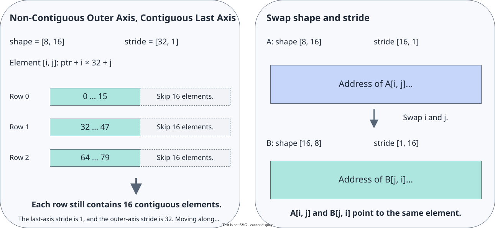

# pypto_pro.language.make_tensor

<!-- md-trans-meta sourceCommit=7d0ab31d84c294a0a8327f597d2bdee012acb22d translatedAt=2026-10-26T14:19:45.039Z pushedAt=2026-10-28T11:57:29.144Z nl=2 -->

## Applicable Products

<!-- npu="950" id1 -->
- Ascend 950PR&950DT products: Supported
<!-- end id1 -->
<!-- npu="A3" id2 -->
- Atlas A3 products: Not supported
<!-- end id2 -->
<!-- npu="910b" id3 -->
- Atlas A2 products: Not supported
<!-- end id3 -->

## Description

Constructs a Tensor view from a raw pointer (pypto_pro.language.Ptr[dtype]) or an existing Tensor, together with an explicit shape and an optional stride. The Tensor view itself does not allocate memory; it only sets a "shape + stride" interpretation for the same GM address, after which it can be used by [load](../memory_data_movement/load.md)/[store](../memory_data_movement/store.md) like a normal GM Tensor. When stride is omitted, the API automatically generates a contiguous row-major stride based on shape.

Often used together with [pypto_pro.language.addptr](addptr.md): use addptr to slice out a segment of the workspace address, and then use make_tensor to wrap it into a readable and writable Tensor.

The following figure shows the core semantics of make_tensor: it uses shape and stride to create a Tensor view for an existing address, without allocating new memory or moving data.



## Prototype

```python
pypto_pro.language.make_tensor(
    ptr: Union[Ptr, Tensor],
    shape: Sequence[Union[int, Scalar]],
    stride: Optional[Sequence[Union[int, Scalar]]] = None,
    dtype: Optional[DataType] = None,
) -> Tensor
```

## Parameters

| Parameter | Input/Output | Description |
|---|---|---|
| ptr | Input | Address object used to construct the Tensor view, of Ptr or Tensor type. The created Tensor view shares the data address with the source object. |
| shape | Input | Tensor shape, of Sequence[int or Scalar] type. Each dimension can be an integer constant or a runtime integer Scalar expression. |
| stride | Input | Tensor stride, of Sequence[int or Scalar] type, optional, in elements. When explicitly passed, its length must equal the number of dimensions of shape, and the element offset of [i0, i1, ...] relative to ptr is i0 × stride[0] + i1 × stride[1] + .... When omitted, a contiguous row-major stride is generated automatically. For sub-byte data types, the innermost dimension must be contiguous, that is, the last stride must be 1. |
| dtype | Input | Tensor element type, of [DataType](../basic_data_structures/DataType.md) type, optional. When passed, the source address is interpreted as this type; when omitted, the data type of the source pointer or source Tensor is used. |

## Constraints

- The created Tensor is only an address view. You must ensure that all accesses described by shape, stride, and dtype fall within the valid memory range of the source object and meet the address alignment requirements of dtype.
- stride is also used for the start address conversion of load and store and for GM transfer description, and must fall within the capability range of the corresponding transfer API. General load and store are mainly used for two-dimensional transfer with a contiguous last dimension.

## Return Value

Returns a tensor view that shares the address with the input ptr.

## Examples

### Contiguous Row-Major Tensor View

When stride is omitted, the API automatically generates contiguous row-major strides: the stride of the last dimension is 1, and the stride of each remaining dimension equals the product of the sizes of all subsequent dimensions.

```python
normal = pl.make_tensor(ptr, [8, 16])
# Equivalent to: normal = pl.make_tensor(ptr, [8, 16], [16, 1])
```

### Tensor View with Discontinuous Rows

In the following Tensor, each row contains 16 contiguous elements, and the starting addresses of two adjacent rows are 32 elements apart, so 16 elements are skipped between rows:

```python
pitched = pl.make_tensor(ptr, [8, 16], [32, 1])
# Element address of pitched[i, j]: ptr + i * 32 + j
```

### Swapping shape and stride to express a transposed view

```python
normal = pl.make_tensor(ptr, [8, 16], [16, 1])
transposed = pl.make_tensor(ptr, [16, 8], [1, 16])
```

Both share the same ptr, and normal[i, j] and transposed[j, i] point to the same address. The API only changes the mapping from logical indices to physical addresses; it does not transpose the original data.



### Accessing a Tensor That Is Non-contiguous Across Rows in a Kernel

```python
import pypto_pro.language as pl


@pl.jit(auto_mutex=True)
def workspace_kernel(
    a: pl.Tensor[[64, 128], pl.DT_FP16],
    workspace: pl.Ptr[pl.DT_FP16],
    out: pl.Tensor[[64, 128], pl.DT_FP16],
):
    ws_buf_ptr = pl.addptr(workspace, 64 * 128)
    ws_buf = pl.make_tensor(ws_buf_ptr, [64, 128], [256, 1])

    tt = pl.TileType(shape=[32, 128], dtype=pl.DT_FP16, target_memory=pl.MemorySpace.Vec)
    tile = pl.make_tile_group(type=tt, addrs=0x0000, mutex_ids=[0])

    with pl.section_vector():
        t = tile.current()
        pl.load(t, a, [0, 0])
        pl.add(t, t, t)
        pl.store(ws_buf, t, [0, 0])
        pl.load(t, ws_buf, [0, 0])
        pl.store(out, t, [0, 0])

        pl.load(t, a, [32, 0])
        pl.add(t, t, t)
        pl.store(ws_buf, t, [32, 0])
        pl.load(t, ws_buf, [32, 0])
        pl.store(out, t, [32, 0])
```

### Rebuild a Tensor View and Merge Consecutive Dimensions

pypto_pro.language.make_tensor can rebuild a GM tensor view via shape and stride without moving data, to adjust the number of dimensions, shape, or stride, and to merge consecutive dimensions. The new tensor view shares storage with the original tensor, and its stride must match the actual memory layout.

To rebuild a view via pypto_pro.language.Ptr, declare the kernel parameter as pypto_pro.language.Ptr[dtype] and call pypto_pro.language.make_tensor(ptr, shape, stride) in the function body. The length of each dimension in shape can come from runtime TilingData, but the length of the shape list must be determined at compile time.

#### Create a Tensor View via Ptr

```python
@pl.jit()
def k(q: pl.Ptr[pl.DT_FP16], tiling: OpTiling):
    # Row-major => stride = [n*d, d, 1]; shape/stride all come from tiling.
    tensor_q = pl.make_tensor(q, [tiling.sq, tiling.n, tiling.d],
                              [tiling.n * tiling.d, tiling.d, 1])
    # Afterwards, tensor_q is used exactly the same way as a pl.Tensor parameter.
```

The first argument of pypto_pro.language.make_tensor can also be an existing pypto_pro.language.Tensor. The new view shares the same address as the original Tensor and uses the newly specified shape, stride, and optional dtype.

Merging axes combines two adjacent and contiguous dimensions of a GM Tensor into a single dimension. Unlike selecting two dimensions from a multi-dimensional Tensor via order, merging axes reduces the dimensionality of the Tensor view so that it corresponds to a two-dimensional Tile. Typical uses are as follows:

- For the TND or BSND layout of FlashAttention, merge the batch dimension B and the sequence dimension S into the total token dimension B × S, that is, the T dimension in TND, so that a single load can read multiple rows contiguously across batches.
- For Host inputs with different numbers of dimensions, merge the first several contiguous dimensions to construct a fixed two-dimensional [M, N] view inside the Kernel.

#### Merging Consecutive Dimensions

Axes can be merged only when the dimensions to be merged are contiguous in memory with no gaps. For a row-major ND layout [d0, d1, d2], the strides are [d1 × d2, d2, 1]:

- After merging d0 and d1, the new dimension size is d0 × d1, and the stride is taken from the inner dimension d1. The merge condition is stride(d0) = d1 × stride(d1).
- If padding exists between d0 and d1, that is, stride(d0) > d1 × stride(d1), the dimensions cannot be merged; otherwise, the padding region would be read as valid data.

#### Merge [B, S, D] into [B × S, D]

Use pypto_pro.language.make_tensor to merge consecutive dimensions and create a Tensor view with one fewer dimension, then call load to move data into a Tile.

```python
# Original GM: q is [B, S, D], row-major contiguous, stride = [S*D, D, 1]
q: pl.Tensor[[B, S, D], pl.DT_FP16]

# Merge axes: merge B and S into one dimension B*S, and take the inner D as the stride.
q_merged = pl.make_tensor(q, [B * S, D], [D, 1])   # Reuse the pointer of q without moving data.

# Now q_merged is two-dimensional [B*S, D]. Load it directly by Tile index.
tile = pl.make_tile(pl.TileType(shape=[TS, D], dtype=pl.DT_FP16,
                                target_memory=pl.MemorySpace.Vec), addr=0x0)
pl.load_tile(tile, q_merged, [t, 0])   # The t-th block = rows [t*TS : (t+1)*TS] on the merged axis.
```

To read the s-th row of the b-th batch in the original Tensor, the merged row number is b × S + s.

#### Merge into [M, N] Using Runtime Shapes

The kernel can receive a pointer and TilingData, merging the shapes of 2D to 4D host-side inputs into a fixed 2D tensor view. N is the innermost dimension, and M is the product of the remaining dimensions.

```python
@pl.jit(auto_mutex=True)
def add_dynrank_kernel(x: pl.Ptr[pl.DT_FP16], y: pl.Ptr[pl.DT_FP16],
                       z: pl.Ptr[pl.DT_FP16], tiling: AddTiling):
    N = tiling.shape[3]
    M = tiling.shape[0] * tiling.shape[1] * tiling.shape[2]   # Merge the first three dimensions into M.
    tensor_x = pl.make_tensor(x, [M, N], [N, 1])              # Fold into a 2D [M, N].
    tensor_y = pl.make_tensor(y, [M, N], [N, 1])
    tensor_z = pl.make_tensor(z, [M, N], [N, 1])
    ...
    pl.load_tile(tile_a, tensor_x, [i, j])                    # Subsequent operations are ordinary 2D loads.
```

Element-wise operators depend only on the contiguous element order, so shapes such as [2, 4, 256, 256], [8, 256, 256], and [512, 512] can be merged into [M, N] and processed by the same kernel. The view constructed via pypto_pro.language.make_tensor inside the kernel is always 2D.

#### Convert BSND Layout to TND View

The TND layout of FlashAttention merges the batch and sequence dimensions into a total token dimension T = ΣS_i. For a BSND tensor of shape [B, S, N, D], if S is identical across batches and the data is contiguous in memory, you can merge the B and S dimensions to construct a TND view.

```python
# BSND -> Merge B and S into T = B*S (keeping N and D), and take the inner stride.
q_tnd = pl.make_tensor(q, [B * S, N, D], [N * D, D, 1])
# Then use order to select the (T, D) dimensions from [T, N, D].
pl.load_tile(q_tile, q_tnd, [t_off, n_idx, 0], order=[0, 2])
```

#### Summary

| Step | Action |
|------|------|
| 1. Confirm that axes can be merged | The two dimensions to be merged are contiguous in memory (no padding). |
| 2. Rebuild the view   | pypto_pro.language.make_tensor(src, merged shape, merged stride), where stride takes the stride of the inner dimension. |
| 3. Load normally  | The merged tensor has fewer dimensions, so load it as an ordinary 2D / multi-dimensional scenario. |
| 4. Convert the offset   | The row number of the merged axis = outer index * inner size + inner index. |

> **Axis merging constraint**: The dimensions to be merged must be contiguous, and the stride must be consistent with the actual memory layout. Violating the above constraints will read data from incorrect positions or padding regions. When troubleshooting precision issues, you can switch to an unmerged per-dimension tensor view for comparison and verification.
