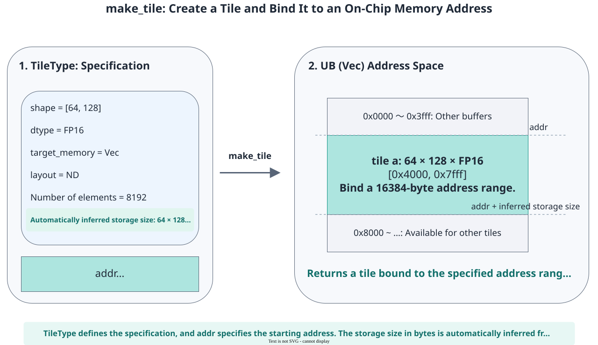

# pypto_pro.language.make_tile

<!-- md-trans-meta sourceCommit=7d0ab31d84c294a0a8327f597d2bdee012acb22d translatedAt=2026-10-26T14:20:19.758Z pushedAt=2026-10-28T11:57:29.140Z nl=2 -->

## Applicable Products

<!-- npu="950" id1 -->
- Ascend 950PR&950DT products: Supported
<!-- end id1 -->
<!-- npu="A3" id2 -->
- Atlas A3 products: Not supported
<!-- end id2 -->
<!-- npu="910b" id3 -->
- Atlas A2 products: Not supported
<!-- end id3 -->

## Description

Creates a Tile at the address of a specified Buffer according to [TileType](../basic_data_structures/TileType.md). This is the core API for creating a Tile in a Kernel. The shape, data type, Buffer, and layout of the Tile are described by TileType, and make_tile binds them to a specific address.

If you need multiple Tiles of the same specification to form a ping-pong double buffer with automatic mutual exclusion management, use [pypto_pro.language.make_tile_group](make_tile_group.md).

The following figure uses UB as an example to show how make_tile binds a Tile to an on-chip address: addr specifies the start address, and the address range size is derived from the shape and dtype of TileType.



## Prototype

```python
pypto_pro.language.make_tile(
    tile_type: TileType,
    /,
    *,
    addr: int,
) -> Tile
```

## Parameters

| Parameter | Input/Output | Description |
|---|---|---|
| tile_type | Input | Tile type description, of the [TileType](../basic_data_structures/TileType.md) type. It is the only allowed positional parameter. Its shape, dtype, target_memory, and layout jointly determine the storage size and available APIs of the Tile. |
| addr | Input | Tile address, of the int type, indicating the byte offset of the Tile within the Buffer specified by tile_type. It must be passed as a keyword argument and determined at compile time. UB and L1 Buffers require 32-byte alignment, L0A and L0B Buffers require 512-byte alignment, and L0C Buffers require 64-byte alignment. |

## Constraints

The number of bytes in the address range is automatically derived by multiplying the number of shape elements of TileType by the number of bytes of dtype, and no size parameter is accepted. Each dimension of shape must be a positive integer determined at compile time. valid_shape does not change the allocation range. For data types smaller than 8 bits, at least 1 byte of space is reserved per element.

The address ranges of multiple Tiles must not overlap unintentionally. When the same Buffer is intentionally reused, the caller must ensure correct memory access ordering.

## Return Value

Returns the Tile bound to the specified on-chip address.

## Examples

### Creating a Tile in UB and Performing Element-wise Addition

```python
import pypto_pro.language as pl


@pl.jit()
def make_tile_add_kernel(
    a: pl.Tensor[[64, 128], pl.DT_FP16],
    b: pl.Tensor[[64, 128], pl.DT_FP16],
    out: pl.Tensor[[64, 128], pl.DT_FP16],
):
    tt = pl.TileType(shape=[64, 128], dtype=pl.DT_FP16, target_memory=pl.MemorySpace.Vec)
    # The address range size is derived from tt as 64 * 128 * 2 = 16384 bytes.
    tile_a = pl.make_tile(tt, addr=0x0000)
    tile_b = pl.make_tile(tt, addr=0x4000)
    tile_out = pl.make_tile(tt, addr=0x8000)

    with pl.section_vector():
        pl.load(tile_a, a, [0, 0])
        pl.load(tile_b, b, [0, 0])
        pl.system.sync_src(set_pipe=pl.PipeType.MTE2, wait_pipe=pl.PipeType.V, event_id=0)
        pl.system.sync_dst(set_pipe=pl.PipeType.MTE2, wait_pipe=pl.PipeType.V, event_id=0)
        pl.add(tile_out, tile_a, tile_b)
        pl.system.sync_src(set_pipe=pl.PipeType.V, wait_pipe=pl.PipeType.MTE3, event_id=1)
        pl.system.sync_dst(set_pipe=pl.PipeType.V, wait_pipe=pl.PipeType.MTE3, event_id=1)
        pl.store(out, tile_out, [0, 0])
```

For the shape, data type, buffer, layout, and tail block configuration of a Tile, see [pypto_pro.language.TileType](../basic_data_structures/TileType.md).
