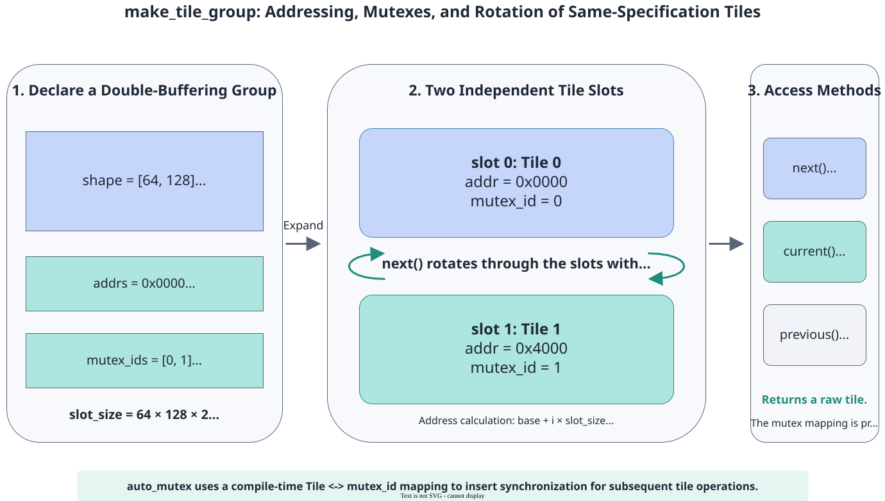

# pypto_pro.language.make_tile_group

## Applicable Products

<!-- npu="950" id1 -->
- Ascend 950PR&950DT products: Supported
<!-- end id1 -->
<!-- npu="A3" id2 -->
- Atlas A3 products: Not supported
<!-- end id2 -->
<!-- npu="910b" id3 -->
- Atlas A2 products: Not supported
<!-- end id3 -->

## Description

Creates a group of Tiles of the same specification that can be rotated and reused in one call, binds an independent address to each Tile, and optionally establishes the mapping between Tiles and one or more mutex IDs. The parser expands the TileGroup into multiple [pypto_pro.language.make_tile](make_tile.md) operations. When auto_mutex is enabled, the framework automatically inserts mutex synchronization for subsequent operations involving these Tiles based on this metadata.

The buffer depth is determined by depth or the length of a non-empty mutex_ids:

- **1-buffer** (depth is 1, or the length of mutex_ids is 1): Contains only one Tile, which can be accessed using current() or group[0], and does not produce an actual rotation effect.
- **2-buffer** (double-buffer/ping-pong): Two Tiles are used alternately.
- **3-buffer, 4-buffer, or N-buffer**: Multiple Tiles rotate cyclically, suitable for scenarios where deepening the pipeline hides data transfer latency.

Compared with calling [pypto_pro.language.make_tile](make_tile.md) multiple times, make_tile_group uniformly manages address layout, rotation position, and mutex metadata, eliminating the need to manually maintain Tile subscripts and synchronization relationships. The TileGroup itself does not perform locking or unlocking at runtime. When auto_mutex is enabled, its mutex mapping is used at compile time to generate synchronization operations.

The following figure uses double buffering in UB as an example to show how a single base address expands into two consecutive Tile slots, and the correspondence among addresses, mutexes, and rotational access.



## Prototype

```python
pypto_pro.language.make_tile_group(
    *,
    type: TileType,
    addrs: Union[int, List[int]],
    mutex_ids: Union[str, Sequence[Union[int, Sequence[int]]], None] = None,
    depth: Optional[int] = None,
    fwd_ids: Optional[Sequence[int]] = None,
    bwd_ids: Optional[Sequence[int]] = None,
) -> TileGroup
```

## Parameters

| Parameter| Input/Output| Description|
|---|---|---|
| type | Input| Tile type description, of the [pypto_pro.language.TileType](../basic_data_structures/TileType.md) type.|
| addrs | Input| Tile address, of the int or List[int] type. It must be non-negative and determined at compile time, and must meet the address alignment requirement of the corresponding Buffer. When a single base address is passed, the address of the i-th Tile is base + i × slot_size, where slot_size is the number of bytes occupied by a single Tile. When an address list is passed, the list length must equal the length of mutex_ids or the value of depth, and the address of each Tile is specified in order. An address list can be used for non-contiguous address layout.|
| mutex_ids | Input| Optional, mutex ID configuration, which can be "auto" or an integer list/tuple (each tile corresponds to an integer or a non-empty integer list/tuple). You can also pass None or an empty list/tuple. The value range of the mutex ID is [0, 31]. The requirements for passing a sequence and "auto" are as follows:<br>- **Manual configuration (list or tuple)**: When non-empty mutex_ids are configured, the auto_mutex mode (auto_mutex=True) must be enabled for @pypto_pro.language.jit. The framework inserts synchronization based on the mapping between Tiles and mutexes. The number of mutex IDs corresponding to each Tile must be the same. Multiple mutex IDs of the same Tile must be unique. Different Tiles can use the same mutex ID.<br>- **"auto" (str type)**: The framework automatically allocates one mutex ID to each Tile in the group at compile time. In this case, depth must be specified. Pay attention to the following points:<br>&nbsp;&nbsp;- The auto_mutex mode (auto_mutex=True) must be enabled for @pypto_pro.language.jit.<br>&nbsp;&nbsp;- Within the same TileGroup: The mutex_id of different Tiles cannot be a mix of "auto" and manually configured IDs.<br>&nbsp;&nbsp;- Between different TileGroups:<br>&nbsp;&nbsp;&nbsp;&nbsp;- A mix of manually configured mutex_ids and automatically allocated mutex_ids ("auto") can be set.<br>&nbsp;&nbsp;&nbsp;&nbsp;- Partial address overlap between the address ranges of a Tile that requires "auto" and other Tiles is not supported. Complete address overlap is allowed.<br>&nbsp;&nbsp;&nbsp;&nbsp;- In scenarios where Tiles completely overlap and include a Tile that requires "auto", the IDs allocated to all the Tiles must be the same, and only one mutex_id can be manually configured across the Tiles.|
| depth | Input| TileGroup depth, of the int type. It is optional and must be a positive compile-time integer. When mutex_ids is "auto", None, or an empty list, depth must be specified. When depth is not specified and mutex_ids is non-empty, it is determined by the length of mutex_ids. When both are specified, they must be equal.|
| fwd_ids | Input| Event ID for inter-core forward synchronization. This parameter is optional and is used only for [Automatic CV Parallel Pipeline](../../../../guide/programming_guide/pro/advanced_programming/auto_parallel_pipeline.md). The value is an integer sequence (list or tuple). It is ignored when the automatic pipeline is disabled.|
| bwd_ids | Input| Event ID for inter-core backward synchronization. This parameter is optional and is used only for [Automatic CV Parallel Pipeline](../../../../guide/programming_guide/pro/advanced_programming/auto_parallel_pipeline.md). The value is an integer sequence (list or tuple). It is ignored when the automatic pipeline is disabled.|

## Constraints

- When group[i] is used to access a Tile, i can be a compile-time integer or a runtime integer expression, for example, g[i] or g[(i + 1) % 2]. The index value must be within the range of [0, num_tile). When mutex_ids is None or "auto", num_tile is the depth. In other cases, num_tile is the length of the non-empty sequence.

## Return Value

Returns a TileGroup object, which supports the following access methods:

| Access Method| Description|
|---|---|
| group.next() | Advances the rotation position and returns the next Tile. On consecutive calls, Tiles are selected cyclically according to the TileGroup size.|
| group.current() | Returns the current Tile without advancing the rotation position.|
| group.previous() | Returns the Tile before the current Tile without advancing the rotation position.|
| group[i] | Returns the Tile with subscript i, where i supports a compile-time integer or a runtime integer expression. This operation does not read or change the rotation position.|

A TileGroup can also be passed directly to pypto_pro.language.set_validshape to set the valid_shape of all Tiles in the group in a batch.

## Examples

### 2-buffer (double-buffer/ping-pong)

```python
import pypto_pro.language as pl

TILE = 128
MM_M, MM_K, MM_N = 256, 128, 256


@pl.jit(auto_mutex=True)
def tile_group_matmul_kernel(
    a: pl.Tensor[[MM_M, MM_K], pl.DT_FP16],
    b: pl.Tensor[[MM_K, MM_N], pl.DT_FP16],
    c: pl.Tensor[[MM_M, MM_N], pl.DT_FP32],
):
    # L1 double-buffer (next() rotation)
    a_l1_db = pl.make_tile_group(
        type=pl.TileType(shape=[TILE, MM_K], dtype=pl.DT_FP16, target_memory=pl.MemorySpace.Mat),
        addrs=0x00000, mutex_ids=[0, 1])
    b_l1_db = pl.make_tile_group(
        type=pl.TileType(shape=[MM_K, TILE], dtype=pl.DT_FP16, target_memory=pl.MemorySpace.Mat),
        addrs=0x10000, mutex_ids=[2, 3])
    # L0A Buffer, L0B Buffer, and L0C Buffer all use a single Tile group (current()).
    a_left = pl.make_tile_group(
        type=pl.TileType(shape=[TILE, MM_K], dtype=pl.DT_FP16, target_memory=pl.MemorySpace.Left),
        addrs=0x0000, mutex_ids=[4])
    b_right = pl.make_tile_group(
        type=pl.TileType(shape=[MM_K, TILE], dtype=pl.DT_FP16, target_memory=pl.MemorySpace.Right),
        addrs=0x0000, mutex_ids=[5])
    acc = pl.make_tile_group(
        type=pl.TileType(shape=[TILE, TILE], dtype=pl.DT_FP32, target_memory=pl.MemorySpace.Acc),
        addrs=0x0000, mutex_ids=[6])

    with pl.section_cube():
        for i in pl.range(0, MM_M, TILE):
            for j in pl.range(0, MM_N, TILE):
                cur_a = a_l1_db.next()      # Double-buffer rotation
                cur_b = b_l1_db.next()
                al = a_left.current()       # Single Tile group
                br = b_right.current()
                ac = acc.current()
                pl.load(cur_a, a, [i, 0])
                pl.load(cur_b, b, [0, j])
                pl.move(al, cur_a)
                pl.move(br, cur_b)
                pl.matmul(ac, al, br)
                pl.store(c, ac, [i, j])
```

### Creating a 4-buffer in the L1 Buffer

```python
import pypto_pro.language as pl

TILE = 128
MM_M, MM_K, MM_N = 256, 128, 256


@pl.jit(auto_mutex=True)
def tile_group_4buf_matmul_kernel(
    a: pl.Tensor[[MM_M, MM_K], pl.DT_FP16],
    b: pl.Tensor[[MM_K, MM_N], pl.DT_FP16],
    c: pl.Tensor[[MM_M, MM_N], pl.DT_FP32],
):
    a_l1 = pl.make_tile_group(
        type=pl.TileType(shape=[TILE, MM_K], dtype=pl.DT_FP16, target_memory=pl.MemorySpace.Mat),
        addrs=0x00000, mutex_ids=[0, 1, 2, 3])
    b_l1 = pl.make_tile_group(
        type=pl.TileType(shape=[MM_K, TILE], dtype=pl.DT_FP16, target_memory=pl.MemorySpace.Mat),
        addrs=0x20000, mutex_ids=[4, 5, 6, 7])
    a_left = pl.make_tile_group(
        type=pl.TileType(shape=[TILE, MM_K], dtype=pl.DT_FP16, target_memory=pl.MemorySpace.Left),
        addrs=0x0000, mutex_ids=[8])
    b_right = pl.make_tile_group(
        type=pl.TileType(shape=[MM_K, TILE], dtype=pl.DT_FP16, target_memory=pl.MemorySpace.Right),
        addrs=0x0000, mutex_ids=[9])
    acc = pl.make_tile_group(
        type=pl.TileType(shape=[TILE, TILE], dtype=pl.DT_FP32, target_memory=pl.MemorySpace.Acc),
        addrs=0x0000, mutex_ids=[10])

    with pl.section_cube():
        for i in pl.range(0, MM_M, TILE):
            for j in pl.range(0, MM_N, TILE):
                cur_a = a_l1.next()
                cur_b = b_l1.next()
                al = a_left.current()
                br = b_right.current()
                ac = acc.current()
                pl.load(cur_a, a, [i, 0])
                pl.load(cur_b, b, [0, j])
                pl.move(al, cur_a)
                pl.move(br, cur_b)
                pl.matmul(ac, al, br)
                pl.store(c, ac, [i, j])
```

### Creating a Non-contiguous Buffer Using an Address List

```python
# Two tiles are placed at 0x0 and 0x10000, respectively.
tt = pl.TileType(shape=[64, 64], dtype=pl.DT_FP32, target_memory=pl.MemorySpace.Vec)
buf = pl.make_tile_group(type=tt, addrs=[0x0, 0x10000], mutex_ids=[0, 1])
```

### Automatically Allocating mutex IDs Using mutex_ids="auto"

```python
import pypto_pro.language as pl

ROWS, COLS = 32, 64
DEPTH = 2
TILES = 8


@pl.jit(auto_mutex=True)
def auto_mutex_tile_group_kernel(
    x: pl.Tensor[[ROWS * TILES, COLS], pl.DT_FP16],
    y: pl.Tensor[[ROWS * TILES, COLS], pl.DT_FP16],
):
    tt = pl.TileType(shape=[ROWS, COLS], dtype=pl.DT_FP16, target_memory=pl.MemorySpace.Vec)
    # mutex_ids="auto": The framework automatically allocates a mutex ID to each Tile in the group. In this case, depth must be specified.
    group = pl.make_tile_group(type=tt, addrs=0, mutex_ids="auto", depth=DEPTH)
    with pl.section_vector():
        for i in pl.range(0, TILES):
            tile = group[i % DEPTH]
            pl.load(tile, x, [i * ROWS, 0])
            pl.store(y, tile, [i * ROWS, 0])
```
