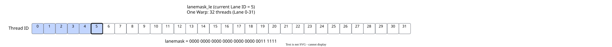

# pypto_pro.language.simt.lanemask_le

## Applicable Products

<!-- npu="950" id1 -->
- Ascend 950PR&950DT products: Supported
<!-- end id1 -->
<!-- npu="A3" id2 -->
- Atlas A3 products: Not supported
<!-- end id2 -->
<!-- npu="910b" id3 -->
- Atlas A2 products: Not supported
<!-- end id3 -->

## Description

Obtains a 32-bit mask of the current thread. In the warp that the current thread belongs to, the bits corresponding to all lanes whose lane IDs are less than or equal to the lane ID of the current thread are 1, and other bits are 0.

For example, if the current lane ID is 5 and the bits are arranged from bit 31 to bit 0, the returned 32-bit binary mask is 00000000 00000000 00000000 00111111. In the figure, the lane IDs increase from left to right. The blue area indicates that the corresponding bit is 1, and the orange border indicates the current lane.

**Figure 1** Schematic diagram of lanemask_le



## Prototype

```python
pypto_pro.language.simt.lanemask_le() -> Scalar
```

## Parameters

None

## Constraints

- This API can only be called in the SIMT kernel, SIMT vector function, or SIMT helper.

## Return Value

Returns a 32-bit lane mask of the DT_INT32 type. Bit i is 1 only when i is less than or equal to the current lane ID. The return value describes only the lane position and does not indicate whether the lane is active.

## Examples

```python
import pypto_pro.language as pl

WARP_SIZE = 32


@pl.vector_function(mode="simt", max_threads=WARP_SIZE)
def lanemask_le_example(output: pl.Tensor[[1, WARP_SIZE], pl.DT_INT32]):
    tid = pl.simt.linear_thread_idx()
    output[0, tid] = pl.simt.lanemask_le()


@pl.jit()
def lanemask_le_kernel(output: pl.Tensor[[1, WARP_SIZE], pl.DT_INT32]):
    with pl.section_vector():
        lanemask_le_example[WARP_SIZE](output)
```
