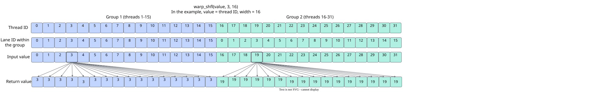

# pypto_pro.language.simt.warp_shfl

## Applicable Products

<!-- npu="950" id1 -->
- Ascend 950PR&950DT products: Supported
<!-- end id1 -->
<!-- npu="A3" id2 -->
- Atlas A3 products: Not supported
<!-- end id2 -->
<!-- npu="910b" id3 -->
- Atlas A2 products: Not supported
<!-- end id3 -->

## Description

Shuffles scalar data within a warp so that each lane can directly read the value held by a specified lane without using the Unified Buffer (UB) for data transfer. This API is often used to broadcast the data of a lane to other lanes in a logical subgroup or to allow different lanes to read data based on their respective src_lane.

width divides a warp into several consecutive logical subgroups, and each subgroup independently shuffles data. For example, if width is 8, a 32-lane warp is divided into four subgroups: lanes 0–7, lanes 8–15, lanes 16–23, and lanes 24–31. The logical lane IDs in each subgroup are renumbered from 0.

For the current lane, the position of the source lane is:

Source lane position = Subgroup start lane ID + (src_lane % width)

Therefore, the same src_lane selects the same relative position in each logical subgroup instead of always selecting the same physical lane in the warp.

The following figure shows a complete 32-lane warp. When width is 16, lanes 0–15 and lanes 16–31 form two logical subgroups. The lane IDs in each group are numbered from 0 to 15. After warp_shfl(value, 3, 16) is called, the two groups read the values held by thread 3 and thread 19, respectively.



## Prototype

```python
pypto_pro.language.simt.warp_shfl(
    value: Union[int, float],
    src_lane: int,
    width: int = 32,
) -> Scalar
```

## Parameters

| Parameter| Input/Output| Description|
|---|---|---|
| value | Input| Scalar value of the current lane used for data shuffle. DT_INT32, DT_UINT32, DT_INT64, DT_UINT64, DT_FP16, DT_BF16, and DT_FP32 are supported. Different values can be passed for each lane.|
| src_lane | Input| ID of the source lane in the logical subgroup. The value is an integer constant or a runtime integer scalar expression of the DT_INT32 type. The value range is [0, 31]. When src_lane is greater than or equal to width, src_lane % width is used to obtain the actual logical lane ID. Different src_lanes can be passed for different lanes. The target lane specified by src_lane must be in the current active thread set. Otherwise, the read result is undefined.|
| width | Input| Width of the logical subgroup. The value is an integer constant or a runtime integer scalar expression of the DT_INT32 type. The value can be 1, 2, 4, 8, 16, or 32. The default value is 32. When width is less than 32, a warp is divided into multiple consecutive and equal-width logical subgroups. You can pass the value by position or by using the width keyword, but you cannot use both methods at the same time.|

## Constraints

- This API can only be called in the SIMT kernel, SIMT vector function, or SIMT helper.
- Data shuffle occurs only within the current warp and logical subgroup.

## Return Value

Returns the value of the specified lane in the current logical subgroup. The data type of the return value is the same as that of value.

## Examples

In the following example, a warp is divided into two 16-lane logical subgroups, and the value of logical lane 3 is broadcast in each subgroup. If values[0, tid] is equal to tid, the output of lanes 0 to 15 is 3, and the output of lanes 16 to 31 is 19.

```python
import pypto_pro.language as pl

WARP_SIZE = 32


@pl.vector_function(mode="simt", max_threads=WARP_SIZE)
def warp_shfl_example(
    values: pl.Tensor[[1, WARP_SIZE], pl.DT_FP32],
    output: pl.Tensor[[1, WARP_SIZE], pl.DT_FP32],
):
    tid = pl.simt.linear_thread_idx()
    warp_width = pl.simt.warp_size()
    width = pl.simt.cast(warp_width // 2, pl.DT_INT32)
    output[0, tid] = pl.simt.warp_shfl(values[0, tid], 3, width)


@pl.jit()
def warp_shfl_kernel(
    values: pl.Tensor[[1, WARP_SIZE], pl.DT_FP32],
    output: pl.Tensor[[1, WARP_SIZE], pl.DT_FP32],
):
    with pl.section_vector():
        warp_shfl_example[WARP_SIZE](values, output)
```
