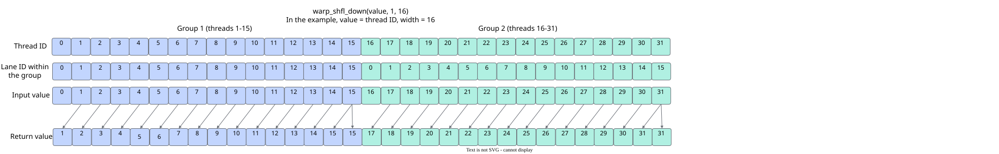

# pypto_pro.language.simt.warp_shfl_down

## Applicable Products

<!-- npu="950" id1 -->
- Ascend 950PR&950DT products: Supported
<!-- end id1 -->
<!-- npu="A3" id2 -->
- Atlas A3 products: Not supported
<!-- end id2 -->
<!-- npu="910b" id3 -->
- Atlas A2 products: Not supported
<!-- end id3 -->

## Description

Shuffles scalar data within a warp so that each lane reads the value held by the lane whose ID is delta greater than its own. For example, when delta is 1, lane 0 reads the value of lane 1. This API does not require data to be transferred through the Unified Buffer (UB) and is commonly used for intra-warp reduction and data reuse between adjacent lanes.

width divides a warp into several consecutive logical subgroups, and each subgroup independently shuffles data. Assume that the logical lane ID of the current lane within the subgroup is logical_lane_id:

- When logical_lane_id + delta < width, the value held by the logical lane logical_lane_id + delta is read.
- When logical_lane_id + delta >= width, the source lane crosses the upper boundary of the subgroup. In this case, the value of the current lane is returned.

The following figure shows a complete 32-lane warp. When width is 16, lanes 0–15 and lanes 16–31 form two logical subgroups. The lane IDs in each group are numbered from 0 to 15. After warp_shfl_down(value, 1, 16) is called, each group reads the value of the next lane except the last lane. Threads 15 and 31 retain their own values.



## Prototype

```python
pypto_pro.language.simt.warp_shfl_down(
    value: Union[int, float],
    delta: int,
    width: int = 32,
) -> Scalar
```

## Parameters

| Parameter| Input/Output| Description|
|---|---|---|
| value | Input| Scalar value of the current lane used for data shuffle. DT_INT32, DT_UINT32, DT_INT64, DT_UINT64, DT_FP16, DT_BF16, and DT_FP32 are supported. Different values can be passed for each lane.|
| delta | Input| Offset relative to the current logical lane in the direction of increasing lane IDs. The value is an integer constant or a runtime integer scalar expression of the DT_UINT32 type. The value range is [0, 31]. When the target lane determined by delta is within the current logical subgroup, the target lane must be in the current active thread set. Otherwise, the read result is undefined.|
| width | Input| Width of the logical subgroup. The value is an integer constant or a runtime integer scalar expression of the DT_INT32 type. The value can be 1, 2, 4, 8, 16, or 32. The default value is 32. When width is less than 32, a warp is divided into multiple consecutive and equal-width logical subgroups. You can pass the value by position or by using the width keyword, but you cannot use both methods at the same time.|

## Constraints

- This API can only be called in the SIMT kernel, SIMT vector function, or SIMT helper.

## Return Value

Returns the value of the target lane if the target lane is within the current logical subgroup; returns the value of the current lane if the target lane crosses the upper boundary of the subgroup. When delta is greater than or equal to width, all lanes return their own values. The type of the return data is the same as that of value.

## Examples

In the following example, a warp is divided into two 16-lane logical subgroups, so that lanes except the subgroup boundary read the value of the next lane. If values[0, tid] is equal to tid, the outputs of the two subgroups are [1, 2, ..., 15, 15] and [17, 18, ..., 31, 31], respectively.

```python
import pypto_pro.language as pl

WARP_SIZE = 32


@pl.vector_function(mode="simt", max_threads=WARP_SIZE)
def warp_shfl_down_example(
    values: pl.Tensor[[1, WARP_SIZE], pl.DT_FP32],
    output: pl.Tensor[[1, WARP_SIZE], pl.DT_FP32],
):
    tid = pl.simt.linear_thread_idx()
    warp_width = pl.simt.warp_size()
    width = pl.simt.cast(warp_width // 2, pl.DT_INT32)
    output[0, tid] = pl.simt.warp_shfl_down(values[0, tid], 1, width)


@pl.jit()
def warp_shfl_down_kernel(
    values: pl.Tensor[[1, WARP_SIZE], pl.DT_FP32],
    output: pl.Tensor[[1, WARP_SIZE], pl.DT_FP32],
):
    with pl.section_vector():
        warp_shfl_down_example[WARP_SIZE](values, output)
```
